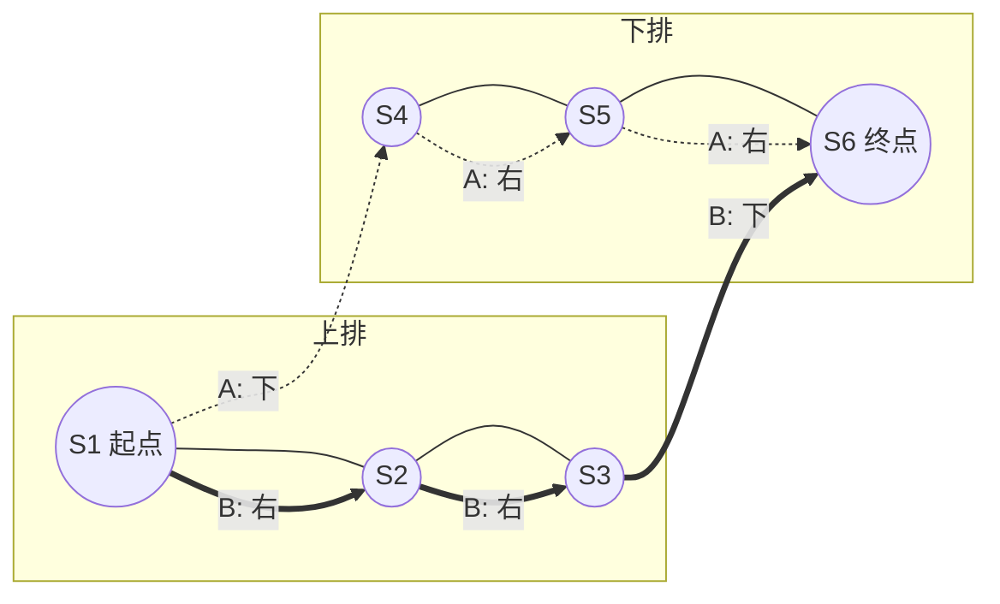
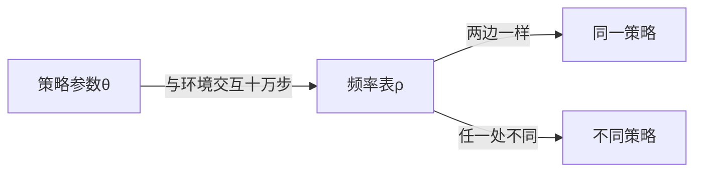
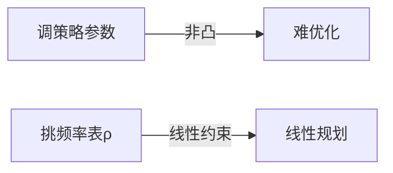

# 2.2.1 强化学习概述

> [!abstract] 一句话
> RL = 感知 → 决策 → 拿奖励 → 环境变化 → 循环，目标是让累计奖励的期望最大。

---

## 一、强化学习概念

> [!note] 定义
> 强化学习（Reinforcement Learning, RL）是智能体（Agent）与环境（Environment）反复交互、依据奖励信号调整决策，以最大化累积奖励期望的一种计算方法。

### 1.1 三个动作，一个循环

| 环节 | 做什么 |
| --- | --- |
| **感知（Perception）** | 读取当前状态 $s_t$ |
| **决策（Decision）** | 按策略输出动作 $a_t$ |
| **奖励（Reward）** | 环境返回 $r_t$ 并转移到 $s_{t+1}$ |

### 1.2 Agent 的实现形态

可以是简单的深度网络，也可以是 LLM （即 LLM-based agent），交互循环不变。

![[Pasted image 20261106091119.png|822]]

*图 1：Agent 与环境的交互循环*

### 1.3 训练流程

1. 每一轮交互中，Agent 首先感知环境所处的 **state**，然后决策出本轮的 **action**，并应用到环境中。
2. 环境产生**即时奖励并产生状态转移**，Agent 根据**奖励**修改其决策策略。
3. 循环直到达到终止状态，得到一个策略。

---

## 二、强化学习环境

### 2.1 动态环境

- 环境是一个**动态的随机过程**，会随着某些因素的变化而不断演变。
- 环境的**未来状态**由当前状态和智能体的动作共同决定。

### 2.2 状态转移

- 环境的**下一刻状态的概率分布由当前状态和智能体的动作决定**。

---

## 三、强化学习目标

### 3.1 累积奖励

智能体和环境交互过程中**获得的奖励信号可以累加**，形成累计奖励。目标是最大化多轮交互过程中累积奖励的期望，并将其定义为价值。

### 3.2 价值计算

价值的计算需要对交互过程中**每一轮智能体采取动作的概率分布和环境状态转移的概率分布做积分运算**。

---

## 四、强化学习数据

### 4.1 数据分布

强化学习中的数据是在智能体与环境交互过程中得到的。智能体的策略不同，与环境交互产生的数据分布也不同。

### 4.2 占用度量

> [!note] 定义
> **占用度量衡量在一个智能体决策与一个动态环境的交互过程中，采样到一个具体的状态动作对的概率分布。**

> [!important] 性质
> 给定两个策略及其与一个动态环境交互得到的两个占用度量，当且仅当这两个占用度量相同时，这两个策略相同。

---

## 五、对比有监督训练

对于一般的有监督学习任务，我们的目标是**找到一个最优的模型函数**，使其在训练数据集上最小化一个给定的损失函数。在训练数据独立同分布的假设下，这个优化目标表示最小化模型在整个数据分布上的泛化误差，用简要的公式可以概括为

![[Pasted image 20261106091412.png]]

相比之下，强化学习任务的**最终优化目标是最大化智能体策略在和动态环境交互过程中的价值。** 策略的价值可以等价转换成奖励函数在策略的占用度量上的期望，即：

![[Pasted image 20261106092439.png]]

> [!summary] 有监督学习 vs 强化学习
> - **优化目标**：有监督学习和强化学习的优化目标**相似**，即都是在优化**某个数据分布下的一个分数值的期望**。
> - **优化方法**：二者优化的途径是不同的，有监督学习直接通过优化模型对于数据特征的输出来优化目标，即**修改目标函数而数据分布不变**；**强化学习则通过改变策略来调整智能体和环境交互数据的分布，进而优化目标，即 ==修改数据分布而目标函数不变==。**
> - **训练目标**：有监督学习关注寻找一个模型，使其在给定数据分布下得到的**损失函数的期望最小**；强化学习关注寻找一个智能体策略，使其在与动态环境交互的过程中**产生最优的数据分布**，即**最大化该分布下一个给定奖励函数的期望**。
> - **训练周期**：有监督学习的数据是**静态的**，只在给定数据集上训练进行**一次性训练**，模型能力**高度依赖标注数据的质量和覆盖性**。强化学习的数据**可以不断产生，可以持续训练**，通过不断地与环境交互更新策略。
> - **数据**：有监督学习**需要标注数据集**，强化学习**不依赖标注数据集**，而是**通过与环境交互产生数据**。
> - **损失函数**：有监督学习的损失是**准确的**，可以直接根据标签和预测计算损失。强化学习只能从环境或奖励模型获取奖励，从环境获取奖励一般是**延迟的**，奖励模型给出的奖励**不一定准确**，计算得到的损失**不一定准确**。
> - **有监督学习可能存在以下问题**：生成内容**重复无用**，生成**错误**的内容，生成**违反法律**的内容等。而通过强化学习（例如 PPO、DPO 等）的正负样本对比，能让模型理解一些**抽象的概念**，比如什么违法什么不违法，什么是真的什么是假的。

---

# 附录：疑问 · 占用度量

> [!question] 你问的是：占用度量具体衡量的是什么，为什么两个策略的占用度量相同，这两个策略就相同。

把它理解成一张**长期停留记录**：策略与环境持续交互后，统计每个「状态—动作」组合出现的频率，这张频率表就是占用度量。

折扣形式：

$$
\rho^\pi(s,a)=\sum_{t=0}^{\infty}\gamma^{t}\,P(s_t=s,\ a_t=a\mid \pi)
$$

## 用一个 2×3 的格子看差别

策略 A（虚线）走下方路线，策略 B（粗线）走上方路线。两种策略各跑十万步后，在「状态—动作」表上的主要差异如下：

- A 的频率集中在 $(S1,\text{下})$、$(S4,\text{右})$、$(S5,\text{右})$
- B 的频率集中在 $(S1,\text{右})$、$(S2,\text{右})$、$(S3,\text{下})$

这张图对应笔记里的那句话：==环境固定时，策略与占用度量一一对应==。

## 对优化的意义

奖励由环境给定，价值就是奖励在这张频率表上的加权和：

$$
V(\pi)=\sum_{s,a}\rho^\pi(s,a)\,r(s,a)
$$

奖励已固定，剩下的变量只有 $\rho$。原本「调参数」的问题是非凸的，换成「挑一张可行频率表」后，就变成**带约束的线性规划**。逆强化学习与 GAIL 也采用这个思路：不比较参数，直接让学出来的策略产出与专家相同的频率表。

与笔记里的「对比有监督训练」接起来看：监督学习比较的是**模型输出与标签**，强化学习比较的是**两个策略产生的数据分布**，而占用度量把后者的「数据分布」写成了一个可计算的式子。
