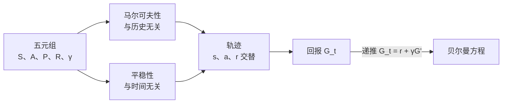

# 2.2.2 马尔可夫决策过程 MDP

> [!abstract] 一句话
> MDP 把"智能体与环境反复打交道"这件事写成五个量 $(S,\ A,\ P,\ R,\ \gamma)$，再由**马尔可夫性**保证"只看当前状态就够"。

> [!info] 本节只做三件事
> 1. 把任务写成**五元组**：五样东西分别是什么、由谁决定
> 2. 加**两条假设**（马尔可夫性、平稳性）：凭什么可以忘掉历史
> 3. 定义**回报** $G_t$：怎么给一段轨迹打分，并把递推式交给 [[2.2.3 Bellman equation  贝尔曼方程]]
>
> 本节不算价值、不推贝尔曼方程。

![[mdp-grid-world.svg|694]]

---

## 一、五元组：把世界写成五个量

**要回答的问题**：一个"走格子"的任务，需要记录哪几样东西，才能算清"这一步走得好不好"？

| 元素 | 符号 | 由谁决定 | 在格子世界里的取值 |
| --- | --- | --- | --- |
| 状态空间 | $\mathcal{S}$ | 环境 | $\{A,B,C,D\}$ 四个格子 |
| 动作空间 | $\mathcal{A}$ | 环境 | $\{\text{上},\text{下},\text{左},\text{右}\}$ |
| 状态转移概率 | $P(s'\mid s,a)$ | 环境 | 在 A 往右走，落到 B 的概率 |
| 奖励函数 | $R(s,a,s')$ | 环境 | 进入 D 得 $+1$，其余转移得 $0$ |
| 折扣因子 | $\gamma\in[0,1)$ | 人设定 | 取 $0.9$ |

**五个量全部描述环境**。智能体改不动 $P$ 和 $R$，只能改自己的行为方式——行为方式记作策略 $\pi$。

### 1.1 策略：智能体这一侧的量

$$\pi(a\mid s)=P(A_t=a\mid S_t=s)$$

**含义**：站在状态 $s$，选动作 $a$ 的概率。

**为什么用概率而不是固定动作**：格子世界的墙可能挡住一步，"往右"并不总是成功，随机策略能保留试错余地；训练早期更需要随机性去踩没走过的格子。确定性策略是退化情形——某个动作概率为 $1$。

> [!note] 两个概率分属谁
> - $\pi(a\mid s)$：**智能体**在状态 $s$ 下选动作 $a$ 的概率，训练要改的就是这一个
> - $P(s'\mid s,a)$：**环境**在 $(s,a)$ 之后落到 $s'$ 的概率，训练改不动

---

## 二、两条让问题可算的假设

**要回答的问题**：历史可以无限长，凭什么只拿当前状态 $s_t$ 就能决策、只拿一个 $P$ 就能描述环境？

### 2.1 马尔可夫性：与历史无关

$$P(S_{t+1}\mid S_1,A_1,\dots,S_t,A_t)=P(S_{t+1}\mid S_t,A_t)$$

**含义**：下一步会怎样，只取决于当前状态和当前动作，与到达当前状态之前发生过什么无关。

**结论**：马尔可夫性不是世界天生的性质，而是对**状态设计**的要求——状态设计得够细，MDP 才成立。

### 2.2 平稳性：与时间无关

$p(s',r\mid s,a)$ 不随时刻 $t$ 变化，称为**平稳**（stationary）；规则随时间漂移（例如对手越来越强），称为**非平稳**（non-stationary）。

平稳性让同一套 $P$、$R$ 可以反复使用，不必为每个时刻各存一份；[[2.2.3 Bellman equation  贝尔曼方程]] 能写成"一个方程解全部状态"，靠的正是平稳性。

---

## 三、轨迹：五元组走出来的序列

**要回答的问题**：给定五元组和策略，智能体实际会走出什么？

**轨迹（trajectory）** 是状态、动作、奖励交替出现的序列：

$$s_0,\ a_0,\ r_1,\ s_1,\ a_1,\ r_2,\ \dots$$

**完整转移概率**把"落到哪个状态"与"拿到多少奖励"写在一起：

$$p(s',r\mid s,a)=P(S_t=s',\ R_t=r\mid S_{t-1}=s,\ A_{t-1}=a)$$

**一条轨迹出现的概率**由策略与环境各出一半、逐步相乘：

$$p(s_0,a_0,r_1,s_1,\dots)=\prod_{t}\pi(a_t\mid s_t)\,p(s_{t+1},r_{t+1}\mid s_t,a_t)$$

**含义**：轨迹的随机性只有两个来源——智能体的 $\pi$ 与环境的 $p$。五元组配上策略，整条轨迹的分布就定死了。

![[Pasted image 20261106094251.png|750]]

*图 1：MDP 的交互轨迹 —— 状态、动作、奖励交替出现*

### 3.1 轨迹与 episode 不是同义词

| 术语 | 含义 | 用在哪类任务 |
| --- | --- | --- |
| **轨迹 trajectory** | 任意一段 $s,a,r$ 序列 | 所有任务 |
| **回合 episode** | **有终止点**的一段轨迹，从开局走到终止状态 | 仅 Episodic Task |

| 任务类型                | 说明             | 格子世界里的样子             |
| ------------------- | -------------- | -------------------- |
| **Episodic Task**   | 有终止点，一局结束后重新开局 | 走进 D 即结束，算一个 episode |
| **Continuing Task** | 没有终止点，交互一直持续   | 没有 D，格子无限走下去         |

**用词提醒**：说 episode 时一定暗含终止点；Continuing Task 只有一条无限长的轨迹，没有 episode。

---

## 四、回报：怎么给一段轨迹打分

**要回答的问题**：手里握着一条轨迹，怎么算出"从这一刻起总共赚了多少"？

**回报（return）** 从时刻 $t$ 起把未来奖励加权求和，权重是 $\gamma$ 的幂：

$$G_t=R_{t+1}+\gamma R_{t+2}+\gamma^2R_{t+3}+\cdots=\sum_{k=0}^{\infty}\gamma^{k}R_{t+k+1}$$

"累积奖励"这个概念的动机见 [[2.2.1 强化学习概述#3.1 累积奖励]]。

**为什么要折扣**：

1. Continuing Task 的求和有无穷多项，不折扣可能发散
2. 越远的奖励越不确定，权重理应更小
3. $\gamma<1$ 保证回报有上界，才能比较两个策略谁更好

| $\gamma$ | 效果 | 格子世界里的表现 |
| --- | --- | --- |
| 接近 0 | 只顾眼前 | 走一步不得分就乱试 |
| 接近 1 | 极看重长期 | 愿意绕远路去拿 D 的 $+1$ |

### 4.1 回报有上界

**要回答的问题**：无穷多项相加，会不会变成无穷大？

> [!info]- 推导：用 $\gamma<1$ 把无穷项压成一个有限值
>
> $$
> \mathbb{E}(G_t)=\sum_{k=0}^{\infty}\gamma^{k}\,\mathbb{E}(R_{t+k+1})\leq\sum_{k=0}^{\infty}\gamma^{k}\,\mathbb{E}(R_{\max})=\frac{1}{1-\gamma}\,\mathbb{E}(R_{\max})
> $$
>
> - $G_t$：从第 $t$ 步往后拿到的**折扣回报**
> - $R_{\max}$：所有可能奖励里最大的那个，于是每一项都能被它放大
> - 最后一步用了等比数列求和：$\sum_{k=0}^{\infty}\gamma^{k}=\dfrac{1}{1-\gamma}$，在 $0\le\gamma<1$ 时收敛

**作用**：回报有限之后，才能逐状态比较数值大小、判断策略优劣、谈最优策略。

### 4.2 回报的递推关系

**要回答的问题**：$G_t$ 与 $G_{t+1}$ 是不是同一个东西的两段？

> [!info]- 推导：把第一项拆出来，剩下的正好是下一步的回报
>
> $$
> G_t=R_{t+1}+\gamma G_{t+1}
> $$
>
> - 展开 $G_t=R_{t+1}+\gamma R_{t+2}+\gamma^2R_{t+3}+\cdots$，提出一个 $\gamma$ 后，括号里是 $R_{t+2}+\gamma R_{t+3}+\cdots$，正好等于 $G_{t+1}$
> - 两边取期望得 $\mathbb{E}(G_t)=\mathbb{E}(R_{t+1})+\gamma\,\mathbb{E}(G_{t+1})$

**"整段未来"折成"当前一步 + 下一时刻的同一个量"**，这一句就是贝尔曼方程的雏形，展开见 [[2.2.3 Bellman equation  贝尔曼方程#一、State value 状态价值函数]]。

---

## 五、附录：两种即时奖励写法（了解即可）

**要回答的问题**：论文里 $r(s,a)$ 与 $r(s,a,s')$ 为什么是两个符号？

**状态-动作期望奖励**（把下一状态平均掉）：

$$
r(s,a)\doteq\mathbb{E}\left[R_t\mid S_{t-1}=s,A_{t-1}=a\right]=\sum_{r\in\mathbb{R}}r\sum_{s'\in\mathcal{S}}p(s',r\mid s,a)
$$

**状态-动作-下一状态期望奖励**（已知落到哪个格子后再平均）：

> [!info]- 推导
>
> $$
> \begin{aligned}
> r(s,a,s') &\doteq \mathbb{E}\left[R_t\mid S_{t-1}=s,A_{t-1}=a,S_t=s'\right]\\
> &= \sum_{r\in\mathbb{R}} r\cdot p(r\mid s,a,s')\\
> &= \sum_{r\in\mathbb{R}} r\,\frac{p(s',r\mid s,a)}{p(s'\mid s,a)} \quad(\text{贝叶斯公式})
> \end{aligned}
> $$

其中 $p(s'\mid s,a)=P(S_t=s'\mid S_{t-1}=s,A_{t-1}=a)=\sum_{r\in\mathbb{R}}p(s',r\mid s,a)$。

> [!tip] 两个符号的差别只在"平均到什么范围"
> - $r(s,a)$ 把下一状态吞掉，直接回答"在 $s$ 做 $a$ 平均能拿多少"，用于贝尔曼方程的即时奖励项
> - $r(s,a,s')$ 多留一个条件：已经知道落到 $s'$，在这个前提下再平均，用于奖励与下一状态有关的情形
>
> 二者的关系是
>
> $$
> r(s,a)=\sum_{s'}p(s'\mid s,a)\,r(s,a,s')
> $$
>
> 若奖励只由 $(s,a)$ 决定、与落到哪个格子无关，两个量相等，用 $r(s,a)$ 即可。

---

## 六、全节回顾

| 环节 | 一句话作用 | 对应章节 |
| --- | --- | --- |
| 五元组 | 把环境写成可计算的五个量 | 一 |
| 马尔可夫性 + 平稳性 | 让"只看当前状态、只用一套规则"成立 | 二 |
| 轨迹 | 五元组与策略共同生成的序列 | 三 |
| 回报 | 给一条轨迹打分 | 四 |
| 递推关系 | 把回报折成"当前一步 + 未来"，交给贝尔曼方程 | 4.2 |
