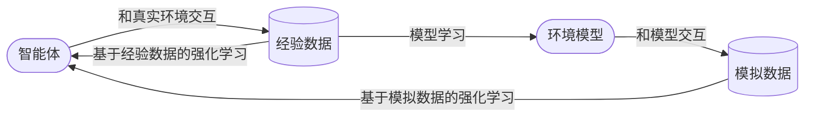

# 2.2.6 时序差分（Temporal Difference, TD）

> [!abstract] 一句话
> 不必等整局结束，也不必知道转移概率——走一步就用"刚拿到的奖励 + 对下一状态的估计"当作答案。

> [!info] 本节路线
> 1. TD(0) 预测：怎么用一个数更新 $V$
> 2. Sarsa 与 Q-learning：把 $V$ 换成 $Q$，两种做法的差别只在一个符号
> 3. 多步 Sarsa：$n=1$ 是 TD，$n\to\infty$ 是 MC
> 4. on-policy 与 off-policy 的分界
> 5. Dyna-Q：TD 加上规划

**符号约定**：时刻统一用下标，执行 $A_t$ 之后观测到的是 $R_{t+1}$ 与 $S_{t+1}$；回报写 $G_t$，TD 误差写 $\delta_t$；伪代码里的大写 $S,A,R$ 与正文的 $S_t,A_t,R_{t+1}$ 是同一组量。

---

## 一、TD 与 MC、DP 的分工

**任务**：估计"站在某个格子，这局游戏最终能拿多少分"。

三种做法的差别只在**什么时候能给出答案**：

| 方法 | 怎么算 | 什么时候能算 | 要不要环境模型 |
| --- | --- | --- | --- |
| 蒙特卡洛 MC | 走完整局，把实际总分当答案 | **必须打完这一局** | 不要 |
| 动态规划 DP | 用已知的转移概率，把所有可能性加权平均 | 立刻能算 | **必须要** |
| **时序差分 TD** | 走一步，用"刚拿的奖励 + 自己对下一格的估计"当答案 | **走一步就能算** | 不要 |

换成大白话：MC 是"考完试才知道成绩"，DP 是"有标准答案册可以直接推"，TD 是"边考边估分——做一道题就根据刚得的印象修一下总分预期"。

对比细节见 [[2.2.5 蒙特卡洛方法#三、与动态规划的分工]]。

---

## 二、TD(0) 预测

### 2.1 一个数就能看懂

设当前状态 $s$ 的估值 $V(s)=0.5$，走一步实际拿到奖励 $r=1$，到达 $s'$，而 $V(s')=0.8$，折扣 $\gamma=0.9$，学习率 $\alpha=0.1$。

```text
① TD 目标 = 刚拿到的奖励 + 折扣 × 对下一格的估计
           = 1 + 0.9 × 0.8 = 1.72

② 误差 = 目标 - 当前估值 = 1.72 - 0.5 = 1.22   ← 这就是 TD 误差

③ 更新 = 0.5 + 0.1 × 1.22 = 0.622
```

含义：**原来的估计 0.5 太低了，往 1.72 的方向挪一小步（挪 10%）**。既不用等这局结束，也不用知道环境的转移概率。

### 2.2 从 MC 的更新式推出来

$V(S_t)$ 是要迭代的估计值，$G_t$ 是采样到的样本值，且

$$
G_t=R_{t+1}+\gamma R_{t+2}+\cdots=R_{t+1}+\gamma G_{t+1}
$$

在蒙特卡洛方法里，**只有整个 episode 结束才能得到** $G_t$。TD 想做的是"当前步结束就算"，办法是拿期望值顶替样本值。

按 **Robbins-Monro 算法**（一种随机近似算法），先写出用样本值更新的形式：

$$
V(S_t)=V(S_t)+\alpha\left[G_t-V(S_t)\right]
$$

再看 $V$ 的定义，把期望拆开：

$$
\begin{aligned}
V_\pi(s)&=\mathbb{E}\left[G_t\mid S_t=s\right]=\mathbb{E}\left[R_{t+1}+\gamma G_{t+1}\mid S_t=s\right]\\
&=\mathbb{E}\left[R_{t+1}\mid S_t=s\right]+\gamma\,\mathbb{E}\left[G_{t+1}\mid S_t=s\right]
\end{aligned}
$$

**第一项的期望用观测到的奖励替代**（采样一次就有一个确定的 $R_{t+1}$），**第二项的期望正好是下一状态的价值** $\mathbb{E}[G_{t+1}\mid S_{t+1}=s']$，用估计值 $V(S_{t+1})$ 代替。于是 $G_t$ 被换成一个不用等整局的近似：

$$
G_t\approx R_{t+1}+\gamma V(S_{t+1})
$$

把近似式代入 Robbins-Monro 更新式：

$$
V(S_t)\leftarrow V(S_t)+\alpha\left[R_{t+1}+\gamma V(S_{t+1})-V(S_t)\right]
$$

括号里那一项称为**时序差分误差**：

$$
\delta_t=R_{t+1}+\gamma V(S_{t+1})-V(S_t)
$$

这样**只需要知道下一个状态**，就能更新当前状态。

### 2.3 偏差与方差：为什么有偏

用 $\mathbb{E}[G_t]$ 的近似代替真实样本 $G_t$，**牺牲了无偏性**，换来的是**更快、更直接**：

|       | 蒙特卡洛                                   | 时序差分                             |
| ----- | -------------------------------------- | -------------------------------- |
| 估计目标  | 真实样本 $G_t$                             | $R_{t+1}+\gamma V(S_{t+1})$，含估计值 |
| 偏差    | **无偏**（unbiased）                       | **有偏**（$V$ 本身还没估准，相当于用估计修正估计）    |
| 方差    | **大**：每一步的状态转移都有不确定性，多步奖励累加起来会极大影响价值估计 | **小**：只关注一步转移、只用一步奖励             |
| 何时能更新 | 必须等整局结束                                | 走一步就能更新                          |

"用估计去修正估计"这件事叫 **bootstrap**（自举），TD 的有偏与低方差都来自 bootstrap。

### 2.4 伪代码

```python
Tabular TD(0) for estimating v_π

Input: the policy π to be evaluated
Algorithm parameter: step size α ∈ (0, 1]
Initialize V(s), for all s ∈ S⁺, arbitrarily except that V(terminal) = 0

Loop for each episode:
    Initialize S
    Loop for each step of episode:
        A ← action given by π for S
        Take action A, observe R, S′
        V(S) ← V(S) + α[R + γV(S′) − V(S)]
        S ← S′
    until S is terminal
```

| 代码 | 作用 |
| --- | --- |
| `Tabular` | 用一张表存 $V$，一个状态一格 |
| `TD(0)` | 更新时只看一步，不做更多前瞻 |
| `Input` | 待评估的策略 $\pi$ |
| `step size α ∈ (0,1]` | 每次往目标挪动的比例，越大改得越猛 |
| `Initialize` | $S^+$ 表示"所有状态加上终止状态"；普通状态随便给，**终止状态必须为 0** |
| `Initialize S` | 每回合重新选起点 |
| `A ← action given by π for S` | 动作由**策略直接给出**，不做随机探索 |
| `Take action A, observe R, S′` | 真正与环境交互的那一步，拿到奖励和下一状态 |
| `V(S) ← V(S) + α[R+γV(S′) − V(S)]` | 核心：用一步目标修正旧估计 |
| `S ← S′` / `until S is terminal` | 指针推进一格；走到终止状态结束这一回合 |

---

## 三、Sarsa：把 $V$ 换成 $Q$

### 3.1 名字的由来与更新式

策略优化需要动作价值 $Q(s,a)$，TD 同样可以直接更新。Sarsa 的名字来自更新时用到的一串量：**S**tate、**A**ction、**R**eward、next **S**tate、next **A**ction，五个字母连起来就是 Sarsa。

$$
Q(S_t,A_t)\leftarrow Q(S_t,A_t)+\alpha\left[R_{t+1}+\gamma Q(S_{t+1},A_{t+1})-Q(S_t,A_t)\right]
$$

伪代码里 $S'$ 是**下一个状态**，$A'$ 是**根据策略在 $S'$ 下采取的动作**。区别在于：如果 $S'$ 是**终止状态，没有 $A'$**，此时额外定义 $Q(S',A')=0$。

更新完 $Q(s,a)$ 之后，可以再对策略做一次 $\varepsilon$-greedy 改进，公式与两种等价写法见 [[2.2.5 蒙特卡洛方法#2.2 ε-greedy：两种等价写法]]：

$$
\pi(a\mid s)=
\begin{cases}
1-\dfrac{\varepsilon}{|\mathcal{A}(s)|}\left(|\mathcal{A}(s)|-1\right), & \text{贪心动作}\\[3mm]
\dfrac{\varepsilon}{|\mathcal{A}(s)|}, & \text{其余 }|\mathcal{A}(s)|-1\text{ 个动作}
\end{cases}
$$

### 3.2 伪代码

```python
Sarsa (on-policy TD control) for estimating Q ≈ q*

Algorithm parameters: step size α ∈ (0, 1], small ε > 0
Initialize Q(s,a), for all s ∈ S⁺, a ∈ A(s), arbitrarily except that Q(terminal, ·) = 0
Loop for each episode:
    Initialize S
    Choose A from S using policy derived from Q (e.g., ε-greedy)
    Loop for each step of episode:
        Take action A, observe R, S′
        Choose A′ from S′ using policy derived from Q (e.g., ε-greedy)
        Q(S,A) ← Q(S,A) + α[R + γQ(S′,A′) − Q(S,A)]
        S ← S′; A ← A′;
    until S is terminal
```

**注意 `Choose A′` 这一步在更新之前**：更新式里用到的 $A'$ 必须是**下一步真正会执行的**那个动作，先选后算，这也是 Sarsa 属于 on-policy 的原因。

---

## 四、多步 Sarsa：$n$ 步折中

MC 与 TD 的差别可以看成"往前看多远"：MC 看到 episode 结束，TD 只看一步。多步 Sarsa 取中间——**用 $n$ 步的真实奖励，再接一个状态价值的估计**：

$$
G_t=R_{t+1}+\gamma R_{t+2}+\cdots+\gamma^{n-1}R_{t+n}+\gamma^{n}Q(S_{t+n},A_{t+n})
$$

$$
Q(S_t,A_t)\leftarrow Q(S_t,A_t)+\alpha\left[G_t-Q(S_t,A_t)\right]
$$

| $n$ 的取值 | 退化成的算法 |
| --- | --- |
| $n=1$ | TD(0)：只用一步奖励 + 下一状态估计 |
| $1<n<\infty$ | 多步 Sarsa：偏差与方差的折中 |
| $n\to\infty$ | 蒙特卡洛：全用真实奖励，不再 bootstrap |

---

## 五、Q-learning：把 $Q(S',A')$ 换成 $\max$

Q-learning 基于**贝尔曼最优方程直接估计 $Q^*$**（方程本身见 [[2.2.3 Bellman equation  贝尔曼方程#五、最优方程：把加权平均换成取最大]]）：

$$
Q^*(s,a)=\sum_{s'}\sum_{r}p(s',r\mid s,a)\left[r+\gamma\max_{a'}Q^*(s',a')\right]
$$

写成 TD 更新式，与 Sarsa 唯一的差别就是目标里那一项：

$$
Q(S_t,A_t)\leftarrow Q(S_t,A_t)+\alpha\left[R_{t+1}+\gamma\max_{a}Q(S_{t+1},a)-Q(S_t,A_t)\right]
$$

| 算法 | 更新目标里的下一动作项 |
| --- | --- |
| Sarsa | $\gamma Q(S_{t+1},A_{t+1})$：用**策略实际选出的** $A'$ |
| Q-learning | $\gamma\max_a Q(S_{t+1},a)$：直接用**最大值**，不管策略会不会选 |

也就是**每次都用"下一状态里价值最高的动作"作为当前动作价值的估计**。正因为 $A'$ 不需要真的执行，Q-learning 才能拿任意 $(s,a,r,s')$ 来更新。

---

## 六、on-policy 与 off-policy

**要回答的问题**：手上一份数据，什么时候能拿来更新当前策略？

### 6.1 两个策略

| 词 | 定义 | 通常是哪个 |
| --- | --- | --- |
| **行为策略**（behavior policy） | 真正与环境交互、产生数据的策略 | 带 ε 的探索策略 |
| **目标策略**（target policy） | 被评估、被改进的那个策略 | 训练结束要用的策略 |

**两者的关系决定算法类别**：同一个策略 → on-policy；不同策略 → off-policy。

### 6.2 一眼判据：$a'$ 从哪来

看更新式里的"下一步动作"是怎么得到的：

- 来自真实采样：$A_{t+1}$ 是策略在 $S_{t+1}$ 下**真的会执行**的动作 → **on-policy**
- 由 $\max$ 现算：$\max_a Q(S_{t+1},a)$，这个动作**不需要真的执行** → **off-policy**

一句话：**数据里要不要带 $a'$**。

### 6.3 样本长什么样

| 算法 | 样本 | 缺的那一项怎么补 |
| --- | --- | --- |
| Sarsa | **五元组** $(s,a,r,s',a')$ | 不补，$a'$ 必须由当前策略给出 |
| Q-learning | **四元组** $(s,a,r,s')$ | 用 $\max_{a}Q(s',a)$ 现算 |

Q-learning 的更新**并非必须使用当前贪心策略** $\arg\max_a Q(s,a)$ 采样得到的数据：给定任意 $(s,a,r,s')$ 都能直接套更新式，为了探索，通常用一个 **ε-贪婪策略**与环境交互。Sarsa **必须使用当前 ε-贪婪策略**采样得到的数据，因为更新里的 $A_{t+1}$ 就是当前策略在 $S_{t+1}$ 下会执行的动作。

### 6.4 回到 Sarsa 与 Q-learning

| 算法         | 更新目标里的下一动作项                               | 类别         |
| ---------- | ----------------------------------------- | ---------- |
| Sarsa      | $\gamma Q(S_{t+1},A_{t+1})$，用策略实际选出的 $A'$ | on-policy  |
| Q-learning | $\gamma\max_a Q(S_{t+1},a)$，直接用最大值        | off-policy |

### 6.5 一个自测：旧 buffer 能不能用

假设手上有一池子旧数据，来自上上个版本的策略：

- **拿来更新 Sarsa**：不行。五元组里的 $a'$ 必须是"**当前**策略会选的动作"，旧数据里的 $a'$ 来自旧策略，套进去更新的是旧策略的动作价值。
- **拿来更新 Q-learning**：可以。四元组不含 $a'$，$\max$ 现算，数据由谁产生都不影响更新结果。

这条差别直接带来 off-policy 的最大好处：**旧数据可以反复用**。经验回放正是靠这一点建立的，见 [[2.2.7 Function approximation#经验回放]]。

### 6.6 两类算法的对比

| 特征 | On-Policy | Off-Policy |
| --- | --- | --- |
| 数据来源 | 必须由当前策略生成 | 可用历史数据或其他策略产生的数据 |
| 样本效率 | 低（每次更新后旧数据失效） | 高（可重复利用旧数据） |
| 策略更新与探索的耦合 | 强耦合：改策略就得重新采样 | 解耦：行为策略可独立设计 |
| **偏差**（数据与目标策略不一致带来的，区别于 2.3 的估计偏差） | 低：数据与目标策略一致，收敛更稳定 | 高：需处理策略差异（如重要性采样），收敛可能不稳定 |
| 实现复杂度 | 较简单 | 较复杂（需处理重要性采样比率等） |
| 典型场景 | 需要实时适应环境、对稳定性要求高的控制任务 | 数据丰富、需要高效利用数据的场景（推荐系统、游戏 AI），也可从离线数据学习 |
| 训练速度 | 更新目标策略时不能采样，可能减慢训练 | 可并行收集数据（多个环境实例同时生成），加速训练 |

---

## 七、Dyna-Q：把一条经验用 N 次

**要回答的问题**：Sarsa 与 Q-learning 走一步只更新一次，转身就把这条数据扔了。同一次真实交互，能不能多学几次？

**日常类比**：Q-learning 像"做完题不复习"，做一道忘一道；Dyna-Q 像"做完题把错题记在本子上，睡前再翻 N 遍"。本子里的题不是新做的，但每翻一遍都能把 Q 表修得更准。

### 7.1 本子里记什么

本子就是**环境模型** $M(s,a)$，记一条转移的结果：

$$
M(s,a)\leftarrow (r,\ s')
$$

含义是"在 $s$ 做 $a$，观测到会拿到 $r$、落到 $s'$"。这条记录正是 [[2.2.4 动态规划#1.1 前提条件：必须有"模型"]] 里 $p(s',r\mid s,a)$ 的**查表版本**——DP 的模型是预先给定的，Dyna-Q 的模型是自己边走边记出来的，这是两者最关键的区别。

有了 $M(s,a)$，就能凭空造出 $(s,a,r,s')$ 这种"假经验"，不必真的再走一遍。

### 7.2 一轮 Dyna-Q 做什么

一轮循环里有两层动作：

1. **真实交互一次**：选动作 $A$、执行、观测到 $R_{t+1}$ 与 $S_{t+1}$，用 Q-learning 的更新式改一次 $Q$
2. **把这次结果写进本子**：$M(S_t,A_t)\leftarrow (R_{t+1},S_{t+1})$
3. **复习 N 次**：每次随机挑一条曾经访问过的 $(s,a)$，让模型吐出对应的 $(r,s')$，再套同一条 Q-learning 更新式

第 3 步就是 **Q-planning**：**用模型生成的模拟数据代替真实数据**，更新方式与 Q-learning 一模一样（更新式见第五章）。

### 7.3 一个能数的例子

设 $N=5$，真实环境里刚走了一步，观测到 $(s,a,r,s')=(\text{A},\text{右},0,\text{B})$：

```text
第 1 次更新：用真实数据 (A, 右, 0, B) 改 Q(A,右)
           本子记录 M(A,右) ← (0, B)

复习 5 次（每次随机抽一条旧记录，例如）：
   M(C,下)   ← 上次记的 (0, D)  → 改 Q(C,下)
   M(A,下)   ← 上次记的 (0, C)  → 改 Q(A,下)
   M(B,下)   ← 上次记的 (+1, D) → 改 Q(B,下)
   M(A,右)   ← 刚记的   (0, B)  → 再改一次 Q(A,右)
   M(C,右)   ← 上次记的 (0, D)  → 改 Q(C,右)
```

**一次真实交互，Q 表被改了 6 次**（1 次真实 + 5 次复习），而真实环境只被打扰了一次。$N$ 就是"复习遍数"：**$N=0$ 时退化成 Q-learning**，$N$ 越大，同一条真实经验被利用得越充分。

### 7.4 结构图与伪代码



*图 1：Dyna-Q 的四个角色转一圈——真实交互产出经验数据，经验数据训出环境模型，环境模型再造模拟数据，模拟数据回到智能体继续训练*

![[Pasted image 20261107144920.png|654]]

*图 2：Dyna-Q 伪代码*

读伪代码只盯两处：

- **内层 `for n = 1..N` 循环**：这是 Q-planning，数据来自 $M(s,a)$，不接触真实环境
- **外层循环**：这才是真实交互，一次一条数据，顺带把 $M(s,a)$ 更新成最新的 $(r,s')$

**Dyna-Q 属于基于模型的方法**（伪代码里的 $M(s,a)$ 就是环境模型），但模型是**训练过程中现学现记**的，不像动态规划那样事先给定。

---

## 附：强化学习的其他划分

> [!note]- 与 TD 主线无关，可整体移入 [[强化学习]] 总览
>
> **从数据的角度**
>
> - **在线强化学习（online RL）**：智能体**边采样数据、边更新策略模型**。
> - **离线强化学习（offline RL）**：off-policy 的强化学习可以**基于经验回放池中的样本**（行为策略预先采样的数据）学习，但需要保证学习过程中**仍能不断与环境交互**，把最新样本加入回放池，使池中**有一定数量的样本与当前策略的数据分布接近**；**离线强化学习则完全基于已经预先采样的数据**更新策略模型。
>
> **从动态环境的角度**
>
> - **Model-based**：**已知环境属性**，智能体**不需要与环境交互**；也可以**由交互采样到的数据学习得到**。基于模型的算法由于**持有环境模型**，可以**额外与环境模型交互**，对真实环境样本的**需求量往往减少**，通常比无模型算法**样本复杂度更低**（即收敛需要在真实环境采样的样本数量）。但**环境模型不精确**时，**策略的期望回报可能不如 Model-free**。代表方法：**动态规划**。
> - **Model-free**：**环境属性未知**，通过**与环境交互采样并学习策略**。代表方法：**蒙特卡洛与时序差分**。
>
> **从动作空间的角度**
>
> - **离散动作空间**：动作**离散、有限**，如**围棋**落子位置；前面所有算法都属于离散动作空间。
> - **连续动作空间**：动作**连续、无限**，如**机器人控制**中的**关节角度与速度**；对应方法如**策略梯度、PPO**。
>
> **从训练的角度**
>
> - **value-based**：主要**学习价值函数**，再**由价值函数推导策略**（训练 $Q$，再按 $Q$ 用 **ε-贪婪**选动作），**学习过程中不存在显式策略**。例如 **Q-learning、DQN**。
> - **policy-based**：**直接显式学习目标策略**。例如 **Policy Gradient**。
