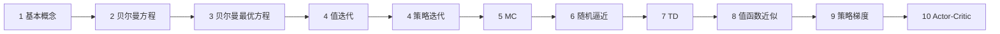

## 前言

本书旨在以数学化又友好的方式，介绍强化学习中的**基本概念、基本问题与经典算法**。本书的几个主要特点如下。

本书从**数学视角**介绍强化学习。希望读者不仅知道一个算法是怎么执行的，还能理解这个算法当初为什么这样设计、以及它为什么有效。

数学的深度被谨慎地控制在合适的水平，呈现方式也经过精心安排，保证读起来友好。灰色方框中的内容，读者可以按自己的兴趣选择性阅读。

书中给出了大量示例，帮助读者更好地理解各个主题。本书所有示例都基于**一个网格世界**（grid world）任务，它简单易懂，很适合用来讲解概念与算法。

在介绍一个算法时，本书力求把它的核心思想与可能分散注意力的复杂细节分开。这样读者能更牢地抓住**算法的核心思想**。

全书内容组织连贯：每一章都建立在前一章之上，同时为下一章打下必要的基础。

本书面向对强化学习感兴趣的**高年级本科生、研究生、科研人员和工程实践者**。它不要求读者具备任何强化学习背景，因为开篇就从最基本的概念讲起。如果读者已有一些强化学习基础，相信本书也能帮你更深入地理解某些主题，或者提供不同的视角。不过本书要求读者具备一些概率论与线性代数知识，所需数学的基础内容也收录在附录中。

我从 2019 年开始讲授一门研究生水平的强化学习课程，感谢班上同学对教学的反馈。本书的草稿于 2022 年 8 月放到网上，至今收到了许多读者的宝贵意见，在此向他们致谢。此外，感谢我的科研助理 Jialing Lv 在书稿与讲课视频编辑上的出色支持；感谢我的助教 Jianan Li 与 Yize Mi 在教学上的帮助；感谢我的博士生 Canlun Zheng 在书中一张插图设计上的协助；感谢我的家人给予的巨大支持。最后，感谢本书的编辑——Springer Nature 出版社与清华大学出版社的 Lanlan Chang 博士和 Sai Guo 先生——的大力支持。

请注意，我基于本教材开设了一门公开课，公开课的幻灯片与教材 PDF 都可以在网上免费下载。更多信息见教材主页：https://github.com/MathFoundationRL/Book-Mathematical-Foundation-of-Reinforcement-Learning

我衷心希望本书能帮助读者顺利地走进强化学习这个激动人心的领域。

赵世钰（Shiyu Zhao）

## 本书概览

图 1：本书的结构地图。

在旅程开始之前，先看一眼图 1 这张本书的"地图"很重要。本书共十章，可分为两部分：第一部分是**基本工具**，第二部分是**算法**。十章之间高度关联，一般需要先学前面的章，再学后面的章。

接下来，请跟我快速走一遍这十章。每章会讲两方面：一是**这一章介绍了什么内容**，二是**它与前章、后章的关系**。读这段概览前有个提醒：它的目的是让你对全书的内容与结构先有个印象，遇到很多看不懂的概念完全没关系。希望你读完概览后，能制定出一份适合自己的学习计划。

第 1 章介绍**状态、动作、奖励、回报、策略等基本概念**，这些概念在后续各章中被广泛使用。它们先通过**一个网格世界示例引出**——其中机器人要抵达一个预先指定的目标；然后用**马尔可夫决策过程（Markov decision process）的框架**更正式地给出定义。

第 2 章介绍两个关键要素：**一个关键概念**和**一个关键工具**。关键概念是**状态值**（state value），它定义为智能体从某个状态出发、按给定策略行动所能获得的期望回报。状态值越大，对应的策略越好。因此，状态值可以用来评价一个策略的好坏。

关键工具是**贝尔曼方程**（Bellman equation），**它可以用来分析状态值**。简而言之，贝尔曼方程描述了**所有状态的值之间的关系**；求解贝尔曼方程就能得到各状态的值。这一过程称为**策略评估（policy evaluation）**，是强化学习中的一个基础概念。最后，本章还引入了**动作值（action value）的概念**。

第 3 章同样介绍两个关键要素。关键概念是**最优策略**（optimal policy）：与其他策略相比，最优策略的状态值最大。**关键工具是贝尔曼最优方程**（Bellman optimality equation）。顾名思义，贝尔曼最优方程是一种特殊的贝尔曼方程。

这里有个根本性问题：强化学习的终极目标是什么？答案是**获得最优策略**。贝尔曼最优方程之所以重要，正是因为它能用来求最优策略。我们会看到，这个方程十分优雅，能帮我们透彻理解许多根本性问题。

前三章构成本书的第一部分，为后续各章打下必要的基础。从第 4 章开始，本书介绍学习**最优策略的算法。**

第 4 章介绍三个算法：**值迭代**（value iteration）、**策略迭代**（policy iteration）和**截断策略迭代**（truncated policy iteration）。三者关系密切。第一，值迭代算法正是第 3 章中求解贝尔曼最优方程所用的那个算法。第二，策略迭代算法是值迭代算法的**扩展**，它也是第 5 章**蒙特卡洛**（Monte Carlo, MC）算法的基础。第三，**截断策略迭代**是一个统一的版本，把值迭代与策略迭代都作为特例包含在内。

这三个算法结构相同：每次迭代都有两步，**一步更新值，另一步更新策略**。值更新与策略更新相互作用的思路，广泛存在于强化学习算法之中，也被称**为广义策略迭代**（generalized policy iteration）。此外，本章介绍的算法实际上是**动态规划算法，需要系统模型**；相比之下，后续各章介绍的算法**都不需要模型**。在进入后续章节前，先把本章内容理解透彻很重要。

从第 5 章开始，我们介绍不需要系统模型的**无模型（model-free）强化学习算法**。这是本书第一次引入无模型算法，因此必须先补上一个知识缺口：没有模型，怎么找到最优策略？道理很简单——没有模型，就必须有数据；**没有数据，就必须有模型**；两样都没有，就什么也做不了。强化学习中的"数据"，指的是**智能体与环境交互时产生的经验样本**。

本章基于 **MC 估计**介绍三个能从经验样本中学习最优策略的算法。第一个也是最简单的一个是 **MC Basic**，它可以由第 4 章的策略迭代算法直接扩展得到。理解 MC Basic 对把握基于 MC 的强化学习的基本思想很重要。在此基础上继续扩展，我们**又引入两个更复杂但更高效的 MC 类算法**。本章还详细讨论了**探索（exploration）与利用（exploitation）之间的根本权衡**。

读到这里，读者可能已经注意到这些章节的内容高度相关。例如，要学 MC 算法（第 5 章），得先理解策略迭代算法（第 4 章）；要学策略迭代，得先知道值迭代（第 4 章）；要弄懂值迭代，得先理解贝尔曼最优方程（第 3 章）；要理解贝尔曼最优方程，得先学贝尔曼方程（第 2 章）。因此强烈建议一章一章地学，否则后面的内容可能难以理解。

链条是单向的：从下往上追问，最终都会落回**第 2 章的贝尔曼方程**。

◇ 从第 5 章到第 7 章之间有一个知识缺口：第 7 章的算法是**增量式的（incremental）**，而第 5 章的算法不是。第 6 章正是为填补这个缺口而设，**介绍随机逼近（stochastic approximation）理论**。随机逼近指一大类用于求解求根问题或优化问题的随机迭代算法，**经典的 Robbins-Monro 算法与随机梯度下降都是它的特例**。本章虽然不介绍任何强化学习算法，但很重要——它为学习第 7 章打下必要的基础。

第 7 章介绍**经典的时间差分（temporal-difference, TD）算法**。有了第 6 章的铺垫，相信读者看到 TD 算法时不会感到意外。从数学角度看，**TD 算法可以看作求解贝尔曼方程或贝尔曼最优方程的随机逼近算法**。与蒙特卡洛学习一样，TD 学习也是无模型的，但它的增量形式带来了一些优势。例如它可以在线学习：每收到一个经验样本就更新一次值估计。本章介绍了相当多的 TD 算法，如 Sarsa 与 Q-learning，还引入了同策略（on-policy）与异策略（off-policy）这两个重要概念。

◇ **第 8 章介绍值函数近似（value function approximation）方法**。实际上本章仍在讲 TD 算法，只是**换了一种表示状态值/动作值的方式**。前面各章用表格表示状态值/动作值，表格法直白易懂，但在状态或动作空间很大时**效率很低**。为解决这个问题，可以采用**值函数近似**。理解这一方法的关键，是理解其优化形式中的三个步骤：**第一步，选取一个目标函数来定义什么样的策略最优；第二步，求目标函数的梯度；第三步，用基于梯度的算法求解该优化问题**。这一方法之所以重要，是因为它已成为表示值的标准技术，也是人工神经网络作为函数近似器被引入强化学习的地方。著名的**深度 Q 学习（deep Q-learning）算法**也在本章介绍。

第 9 章介绍**策略梯度（policy gradient）方法**，它是许多现代强化学习算法的基础。策略梯度方法是基于**策略的**（policy-based）——这是本书的一大跨越，因为前面各章的方法都是基于值的（value-based）。它的基本思想很简单：**选一个合适的标量指标，然后用梯度上升算法去优化它**。第 9 章与第 8 章关系密切，因为两者都依赖函数近似的思想。策略梯度方法的优点很多，例如处理大状态/动作空间更高效、泛化能力更强、样本利用更充分。

第 10 章介绍**演员-评论家（actor-critic）方法**。从一个角度看，actor-critic 是一种同时融合基于**策略与基于值两类方法的结构**；从另一个角度看，它并不算新东西，因为它仍属于策略梯度方法的范畴——具体来说，它可以由第 9 章的策略梯度算法扩展得到。在学习第 10 章之前，正确理解第 8、9 章的内容是必要的。
