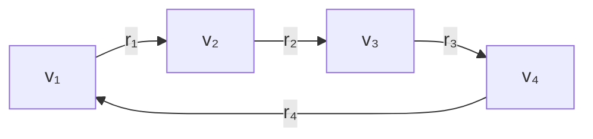
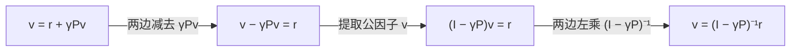

# 第 2 章 状态值与贝尔曼方程

*图 2.1：本书的进度位置。*

本章介绍一个核心概念和一个重要工具。核心概念是**状态值**（state value），它定义为智能体遵循给定策略时所能获得的平均奖励。状态值越大，对应的策略越好。因此，状态值可以作为衡量策略好坏的指标。状态值固然重要，但该如何分析它？答案是**贝尔曼方程**（Bellman equation）——分析状态值的重要工具。简而言之，贝尔曼方程描述了所有状态的值之间的关系；求解贝尔曼方程就能得到各状态的值。这一过程称为**策略评估**（policy evaluation），是强化学习中的一个基础概念。最后，本章还介绍另一个重要概念——**动作值**（action value）。

## 2.1 动机示例一：为什么回报重要？

上一章介绍了回报的概念。事实上，回报在强化学习中具有基础性地位，因为它能评价一个策略的好坏。下面用例子说明。

![[Pasted image 20261106201801.png|768]]

*图 2.2：用来说明回报重要性的例子。三个例子在 $s_1$ 上的策略不同。*

考察图 2.2 中的三个策略。可以看到，三者在 $s_1$ 上有所不同。哪个最好、哪个最差？直观上，最左边的策略最好，因为从 $s_1$ 出发的智能体可以避开禁区；中间的策略直观上更差，因为从 $s_1$ 出发的智能体会走进禁区；最右边的策略介于两者之间，因为它有 0.5 的概率走进禁区。

上面的分析基于直觉，那么自然要问：能不能用数学来描述这种直觉？答案是可以，靠的就是**回报**这一概念。具体来说，假设智能体从 $s_1$ 出发。

遵循第一个策略，轨迹为 $s_1 \to s_3 \to s_4 \to s_4 \cdots$，相应的折扣回报为

$$
\begin{array}{r l} \mathrm{return} _ {1} & = 0 + \gamma 1 + \gamma^ {2} 1 + \dots \\ & = \gamma (1 + \gamma + \gamma^ {2} + \dots) \\ & = \frac {\gamma}{1 - \gamma}, \end{array}
$$

其中 $\gamma \in (0,1)$ 是折扣率。

遵循第二个策略，轨迹为 $s_1 \to s_2 \to s_4 \to s_4 \cdots$，折扣回报为

$$
\begin{array}{r l} \mathrm{return} _ {2} & = - 1 + \gamma 1 + \gamma^ {2} 1 + \ldots \\ & = - 1 + \gamma (1 + \gamma + \gamma^ {2} + \ldots) \\ & = - 1 + \frac {\gamma}{1 - \gamma}. \end{array}
$$

遵循第三个策略，可能得到两条轨迹：一条是 $s_1 \to s_3 \to s_4 \to s_4 \cdots$，另一条是 $s_1 \to s_2 \to s_4 \to s_4 \cdots$，两条轨迹的概率都是 0.5。那么，从 $s_1$ 出发能获得的平均回报为

$$
\begin{array}{c} \mathrm{return} _ {3} = 0. 5 \left(- 1 + \frac {\gamma}{1 - \gamma}\right) + 0. 5 \left(\frac {\gamma}{1 - \gamma}\right) \\ = - 0. 5 + \frac {\gamma}{1 - \gamma}. \end{array}
$$

比较三个策略的回报，可以发现

$$
\mathrm{return} _ {1} > \mathrm{return} _ {3} > \mathrm{return} _ {2} \tag{2.1}
$$

对任意 $\gamma$ 都成立。式 (2.1) 表明：**第一个策略最好，因为回报最大**；第二个策略最差，因为回报最小。这个数学结论与前面的直觉一致——第一个策略能避开禁区所以最好，第二个策略会走进禁区所以最差。

上面的例子说明，**回报可以用来评价策略**：遵循某个策略得到的回报越大，该策略就越好。最后要注意，$\mathrm{return}_3$ 其实并不严格符合回报的定义，因为它更像是一个期望值。后面会看到，$\mathrm{return}_3$ 实际上就是一个状态值。

## 2.2 动机示例二：如何计算回报？

我们已经说明了回报的重要性，那么接着要问：在给定策略下，如何计算回报？

计算回报有两种方法。

第一种就是按定义计算：回报等于沿轨迹收集到的所有奖励的折扣和。考虑图 2.3 的例子。令 $v_i$ 表示从 $s_i$ 出发得到的回报，$i = 1,2,3,4$。那么，从图 2.3 中四个状态出发得到的回报可以计算为

![[Pasted image 20261106201941.png|323]]

*图 2.3：用来说明如何计算回报的例子。该例中没有目标格子和禁区。*

$$
\begin{array}{r l} & v _ {1} = r _ {1} + \gamma r _ {2} + \gamma^ {2} r _ {3} + \ldots , \\ & v _ {2} = r _ {2} + \gamma r _ {3} + \gamma^ {2} r _ {4} + \ldots , \\ & v _ {3} = r _ {3} + \gamma r _ {4} + \gamma^ {2} r _ {1} + \ldots , \\ & v _ {4} = r _ {4} + \gamma r _ {1} + \gamma^ {2} r _ {2} + \ldots . \end{array} \tag{2.2}
$$

第二种方法（也是更重要的方法）基于**自举**（bootstrapping）的思想。观察 (2.2) 中回报的表达式，可以把它们改写成

$$
\begin{array}{r l} & v _ {1} = r _ {1} + \gamma (r _ {2} + \gamma r _ {3} + \ldots) = r _ {1} + \gamma v _ {2}, \\ & v _ {2} = r _ {2} + \gamma (r _ {3} + \gamma r _ {4} + \ldots) = r _ {2} + \gamma v _ {3}, \\ & v _ {3} = r _ {3} + \gamma (r _ {4} + \gamma r _ {1} + \ldots) = r _ {3} + \gamma v _ {4}, \\ & v _ {4} = r _ {4} + \gamma (r _ {1} + \gamma r _ {2} + \ldots) = r _ {4} + \gamma v _ {1}. \end{array} \tag{2.3}
$$

这些等式揭示了一个有趣的现象：**各回报的值相互依赖**。具体地说，$v_1$ 依赖 $v_2$，$v_2$ 依赖 $v_3$，$v_3$ 依赖 $v_4$，$v_4$ 又依赖 $v_1$。这正体现了自举的思想——用某些量自身来求这些量的值。

乍看之下，自举像是一个死循环，因为计算一个未知量要用到另一个未知量。其实从数学角度看，自举并不难理解。具体来说，式 (2.3) 可以改写成线性矩阵-向量方程：

$$
\underbrace {\left[ \begin{array}{c} v _ {1} \\ v _ {2} \\ v _ {3} \\ v _ {4} \end{array} \right]} _ {v} = \left[ \begin{array}{c} r _ {1} \\ r _ {2} \\ r _ {3} \\ r _ {4} \end{array} \right] + \left[ \begin{array}{c} \gamma v _ {2} \\ \gamma v _ {3} \\ \gamma v _ {4} \\ \gamma v _ {1} \end{array} \right] = \underbrace {\left[ \begin{array}{c} r _ {1} \\ r _ {2} \\ r _ {3} \\ r _ {4} \end{array} \right]} _ {r} + \gamma \underbrace {\left[ \begin{array}{c c c c} 0 & 1 & 0 & 0 \\ 0 & 0 & 1 & 0 \\ 0 & 0 & 0 & 1 \\ 1 & 0 & 0 & 0 \end{array} \right]} _ {P} \underbrace {\left[ \begin{array}{c} v _ {1} \\ v _ {2} \\ v _ {3} \\ v _ {4} \end{array} \right]} _ {v},
$$

可紧凑地写为

$$
v = r + \gamma P v.
$$

于是 $v$ 的值可以很容易地算出：$v = (I - \gamma P)^{-1} r$，其中 $I$ 是适当维度的单位矩阵。有人可能会问：$I - \gamma P$ 一定可逆吗？**答案是肯定的**，解释见 2.7.1 节。

事实上，式 (2.3) 就是这个简单例子的**贝尔曼方程**。虽然简单，它却体现了贝尔曼方程的核心思想：从一个状态出发得到的回报，依赖于从其他状态出发得到的回报。自举的思想以及一般情形下的贝尔曼方程，将在后面几节形式化。

## 2.3 状态值

前面说过，回报可以用来评价策略。但回报不适用于随机系统，因为从同一个状态出发可能得到不同的回报。本节引入**状态值**这一概念来应对这个问题。

首先介绍一些必要的记号。考虑时间步序列 $t = 0,1,2,\ldots$。在时刻 $t$，智能体处于状态 $S_t$；遵循策略 $\pi$ 采取的动作是 $A_t$；下一状态是 $S_{t+1}$，得到的即时奖励是 $R_{t+1}$。这一过程可以简洁地表示为

$$
S _ {t} \xrightarrow {A _ {t}} S _ {t + 1}, R _ {t + 1}.
$$

注意 $S_t, S_{t+1}, A_t, R_{t+1}$ 都是随机变量。并且 $S_t, S_{t+1} \in \mathcal{S}$，$A_t \in \mathcal{A}(S_t)$，$R_{t+1} \in \mathcal{R}(S_t, A_t)$。

从 $t$ 出发，可以得到一条"状态-动作-奖励"轨迹：

$$
S _ {t} \xrightarrow {A _ {t}} S _ {t + 1}, R _ {t + 1} \xrightarrow {A _ {t + 1}} S _ {t + 2}, R _ {t + 2} \xrightarrow {A _ {t + 2}} S _ {t + 3}, R _ {t + 3} \dots .
$$

按定义，**沿这条轨迹的折扣回报**为

$$
G _ {t} \doteq R _ {t + 1} + \gamma R _ {t + 2} + \gamma^ {2} R _ {t + 3} + \ldots ,
$$

其中 $\gamma \in (0,1)$ 是折扣率。注意 $G_t$ 是随机变量，因为 $R_{t+1}, R_{t+2}, \ldots$ 都是随机变量。

既然 $G_t$ 是随机变量，**就可以计算它的期望值**（也叫期望或均值）：

$$
v _ {\pi} (s) \doteq \mathbb {E} [ G _ {t} | S _ {t} = s ].
$$

这里 $v_\pi(s)$ 称为**状态值函数**，简称 $s$ 的**状态值**。下面给出几点重要说明。

- $v_\pi(s)$ 依赖 $s$。因为它的定义是一个条件期望，条件是智能体从 $S_t = s$ 出发。
- $v_\pi(s)$ 依赖 $\pi$。因为轨迹是遵循策略 $\pi$ 生成的；策略不同，状态值可能不同。
- $v_\pi(s)$ 不依赖 $t$。智能体在状态空间中移动时，$t$ 表示**当前时间步**；只要策略给定，$v_\pi(s)$ 的值就确定了。

状态值与回报的关系可进一步说明如下。当策略与系统模型都是确定性的时候，从某状态出发总是得到同一条轨迹，此时从该状态出发得到的回报就等于该状态的值。相反，当策略或系统模型是随机的时候，从同一状态出发可能产生不同轨迹，不同轨迹的回报不同，而状态值就是这些回报的均值。

虽然如 2.1 节所示回报也能评价策略，但用状态值来评价更正式：产生更大状态值的策略更好。因此，状态值是强化学习的核心概念。状态值固然重要，那么它该怎么算？下一节回答这个问题。

## 2.4 贝尔曼方程

现在介绍贝尔曼方程——**分析状态值的数学工具**。简而言之，贝尔曼方程是一组线性方程，描述所有状态的值之间的关系。

下面推导贝尔曼方程。首先注意 $G_t$ 可以改写为

$$
\begin{array}{r l} & G _ {t} = R _ {t + 1} + \gamma R _ {t + 2} + \gamma^ {2} R _ {t + 3} + \dots \\ & \qquad = R _ {t + 1} + \gamma (R _ {t + 2} + \gamma R _ {t + 3} + \dots) \\ & \qquad = R _ {t + 1} + \gamma G _ {t + 1}, \end{array}
$$

其中 $G_{t+1} = R_{t+2} + \gamma R_{t+3} + \ldots$。这个式子建立了 $G_t$ 与 $G_{t+1}$ 的关系。于是状态值可以写成

$$
\begin{array}{r l} & v _ {\pi} (s) = \mathbb {E} [ G _ {t} | S _ {t} = s ] \\ & \qquad = \mathbb {E} [ R _ {t + 1} + \gamma G _ {t + 1} | S _ {t} = s ] \\ & \qquad = \mathbb {E} [ R _ {t + 1} | S _ {t} = s ] + \gamma \mathbb {E} [ G _ {t + 1} | S _ {t} = s ]. \end{array} \tag{2.4}
$$

下面对 (2.4) 中的两项分别分析。

第一项 $\mathbb{E}[R_{t+1}|S_t=s]$ 是**即时奖励的期望**。利用全期望公式（附录 A），它可以计算为

$$
\begin{array}{c} \mathbb {E} [ R _ {t + 1} | S _ {t} = s ] = \sum_ {a \in \mathcal {A}} \pi (a | s) \mathbb {E} [ R _ {t + 1} | S _ {t} = s, A _ {t} = a ] \\ = \sum_ {a \in \mathcal {A}} \pi (a | s) \sum_ {r \in \mathcal {R}} p (r | s, a) r. \end{array} \tag{2.5}
$$

这里 $\mathcal{A}$ 与 $\mathcal{R}$ 分别是**可能的动作集合与奖励集合**。需要注意，不同状态的动作集合可能不同，此时应写作 $\mathcal{A}(s)$；类似地，$\mathcal{R}$ 也可能依赖 $(s,a)$。本书为简便起见省略了对 $s$ 或 $(s,a)$ 的依赖，不过即使存在这种依赖，结论依然成立。

- 第二项 $\mathbb{E}[G_{t+1}|S_t=s]$ 是未来奖励的期望，可计算为

$$
\begin{array}{l} \mathbb {E} [ G _ {t + 1} | S _ {t} = s ] = \sum_ {s ^ {\prime} \in \mathcal {S}} \mathbb {E} [ G _ {t + 1} | S _ {t} = s, S _ {t + 1} = s ^ {\prime} ] p (s ^ {\prime} | s) \\ \quad = \sum_ {s ^ {\prime} \in \mathcal {S}} \mathbb {E} [ G _ {t + 1} | S _ {t + 1} = s ^ {\prime} ] p (s ^ {\prime} | s) \quad (\text { 由马尔可夫性 }) \\ \quad = \sum_ {s ^ {\prime} \in \mathcal {S}} v _ {\pi} (s ^ {\prime}) p (s ^ {\prime} | s) \\ \quad = \sum_ {s ^ {\prime} \in \mathcal {S}} v _ {\pi} (s ^ {\prime}) \sum_ {a \in \mathcal {A}} p (s ^ {\prime} | s, a) \pi (a | s). \end{array} \tag{2.6}
$$

上面的推导用到了 $\mathbb{E}[G_{t+1}|S_t=s, S_{t+1}=s'] = \mathbb{E}[G_{t+1}|S_{t+1}=s']$，这正是**马尔可夫性**：**未来奖励只依赖当前状态，而不依赖更早的状态。**

把 (2.5)-(2.6) 代入 (2.4) 得到

$$
\begin{array}{l} v _ {\pi} (s) = \mathbb {E} [ R _ {t + 1} | S _ {t} = s ] + \gamma \mathbb {E} [ G _ {t + 1} | S _ {t} = s ], \\ \qquad = \underbrace {\sum_ {a \in \mathcal {A}} \pi (a | s) \sum_ {r \in \mathcal {R}} p (r | s , a) r} _ {\text { 即时奖励的均值 }} + \underbrace {\gamma \sum_ {a \in \mathcal {A}} \pi (a | s) \sum_ {s ^ {\prime} \in \mathcal {S}} p (s ^ {\prime} | s , a) v _ {\pi} (s ^ {\prime})} _ {\text { 未来奖励的均值 }} \\ \qquad = \sum_ {a \in \mathcal {A}} \pi (a | s) \left[ \sum_ {r \in \mathcal {R}} p (r | s, a) r + \gamma \sum_ {s ^ {\prime} \in \mathcal {S}} p (s ^ {\prime} | s, a) v _ {\pi} (s ^ {\prime}) \right], \quad \text { 对所有 } s \in \mathcal {S}. \end{array} \tag{2.7}
$$

这个方程就是**贝尔曼方程**，它刻画了各状态值之间的关系，是设计与分析强化学习算法的基础工具。

贝尔曼方程乍看复杂，其实结构清晰。下面给出几点说明。

- $v_\pi(s)$ 与 $v_\pi(s')$ 是**待求的未知状态值**。初学者可能会困惑：$v_\pi(s)$ 依赖另一个未知量 $v_\pi(s')$，那怎么算？必须注意，贝尔曼方程不是单个方程，而是针对所有状态的一组线性方程。把这些方程放在一起，如何求出全部状态值就清楚了，细节见 2.7 节。
- $\pi(a|s)$ 是**给定策略**。既然状态值可以用来评价策略，那么从贝尔曼方程解出状态值的过程就是一种**策略评估**，它是许多强化学习算法中的重要环节，后面会看到。
- $p(r|s,a)$ 与 $p(s'|s,a)$ 表示**系统模型**。我们会在 2.7 节先说明有模型时如何计算状态值，再在本书后面介绍无模型算法时说明没有模型时如何计算。

除了 (2.7) 这一形式，读者在文献中还可能见到贝尔曼方程的其他写法。下面介绍两种等价形式。

第一，由全概率公式可得

$$
\begin{array}{c} p (s ^ {\prime} | s, a) = \sum_ {r \in \mathcal {R}} p (s ^ {\prime}, r | s, a), \\ p (r | s, a) = \sum_ {s ^ {\prime} \in \mathcal {S}} p (s ^ {\prime}, r | s, a). \end{array}
$$

于是式 (2.7) 可以改写为

$$
v _ {\pi} (s) = \sum_ {a \in \mathcal {A}} \pi (a | s) \sum_ {s ^ {\prime} \in \mathcal {S}} \sum_ {r \in \mathcal {R}} p (s ^ {\prime}, r | s, a) [ r + \gamma v _ {\pi} (s ^ {\prime}) ].
$$

这是文献 [3] 中采用的形式。

第二，在某些问题中奖励 $r$ 可能只依赖下一状态 $s'$。此时可以把奖励写成 $r(s')$，于是 $p(r(s')|s,a) = p(s'|s,a)$，代入 (2.7) 得到

$$
v _ {\pi} (s) = \sum_ {a \in \mathcal {A}} \pi (a | s) \sum_ {s ^ {\prime} \in \mathcal {S}} p (s ^ {\prime} | s, a) [ r (s ^ {\prime}) + \gamma v _ {\pi} (s ^ {\prime}) ].
$$

## 2.5 演示贝尔曼方程的例子

下面用两个例子一步步演示如何写出贝尔曼方程、并据此求出状态值。建议读者仔细过一遍这些例子，以加深对贝尔曼方程的理解。

*图 2.4：用来演示贝尔曼方程的例子。该例中的策略是确定性的。*

先看第一个例子（图 2.4），其策略是确定性的。下面写出**贝尔曼方程**并由它解出状态值。

首先考虑状态 $s_1$。在该策略下，各动作的概率为 $\pi(a=a_3|s_1)=1$、$\pi(a \neq a_3|s_1)=0$。状态转移概率为 $p(s'=s_3|s_1,a_3)=1$、$p(s' \neq s_3|s_1,a_3)=0$。奖励概率为 $p(r=0|s_1,a_3)=1$、$p(r \neq 0|s_1,a_3)=0$。把这些值代入 (2.7) 得到

$$
v _ {\pi} (s _ {1}) = 0 + \gamma v _ {\pi} (s _ {3}).
$$

有意思的是，(2.7) 中贝尔曼方程的表达式看似复杂，但对这个具体状态，表达式非常简单。

类似地可以得到

$$
\begin{array}{r l} & v _ {\pi} (s _ {2}) = 1 + \gamma v _ {\pi} (s _ {4}), \\ & v _ {\pi} (s _ {3}) = 1 + \gamma v _ {\pi} (s _ {4}), \\ & v _ {\pi} (s _ {4}) = 1 + \gamma v _ {\pi} (s _ {4}). \end{array}
$$

从这些方程可以解出状态值。由于方程很简单，可以手工求解；更复杂的方程可用 2.7 节给出的算法求解。这里解得的值为

$$
\begin{array}{l} {v _ {\pi} (s _ {4}) = \frac {1}{1 - \gamma},} \\ {v _ {\pi} (s _ {3}) = \frac {1}{1 - \gamma},} \\ {v _ {\pi} (s _ {2}) = \frac {1}{1 - \gamma},} \\ {v _ {\pi} (s _ {1}) = \frac {\gamma}{1 - \gamma}.} \end{array}
$$

进一步，若取 $\gamma = 0.9$，则

$$
v _ {\pi} (s _ {4}) = \frac {1}{1 - 0 . 9} = 1 0,
$$

$$
v _ {\pi} (s _ {3}) = \frac {1}{1 - 0 . 9} = 1 0,
$$

$$
v _ {\pi} (s _ {2}) = \frac {1}{1 - 0 . 9} = 1 0,
$$

$$
v _ {\pi} (s _ {1}) = \frac {0 . 9}{1 - 0 . 9} = 9.
$$

*图 2.5：用来演示贝尔曼方程的例子。该例中的策略是随机的。*

再看第二个例子（图 2.5），其策略是随机的。下面同样写出贝尔曼方程，并由此解出状态值。

在状态 $s_1$，向右走与向下走的概率都是 0.5，即 $\pi(a=a_2|s_1)=0.5$、$\pi(a=a_3|s_1)=0.5$。状态转移是确定性的，因为 $p(s'=s_3|s_1,a_3)=1$、$p(s'=s_2|s_1,a_2)=1$。奖励也是确定性的，因为 $p(r=0|s_1,a_3)=1$、$p(r=-1|s_1,a_2)=1$。把这些值代入 (2.7) 得到

$$
v _ {\pi} (s _ {1}) = 0. 5 [ 0 + \gamma v _ {\pi} (s _ {3}) ] + 0. 5 [ - 1 + \gamma v _ {\pi} (s _ {2}) ].
$$

类似地可以得到

$$
\begin{array}{r l} & v _ {\pi} (s _ {2}) = 1 + \gamma v _ {\pi} (s _ {4}), \\ & v _ {\pi} (s _ {3}) = 1 + \gamma v _ {\pi} (s _ {4}), \\ & v _ {\pi} (s _ {4}) = 1 + \gamma v _ {\pi} (s _ {4}). \end{array}
$$

由上述方程可以解出状态值。由于方程简单，可以手工求解，得到

$$
\begin{array}{r l} & v _ {\pi} (s _ {4}) = \frac {1}{1 - \gamma}, \\ & v _ {\pi} (s _ {3}) = \frac {1}{1 - \gamma}, \\ & v _ {\pi} (s _ {2}) = \frac {1}{1 - \gamma}, \\ & v _ {\pi} (s _ {1}) = 0. 5 [ 0 + \gamma v _ {\pi} (s _ {3}) ] + 0. 5 [ - 1 + \gamma v _ {\pi} (s _ {2}) ], \\ & \qquad = - 0. 5 + \frac {\gamma}{1 - \gamma}. \end{array}
$$

进一步，若取 $\gamma = 0.9$，则

$$
\begin{array}{l} {v _ {\pi} (s _ {4}) = 1 0,} \\ {v _ {\pi} (s _ {3}) = 1 0,} \\ {v _ {\pi} (s _ {2}) = 1 0,} \\ {v _ {\pi} (s _ {1}) = - 0. 5 + 9 = 8. 5.} \end{array}
$$

把上面两个例子中两个策略的状态值作比较，可以看到

$$
v _ {\pi_ {1}} (s _ {i}) \geq v _ {\pi_ {2}} (s _ {i}), \quad i = 1, 2, 3, 4,
$$

这说明图 2.4 中的策略更好，因为它的状态值更大。这个数学结论与直觉一致：第一个策略更好，因为从 $s_1$ 出发时可以避开禁区。由此可见，状态值可以用来评价策略。

## 2.6 贝尔曼方程的矩阵-向量形式

(2.7) 中的贝尔曼方程是逐元素形式。由于它对每个状态都成立，可以把这些方程合在一起，紧凑地写成矩阵-向量形式——这一形式在分析贝尔曼方程时会被频繁使用。

为推导矩阵-向量形式，先把 (2.7) 改写为

$$
v _ {\pi} (s) = r _ {\pi} (s) + \gamma \sum_ {s ^ {\prime} \in \mathcal {S}} p _ {\pi} (s ^ {\prime} | s) v _ {\pi} (s ^ {\prime}), \tag{2.8}
$$

其中

$$
\begin{array}{c} r _ {\pi} (s) \doteq \sum_ {a \in \mathcal {A}} \pi (a | s) \sum_ {r \in \mathcal {R}} p (r | s, a) r, \\ p _ {\pi} (s ^ {\prime} | s) \doteq \sum_ {a \in \mathcal {A}} \pi (a | s) p (s ^ {\prime} | s, a). \end{array}
$$

这里 $r_\pi(s)$ 表示即时奖励的均值，$p_\pi(s'|s)$ 表示策略 $\pi$ 下从 $s$ 转移到 $s'$ 的概率。

假设状态编号为 $s_i$，$i = 1,\ldots,n$，其中 $n = |\mathcal{S}|$。对状态 $s_i$，式 (2.8) 可写为

$$
v _ {\pi} (s _ {i}) = r _ {\pi} (s _ {i}) + \gamma \sum_ {s _ {j} \in \mathcal {S}} p _ {\pi} (s _ {j} | s _ {i}) v _ {\pi} (s _ {j}). \tag{2.9}
$$

令 $v_\pi = [v_\pi(s_1), \ldots, v_\pi(s_n)]^T \in \mathbb{R}^n$、$r_\pi = [r_\pi(s_1), \ldots, r_\pi(s_n)]^T \in \mathbb{R}^n$，以及 $P_\pi \in \mathbb{R}^{n \times n}$，其中 $[P_\pi]_{ij} = p_\pi(s_j|s_i)$。那么 (2.9) 可写成如下矩阵-向量形式：

$$
v _ {\pi} = r _ {\pi} + \gamma P _ {\pi} v _ {\pi}, \tag{2.10}
$$

其中 $v_\pi$ 是待求的未知量，$r_\pi$ 与 $P_\pi$ 已知。

矩阵 $P_\pi$ 有一些有趣的性质。第一，它是**非负矩阵**，即所有元素都大于或等于零，记作 $P_\pi \geq 0$，这里的 $0$ 表示适当维度的零矩阵。本书中 $\geq$ 与 $\leq$ 都表示逐元素比较。第二，$P_\pi$ 是**随机矩阵**，即每一行元素之和等于 1，记作 $P_\pi \mathbf{1} = \mathbf{1}$，其中 $\mathbf{1} = [1,\ldots,1]^T$ 具有适当维度。

考察图 2.6 所示例子，其贝尔曼方程的矩阵-向量形式为

$$
\underbrace {\left[ \begin{array}{l} v _ {\pi} (s _ {1}) \\ v _ {\pi} (s _ {2}) \\ v _ {\pi} (s _ {3}) \\ v _ {\pi} (s _ {4}) \end{array} \right]} _ {v _ {\pi}} = \underbrace {\left[ \begin{array}{l} r _ {\pi} (s _ {1}) \\ r _ {\pi} (s _ {2}) \\ r _ {\pi} (s _ {3}) \\ r _ {\pi} (s _ {4}) \end{array} \right]} _ {r _ {\pi}} + \gamma \underbrace {\left[ \begin{array}{l l l l} p _ {\pi} (s _ {1} | s _ {1}) & p _ {\pi} (s _ {2} | s _ {1}) & p _ {\pi} (s _ {3} | s _ {1}) & p _ {\pi} (s _ {4} | s _ {1}) \\ p _ {\pi} (s _ {1} | s _ {2}) & p _ {\pi} (s _ {2} | s _ {2}) & p _ {\pi} (s _ {3} | s _ {2}) & p _ {\pi} (s _ {4} | s _ {2}) \\ p _ {\pi} (s _ {1} | s _ {3}) & p _ {\pi} (s _ {2} | s _ {3}) & p _ {\pi} (s _ {3} | s _ {3}) & p _ {\pi} (s _ {4} | s _ {3}) \\ p _ {\pi} (s _ {1} | s _ {4}) & p _ {\pi} (s _ {2} | s _ {4}) & p _ {\pi} (s _ {3} | s _ {4}) & p _ {\pi} (s _ {4} | s _ {4}) \end{array} \right]} _ {P _ {\pi}} \underbrace {\left[ \begin{array}{l} v _ {\pi} (s _ {1}) \\ v _ {\pi} (s _ {2}) \\ v _ {\pi} (s _ {3}) \\ v _ {\pi} (s _ {4}) \end{array} \right]} _ {v _ {\pi}}
$$

把具体数值代入上式得到

$$
\left[ \begin{array}{c} v _ {\pi} (s _ {1}) \\ v _ {\pi} (s _ {2}) \\ v _ {\pi} (s _ {3}) \\ v _ {\pi} (s _ {4}) \end{array} \right] = \left[ \begin{array}{c} 0. 5 (0) + 0. 5 (- 1) \\ 1 \\ 1 \\ 1 \end{array} \right] + \gamma \left[ \begin{array}{c c c c} 0 & 0. 5 & 0. 5 & 0 \\ 0 & 0 & 0 & 1 \\ 0 & 0 & 0 & 1 \\ 0 & 0 & 0 & 1 \end{array} \right] \left[ \begin{array}{c} v _ {\pi} (s _ {1}) \\ v _ {\pi} (s _ {2}) \\ v _ {\pi} (s _ {3}) \\ v _ {\pi} (s _ {4}) \end{array} \right].
$$

可以看到，$P_\pi$ 满足 $P_\pi \mathbf{1} = \mathbf{1}$。

*图 2.6：用来演示贝尔曼方程矩阵-向量形式的例子。*

## 2.7 由贝尔曼方程求解状态值

计算给定策略的状态值是强化学习中的一个基本问题，通常称为**策略评估**。本节介绍两种由贝尔曼方程计算状态值的方法。

### 2.7.1 闭式解

由于 $v_\pi = r_\pi + \gamma P_\pi v_\pi$ 是简单的线性方程，很容易得到它的闭式解：

$$
v _ {\pi} = (I - \gamma P _ {\pi}) ^ {- 1} r _ {\pi}.
$$

下面给出 $(I - \gamma P_\pi)^{-1}$ 的一些性质。

- $I - \gamma P_\pi$ 可逆。证明如下：根据盖尔圆定理（Gershgorin circle theorem）[4]，$I - \gamma P_\pi$ 的每个特征值都至少落在其中一个盖尔圆内。第 $i$ 个盖尔圆的圆心为 $[I - \gamma P_\pi]_{ii} = 1 - \gamma p_\pi(s_i|s_i)$，半径为 $\sum_{j \neq i} [I - \gamma P_\pi]_{ij} = -\sum_{j \neq i} \gamma p_\pi(s_j|s_i)$。由于 $\gamma < 1$，可知半径小于圆心到原点的距离：$\sum_{j \neq i} \gamma p_\pi(s_j|s_i) < 1 - \gamma p_\pi(s_i|s_i)$。因此所有盖尔圆都不包含原点，于是 $I - \gamma P_\pi$ 没有零特征值。
- $(I - \gamma P_\pi)^{-1} \geq I$，即 $(I - \gamma P_\pi)^{-1}$ 的每个元素都非负，而且不小于单位矩阵对应元素。这是因为 $P_\pi$ 的元素非负，于是 $(I - \gamma P_\pi)^{-1} = I + \gamma P_\pi + \gamma^2 P_\pi^2 + \cdots \geq I \geq 0$。
- 对任意向量 $r \geq 0$，都有 $(I - \gamma P_\pi)^{-1} r \geq r \geq 0$。这是由上一性质推出的，因为 $[(I - \gamma P_\pi)^{-1} - I] r \geq 0$。因此，若 $r_1 \geq r_2$，就有 $(I - \gamma P_\pi)^{-1} r_1 \geq (I - \gamma P_\pi)^{-1} r_2$。

### 2.7.2 迭代解

闭式解对理论分析很有用，但实际中并不适用，因为它要做矩阵求逆，而矩阵求逆本身仍需其他数值算法来计算。事实上，可以直接用下面的迭代算法求解贝尔曼方程：

$$
v _ {k + 1} = r _ {\pi} + \gamma P _ {\pi} v _ {k}, \quad k = 0, 1, 2, \ldots \tag{2.11}
$$

该算法产生一个序列 $\{v_0, v_1, v_2, \ldots\}$，其中 $v_0 \in \mathbb{R}^n$ 是对 $v_\pi$ 的初始猜测。可以证明

$$
v _ {k} \rightarrow v _ {\pi} = (I - \gamma P _ {\pi}) ^ {- 1} r _ {\pi}, \quad \text{当 } k \rightarrow \infty . \tag{2.12}
$$

感兴趣的读者可参看方框 2.1 的证明。

### 方框 2.1：(2.12) 的收敛性证明

定义误差 $\delta_k = v_k - v_\pi$，只需证明 $\delta_k \to 0$。把 $v_{k+1} = \delta_{k+1} + v_\pi$ 与 $v_k = \delta_k + v_\pi$ 代入 $v_{k+1} = r_\pi + \gamma P_\pi v_k$，得到

$$
\delta_{k+1} + v_\pi = r_\pi + \gamma P_\pi (\delta_k + v_\pi),
$$

可改写为

$$
\delta_{k+1} = -v_\pi + r_\pi + \gamma P_\pi \delta_k + \gamma P_\pi v_\pi,
$$

$$
= \gamma P_\pi \delta_k - v_\pi + (r_\pi + \gamma P_\pi v_\pi),
$$

$$
= \gamma P_\pi \delta_k.
$$

因此

$$
\delta_{k+1} = \gamma P_\pi \delta_k = \gamma^2 P_\pi^2 \delta_{k-1} = \cdots = \gamma^{k+1} P_\pi^{k+1} \delta_0.
$$

由于 $P_\pi$ 的每个元素都非负且不大于 1，对任意 $k$ 都有 $0 \leq P_\pi^k \leq \mathbf{1}$，即 $P_\pi^k$ 的每个元素都不大于 1。另一方面，由于 $\gamma < 1$，有 $\gamma^k \to 0$，于是当 $k \to \infty$ 时 $\delta_{k+1} = \gamma^{k+1} P_\pi^{k+1} \delta_0 \to 0$。

### 2.7.3 示例

下面用 (2.11) 中的算法求解几个例子的状态值。

例子如图 2.7 所示。橙色格子表示禁区，蓝色格子表示目标区域。奖励设置为 $r_{\mathrm{boundary}} = r_{\mathrm{forbidden}} = -1$、$r_{\mathrm{target}} = 1$，折扣率 $\gamma = 0.9$。

|  | 1 | 2 | 3 | 4 | 5 |
| --- | --- | --- | --- | --- | --- |
| 1 | -6.6 | -7.3 | -8.1 | -9.0 | -10.0 |
| 2 | -8.5 | -8.3 | -8.1 | -9.0 | -10.0 |
| 3 | -7.5 | -8.3 | -8.1 | -9.0 | -10.0 |
| 4 | -7.5 | -7.2 | -9.1 | -9.0 | -10.0 |
| 5 | -7.6 | -7.3 | -8.1 | -9.0 | -10.0 |

|  | 1 | 2 | 3 | 4 | 5 |
| --- | --- | --- | --- | --- | --- |
| 1 | 3.5 | 3.9 | 4.3 | 4.8 | 5.3 |
| 2 | 3.1 | 3.5 | 4.8 | 5.3 | 5.9 |
| 3 | 2.8 | 2.5 | 10.0 | 5.9 | 6.6 |
| 4 | 2.5 | 10.0 | 10.0 | 10.0 | 7.3 |
| 5 | 2.3 | 9.0 | 10.0 | 9.0 | 8.1 |

|  | 1 | 2 | 3 | 4 | 5 |
| --- | --- | --- | --- | --- | --- |
| 1 | 3.5 | 3.9 | 4.3 | 4.8 | 5.3 |
| 2 | 3.1 | 3.5 | 4.8 | 5.3 | 5.9 |
| 3 | 2.8 | 2.5 | 10.0 | 5.9 | 6.6 |
| 4 | 2.5 | 10.0 | 10.0 | 10.0 | 7.3 |
| 5 | 2.3 | 9.0 | 10.0 | 9.0 | 8.1 |

(a) 两个"好"策略及其状态值。两个策略的状态值相同，但它们在第四列最上面两个状态上的动作不同。

(b) 两个"坏"策略及其状态值。它们的状态值比"好"策略的更小。

*图 2.7：策略及其对应状态值的例子。*

图 2.7(a) 给出两个"好"策略以及由 (2.11) 求得的状态值。这两个策略的状态值相同，但在第四列最上面两个状态上的动作不同。可见，不同的策略可以有相同的状态值。

图 2.7(b) 给出两个"坏"策略及其状态值。这两个策略之所以坏，是因为很多状态上的动作在直觉上就不合理。这种直觉也被求得的状态值印证了：这两个策略的状态值为负，且远小于图 2.7(a) 中好策略的状态值。

## 2.8 从状态值到动作值

本章此前一直在讨论状态值，现在转向**动作值**（action value）——它表示在某个状态采取某个动作的"价值"。动作值这一概念之所以放在本章最后一节介绍，是因为它高度依赖状态值的概念；先把状态值彻底理解，再学动作值才更顺畅。

状态-动作对 $(s,a)$ 的动作值定义为

$$
q _ {\pi} (s, a) \doteq \mathbb {E} [ G _ {t} | S _ {t} = s, A _ {t} = a ].
$$

可以看到，动作值定义为在某个状态采取某个动作后所能取得的期望回报。必须注意，$q_\pi(s,a)$ 依赖的是状态-动作对 $(s,a)$，而不是单独一个动作。严格说来，把它称为"状态-动作值"更准确，但习惯上为了简便就称为动作值。

动作值与状态值是什么关系？

第一，由条件期望的性质可得

$$
\underbrace {\mathbb {E} [ G _ {t} | S _ {t} = s ]} _ {v _ {\pi} (s)} = \sum_ {a \in \mathcal {A}} \underbrace {\mathbb {E} [ G _ {t} | S _ {t} = s , A _ {t} = a ]} _ {q _ {\pi} (s, a)} \pi (a | s).
$$

于是得到

$$
v _ {\pi} (s) = \sum_ {a \in \mathcal {A}} \pi (a | s) q _ {\pi} (s, a). \tag{2.13}
$$

也就是说，状态值是该状态下各动作值的期望。

第二，由于状态值为

$$
v _ {\pi} (s) = \sum_ {a \in \mathcal {A}} \pi (a | s) \Big [ \sum_ {r \in \mathcal {R}} p (r | s, a) r + \gamma \sum_ {s ^ {\prime} \in \mathcal {S}} p (s ^ {\prime} | s, a) v _ {\pi} (s ^ {\prime}) \Big ],
$$

与 (2.13) 对比可得

$$
q _ {\pi} (s, a) = \sum_ {r \in \mathcal {R}} p (r | s, a) r + \gamma \sum_ {s ^ {\prime} \in \mathcal {S}} p (s ^ {\prime} | s, a) v _ {\pi} (s ^ {\prime}). \tag{2.14}
$$

可见动作值由两项组成：第一项是即时奖励的均值，第二项是未来奖励的均值。

(2.13) 与 (2.14) 都描述了状态值与动作值的关系，如同一枚硬币的两面：(2.13) 说明如何由动作值得到状态值，(2.14) 说明如何由状态值得到动作值。

### 2.8.1 示例

$$
\begin{array}{c c} \hline & p = 0. 5 \\ & r = - 1 \\ s _ {1} \longrightarrow \\ r = 0 \\ p = 0. 5 \\ \hline & s _ {2} \\ & r = 1 \\ \hline & s _ {3} \longrightarrow \\ & r = 1 \\ \hline & s _ {4} \\ & r = 1 \\ \hline \end{array}
$$

*图 2.8：用来演示动作值计算过程的例子。*

下面用一个例子说明动作值的计算过程，并讨论初学者常犯的一个错误。

考虑图 2.8 中的随机策略。这里只考察 $s_1$ 的动作，其他状态可类似分析。$(s_1,a_2)$ 的动作值为

$$
q _ {\pi} (s _ {1}, a _ {2}) = - 1 + \gamma v _ {\pi} (s _ {2}),
$$

其中 $s_2$ 是下一状态。类似地有

$$
q _ {\pi} (s _ {1}, a _ {3}) = 0 + \gamma v _ {\pi} (s _ {3}).
$$

初学者常犯的一个错误，是关于策略不会选到的那些动作的值。例如图 2.8 中的策略只能选 $a_2$ 或 $a_3$，选不到 $a_1, a_4, a_5$。有人会认为：既然策略不会选 $a_1, a_4, a_5$，那就不必算它们的动作值，或者干脆令 $q_\pi(s_1,a_1) = q_\pi(s_1,a_4) = q_\pi(s_1,a_5) = 0$。这是错的。

第一，即使某个动作不会被策略选中，它仍然有动作值。本例中虽然策略 $\pi$ 在 $s_1$ 上不采取 $a_1$，我们仍可通过考察"若采取该动作会得到什么"来算出它的动作值。具体来说，采取 $a_1$ 后智能体被弹回 $s_1$（所以即时奖励为 $-1$），然后从 $s_1$ 继续按 $\pi$ 在状态空间中移动（所以未来奖励为 $\gamma v_\pi(s_1)$）。因此 $(s_1,a_1)$ 的动作值为

$$
q _ {\pi} (s _ {1}, a _ {1}) = - 1 + \gamma v _ {\pi} (s _ {1}).
$$

类似地，对同样不可能被该策略选中的 $a_4$ 与 $a_5$，有

$$
\begin{array}{l} {q _ {\pi} (s _ {1}, a _ {4}) = - 1 + \gamma v _ {\pi} (s _ {1}),} \\ {q _ {\pi} (s _ {1}, a _ {5}) = 0 + \gamma v _ {\pi} (s _ {1}).} \end{array}
$$

第二，为什么要关心策略选不到的动作？虽然某些动作不会被给定策略选中，但这并不意味着这些动作不好。给定策略本身可能并不好，因而选不出最好的动作。强化学习的目的正是寻找最优策略；为此必须持续探索所有动作，为每个状态找出更好的动作。

最后，算出动作值之后，也可以按 (2.14) 反算状态值：

$$
\begin{array}{c} v _ {\pi} (s _ {1}) = 0. 5 q _ {\pi} (s _ {1}, a _ {2}) + 0. 5 q _ {\pi} (s _ {1}, a _ {3}), \\ = 0. 5 [ 0 + \gamma v _ {\pi} (s _ {3}) ] + 0. 5 [ - 1 + \gamma v _ {\pi} (s _ {2}) ]. \end{array}
$$

### 2.8.2 用动作值表示的贝尔曼方程

前面介绍的贝尔曼方程是基于状态值定义的。事实上，它也可以用动作值来表示。

具体来说，把 (2.13) 代入 (2.14) 得到

$$
q _ {\pi} (s, a) = \sum_ {r \in \mathcal {R}} p (r | s, a) r + \gamma \sum_ {s ^ {\prime} \in \mathcal {S}} p (s ^ {\prime} | s, a) \sum_ {a ^ {\prime} \in \mathcal {A} (s ^ {\prime})} \pi (a ^ {\prime} | s ^ {\prime}) q _ {\pi} (s ^ {\prime}, a ^ {\prime}),
$$

这是一个关于动作值的方程，对每个状态-动作对都成立。把所有这些方程放在一起，其矩阵-向量形式为

$$
q _ {\pi} = \tilde {r} + \gamma P \Pi q _ {\pi}, \tag{2.15}
$$

其中 $q_\pi$ 是以状态-动作对为索引的动作值向量，其第 $(s,a)$ 个元素为 $[q_\pi]_{(s,a)} = q_\pi(s,a)$；$\tilde{r}$ 是以状态-动作对为索引的即时奖励向量，$[\tilde{r}]_{(s,a)} = \sum_{r \in \mathcal{R}} p(r|s,a) r$；矩阵 $P$ 是概率转移矩阵，行以状态-动作对为索引、列以状态为索引，$[P]_{(s,a),s'} = p(s'|s,a)$；$\Pi$ 是块对角矩阵，每块是一个 $1 \times |\mathcal{A}|$ 向量，$\Pi_{s',(s',a')} = \pi(a'|s')$，$\Pi$ 的其余元素为零。

与基于状态值定义的贝尔曼方程相比，基于动作值的方程有些独特之处。例如，$\tilde{r}$ 与 $P$ 都与策略无关，完全由系统模型决定；策略被嵌在 $\Pi$ 里。可以验证 (2.15) 同样是一个压缩映射，有唯一解，可用迭代法求解。更多细节见 [5]。

## 2.9 小结

本章最重要的概念是状态值。从数学上看，状态值是智能体从某状态出发所能获得的期望回报。不同状态的值彼此相关：状态 $s$ 的值依赖另外一些状态的值，而那些值又可能反过来依赖 $s$ 自身的值。这个现象可能是本章最令初学者困惑的地方，它关联着一个重要概念——**自举**，即用某个量自身来求它自己。自举在直觉上可能让人困惑，但只要考察贝尔曼方程的矩阵-向量形式就清楚了：贝尔曼方程是一组线性方程，描述所有状态的值之间的关系。

既然状态值可以用来评价策略好坏，那么从贝尔曼方程解出某策略的状态值的过程就称为策略评估。本书后面会看到，策略评估是许多强化学习算法中的重要一步。

另一个重要概念——动作值，用来描述在某个状态采取某个动作的价值。本书后面会看到，在寻找最优策略时，动作值比状态值发挥更直接的作用。最后，贝尔曼方程并不局限于强化学习领域，它广泛存在于控制理论、运筹学等许多领域，在不同领域可能有不同表达形式。本书在离散马尔可夫决策过程的框架下研究贝尔曼方程，关于这一主题的更多内容可参阅 [2]。

## 2.10 问答

**问：状态值与回报是什么关系？**

答：一个状态的值，是智能体从该状态出发所能获得的回报的均值。

**问：为什么要关心状态值？**

答：状态值可以用来评价策略。事实上，最优策略正是基于状态值定义的，下章会更清楚。

**问：为什么要关心贝尔曼方程？**

答：贝尔曼方程描述了所有状态的值之间的关系，是分析状态值的工具。

**问：为什么求解贝尔曼方程的过程叫策略评估？**

答：求解贝尔曼方程得到的是状态值。既然状态值可以用来评价策略，那么求解贝尔曼方程就可以理解为在评价相应的策略。

**问：为什么需要研究贝尔曼方程的矩阵-向量形式？**

答：贝尔曼方程是针对所有状态建立的一组线性方程。要求状态值，必须把所有线性方程放在一起；矩阵-向量形式正是这组方程的紧凑表达。

**问：状态值与动作值是什么关系？**

答：一方面，状态值是该状态下各动作值的均值；另一方面，动作值依赖采取该动作后可能转移到的下一状态的值。

**问：为什么要关心给定策略选不到的那些动作的值？**

答：虽然给定策略选不到某些动作，但这不代表这些动作不好。相反，给定策略本身可能并不好，因而错失了最好的动作。要找到更好的策略，就必须不断探索不同的动作，即使其中一些不会被当前策略选中。

第 3 章

# 疑问

## 自举：拿“估计”去更新“估计”

> 你问的是：笔记里说的自举（bootstrapping）到底是什么意思？

(2.3) 只做了一件很简单的事：把 $v_1$ 那个无穷级数拆开，第一项单独拎出来，剩下的部分恰好就是 $v_2$。

$$v_1 = r_1 + \gamma(\underbrace{r_2 + \gamma r_3 + \cdots}_{=\,v_2}) = r_1 + \gamma v_2$$

原本要无穷多项才能算出 $v_1$，现在只要 $r_1$ 和 $v_2$ 就能算出 $v_1$。代价是 $v_2$ 本身也未知，于是四个状态互相牵连，形成环路。

**自举就是：不把整条轨迹跑完，而是用另一个已有的估计值，来更新当前的估计值。** 词源是“拽着自己的鞋带把自己提起来”，也就是不借助外部支点、只靠自身。图里每个 $v$ 都由别人的 $v$ 定义，谁也没从零开始算。

### 为什么不是死循环

因为这是一**组**方程，而不是一条递归语句。四个未知数配四个方程，联立即可求解：

$$v = r + \gamma P v \;\Longrightarrow\; v = (I - \gamma P)^{-1} r$$

实际计算时连求逆都不用：随便猜一个 $v_0$，反复代入 $v_{k+1} = r + \gamma P v_k$，误差按 $\gamma^k$ 衰减，最终收敛到真解，**这正是 2.7.2 节的迭代法**。

### 与蒙特卡洛的对比

这个区别在第七章还会出现，是 TD 与 MC 最本质的分界：

| | 更新用的目标 | 要不要等回合结束 |
| --- | --- | --- |
| MC | 实际跑完得到的回报 $G_t$ | 要，必须整条轨迹 |
| TD | $r_{t+1} + \gamma v(s_{t+1})$，其中 $v$ 是自己的估计 | 不要，走一步就能更新 |

TD 那个目标里含有 $v$ 自己的估计，所以 TD 是自举的；MC 拿真实采样得到的 $G_t$ 当目标，所以不自举。自举换来的是**在线、单步、能处理不终止任务**；代价是**必须有初值，且估计有偏**，因为你在用不准确的估计去修正不准确的估计。

这也是**贝尔曼方程能把“无穷求和”变成“解方程”的原因**：一旦承认 $v$ 之间可以互相定义，问题就从求和变成了求解线性方程组。

原文：[[Chapter 02 State Values and Bellman Equation#2.2 动机示例二：如何计算回报？]]、[[Chapter 07 Temporal-Difference Methods]]

## 把“未知数出现在两边”挪到同一边

> 你问的是：$v = r + \gamma P v$ 是怎么变成 $v = (I - \gamma P)^{-1} r$ 的？

这道题小学就学过，只是把数字换成了矩阵。

### 先看小学版

$$x = 3 + 0.5x$$

未知数 $x$ 在等号两边都出现了。做法是把它们挪到同一边：

$$x - 0.5x = 3 \;\Rightarrow\; (1 - 0.5)x = 3 \;\Rightarrow\; x = \frac{3}{1 - 0.5} = 6$$

关键就一句话：**把“含未知数自己的那部分”减到左边，剩下的常数除一下就行**。$0.5x$ 就是“$x$ 自己的一部分”，$x - 0.5x$ 合并成 $(1-0.5)x$。

### 换成本书的式子，一步不差

$$v = r + \gamma P v$$

- $v$ 就是那个 $x$，只不过它不是 1 个数，而是一串数（每个状态一个）；
- $r$ 就是那个 3，是已知的常数项；
- $\gamma P v$ 就是那个 $0.5x$，是“$v$ 自己的一部分”，只不过这个比例不是数字，而是一个矩阵 $\gamma P$。

完全照搬小学的三步：

### 两个容易卡住的地方

**一、为什么是 $I$ 而不是 1？** 数字里 $x - 0.5x$ 能写成 $(1-0.5)x$，因为 $1 \cdot x = x$。矩阵里没有“数字 1 乘以向量”这种写法，得用单位矩阵：$I v = v$。所以 $v - \gamma P v = I v - \gamma P v = (I - \gamma P)v$。**$I$ 就是矩阵世界里的 1。**

**二、为什么是“乘逆矩阵”而不是“除”？** 矩阵没有除法，只有逆矩阵。数字里 $x = \frac{3}{1-0.5}$，矩阵里就写成 $v = (I-\gamma P)^{-1} r$。两者的关系就像 $\frac{1}{a}$ 与 $a^{-1}$ 一样。

数字里要求 $1 - 0.5 \neq 0$，否则除不了；矩阵里同理，要求 $I - \gamma P$ 可逆。因为 $\gamma < 1$，这个矩阵一定可逆（2.7.1 节用盖尔圆定理证明了），所以这步总是合法的。

### 一句话总结

这一步既没做近似，也没有用级数求和，只是在解一个普通的线性方程：**未知数也出现在右边，就把右边含未知数的那部分挪到左边，再除掉系数**。解出来的是精确的 $v$，而不是迭代逼近的结果。

原文：[[Chapter 02 State Values and Bellman Equation#2.7 由贝尔曼方程求解状态值]]