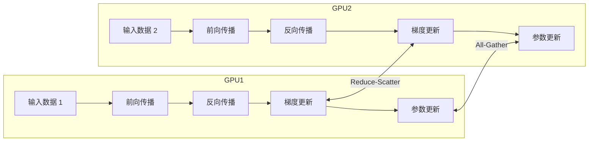
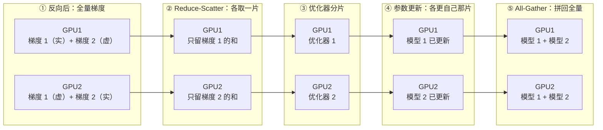
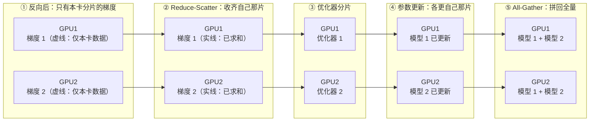

# 2.4.5 DeepSpeed

> [!abstract] 一句话
> DDP 让每张卡都存一份完整状态，ZeRO 把这份状态切开分给各卡——用**通信**换**显存**。

---

## 一、DDP 的显存账

**DDP 存在的问题**：在 N 张卡上训练，需要存储 N 份模型、梯度和优化器参数。设模型参数量为 $M$，采用全精度（fp32，每参数 4 字节）时，需要的空间为：

$$
\text{参数}+\text{梯度}+\text{优化器}=(4+4+8)\times M
$$

即每卡 16 字节/参数。若换成**混合精度**（参数与梯度各 2 字节、优化器状态按 Adam 计 12 字节），则是 $2+2+12=16$ 字节/参数——两种算法的总数相同，构成完全不同，看公式时要先确认前提。

Deepspeed 则是在 DDP 的基础上，采用 **ZeRO 分片**策略。ZeRO 有三个阶段：

- **ZeRO Stage 1**：仅对**优化器状态**进行分割，每个 GPU 中仍有完整的模型参数和梯度数据
- **ZeRO Stage 2**：对**优化器状态和梯度**进行分割
- **ZeRO Stage 3**：对**优化器状态、梯度和模型参数**全部进行分割，前向/反向传播时动态获取其他设备的参数分片（通过 `gather` / `scatter` 操作）

![[Pasted image 20261111171701.png]]

*图 1：DDP 与 ZeRO 三个阶段的显存分布——每行是一张卡，彩色块是本卡负责维护的分片*

图中 **2** 指混合精度下 fp16 的**参数和梯度**各占 2 个字节，**K 指优化器占用的字节数**（这里用 Adam，K 取 12，即 4 一阶动量 + 4 二阶动量 + 4 全量的备份模型参数），$N_d$ 代表卡的数量，$\Psi$ 指模型中的参数数量。

**通信量**：ZeRO-1、ZeRO-2 与 DDP 相比**通信量不变**；**ZeRO-3 与 DDP 相比通信总量提升 1.5 倍**，因为把模型参数拆开了，前向和反向时都要额外同步一次参数。

---

## 二、ZeRO 的三个阶段

### 2.1 ZeRO-1

只分块**优化器状态**（O, fp32），参数（W, fp16）和梯度（G, fp16）还是全量复制。

*图 2：ZeRO-1 的一轮——上图是两张卡各自的流程，下图是状态的五步变化；**实线块**表示基于完整数据求和后的梯度，**虚线块**表示仅基于本卡数据算出的梯度，彩色块表示该分片由本卡负责*

**训练流程：**

1. **启动阶段**
   - 在每张 GPU 上各放一份完整的模型参数 W；把当前批数据 X 均分成 2 份（各卡一份）。
   - 仅优化器状态做分片：第 $i$ 张卡持有自己那一份 $O_i$（例如 Adam 的一二阶矩等），而 W 与反向产生的梯度最初仍是全量副本。

2. **反向与梯度更新**
   - 每张 GPU 用本地的 X 子批在完整 W 上做前后向传播，得到各自的梯度。
   - 随后执行一次 **Reduce-Scatter**，把同一参数分片对应的梯度聚到负责该分片优化器状态的那张卡上；单卡通信量为 $\Psi$。
   - 如果用 **Ring AllReduce**（本质上是 Reduce-Scatter + All-Gather 的两步实现），则每卡的通信量是 $2\Psi$。图中画的就是这一等价实现，因此每张卡上看到的是"各梯度块求和后的结果"。

3. **参数同步**
   - 第 $i$ 张卡用本地的 $O_i$ 与收到的"对应梯度块之和"去更新属于自己的那一块参数，得到一块更新后的 W。
   - 为了让所有设备继续持有完整且一致的参数，需要对各块 W 做一次 **All-Gather**，把分片拼回全量；单卡通信量为 $\Psi$。

> [!note] 两个数字不矛盾
> $\Psi$ 是**梯度规约**那一段的通信量，$2\Psi$ 是**梯度规约 + 参数同步**的总量。Ring AllReduce 把这两步合在一次通信里，所以看起来是"一次操作 2Ψ"。

### 2.2 ZeRO-2

只分块优化器状态（O, fp32）和梯度（G, fp16），参数（W, fp16）全量复制。

*图 3：ZeRO-2 的状态演进——与 ZeRO-1 相比，**第 ① 步就只剩本卡负责的那片梯度**（GPU1 只有梯度 1、GPU2 只有梯度 2），所以每卡的梯度显存减半；后续 ③④⑤ 与 ZeRO-1 完全相同*

流程与 ZeRO-1 一致（输入 → 前向 → 反向 → 梯度更新 → 参数更新，梯度更新之间一次 Reduce-Scatter、参数更新之间一次 All-Gather），差别只在梯度阶段：ZeRO-1 反向后每卡仍持有全部梯度，ZeRO-2 反向后只保留本卡负责的那一片。

1. **启动阶段**
   - 在每张 GPU 上各放一份完整参数 W，把当前批次数据 X 均分成 2 份（示图中的输入数据 1 / 输入数据 2）。
   - 第 $i$ 张卡只持有自己那一份优化器状态 $O_i$（如 Adam 的一、二阶矩）和梯度 $G_i$。

2. **反向与梯度更新**
   - 各 GPU 用本地 X 在完整 W 上做前后向传播，得到本地梯度。
   - 随后对梯度执行 **Reduce-Scatter**：把"同一参数分块"的梯度归到负责该分块的那张卡上——例如 GPU1 只"收齐并保留" $G_1$ 的加和（图里 GPU1 上 G2/G3 被删掉），GPU2/3 同理各自只留下 $G_2$、$G_3$。单卡通信量为 $\Psi$。

3. **参数同步**
   - 第 $i$ 张卡用本地的 $O_i$ 与收到的已归并的 $G_i$ 去更新属于自己的那一块参数，得到一块更新后的 W。
   - 为了让后续计算仍在完整 W 上进行，对这些更新后的 W 块执行一次 **All-Gather**，把分片拼回每张卡的全量参数；单卡通信量为 $\Psi$。完成后，三张 GPU 再次都持有同步后的完整 W。

### 2.3 ZeRO-3

分块优化器状态（O, fp32）、梯度（G, fp16）和参数（W, fp16）。

![[Pasted image 20261111172629.png]]

*图 4：ZeRO-3 的显存分布——参数也只留分片，用到时临时聚合*

1. **启动阶段**
   - 把当前批次数据 X 均分成 2 份（示图中的输入数据 1 / 输入数据 2）。
   - 第 $i$ 张卡持有自己那一份优化器状态 $O_i$、梯度 $G_i$ 和参数 $W_i$。

2. **前向传播 & 反向传播**
   - 当某一层需要用到它的**权重**时，对该层对应的 W 触发一次 **All-Gather**，临时在每卡形成"那层所需的完整 W"；层内计算结束，立刻把非本卡负责的权重片段丢弃/还原为分片。单卡通信量为 $\Psi$。同一层的反向也遵循同样的"聚合 → 计算 → 释放"节奏。
   - 说明：工业实现里常把 All-Gather 与后续计算流水化或重叠，以减少等待时间（如 ZeRO++ 的做法）。

3. **更新梯度**
   - 反向完毕，各卡先得到"本地计算出的梯度"。随后对梯度执行 **Reduce-Scatter**：把"属于本卡负责分片"的梯度从其他卡规约并汇总到本卡，只保留 G 的本地分片，其它分片当场丢弃。单卡通信量为 $\Psi$。

4. **更新参数**
   - 第 $i$ 张卡用"归并后的 $G_i$ + 本地 $O_i$"仅更新自己负责的那一块 W，完成后每卡只保存更新后的参数分片。下一轮前/反向需要某层权重时，再按步骤 2 去 All-Gather 对应层的 W。

### 2.4 三阶段对比

| 阶段 | 每卡保留 | 每卡显存 | 相对 DDP 的通信量 |
| --- | --- | --- | --- |
| DDP | 参数 + 梯度 + 优化器状态，全量 | $16\Psi$ | 1×（AllReduce $2\Psi$） |
| **ZeRO-1** | 参数、梯度全量，优化器状态分片 | $4\Psi+12\Psi/N$ | 1× |
| **ZeRO-2** | 参数全量，梯度与优化器状态分片 | $2\Psi+14\Psi/N$ | 1× |
| **ZeRO-3** | 参数、梯度、优化器状态全部分片 | $16\Psi/N$ | 1.5× |

---

## 三、层间切分 vs 层内切分

最新的 ZeRO-3 采用**层内（intra）分割**，也就是把完整的权重矩阵分成几块；而早期的 ZeRO-3 采用**层间（inter）分割**，包括微软官方的介绍视频（[ZeRO & DeepSpeed](https://www.microsoft.com/en-us/research/blog/zero-deepspeed-new-system-optimizations-enable-training-models-with-over-100-billion-parameters/)）也是早期版本的实现。

![[Pasted image 20261111172834.png]]

*图 5：早期层间分割（按层放不同卡）与现在层内分割（同一层再切块）*

两种分割方式对应不同的通信方式：

- **层间（inter）分割**：在前向传播和反向传播时做 broadcast，计算到 $M_0$ 时，GPU0 将 $M_0$ 广播到其他设备。
- **层内（intra）分割**：在前向传播和反向传播时做 all-gather，取回完整的权重，以便做梯度计算。

---

## 四、ZeRO 的四个变体

- **ZeRO++**：针对 ZeRO-3 通信进行优化，通过权重量化、权重分层存储、梯度量化降低跨节点通信量
- **ZeRO-Infinity**：是 ZeRO-3 的拓展，允许通过使用 NVMe 固态硬盘扩展 GPU 和 CPU 内存来训练 LLM
- **ZeRO Offload**：将优化器、模型参数从显存卸载至内存，或者二者协同搭配（offload++）
- **DeepSpeed Ulysses**：针对长序列训练，将各个样本在序列维度上分割给参与的 GPU

---

## 五、DDP 与 DeepSpeed 对比

| 特点 | DDP (Distributed Data Parallel) | DeepSpeed |
| --- | --- | --- |
| 基本原理 | 数据并行，通过复制模型副本到不同 GPU，进行参数同步 | 提供更多功能，除了数据并行，还有优化器分布、混合精度训练、模型并行等 |
| 性能与扩展性 | 适合较小规模训练，通信瓶颈会影响性能 | 优化通信和内存管理，适合大规模训练，能够高效扩展 |
| 内存优化 | 对内存优化较少，内存消耗取决于模型和 batch size | ZeRO 优化器分阶段优化内存使用，减少内存消耗，支持大规模训练 |
| 训练速度 | 通常较为稳定，但通信延迟会影响速度 | 通过优化通信、内存管理和混合精度，提供更高效的训练速度 |
| 调用方式 | `torch.nn.parallel.DistributedDataParallel` | `deepspeed.initialize()`（也可通过 Accelerate / Trainer 集成） |
| 适用场景 | 中小规模的分布式训练，适用于标准 PyTorch 用户 | 大规模模型训练、内存和计算资源优化，适合超大规模模型训练任务 |

DDP 的通信细节见 [[2.4.3 分布式数据并行（Distributed Data Parallel，DDP)]]；ZeRO 与 TP、PP 的叠加方式见 [[2.4.6 Megatron-LM#5.4 PTD-P]]。
