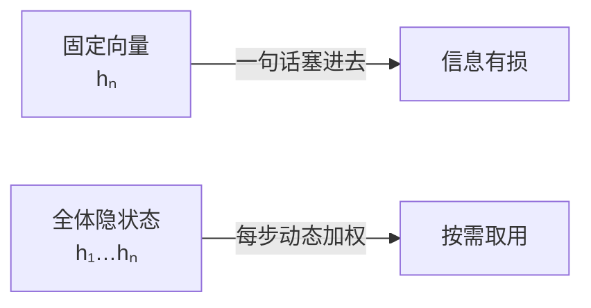
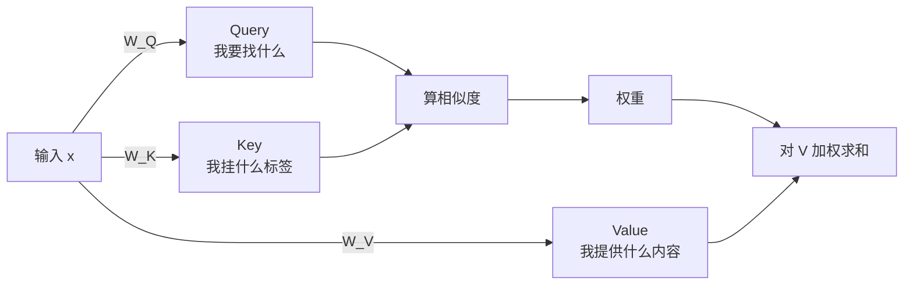
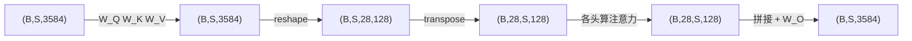
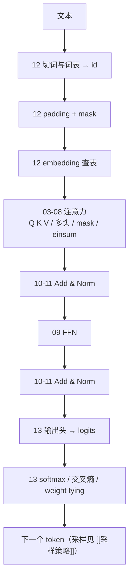

# Transformer

结构、注意力、输入输出与架构选择。

## 01 从固定向量到动态读取

### RNN + Encoder-Decoder 的老办法

编码器把整句压成**最后一个隐藏状态** $\mathbf{h}_n$，解码器全程只看这一个向量：

$$\text{整句} \rightarrow \mathbf{h}_n \rightarrow \text{Decoder 每一步都用它}$$

句子一长，前面信息被挤没了。

### Attention 改了什么

**解码器不再只能用最后一个隐藏状态，而是能访问编码器的所有隐藏状态。**

$$\text{整句} \rightarrow \mathbf{h}_1,\dots,\mathbf{h}_n \rightarrow \text{每步算权重，按需读取}$$



### 一句话

**Attention 不是"更强的压缩"，而是"不再压缩"**——把原始信息全留着，让解码时自己挑。

## 02 Transformer 替代的是 RNN，不是 Encoder-Decoder

### 常见误解

> Transformer 是新的 Encoder-Decoder 架构。

**不对。** Encoder-Decoder 是更早的结构，Attention 也不是 Transformer 发明的。

### 真正的替换关系

| 被替换的 | 替换成 | 有没有被替换 |
| --- | --- | --- |
| RNN 的**递归**序列建模 | Self-Attention 的两两交互 | ✅ 换掉了 |
| Encoder-Decoder 结构 | — | ❌ 保留了（原始 Transformer 就是） |
| Attention 机制 | — | ❌ 保留了，还成了主角 |

### RNN + Attention 剩下的两个问题

1. **信息冗余**：$\mathbf{h}_1,\dots,\mathbf{h}_n$ 是逐步累积出来的，相邻隐状态大量重叠。
2. **无法并行**：$\mathbf{h}_i$ 依赖 $\mathbf{h}_{i-1}$，必须排队算。

Self-Attention 一次把任意两个 token 连起来，两个问题一起解决。

### 一句话

**Transformer 换掉的是"必须一个接一个算"这件事，不是整体架构。**

## 03 Q、K、V 的直觉

### 查字典

| 角色 | 直觉 | 作用 |
| --- | --- | --- |
| **Query**（查询） | 我要找什么 | 当前 token 发出的需求 |
| **Key**（键） | 每条信息的标签 | 供匹配的索引 |
| **Value**（值） | 真正的内容 | 匹配上之后取走的东西 |

用 Q 和每个 K 算相似度 → softmax 成权重 → 对 V 加权求和。

$$\text{Attn}(Q,K,V)=\text{softmax}\!\left(\frac{QK^\top}{\sqrt{d}}\right)V$$

### 为什么 Q 和 K 要分开

如果 Q、K 是同一个东西，就只能算"我和谁像"，没法表达"**我需要什么** 和 **你能提供什么**"这种非对称关系。

分开的好处：$W_Q$ 学"提问方式"，$W_K$ 学"自我介绍方式"，两者独立优化。

### 为什么 V 又和 Q、K 不一样

K 是**索引**（用来匹配），V 是**内容**（用来返回）。同一份信息，"怎么被找到"和"找到了给什么"本来就可以不同。



## 04 Self-Attention 与 Cross-Attention

### 层级关系

```text
Attention（通用的信息选择机制）
├── Self-Attention：同一个序列内部相互查看
└── Cross-Attention：一个序列去读取另一个序列

Transformer（用 Attention 搭起来的完整网络）
├── Encoder：用 Self-Attention 处理输入序列
└── Decoder：用 Self-Attention + Cross-Attention 读 Encoder
```

### 四个维度的对比

| 维度 | Self-Attention | Cross-Attention |
| --- | --- | --- |
| **Q, K, V 来源** | **同源**：都来自同一个序列 | **异源**：Q 来自目标序列，K、V 来自源序列 |
| **交互对象** | 序列内部 token 之间 | 两个序列之间 |
| **典型位置** | Encoder、Decoder-Only、Decoder 第一层 | Encoder-Decoder 的 Decoder 中间层 |
| **主要功能** | 建模上下文、长距离依赖 | 用已知条件指导生成 |

### 一句话

**Self-Attention 是"自己人开会"，Cross-Attention 是"去隔壁部门取资料"。**

### 判断技巧

只看 **Q 从哪来、K/V 从哪来**：三个来源相同就是 self，Q 一个来源、K/V 另一个来源就是 cross。

Decoder-Only 模型（GPT 系列）里**没有 Cross-Attention**，因为它没有独立的编码器。

## 05 缩放点积注意力与 √d 缩放

### 公式

$$\text{Attention}(Q,K,V)=\text{softmax}\!\left(\frac{QK^\top}{\sqrt{d_{\text{head}}}}\right)V$$

三步：算相似度 → softmax 成权重 → 对 V 加权求和。

### 为什么除以 $\sqrt{d}$

点积是 $d$ 个乘积之和。若各分量独立、均值 0、方差 1，则点积的方差约为 $d$——维度越高，分数越容易跑到很大的数值区间。

softmax 对量级极敏感：分数一大就变成"几乎 one-hot"，梯度趋近 0，训练不动。除以 $\sqrt{d}$ 把方差拉回 1 左右，softmax 保持在合适温度。

### 两个容易搞错的点

**一、除的是 $d_{\text{head}}$ 还是 $d_{\text{model}}$？**

除 **$d_{\text{head}}$**（如 128），不是 $d_{\text{model}}$（如 3584）。因为点积是在**单个头内部**做的。

**二、缩放要放在 softmax 之前**

放到之后没有意义——softmax 已经把绝对量级抹掉了，只剩相对比例。

### 代码

```python
energy = torch.einsum("nqhd,nkhd->nhqk", [q, k])
attention = torch.softmax(energy / math.sqrt(self.head_dim), dim=3)
```

## 06 多头注意力：为什么分头（含手算与默写）

### 做法

把 $d_{\text{model}}$ 切成 $h$ 份，每份 $d_{\text{head}}=d_{\text{model}}/h$，各头独立做一次注意力，拼接后再线性变换：

$$\text{MultiHead}=\text{Concat}(\text{head}_1,\dots,\text{head}_h)W_O$$



### 为什么分头更强

单头只能表达**一种**相似度模式。多头让模型在不同子空间同时看不同关系：一个头盯语法依存、一个头盯指代、一个头盯邻近位置……

**总计算量几乎不变**，因为每头维度缩小了 $h$ 倍——这是"同算力换更多视角"。

### 四个线性层

$$Q=XW_Q,\quad K=XW_K,\quad V=XW_V,\quad \text{Out}=\text{Concat}(\text{heads})W_O$$

| 层 | 作用 |
| --- | --- |
| `queries` | 生成"我要找什么" |
| `keys` | 生成"我有什么可被匹配" |
| `values` | 生成"匹配上之后提供什么内容" |
| `fc_out` | 把多头拼起来后融合，维度回到 $d$ |

**注意：四个线性层的输出维度都是 `embed_size`，不是 `head_dim`。** 一次 `nn.Linear(3584,3584)` 把所有头一起算完，靠后面的 reshape 切分。

### 参数量（以 $d=3584$ 为例）

$$\underbrace{3\times 3584^2}_{Q,K,V}+\underbrace{3584^2+3584}_{W_O+b}\approx 5.1\times10^{7}$$

约 5100 万，正好是 FFN（$8d^2\approx1.03$ 亿）的一半——与"FFN 占 block 的 2/3"对得上。

### 手算一遍：2 个 token、4 维、2 个头

#### 最小例子

`seq_len = 2`、`embedding = 4`、`head_num = 2`、`head_dim = 2`。

两个 token：$x_1 = [1,0,1,0]$、$x_2 = [0,1,0,1]$，令 $W_q = W_k = W_v = I$，于是 $Q=K=V=X$。

#### 分头

每个头拿 2 维，两个头分到的都是

$$\begin{bmatrix}1&0\\0&1\end{bmatrix}$$

#### 打分并缩放

$$\frac{QK^\top}{\sqrt{2}}=\begin{bmatrix}0.707&0\\0&0.707\end{bmatrix}$$

#### 逐行 softmax

第一行 $[0.707, 0]$ → $[0.67, 0.33]$，第二行对称地倒过来。

**这是不加掩码的版本**（第一个 token 也能看第二个）；加了因果掩码，第一行会变成 $[1,0]$。

#### 乘 $V$

$$\text{head}_1=\begin{bmatrix}0.67&0.33\\0.33&0.67\end{bmatrix}$$

第二个头数值相同，因为输入的四个维度是对称的。

#### 拼接

token 1 的向量拼成 $[0.67, 0.33, 0.67, 0.33]$；$W_o$ 取单位阵时这就是最终 output。

#### 读数

那个 **0.33 来自 token 2**——token 1 的表示里混进了邻居的成分。这就是"看过上下文"的具体样子。

![[MHA-一个头四步.svg|833]]

### 默写版：最小可运行实现

面试让手写时，写这一版就够（`d_model` 可换成 512，`h` 换成 8）：

```python
import math
import torch
import torch.nn as nn

class MultiHeadAttention(nn.Module):
    def __init__(self, d_model: int = 512, head_num: int = 8):
        super().__init__()
        assert d_model % head_num == 0, "d_model 必须能被头数整除"
        self.h = head_num
        self.d_head = d_model // head_num
        self.w_q = nn.Linear(d_model, d_model)
        self.w_k = nn.Linear(d_model, d_model)
        self.w_v = nn.Linear(d_model, d_model)
        self.w_o = nn.Linear(d_model, d_model)      # 拼接后融合

    def forward(self, x, mask=None):
        B, S, _ = x.shape

        # ① 三个投影：仍是 d_model 维，靠 reshape 才分头
        q = self.w_q(x).view(B, S, self.h, self.d_head).transpose(1, 2)   # (B,h,S,d_head)
        k = self.w_k(x).view(B, S, self.h, self.d_head).transpose(1, 2)
        v = self.w_v(x).view(B, S, self.h, self.d_head).transpose(1, 2)

        # ② 打分 + 缩放：除的是 d_head，不是 d_model
        score = q @ k.transpose(-2, -1) / math.sqrt(self.d_head)          # (B,h,S,S)

        # ③ 掩码必须在 softmax 之前
        if mask is not None:
            score = score.masked_fill(mask == 0, -1e20)

        # ④ 归一化 + 加权求和
        attn = torch.softmax(score, dim=-1)                               # (B,h,S,S)
        out = attn @ v                                                    # (B,h,S,d_head)

        # ⑤ 拼回多头：transpose 后必须 contiguous 才能 view
        out = out.transpose(1, 2).contiguous().view(B, S, self.h * self.d_head)

        # ⑥ 最后一次线性融合
        return self.w_o(out)                                              # (B,S,d_model)
```

#### 形状流转（背这张表就够）

| 步骤 | 形状 |
| --- | --- |
| 输入 `x` | `(B, S, d_model)` |
| `w_q/w_k/w_v(x)` | `(B, S, d_model)` |
| `.view(B, S, h, d_head)` | `(B, S, h, d_head)` |
| `.transpose(1, 2)` | `(B, h, S, d_head)` |
| `q @ k.transpose(-2,-1)` | `(B, h, S, S)` |
| `softmax` | `(B, h, S, S)` |
| `attn @ v` | `(B, h, S, d_head)` |
| `transpose(1,2).view(B,S,-1)` | `(B, S, d_model)` |

#### 默写口诀与六个扣分点

口诀：**四个 Linear、两次 transpose、一次打分、先 mask 再 softmax、拼回来再过 w_o**。

| 常见错 | 后果 |
| --- | --- |
| 忘了 `/ sqrt(d_head)` | 分数过大，softmax 接近 one-hot，梯度消失 |
| 用 `d_model` 去除 | 头数越多缩放越离谱，与设计不符 |
| mask 放在 softmax 之后 | 权重已被归一化，再置 0 会破坏和为 1 |
| 省略 `transpose(1,2)` | 变成在 `S` 上分头，语义全错 |
| `view` 前不 `contiguous()` | transpose 后内存不连续，报错或拿到错数据 |
| `w_o` 输出维度写成 `d_head` | 下一层维度对不上 |

#### 面试时怎么讲（30 秒版）

“把 `d_model` 切成 `h` 份，每份 `d_head`；Q、K、V 各用自己的线性层投影，投影后仍是 `d_model` 维，再 reshape 成 `(B,h,S,d_head)` 分头；每个头算 `softmax(QKᵀ/√d_head)V`，各头独立、互不干扰；最后 transpose 回 `(B,S,d_model)` 拼接，过一次 `w_o` 融合。总参数量约 `4·d_model²`，与头数无关。”

## 07 einsum 与形状流转

### 形状流转

```
(B, S, 3584)
   │ reshape
   ▼
(B, S, 28, 128)      ← 28 个头，每头 128 维
   │ transpose
   ▼
(B, 28, S, 128)      ← 每个头独立算 attention
```

### einsum 算注意力分数

```python
energy = torch.einsum("nqhd,nkhd->nhqk", [queries, keys])
```

字母含义：

| 字母 | 含义 | 维度 |
|---|---|---|
| `n` | batch | B |
| `q` | query 序列长度 | S |
| `k` | key 序列长度 | S |
| `h` | head 数 | 28 |
| `d` | 每个头的维度 | 128 |

**对每个 batch、每个头，拿 Q 去和 K 算内积**，`d` 被求和消掉：

$$
\text{energy}_{nhqk}=\sum_{d}Q_{nqhd}\,K_{nkhd}=\left(Q_{nh}K_{nh}^{\top}\right)_{qk}
$$

$$
Q\in\mathbb{R}^{n\times q\times h\times d},\quad
K\in\mathbb{R}^{n\times k\times h\times d},\quad
\text{energy}\in\mathbb{R}^{n\times h\times q\times k}
$$

输出写成 `nhqk` 而不是 `nqhk`，是因为后面 `softmax(dim=-1)` 要直接作用在 `k` 这一维上。

等价的 matmul 写法：

```python
q = queries.permute(0, 2, 1, 3)   # (n, h, q, d)
k = keys.permute(0, 2, 3, 1)      # (n, h, d, k)
energy = torch.matmul(q, k)       # (n, h, q, k)
```

### 参数量

Projection 部分：

$$
\underbrace{3 \times 3584^2}_{Q,K,V} + \underbrace{3584^2 + 3584}_{W_O + b} \approx 5.1\times 10^{7}
$$

约 5100 万参数，正好是 FFN（$8d^2 \approx 1.03$ 亿）的一半——和"FFN 占一个 block 的 2/3"对得上。

### 两个常见小坑

1. **缩放系数**：应该除以 $\sqrt{d_{\text{head}}}$（128 的开方），而不是 $\sqrt{d_{\text{model}}}$（3584 的开方）。否则点积方差不匹配，softmax 会过早饱和。
2. **reshape 后要 transpose**：`reshape` 只改变视角，不换轴顺序；要把 `(n, q, h, d)` 变成 `(n, h, q, d)` 必须显式 `transpose(1, 2)`，否则不同头的向量会被混在一起。

# 4. padding 位置用极小值挡掉
```# 4. padding 位置用极小值挡掉
        if mask is not None:
            energy = energy.masked_fill(mask == 0, float("-1e20"))
```

这两行的作用是：**把不允许被看到的位置，在 softmax 之前打成极小值，使它们归一化后的权重变成 0。**

## 08 mask：在 softmax 之前打到极小

### 为什么要在 softmax 之前动手

softmax 是：

$$
\text{attn}_{ij}=\frac{e^{z_{ij}}}{\sum_{l}e^{z_{il}}}
$$

想让某个位置的权重为 0，唯一办法是**让它的分数趋于负无穷**，因为 `exp(-∞) = 0`。

`masked_fill(mask == 0, -1e20)` 干的就是这件事：**凡是 mask 为 0 的位置，分数直接替换成 -1e20。**

### 具体过程

假设一个 query 对 4 个 key 的分数，其中第 3、4 个是 padding：

```
mask      = [1, 1, 0, 0]
energy    = [2.1, 0.7, 3.5, 1.9]        ← 原始分数，padding 位置分数也可能很高
            ↓ masked_fill(mask == 0, -1e20)
energy    = [2.1, 0.7, -1e20, -1e20]
            ↓ softmax
attn      = [0.79, 0.21, 0.0, 0.0]      ← 概率总和仍为 1
```

`exp(-1e20)` 在 float32 里直接下溢成 `0.0`，所以这两个位置的权重是**精确的 0**，不是“很小”。

### 为什么是 -1e20，不用 -inf

用 `float("-inf")` 理论上更干净，但工程上有风险：

- `-inf` 参与减法/加法时容易产生 `nan`（比如 `inf - inf`）
- 某些实现里整行全被 mask 时，`softmax` 会得到 `nan`

用 `-1e20` 是个“**足够负的有限数**”，效果等价（指数后仍下溢为 0），但不会污染数值。

### mask 的形状与广播

`energy` 的形状是 `(n, h, q, k)`，而 mask 通常是 `(n, 1, 1, k)` 或 `(n, 1, q, k)`。

`masked_fill` 依赖 **broadcasting**：mask 会在 `h` 和 `q` 两个维度上自动复制，于是**所有头、所有 query 共用同一套屏蔽规则**。

### 两种 mask 都会走这一行

| 类型 | 形状 | 作用 |
|---|---|---|
| **padding mask** | `(n, 1, 1, k)` | 挡掉补齐的 0 位置 |
| **causal mask** | `(n, 1, q, k)` 下三角 | 挡掉“未来”的 token |

两者可以叠加（先做 padding mask，再做因果 mask），本质都是同一招：**把不该看的分数打成 -1e20。**

### 注意 padding 是全被挡的

padding 位置的**行**（作为 query 时）也会被 mask，此时整行都是 -1e20，softmax 后是均匀分布或 nan。但因为**这些位置最后会被丢弃**（只取真实 token 的输出），所以不影响结果。严谨的实现会在 softmax 前把整行 mask 的情况特判掉。

**一句话：masked_fill 是"在 softmax 之前把违规位置的分数打到负无穷"，让它们的注意力权重精确地等于 0，从而在计算上等于"根本没看见"。**

## 09 FFN：升维 → 激活 → 降维

FFN 的结构超级简单，就是**两个线性层中间夹一个激活函数**。

![[Pasted image 20261101214856.png]]

线性变换（**升维**）→ **激活函数** → 线性变换（**降维**）

$$
\text{FFN}(x)=W_2\,\sigma(W_1x+b_1)+b_2,\qquad
W_1\in\mathbb{R}^{4d\times d},\ W_2\in\mathbb{R}^{d\times 4d}
$$

### 张量形状的变换

Transformer / LLM 中 FFN（MLP）张量形状的完整变化：

$$\begin{aligned} & \text{1. 原始输入三维张量} \\ & \quad \mathbf{(\text{batchsize},\, \text{seq\_len},\, \text{embed\_size})} \\ & \qquad \quad \Big\downarrow \quad \text{\small Reshape / Flatten（展平前两个维度）} \\ & \text{2. 二维 Token 矩阵} \\ & \quad \mathbf{(\text{batchsize} \times \text{seq\_len},\, \text{embed\_size})} \\ & \qquad \quad \Big\downarrow \quad \text{\small 第 1 层线性变换（升维 4 倍）} \\ & \text{3. 中间高维特征} \\ & \quad \mathbf{(\text{batchsize} \times \text{seq\_len},\, 4 \times \text{embed\_size})} \\ & \qquad \quad \Big\downarrow \quad \text{\small 非线性激活函数 } \sigma() \\ & \text{4. 激活后的高维特征} \\ & \quad \mathbf{(\text{batchsize} \times \text{seq\_len},\, 4 \times \text{embed\_size})} \\ & \qquad \quad \Big\downarrow \quad \text{\small 第 2 层线性变换（降维还原）} \\ & \text{5. 还原后的二维特征} \\ & \quad \mathbf{(\text{batchsize} \times \text{seq\_len},\, \text{embed\_size})} \\ & \qquad \quad \Big\downarrow \quad \text{\small Reshape Back（恢复三维结构）} \\ & \text{6. 最终输出张量} \\ & \quad \mathbf{(\text{batchsize},\, \text{seq\_len},\, \text{embed\_size})} \end{aligned}$$

本质就是：**"展平 → 升维 4 倍 → 激活 → 降维还原 → 重塑恢复"**。

**升维是为了给非线性提供更多"可组合的特征方向 / 更大的表达空间"，降维是为了对齐残差并压缩信息。**

### 为什么要升 4 倍再激活

**① 提供非线性能力（最根本作用）**

- **问题**：自注意力本质是加权求和，属于线性操作
- **FFN 的解决方案**：通过激活函数（ReLU、GELU 等）引入非线性
- **重要性**：没有非线性，无论堆叠多少层 Transformer，整体仍等价于单层线性模型，无法学习复杂模式

严格说，升维提供的是**更大的表达空间 + 更多参数容量**，而不是凭空多出信息（$W_1$ 是线性变换，信息量并未增加）。真正的增益来自：多出的维度让激活函数有更多可切分的位置，也就是"更多可组合的特征"。

**② 对信息进行深度加工**

- **多头注意力的角色**：让词语之间"开会讨论"，收集全局信息
- **FFN 的角色**：让每个词语"独立深度思考"，消化和提炼信息
- **工作方式**：对注意力层输出的每个位置表示进行独立、并行的深度处理

**③ 存储模型知识**

- **参数量对比**：标准 Transformer 中，FFN 的参数量通常占全层参数的 **2/3** 以上
- **作用**：如同模型的"长期记忆"，存储从训练数据中学到的各种模式和规律
- **工作方式**：通过大量参数学习特征之间的复杂组合关系

### 为什么不在原维度直接激活

两个线性层如果不夹非线性，会塌缩成一个矩阵：$W_2\sigma(W_1x)\big|_{\sigma=\text{恒等}} = (W_2W_1)x$，白加参数。所以非线性必须作用在**宽的那一层**上，才有"展开 → 筛选 → 重组"的效果。

### 4 倍不是铁律

原始 Transformer 用了 4×，之后成为惯例。LLaMA 等用 **SwiGLU**（带门控），为了让参数量持平，中间维度改成 $8d/3 \approx 2.67d$：

$$
\text{SwiGLU}(x)=W_2\big(\text{Swish}(W_1x)\odot W_3x\big)
$$

## 10 Add & Norm 与 LayerNorm

### Add & Norm 是两个动作

![[Pasted image 20261105113412.png|230]]

Add（残差相加）+ Norm（层归一化）：

```
y = x + F(x)              ← Add：残差连接
z = LayerNorm(y)          ← Norm：层归一化
```

注意 **Add 和 Norm 的顺序**：先加残差，再归一化，输出 `z` 才进下一层。

### 作用位置

一个 Transformer block 里 **2 次**，N 层就是 `2N` 次：

```
① Multi-Head Attention 输出  →  Add & Norm
② Feed Forward 输出          →  Add & Norm
```

### Norm 到底对哪一维归一化

对**每个 token 自己的 3584 维向量**做归一化，不是对 batch、也不是对序列长度：

$$
\operatorname{LayerNorm}(x_i)=\gamma\odot\frac{x_i-\mu_i}{\sqrt{\sigma_i^2+\varepsilon}}+\beta,\qquad
\mu_i=\frac{1}{d}\sum_{j=1}^{d}x_{ij},\quad
\sigma_i^2=\frac{1}{d}\sum_{j=1}^{d}(x_{ij}-\mu_i)^2
$$

$$
x_i\in\mathbb{R}^{3584},\quad \gamma,\beta\in\mathbb{R}^{3584}
$$

- 减均值、除标准差后，每个 token 的向量变成**均值 0、方差 1**，再被 γ、β 拉回可学习的尺度
- $\gamma, \beta$ 都是可学习参数，每维一个

**关键：不同 token 之间互不影响**，所以 batch 大小、序列长度变化都不影响结果——这是 LayerNorm 比 BatchNorm 适合 NLP 的原因。

一句话：**Norm 作用在"残差相加之后、送入下一层之前"，对每个 token 的 3584 维特征做标准化，每个 block 两次。**

### 两个轴：seq_len 与 dim

```
X (8, 3584)
  │
  ├─ 第0个token ──▶ 沿 3584 维求均值/方差 ──▶ 归一化 ──▶ 还是 3584 维
  ├─ 第1个token ──▶ 沿 3584 维求均值/方差 ──▶ 归一化 ──▶ 还是 3584 维
  │   ...
  └─ 第7个token ──▶ 沿 3584 维求均值/方差 ──▶ 归一化 ──▶ 还是 3584 维
```

| 操作 | 沿哪条轴 |
|---|---|
| LayerNorm | dim（3584），每个 token 独立 |
| Attention 的 softmax | seq_len（8），每个 query 在所有 key 上归一 |
| BatchNorm（NLP 不用） | batch + seq，跨样本 |

一句话：**形状是 `(seq_len, dim)`，LayerNorm 归一化的是 `dim`，`seq_len` 只是有多少份要各算一遍。**

### Post-LN 与 Pre-LN

原始 Transformer 是 **Post-LN**，norm 放在残差**之后**：

```
Post-LN:  z = LN(x + F(x))
Pre-LN:   z = x + F(LN(x))        ← 现代大模型（GPT / LLaMA / Qwen）
```

Post-LN 训练不稳定（深层容易梯度爆炸，需要 warmup），所以现在的大模型基本都用 **Pre-LN**：先归一化再进子层。

## 11 RMSNorm

### RMSNorm

LLaMA 系列把 LayerNorm 换成 **RMSNorm**（不减均值，只除均方根，少一半计算）：

$$
\operatorname{RMSNorm}(x)=\frac{x}{\sqrt{\frac{1}{d}\sum_j x_j^2+\varepsilon}}\cdot\gamma
$$

### 为什么需要它

| 作用 | 说明 |
|---|---|
| 稳数值 | 每层输出尺度被锁住，不会越传越大/越小 |
| 稳梯度 | 残差让梯度能直通底层，norm 防止爆炸 |
| 解耦合 | 各层输入分布固定，深层才好训 |

## 12 从文本到向量：切词、padding、embedding

一句话：**字符串 → 切词 → 查词表得编号 → 补齐矩形 → 查 embedding 表变向量**。

### 1. 切词

```
"Hello, my dog is cute"
```

按词切开：

```
"Hello"  ","  " my"  " dog"  " is"  " cute"
```

词内部再剁（子词切分）：

```
Hello         →  Hello                整词在表里
cute          →  cute                 整词在表里
unbelievable  →  un + belie + vable   整词不在表里，切三段
```

### 2. 换成编号

每段换一个编号，这套映射叫 **vocabulary（缩写 vocab）**：

```
Hello  →  9906
,      →  11
" my"  →  856
" dog" →  5679
" is"  →  374
" cute"→  19369
```

编号连成一行：

```plaintext
[9906, 11, 856, 5679, 374, 19369]
```

**注意：这一步只是整数 id，不是 one-hot，也没有任何向量。**

### 3. 两头加标记

```plaintext
BERT:  [101, 9906, 11, 856, 5679, 374, 19369, 102]
        CLS                                   SEP
```

`101` 是 `[CLS]`，模型从这里**取整句的汇总表示**。`102` 是 `[SEP]`，标记句子结束。

对话模型不用这套，改用 `<|im_start|>`、`<|im_end|>` 这类标记拼出多轮结构。

### 4. 补齐成矩形

```plaintext
[[9906, 11, 856, 5679, 374, 19369, 0, 0]]     形状 (1, 8)
```

`input_ids` 的形状就是 `(batch_size, seq_len)`。

补出来的 0 是**假数据**，不能参与计算，所以**同时生成一张 0/1 表告诉模型哪些位置是真的**：**attention mask**（注意力掩码）。

```plaintext
[[1, 1, 1, 1, 1, 1, 0, 0]]
```

### 5. 变向量（embedding 查表）

每个编号去 **embedding 表里**取一行，形状从 `(1, 8)` 变成 `(1, 8, 3584)`。补 0 的位置也会**取出一行**，但它在下一步的 attention 里被那张 0/1 表挡住，不影响真实位置。

到这里 `inputs` 就齐了，进第一层 **self-attention**。

### 三个输入张量

`input_ids`、`attention_mask`、`token_type_ids`

### 各阶段对照

| 阶段 | 手上有啥 | 形状 | 用了谁 |
|---|---|---|---|
| tokenize | 字符串 | `"Hello"` | 词表 vocab（字典，不是矩阵） |
| 编号 | 整数 id | `(1, 8)` | 词表 |
| 取向量 | 浮点向量 | `(1, 8, 3584)` | **embedding 矩阵** |
| ~~one-hot~~ | ~~15 万维稀疏~~ | ~~`(1, 8, 151936)`~~ | **不存在，只是概念** |

### 数学视角

$$
\text{token} \xrightarrow{\ \text{vocab}\ } k\in\{0,\dots,V-1\}
\xrightarrow{\ \text{one-hot}\ } e_k\in\mathbb{R}^{V}
\xrightarrow{\ \times E\ } w_k\in\mathbb{R}^{d}
$$

因为 one-hot 乘矩 阵等价于取行（$e_k^{\top}E = w_k$），工程上直接做 `index_select`，稀疏向量从不真正构造出来。

**id 是"行号"，embedding 矩阵是"那张表"，one-hot 是"说明行号为什么能当乘法用"的数学注脚。**

## 13 输出头、logits 与 softmax

### 全连接层

中间的全连接层是为了**增强非线性表达与特征提取能力**，而最后的输出全连接层则是为了**将抽象的向量翻译回具体的词表概率**。

**Weight（权重矩阵，简称 W）**：形状是 `(输入特征数, 输出特征数)`

$$
\text{Output} = \text{Input} \times \text{Weight} + \text{Bias}
$$

### 输出头（output head）

![[Pasted image 20261105115839.png|333]]

在最后一层 Transformer 之后、预测下一个 token 之前。

```
最后一层 Transformer block 输出
        (B, S, d)          B=batch_size  S=seq_len  d=3584
     │
     │  Final LayerNorm（LLaMA/GPT 都有这一层），形状不变
     ▼
        (B, S, d)          ← Linear 的输入就在这
     │
     │  Linear: d → V，对每个位置独立作用
     ▼
        (B, S, V)          ← logits，V ≈ 151936
     │
     │  只取最后一个位置 [:, -1, :]
     ▼
        (B, V)             ← softmax → 下一个 token 的概率
```

**① Linear 作用在最后一维**

```python
lm_head = nn.Linear(d, V)     # 权重 (V, d)
logits = lm_head(hidden)      # (B,S,3584) → (B,S,151936)
```

`nn.Linear` 只吃最后一维，`B` 和 `S` 当作"批量"维度原样保留。所以形状 `(B, S, d) → (B, S, V)`，`B`、`S` 都不变。

**② 每个位置都被预测了，但只用最后一个**

`(B, S, V)` 里第 t 个位置表示"已知前 t 个 token，下一个词是什么"。训练时每个位置都算 loss；推理时只关心最后一个位置：

```python
next_logits = logits[:, -1, :]      # (B, V)
```

### Linear：3584 → 词表大小 V

$$
\text{logits}=h\,W_{\text{out}},\qquad W_{\text{out}}\in\mathbb{R}^{3584\times V}
$$

- 输入 `(1, 3584)`，输出 `(1, V)`，`V ≈ 151936`
- 作用：把隐藏空间的 3584 维向量**投影到词表空间**，给每一个候选 token 打一个**原始分数**
- 输出叫 **logits**，可正可负，不是概率，相加不等于 1
- 这个矩阵常叫 `lm_head` / `unembedding`，很多模型让它**和 embedding 矩阵共享权重**（weight tying），省 5 亿参数

### logits 是什么

logits 就是**模型在 softmax 之前输出的那串原始分数**，没有任何归一化。

```
logits = [2.3, -1.5, 8.7, 0.4]
          ↑     ↑    ↑    ↑
         "猫"  "狗" "天气" "的"
```

- 全是实数，**可正可负，可大可小**
- **加起来不等于 1**，也不是百分比
- 只有**大小关系有意义**：8.7 最大 → "天气" 得分最高

softmax 之后才变成：

```
probs  = [0.002, 0.00003, 0.997, 0.0002]   总和 = 1
```

```
最后一层输出 h (3584维)
     │  × W_out
     ▼
  logits (V 维，原始分数)   ← 就是这一步的产物
     │  softmax / log_softmax
     ▼
  probs  (V 维，概率)
     │  argmax 或采样
     ▼
  下一个 token
```

**一句话：logit 是"打分"，概率是"打分换算出来的百分比"。模型内部一直用 logit 算，只在需要解释或采样时才转成概率。**

### 为什么叫 logits

数学上它是 softmax 的逆运算：

$$
\text{softmax}(z)_k=\frac{e^{z_k}}{\sum_j e^{z_j}}
\quad\Longleftrightarrow\quad
z_k=\log p_k + C
$$

logit 就是"概率的对数"再加一个常数（softmax 对整体平移不变）。词源是 **log-odds**（对数几率）。

### Softmax 与损失

$$
p_k=\frac{\exp\left(z_k/T\right)}{\sum_{j=1}^{V}\exp\left(z_j/T\right)},\qquad
\sum_{k=1}^{V}p_k=1
$$

$$
\hat{y}=\arg\max_{k}\,p_k\ \text{（贪心）}\qquad\text{或}\qquad
\hat{y}\sim \operatorname{Categorical}(\mathbf{p})\ \text{（采样）}
$$

训练时用交叉熵（内部已含 log-softmax）：

$$
\mathcal{L}=-\log p_{y^\ast}
=-\log\frac{\exp\left(z_{y^\ast}\right)}{\sum_{j=1}^{V}\exp\left(z_j\right)}
$$

其中 $y^\ast$ 是真值 token 的下标。

### 和 embedding 的对称关系

```
输入:  id ──查表──▶ 3584 维向量       (embedding,   V × d)
输出:  3584 维向量 ──投影──▶ V 个分数  (lm_head,     d × V)
```

一头一尾，方向相反、矩阵形状互为转置，所以才能共享权重（weight tying）：$W_{\text{out}}=E$。

## 14 Encoder-Decoder 与 Decoder-Only

问题与答案在 inputs 里是否分开，决定了架构类型。

| 架构类型 | 典型代表 | 问题与答案在 inputs 中是否分开？ | 交互方式 |
|---|---|---|---|
| **经典 Transformer (Encoder-Decoder)** | 原始 Transformer, T5, BART | **完全分开** | 问题进 Encoder，答案进 Decoder，通过 **Cross-Attention** 产生交互 |
| **现代大模型 (Decoder-Only)** | GPT-4, LLaMA, Qwen, DeepSeek | **不分开（合并为一整个序列）** | 问题和答案拼成一段话，通过 **Masked Self-Attention** 从左到右流动 |

### 经典 Transformer：问题走 Encoder，答案走 Decoder

**输入端（Encoder 的 inputs）**：

- 只放问题 / 源文本

**输出端（Decoder 的 inputs）**：

- **放已经生成的答案部分**（目标文本）
- 训练时：Decoder 输入的是**带着移位的答案**（Target）
- 推理时：Decoder 最初只接收一个起始符号 `<bos>`，然后一步步拿着当前的词，结合 Encoder 传过来的问题信息（通过 **Cross-Attention**），逐字预测下一个答案词

### 形状对照

```
Encoder:  (B, S_src) → (B, S_src, d)         只编码问题
Decoder:  (B, S_tgt) → (B, S_tgt, d)         生成答案
                        ↑
              Cross-Attention 读 Encoder 的 K、V
```

### Decoder-Only 的做法

```
[<|im_start|> 问题 <|im_end|> 答案 ...]
└────────────── 一整条序列 ──────────────┘
```

问题与答案在同一个序列里，用因果掩码保证只能看到左边，因此不需要额外的 Encoder，也不需要 Cross-Attention。

## 15 BERT 与 GPT

![[BERT与GPT架构对比.svg|649]]

核心一句话：**BERT 是"把句子读成理解"，GPT 是"接着往下写"。**

### 架构层面

| | BERT | GPT |
|---|---|---|
| 来源 | Transformer **Encoder** | Transformer **Decoder** |
| Attention | **双向**（全可见） | **单向因果**（只能看左边） |
| 输入 | `[CLS] ... [SEP]` | `<\|im_start\|> ... <\|im_end\|>` |
| 输出 | 每个位置一个 `d` 维向量 | 每个位置一个词表 logits |

### 最关键的区别：attention mask

```
BERT（双向）：每个 token 能看见所有 token
   [ 1 1 1 1 1 ]
   [ 1 1 1 1 1 ]    ← 全是 1，无遮挡
   [ 1 1 1 1 1 ]

GPT（因果）：只能看自己和左边
   [ 1 0 0 0 0 ]
   [ 1 1 0 0 0 ]    ← 下三角，右上角被 mask 成 -∞
   [ 1 1 1 0 0 ]
```

**这一个 mask 的差别，决定了整个模型的能力边界。**

### 训练目标

**BERT：完形填空（Masked LM）**

```
输入: 我 爱 [MASK] 的 猫
目标: 预测 [MASK] = "你"
```

随机遮 15% 的 token，让模型用**左右两边**的信息猜。

**GPT：续写（Next Token Prediction）**

```
输入: 我 爱 你 的
目标: 预测下一个词 = "猫"
```

永远预测下一个，从左到右。

### 能力对比

| | BERT | GPT |
|---|---|---|
| 理解（分类 / 抽取 / 相似度） | 强 | 一般 |
| 生成（写文章 / 对话） | 不会 | 强 |
| 取句子向量 | `[CLS]` 位置直接可用 | 要取最后一个 token |
| 微调方式 | 加个分类头，改输出层 | 指令微调 / SFT / RLHF |
| 主流现状 | 搜索、检索、NER 仍在用 | 所有大模型 |

### 为什么 GPT 成了主流

1. **一个目标通吃**：next token prediction 可以覆盖几乎所有任务，只要有文本
2. **训练信号密**：每个位置都产生一个 loss，BERT 只有 15% 的位置有 loss
3. **能无限生成**：自回归天然支持多轮对话、长文本
4. **scaling 更顺**：单向 attention 结构简单，堆层数、堆参数的收益更稳定

### 一句话记忆

```
BERT  = Encoder + 双向 mask + 完形填空 → 我懂这句话
GPT   = Decoder + 因果 mask + 续写     → 我接着往下说
```

**同一个 Transformer，换了 mask 和训练目标，就变成了两种完全不同的模型。**

## 16 头数与 head_dim 的经验值

### 参数量与头数无关

四个 `embedding × embedding` 矩阵（$W_q, W_k, W_v, W_o$）合计

$$4\times \text{embedding}^2$$

**头数只决定怎么切分，不改变参数总量。**

### 但头多不等于更强

头数太大时 $d_{\text{head}} = \text{embedding} / \text{head\_num}$ 变小，**单个头的表达能力下降**——一个头只剩几维，能表达的相似度模式非常有限。

$$\text{head\_num} \uparrow \;\Rightarrow\; d_{\text{head}} \downarrow \;\Rightarrow\; \text{单头能力} \downarrow$$

### 常见取法

让 $d_{\text{head}}$ 保持 **≈ 64**，头数按

$$\text{head\_num} = \frac{\text{embedding}}{64}$$

取。例如 `d_model = 3584` 时取 56 个头（实际模型常取 28 或 56，取决于厂商）。

### 一句话记法

**注意力 = 用相似度当权重对 value 做加权平均；多头 = 做 `head_num` 次权重各不相同的加权平均，拼回去再过一次线性层。**

## 数据流全景


