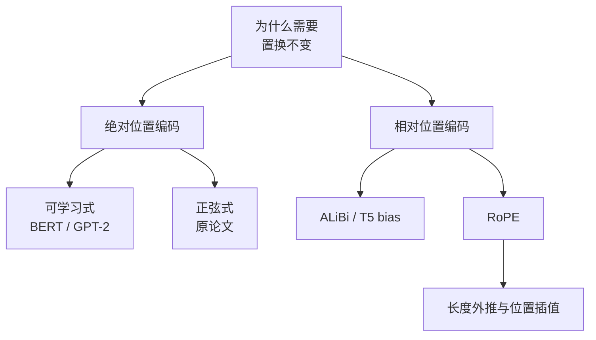
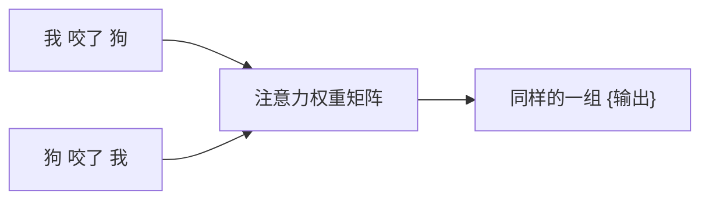
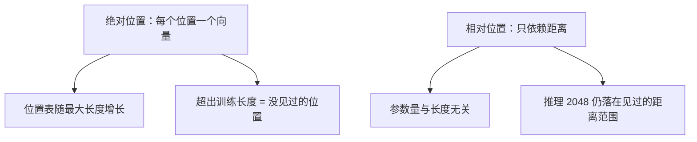
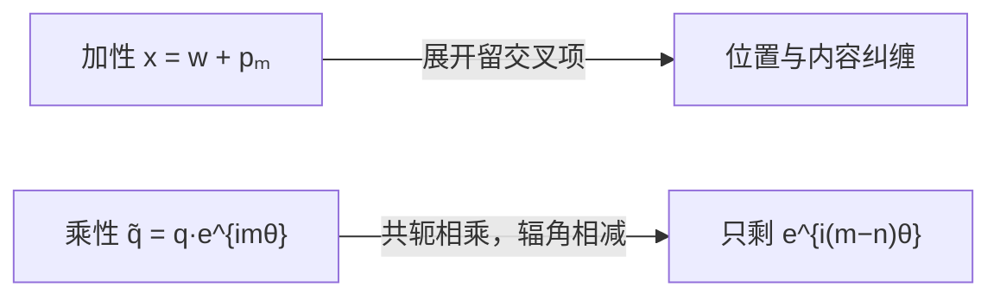
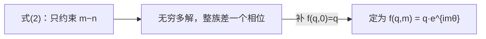
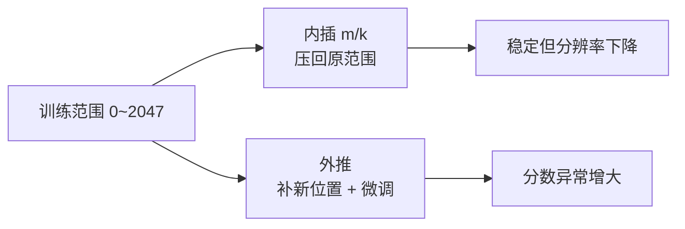

# 位置编码

一句话：Self-Attention 本身**置换不变**，顺序信息必须额外注入；注入方式分绝对与相对两类，RoPE 是目前的主流做法。

## 总览：绝对与相对

> 一句话：Self-Attention 本身**置换不变**，顺序信息必须由位置编码额外注入；按注入方式分**绝对**与**相对**两类。

### 两类注入方式对比

| | 绝对位置编码 | 相对位置编码 |
| --- | --- | --- |
| 注入位置 | **加在输入 embedding 上**，逐元素相加 | **作用在注意力计算里** |
| 代表方法 | 正弦编码（原论文）、可学习编码（BERT、GPT-2） | RoPE、ALiBi、T5 bias |
| 影响范围 | 之后 Q、K、V 都由它变换而来 | **只改 Q、K，不动 V** |
| 可学习参数 | 固定式无，可学习式有 $L\times d$ | 一般无 |
| 外推性 | 差（没见过更长位置） | 较好 |

**位置信息影响的是"该关注谁"，落在 Q·K 上就够了，所以不需要写进 V。**

### 知识地图



### 两个来源

- [[位置编码]] — 系统性整理（教科书视角，覆盖绝对/相对/RoPE/外推全景）
- [[RoPE]] — 苏剑林原文（RoPE 的推导出处 + RoFormer 实验）

## 01 为什么需要位置信息

### 论点

**Self-Attention 把输入当成一个"集合"来算，不是按顺序算。**

打乱词序，注意力权重和输出都不变——这叫**置换不变**（permutation invariant）。

### 为什么会这样

注意力只做两件事：

$$\alpha_{ij} = \operatorname{softmax}_j\!\left(\frac{q_i\cdot k_j}{\sqrt{d}}\right),\qquad o_i=\sum_j \alpha_{ij}v_j$$

第 $i$ 个位置看谁，只看 $q_i$ 与各 $k_j$ 的内积，**与 $j$ 的绝对位置无关**。把序列整体打乱，只是把求和顺序换了，结果集合不变。



### 为什么这是问题

语言有严格顺序。"我咬了狗"和"狗咬了我"必须区分，但注意力看不出区别。

### 结论

顺序信息必须**额外注入**，这就是 [[位置编码#总览：绝对与相对]] 存在的全部理由。

## 02 为什么都走向相对

### 核心原因：语言依赖相对关系

决定语义的是两个 token **相隔多远**，而不是它们在句中的**绝对编号**。


同一句"猫追狗"，前面加两个字，所有 token 的绝对位置都变了，而词与词的距离没变。绝对编码会把整句表示都改一遍，相对编码的表示不变——这就是**平移不变性**。

式 $\langle f(\boldsymbol{q},m),f(\boldsymbol{k},n)\rangle=g(\boldsymbol{q},\boldsymbol{k},m-n)$ 正是把这一点写成要求：**内积只依赖 $m-n$**。

### 四个直接好处

| 好处 | 说明 |
| --- | --- |
| **长度外推** | 训练 512、推理 2048，绝对编码给出的是"没见过的位置"；相对编码只要距离落在见过区间即可 |
| **数据效率** | 共享同一套"距离 → 偏置"的规律，不必为每个位置单独积累数据 |
| **参数与显存** | 可学习绝对编码的参数量随上下文长度线性增长；相对偏置只与距离桶数有关 |
| **贴合 Attention 形式** | 相对信息可直接加在注意力分数上（ALiBi 线性偏置、T5 距离分桶），不必改 Q、K |



### 绝对编码没有退场

它实现简单，还能表达"句首""结尾"这类与绝对次序有关的信号，某些任务确实需要。

当前主流的做法是**把绝对位置编码做成在效果上等价于相对位置**——RoPE 就是满足这一点的方案：形式上是绝对编码，内积里却只剩相对距离。

## 03 绝对位置编码：可学习式

### 做法

给每个位置随机初始化一个 position embedding，和词 embedding **相加**，一起训练。

$$\mathbf{h}_i = \mathbf{e}(w_i) + \mathbf{p}_i$$

BERT、GPT-2 用的就是这个方案。

### 优点

- 简单，实现零成本
- 表达自由，模型自己学出适合任务的位置表示

### 代价

| 代价 | 说明 |
| --- | --- |
| 参数多 | 表大小 $L\times d$，$L$ 是最大训练长度 |
| 需要数据 | 位置向量也要学，数据少就学不好 |
| **没有外推性** | 超过训练长度就没有参数可用，直接崩 |

### 与正弦式的区别

| | 可学习式 | 正弦式 |
| --- | --- | --- |
| 参数 | 有 $L\times d$ | 无 |
| 训练长度外 | 无法处理 | 能算出数（效果会退化） |
| 表达 | 更自由 | 受固定函数约束 |

## 04 正弦位置编码

### 公式（Attention Is All You Need）

位置 $pos$ 的编码向量，偶数维用 sin、奇数维用 cos：

$$PE_{(pos,\ 2i)} = \sin\left(\frac{pos}{10000^{2i/d_{\text{model}}}}\right)$$

$$PE_{(pos,\ 2i+1)} = \cos\left(\frac{pos}{10000^{2i/d_{\text{model}}}}\right)$$

其中 $i \in [0,1,\dots,(d_{\text{model}}-1)/2]$。

### 设计动机：位置差可以被线性表达

由和角公式，$pos+k$ 处的编码能写成 $pos$ 处编码的**线性变换**：

$$\begin{pmatrix}\sin(\omega(pos+k))\\ \cos(\omega(pos+k))\end{pmatrix}=\begin{pmatrix}\cos \omega k & \sin \omega k\\ -\sin \omega k & \cos \omega k\end{pmatrix}\begin{pmatrix}\sin \omega pos\\ \cos \omega pos\end{pmatrix}$$

于是编码里隐含了"差了多少"的信息——这是它比"纯编号"聪明的地方。

### 频率分工

| 维度 | 频率 | 管什么 |
| --- | --- | --- |
| $i$ 小（前面几维） | 高 | 短距离、细分辨 |
| $i$ 大（后面几维） | 低 | 长距离、粗定位 |

多个频率叠加，相当于给位置做了"二进制式"的粗细分层。

### 容易混淆的一点

这里说的"相对关系"**指两个 token 之间**。正弦编码本身仍然是**每个位置一个固定向量**（绝对的），只是数学形式允许位置差被线性表达。

真正的相对编码是直接对距离建模（见 [[位置编码#05 相对位置编码：ALiBi 与 T5 bias]]）。

## 05 相对位置编码：ALiBi 与 T5 bias

### 共同点

- **长度外推性**：相对关系有平移不变性，序列比训练时更长也能处理
- **不做 embedding 加法**：位置信息放进注意力内部
- **一般不含可学习参数**

### 两种做法

**ALiBi**：直接给注意力分数加一个**与距离成正比的负惩罚**，越远扣得越多，无需任何参数。

$$\text{score}_{ij} \leftarrow \text{score}_{ij} - m\cdot|i-j|$$

其中 $m$ 是每个头自己的斜率，不同头关注不同距离尺度。

**T5 bias**：给每个**相对距离**学一个标量偏置，加在分数上。

$$\text{score}_{ij} \leftarrow \text{score}_{ij} + b_{\,|i-j|}$$

### 对比

| | ALiBi | T5 bias | RoPE |
| --- | --- | --- | --- |
| 改什么 | 分数加惩罚 | 分数加偏置 | 旋转 Q、K |
| 参数 | 无 | 每个距离一个标量 | 无 |
| 外推 | 强 | 一般（距离超范围无参数） | 中等 |

### 与 RoPE 的根本差别

ALiBi 和 T5 bias 都是在**注意力矩阵上加东西**，所以只能在"显式构造 $L\times L$ 矩阵"的注意力里用。RoPE 改的是 Q、K 本身，因此还能塞进线性 Attention（见 [[位置编码#12 RoPE 与线性 Attention]]）。

## 06 RoPE 的出发点

### 目标：用绝对形式，做相对效果

给每个位置设计一个变换 $\boldsymbol{f}$，把位置写进向量：

$$\tilde{\boldsymbol{q}}_m=\boldsymbol{f}(\boldsymbol{q},m),\qquad \tilde{\boldsymbol{k}}_n=\boldsymbol{f}(\boldsymbol{k},n)$$

### 唯一的约束

Attention 只用内积，所以要求内积里**只出现相对距离**：

$$\langle \boldsymbol{f}(\boldsymbol{q},m),\ \boldsymbol{f}(\boldsymbol{k},n)\rangle = g(\boldsymbol{q},\boldsymbol{k},\,m-n)$$

再加上初始条件——位置 0 不改变向量：

$$\boldsymbol{f}(\boldsymbol{q},0)=\boldsymbol{q},\qquad \boldsymbol{f}(\boldsymbol{k},0)=\boldsymbol{k}$$

### 问题就转化成了

**解这个函数方程，并且解要尽可能简单。**

这正是 RoPE 的整个推导起点：不是"设计一个编码"，而是"解一个方程"。

### 为什么要求内积只含相对距离

因为只有相对量才具备**平移不变性**：把整段序列往后挪 $c$ 位，任意两个 token 之间的"关注强度"应该不变。这也是相对编码外推性好的根本原因。

## 07 RoPE 为什么用乘法而不是加法

### 先澄清"绝对"指什么

**"绝对"指的是编码过程，不是编码结果。**

$f(\boldsymbol{q},m)$ 只看两样东西：向量本身、它自己的位置编号 $m$。它不关心序列里还有谁、也不看 $n$。这与加性绝对编码 $\boldsymbol{x}_m=\boldsymbol{w}+\boldsymbol{p}_m$ 完全一样，所以两者都算"绝对位置编码"。

### 为什么偏要选乘法

目标是让最终内积**只依赖 $m-n$**。

**加性**：内积展开是 $\langle \boldsymbol{q}+\boldsymbol{p}_m,\ \boldsymbol{k}+\boldsymbol{p}_n\rangle$，里面混着 $\langle\boldsymbol{q},\boldsymbol{p}_n\rangle$ 这类交叉项——位置和内容绑在一起，**消不掉**。

**乘性**：两个向量各自旋转 $m\theta$、$n\theta$，取共轭相乘时**辐角相减**，差 $m-n$ 自然浮出来。



### 为什么是"旋转"，不是别的变换

三条约束把它逼到这里：

| 约束 | 要求 | 后果 |
| --- | --- | --- |
| **线性** | 变换对 $\boldsymbol{q}$ 保持线性 | 否则向量语义被破坏 |
| **保模长** | $|f(\boldsymbol{q},m)|=\|\boldsymbol{q}\|$ | 位置不该改变特征强度 → 矩阵必须正交 |
| **可组合** | $f(f(\boldsymbol{q},m),n)=f(\boldsymbol{q},m+n)$ | 先编码 $m$ 再挪 $n$，等价于直接编码 $m+n$ → 只剩**旋转群** |

三条合起来，解就是"按位置角旋转"，即 $\boldsymbol{q}e^{im\theta}$。

**所以这个设计是「想要的相对性质 + 三条工程约束」推出来的唯一形状，人为规定的成分不多。**

## 08 初始条件 f(q,0)=q 的作用

### 一个常被跳过的细节

$$\langle f(\boldsymbol{q},m),f(\boldsymbol{k},n)\rangle=g(\boldsymbol{q},\boldsymbol{k},m-n)$$

先看清 $f$ 在做什么：

- $f(\boldsymbol{q},m)$：查询 $q$ 带上位置 $m$ 的信息，得到一个带位置标记的查询
- $f(\boldsymbol{k},n)$：键 $k$ 带上位置 $n$ 的信息，得到一个带位置标记的键

左边就是这两个带位置向量的内积，也就是注意力的打分。式 (2) 要求这个分数只跟位置差 $m-n$ 有关。

这个方程**只约束位置差**。对 $m$、$n$ 同时加一个常数，等式不变——所以解有**无穷多个**，彼此只差一个整体的相位平移。

补上初始条件

$$f(\boldsymbol{q},0)=\boldsymbol{q}$$

相当于**把其中一个解固定下来**。



### 语义上也合理

位置从 0 开始编号，那么 0 号位置就等同于"不加位置"。

否则等于给所有 token 的表示都乘上一个固定相位，**输入分布被整体扭转**，训练还得重新适应。

### 推导中它被用了两次

| 位置 | 怎么用 | 推出什么 |
| --- | --- | --- |
| 模长方程 | 令 $m=n$ 得 $R_f(\boldsymbol{q},m)R_f(\boldsymbol{k},m)=R_f(\boldsymbol{q},0)R_f(\boldsymbol{k},0)=\|\boldsymbol{q}\|\|\boldsymbol{k}\|$ | $R_f$ 与 $m$ 无关 |
| 幅角方程 | 同样令 $m=n$，得 $\Theta_f(\boldsymbol{q},m)-\Theta(\boldsymbol{q})=\Theta_f(\boldsymbol{k},m)-\Theta(\boldsymbol{k})$ | 该差只与 $m$ 有关，记作 $\varphi(m)$；再由 $\varphi(m)-\varphi(m-1)=\theta$ 得 $\varphi(m)=m\theta$ |

### 换个初值结果不变

若要求 $f(\boldsymbol{q},m_0)=\boldsymbol{q}$，推出来仍是旋转，只是角度写成 $(m-m_0)\theta$——等价于**把位置原点挪到 $m_0$**。

所以这个条件**不损失一般性**，只是把坐标系原点放在 0 号位置。

## 09 RoPE 的推导：从复数到旋转

### 二维：用复数解方程

内积可写成复数实部 $\langle \boldsymbol{q},\boldsymbol{k}\rangle=\operatorname{Re}[\boldsymbol{q}\boldsymbol{k}^{*}]$，设

$$\boldsymbol{f}(\boldsymbol{q},m)=R_f(\boldsymbol{q},m)e^{\mathrm{i}\Theta_f(\boldsymbol{q},m)}$$

代入函数方程后，拆成**模长**与**幅角**两个方程。

### 第一步：模长与位置无关

令 $m=n$：

$$R_f(\boldsymbol{q},m)R_f(\boldsymbol{k},m)=R_g(\boldsymbol{q},\boldsymbol{k},0)=\|\boldsymbol{q}\|\|\boldsymbol{k}\|$$

所以 $R_f$ 与 $m$ 无关，取 $R_f(\boldsymbol{q},m)=\|\boldsymbol{q}\|$：**变换不改变模长**。

### 第二步：幅角是等差数列

同样令 $m=n$，得 $\Theta_f(\boldsymbol{q},m)-\Theta(\boldsymbol{q})=\varphi(m)$ ——只与 $m$ 有关，与 $\boldsymbol{q}$ 无关。

再代入 $n=m-1$：

$$\varphi(m)-\varphi(m-1)=\Theta_g(\boldsymbol{q},\boldsymbol{k},1)+\Theta(\boldsymbol{k})-\Theta(\boldsymbol{q})=\theta$$

右边是**常数**，所以 $\{\varphi(m)\}$ 是等差数列，$\varphi(m)=m\theta$。

### 二维解就是旋转

$$\boldsymbol{f}(\boldsymbol{q},m)=\boldsymbol{q}\,e^{\mathrm{i}m\theta}=\begin{pmatrix}\cos m\theta & -\sin m\theta\\ \sin m\theta & \cos m\theta\end{pmatrix}\begin{pmatrix}q_0\\ q_1\end{pmatrix}$$

按复数乘法的几何意义，这就是**旋转**。

### 高维：分块对角

内积有线性叠加性，于是每两维一组，每组用自己的频率：

$$\boldsymbol{\mathcal{R}}_m=\operatorname{diag}\big(R(m\theta_0),\ \dots,\ R(m\theta_{d/2-1})\big),\qquad \theta_i=10000^{-2i/d}$$

$$R(\phi)=\begin{pmatrix}\cos\phi & -\sin\phi\\ \sin\phi & \cos\phi\end{pmatrix}$$

### 一句话

**位置不是加到向量上，而是把向量转一个角度；两个位置的关系，就是两个角度之差。**

## 10 RoPE 的核心恒等式与实现

### 核心恒等式

$$(\boldsymbol{\mathcal{R}}_m\boldsymbol{q})^{\top}(\boldsymbol{\mathcal{R}}_n\boldsymbol{k})=\boldsymbol{q}^{\top}\boldsymbol{\mathcal{R}}_m^{\top}\boldsymbol{\mathcal{R}}_n\boldsymbol{k}=\boldsymbol{q}^{\top}\boldsymbol{\mathcal{R}}_{n-m}\boldsymbol{k}$$

因为 $\boldsymbol{\mathcal{R}}_m^{\top}\boldsymbol{\mathcal{R}}_n=\boldsymbol{\mathcal{R}}_{n-m}$：**正交矩阵转置等于逆，角度相减即为位置差。**

位置信息就是这样进入内积的：**不是加到向量上，而是改变两个向量之间的夹角。**

副产物：$\boldsymbol{\mathcal{R}}_m$ 正交，不改变模长，不破坏原模型的数值稳定性。

### 显式形式：分块对角矩阵

二维解按两维一组拼起来，整块矩阵长这样：

$$\boldsymbol{R}_m=\begin{pmatrix}
\cos m\theta_0 & -\sin m\theta_0 & 0 & 0 & \cdots & 0 & 0\\
\sin m\theta_0 & \cos m\theta_0 & 0 & 0 & \cdots & 0 & 0\\
0 & 0 & \cos m\theta_1 & -\sin m\theta_1 & \cdots & 0 & 0\\
0 & 0 & \sin m\theta_1 & \cos m\theta_1 & \cdots & 0 & 0\\
\vdots & \vdots & \vdots & \vdots & \ddots & \vdots & \vdots\\
0 & 0 & 0 & 0 & \cdots & \cos m\theta_{d/2-1} & -\sin m\theta_{d/2-1}\\
0 & 0 & 0 & 0 & \cdots & \sin m\theta_{d/2-1} & \cos m\theta_{d/2-1}
\end{pmatrix},\qquad f(\boldsymbol{q},m)=\boldsymbol{R}_m\boldsymbol{q}$$

给位置 $m$ 的 $\boldsymbol{q}$ 乘 $\boldsymbol{R}_m$、位置 $n$ 的 $\boldsymbol{k}$ 乘 $\boldsymbol{R}_n$，再做 Attention，相对位置就自动包含进去了。

### 显式形式：逐元素向量写法

$$\begin{pmatrix}q_0\\ q_1\\ q_2\\ q_3\\ \vdots\\ q_{d-2}\\ q_{d-1}\end{pmatrix}\otimes
\begin{pmatrix}\cos m\theta_0\\ \cos m\theta_0\\ \cos m\theta_1\\ \cos m\theta_1\\ \vdots\\ \cos m\theta_{d/2-1}\\ \cos m\theta_{d/2-1}\end{pmatrix}+
\begin{pmatrix}-q_1\\ q_0\\ -q_3\\ q_2\\ \vdots\\ -q_{d-1}\\ q_{d-2}\end{pmatrix}\otimes
\begin{pmatrix}\sin m\theta_0\\ \sin m\theta_0\\ \sin m\theta_1\\ \sin m\theta_1\\ \vdots\\ \sin m\theta_{d/2-1}\\ \sin m\theta_{d/2-1}\end{pmatrix}$$

$\otimes$ 是逐位相乘（NumPy / PyTorch 里的 `*`）。从这个写法可以直接看出：**RoPE 是乘性位置编码的变体。**

### 实现：不要真的乘矩阵

$\boldsymbol{\mathcal{R}}_m$ 高度稀疏，直接矩阵乘法浪费算力。用逐元素运算等价实现：

$$\boldsymbol{q}\odot\cos(m\theta)+\boldsymbol{q}_{\text{rot}}\odot\sin(m\theta)$$

其中 $\boldsymbol{q}_{\text{rot}}=(-q_1,q_0,-q_3,q_2,\dots)$，即相邻两维交换并取负。

```python
def rotate_half(x):                 # 前后半配对（LLaMA 等实现）
    x1, x2 = x.chunk(2, dim=-1)
    return torch.cat((-x2, x1), dim=-1)

def apply_rope(x, cos, sin):
    return x * cos + rotate_half(x) * sin
```

### 两种配对约定（不能混用）

| 约定 | 配对方式 | 用在哪 |
| --- | --- | --- |
| 相邻两维 | $q_0$ 与 $q_1$ 一组 | 苏剑林原文 |
| 前后半 | $q_i$ 与 $q_{i+d/2}$ | LLaMA / Qwen 实现 |

两者数学上等价，只差一个固定的维度置换，**训练结果一致，但权重与 cos/sin 缓存必须用同一套约定**，混用会直接训崩。

### 乘性 vs 加性

从实现形式也能看出：**RoPE 是"乘性位置编码"**，而 [[位置编码#04 正弦位置编码]] 是"加性"的。

## 11 RoPE 的频率选择与远程衰减

### 频率公式

$$\theta_i=10000^{-2i/d}$$

沿用了正弦编码的方案：**$i$ 小的维度频率高、管近距离；$i$ 大的维度频率低、管远距离。**

### 为什么这样能带来"距离越远、内积越小"

把内积写成复数形式：

$$(\boldsymbol{\mathcal{R}}_m\boldsymbol{q})^{\top}(\boldsymbol{\mathcal{R}}_n\boldsymbol{k})=\operatorname{Re}\left[\sum_{i=0}^{d/2-1}h_i\,e^{\mathrm{i}(m-n)\theta_i}\right],\qquad h_i=\boldsymbol{q}_{[2i:2i+1]}\boldsymbol{k}^{*}_{[2i:2i+1]}$$

用 Abel 分部求和把它转成

$$-\sum_i S_{i+1}\,(h_{i+1}-h_i),\qquad S_j=\sum_{i<j}e^{\mathrm{i}(m-n)\theta_i}$$

于是内积的上界受 $\dfrac{1}{d/2}\sum_i|S_i|$ 控制，而这一项**随 $|m-n|$ 增大呈下降趋势**——距离越远，内积越小。

直觉版：多个不同频率的复指数相加，相位差越大，越容易互相抵消。

### 完整的不等式链

设 $h_{d/2}=0$、$S_0=0$，Abel 变换给出

$$\sum_{i=0}^{d/2-1}h_i\big(S_{i+1}-S_i\big)=-\sum_{i=0}^{d/2-1}S_{i+1}\,(h_{i+1}-h_i)$$

两边取模并放缩：

$$\left|\sum_{i=0}^{d/2-1}h_i e^{\mathrm{i}(m-n)\theta_i}\right|\le\sum_{i=0}^{d/2-1}|S_{i+1}|\,|h_{i+1}-h_i|\le\Big(\max_i|h_{i+1}-h_i|\Big)\sum_{i=0}^{d/2-1}|S_{i+1}|$$

因为 $\max_i|h_{i+1}-h_i|$ 与相对距离无关，所以**考察 $\dfrac{1}{d/2}\sum_{i=1}^{d/2}|S_i|$ 随 $m-n$ 的变化，就等价于考察衰减性**。

### 验证代码

```mathematica
d = 128;
θ[t_] = 10000^(-2*t/d);
f[m_] = Sum[Norm[Sum[Exp[I*m*θ[i]], {i, 0, j}]], {j, 0, d/2 - 1}]/(d/2);
Plot[f[m], {m, 0, 256}, AxesLabel -> {相对距离, 相对大小}]
```


$d=128$ 时能明显看到**随距离增大而衰减**的趋势，说明 $\theta_i=10000^{-2i/d}$ 确实带来了远程衰减性。

### 两点补充

- 这个选择**不唯一**，任意光滑单调函数都能带来衰减，`10000` 只是沿用既有方案
- 试过把 $\theta_i$ 设为可训练参数，训练后几乎不变，于是干脆固定

## 12 RoPE 与线性 Attention

### 其他相对编码为什么失效

ALiBi、T5 bias 都是**直接修改 Attention 矩阵**（加偏置、乘权重）。

而线性 Attention **根本不显式构造这个矩阵**：

$$\text{Attention}_i=\frac{\sum_j \phi(\boldsymbol{q}_i)^{\top}\varphi(\boldsymbol{k}_j)\boldsymbol{v}_j}{\sum_j \phi(\boldsymbol{q}_i)^{\top}\varphi(\boldsymbol{k}_j)}$$

没有矩阵可改，那些方案全部失效。

### RoPE 为什么能用

**RoPE 只改 Q、K 本身，所以能塞进内积：**

$$\frac{\sum_j [\boldsymbol{\mathcal{R}}_i\phi(\boldsymbol{q}_i)]^{\top}[\boldsymbol{\mathcal{R}}_j\varphi(\boldsymbol{k}_j)]\boldsymbol{v}_j}{\sum_j \phi(\boldsymbol{q}_i)^{\top}\varphi(\boldsymbol{k}_j)}$$

分子里的旋转不改变求和结构，仍然可以先把 $\phi(q_i)$ 与所有 $\varphi(k_j)v_j$ 累加（线性 Attention 的核心技巧），只是乘上旋转。

### 注意分母保持原样

**带旋转的内积可能为负**，若放进分母会出现除零风险。所以只改分子，**牺牲概率归一性换取数值稳定**。

这是一个典型的工程折中：位置编码带来的收益，比"注意力权重严格归一"更重要。

### 为什么敢丢掉归一化

因为 $\boldsymbol{R}_i,\boldsymbol{R}_j$ 都是**正交矩阵，不改变模长**——内积的"量级"没有被 RoPE 改变，只是方向被转了。所以丢掉概率归一化之后，注意力的数值范围仍然可控。

原文也提到：没有证据表明非概率式的注意力就一定差（Nyströmformer 同样不是严格按概率分布构造注意力）。

### 第二种方案：不破坏概率意义的写法

还有一种线性 Attention 用余弦相似度做 sim：

$$\operatorname{sim}(\boldsymbol{q}_i,\boldsymbol{k}_j)=1+\left(\frac{\boldsymbol{q}_i}{\|\boldsymbol{q}_i\|}\right)^{\top}\left(\frac{\boldsymbol{k}_j}{\|\boldsymbol{k}_j\|}\right)$$

它**值域非负**（余弦 ∈ $[-1,1]$，加 1 后 ∈ $[0,2]$），不依赖"内积非负"这个假设。

又因为 RoPE 不改变模长，旋转后的余弦值不变，所以 RoPE **可以直接套用，而且不改变这个方案的概率意义**——不需要像上一种那样牺牲归一化。

| 方案 | 分母 | RoPE 是否破坏概率意义 |
| --- | --- | --- |
| 一般线性 Attention（$\phi$ 非负） | 改成不带旋转的版本 | 破坏，需接受 |
| $1+\cos$ 型 | 保持原样 | **不破坏** |

## 13 RoPE 的局限

### 三条

| 局限 | 说明 |
| --- | --- |
| **外推有限** | 旋转有周期性，序列远超训练长度时模型没见过对应规律，效果下降 |
| **仍需长度扩展技术** | Position Interpolation、NTK-aware、YaRN 都是在 RoPE 基础上改频率或改位置映射 |
| **不降低复杂度** | 本身仍是 $O(n^2)$，要线性复杂度得配合线性 Attention |

### 为什么会"周期性"翻车

位置只通过 $m\theta_i$ 进入，$\theta_i$ 是固定的。当 $m$ 超出训练范围，$m\theta_i$ 会绕圈，两个相距很远的 token 可能得到**与近距离 token 相似的角度差**，模型于是误判距离。

训练时没见过的角度分布，推理时突然出现，注意力就会失准。

### 正确理解

RoPE 不是"解决了长文本"，它只是**让位置信息以相对形式进入内积**。真正的长上下文能力要靠：

- 位置插值（把新位置压回训练范围）
- 频率调整（NTK-aware、YaRN）
- 长文本数据的继续训练

见 [[位置编码#14 长度外推与位置插值]]。

## 14 长度外推与位置插值

### 两条路

**内插（Position Interpolation）**：不扩展编码范围，而是**把超长序列压回训练范围**——在相邻整数位置之间插入新的位置点。

扩大到 $k$ 倍就用 $m/k$ 作位置：原来覆盖 $0\sim2047$，映射后同样的编码范围可表示 $k\times2048$ 个 token。

> 核心思想：**通过插值，让原本落在分布外的位置回到训练分布内。**

**外推**：在现有范围之外继续延伸（$[0,511]$ 扩两倍就补上 $[512,1023]$），再用长句微调。代价是**注意力分数会异常增大**，影响其他指标。



### 扩 k 倍到底插几个点

训练长度 $L=2048$，要处理 6144（3 倍），按 $m/3$ 映射：

| 新位置 | 取哪个编码位置 |
| --- | --- |
| 0 | 0 |
| 1 | 1/3 |
| 2 | 2/3 |
| 3 | 1 |

原来相邻的 0 与 1 之间塞进了 **2 个新点**。

### 一般规律

| 目标 | 映射 | 相邻整数之间插入 | 最大长度 |
| --- | --- | --- | --- |
| 扩大 $k$ 倍 | $m/k$ | $k-1$ 个点 | $kL$ |
| 插入 $k$ 个点 | $m/(k+1)$ | $k$ 个点 | $(k+1)L$ |

**边界验证**：最后一个位置 $kL-1$ 映射成 $(kL-1)/k<L$，始终没跑出训练范围。

### 为什么不是"扩三倍插三个点"

0 到 1 之间被三等分，多出来的只有两个**内点** $1/3$、$2/3$；第三个点就是整数 1 本身，它本来就在。

## 15 RoFormer 模型与实验

### 模型定位

**RoFormer = 把绝对位置编码替换为 RoPE 的 WoBERT。**

| 模型 | token 粒度 | 位置编码 |
| --- | --- | --- |
| BERT | 字级 | 绝对位置编码 |
| WoBERT | 词级 | 绝对位置编码 |
| NEZHA | 字级 | 经典式相对位置编码 |
| **RoFormer** | 词级 | **RoPE** |

### 预训练：多长度、多 batch 交替

以 WoBERT Plus 为基础，故意混着不同序列长度训练，让模型提前适应不同场景：

| maxlen | batch | 步数 | loss | acc |
| --- | --- | --- | --- | --- |
| 512 | 256 | 20 万 | 1.73 | 65.0% |
| 1536 | 256 | 1.25 万 | 1.61 | 66.8% |
| 256 | 256 | 12 万 | 1.75 | 64.6% |
| 128 | 512 | 8 万 | 1.83 | 63.4% |
| 1536 | 256 | 1 万 | 1.58 | 67.4% |
| 512 | 512 | 3 万 | 1.66 | 66.2% |

**关键现象：序列变长，预训练准确率反而上升。** 这侧面说明 RoPE 的长文本处理效果，也体现了它的外推能力。

### 下游实验：CAIL2019-SCM

括号内是微调时的截断长度：

| 模型 | 验证集 | 测试集 |
| --- | --- | --- |
| BERT-512 | 64.13% | 67.77% |
| WoBERT-512 | 64.07% | 68.10% |
| RoFormer-512 | 64.13% | 68.29% |
| RoFormer-1024 | **66.07%** | **69.79%** |

短文本任务上与 WoBERT 持平，长文本任务上拉开差距——符合 RoPE 的定位。

### 成本与限制

- 24G 显存的卡上跑 `maxlen=1024`，batch size 可以到 8 以上。
- **理论上能处理任意长度，但仍具平方复杂度**，长序列照样吃显存。
- 论文版：《RoFormer: Enhanced Transformer with Rotary Position Embedding》。
