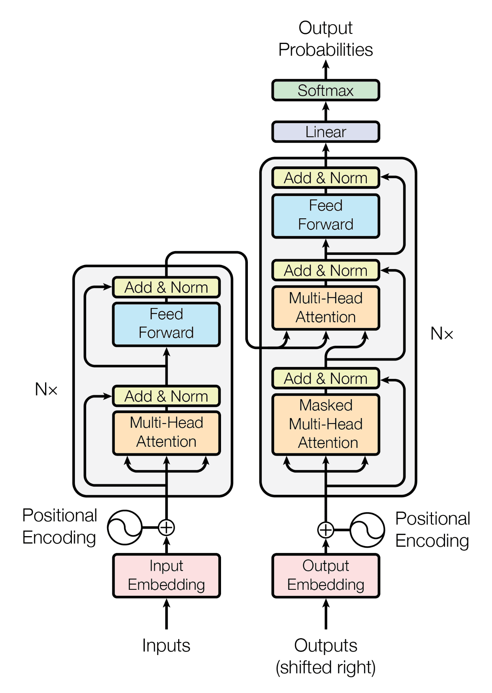
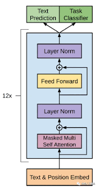
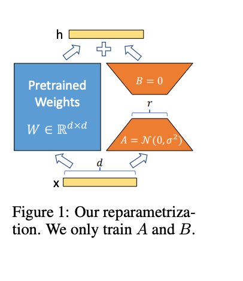
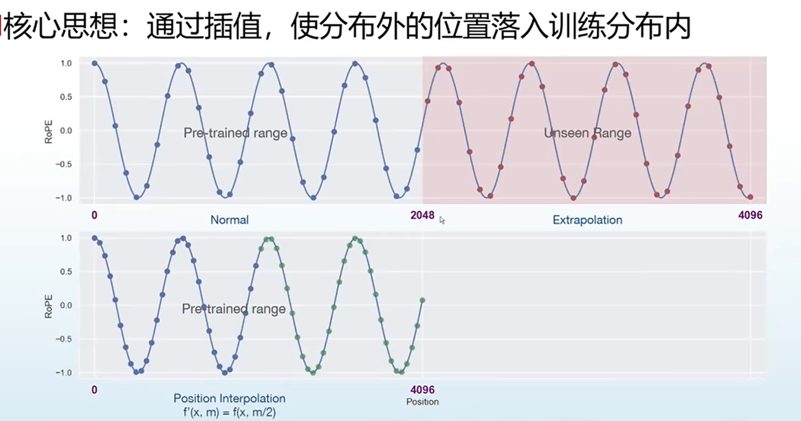
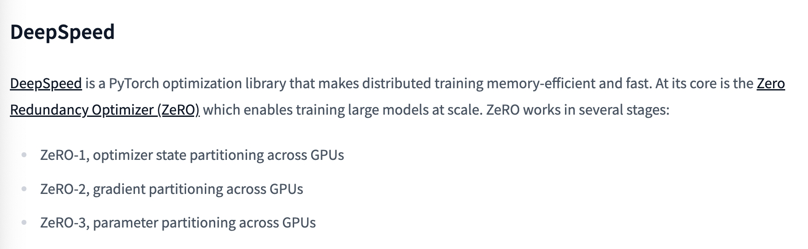
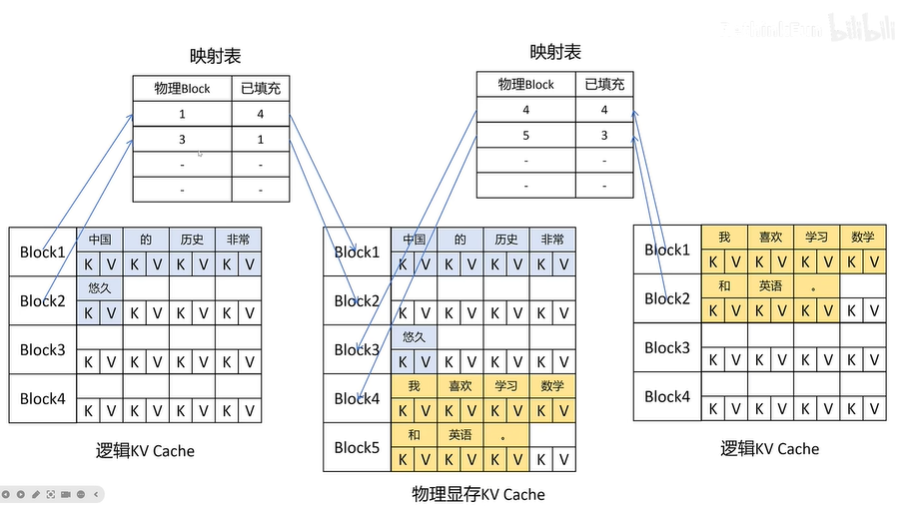
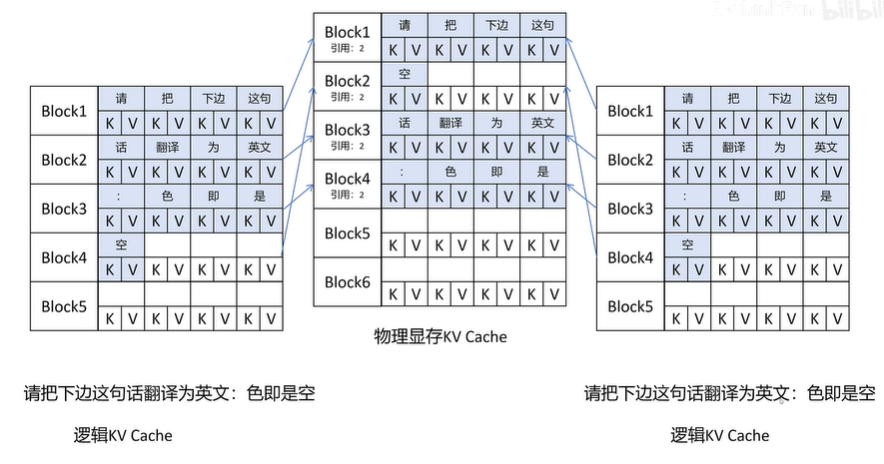
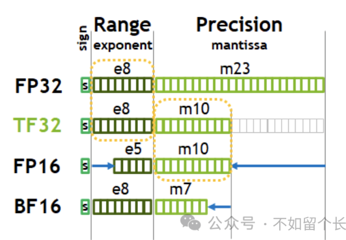
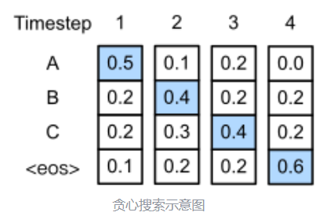
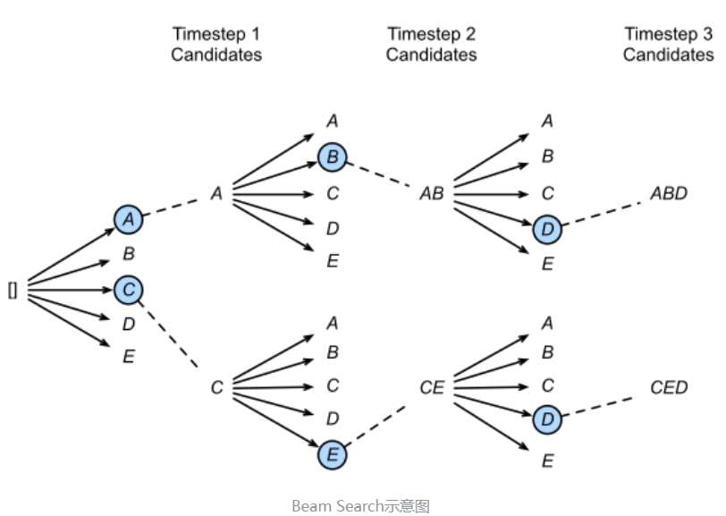

> 🔗 原文链接： [大模型重点基础](https://p0fzoctf5q5.feishu.cn/docx/ZxTGdaFZsotqbzxCR3HcDqoKnyc)
> ⏰ 转存时间： 2026/11/15 21:21:40
> ✂️ 本文档由 [易飞书](https://yifs.cn) 整理生成

---

# 说明

下面为重点基础提纲，上课前需要大概过一遍，可以从学习笔记、知乎、AI 大模型（ChatGPT、DeepSeek）上去查。卡住了就跳过，不需要了解太深。课堂上会从底层讲解，文章除了 RLHF 部分，其他都大概过一遍后就可以约课。

## 第一次大模型课后必须要掌握

- **上课前作业**：重点吃透 MHA，争取能默写，讲项目前一定要会手写 MHA。

- **代码会写**：带 Mask 的 MHA、对比学习 Loss（如果是多模态方向，RAG / Agent 不用看）。

- **代码能懂**（跟着敲一遍）：KV Cache、RoPE、Pretraining / SFT 的 Loss、MQA、GQA。

- **理论能懂**：BF16 / FP32 / FP16、Qwen-VL 系列区别是什么、CLIP、ViT，还有就是文档细节（如果是多模态方向，RAG / Agent 不用看）。

- **再有时间**：理解手撕代码里面重要的部分。

**面试真题**：[大语言模型面试真题全解](https://p0fzoctf5q5.feishu.cn/docx/GwIsd05QIozZ93xfA7fcean2noe)

**面试手撕题**：[大语言模型面试手撕题解](https://p0fzoctf5q5.feishu.cn/docx/RHlIdKB4OoOuC1xyoCGcFZ7Cnuc)

# 大模型知识

## 1. 预训练和微调的任务不同、Transformer

[大模型预训练和 SFT 的 Loss](https://p0fzoctf5q5.feishu.cn/docx/YTEBdY3qNoiYtBxAenYcYVSHnXG?from=from_copylink)

### 1.1 Transformer

- **Encoder-Decoder** vs. **Decoder-Only**
  - Decoder-Only 是 Encoder-Decoder 的哪个部分？
  - (batchsize , seq_len , embed_size) -> (batchsize * seq_len, embed_size) ->
   (batchsize * seq_len, 4* embed_size) -> σ() -> (batchsize * seq_len, embed_size) -> 
  (batchsize , seq_len , embed_size)





- 手写self-attention，MH-self-attention

```Python
import torch
import torch.nn as nn

class SelfAttention(nn.Module):
    def __init__(self, embed_size, heads):
        super(SelfAttention, self).__init__()
        self.embed_size = embed_size
        self.heads = heads
        self.head_dim = embed_size // heads
        #保证能被embed_size能被头整除
        assert (self.head_dim * heads == embed_size),
        
        self.values = nn.Linear(embed_size, embed_size, bias=False)
        self.keys = nn.Linear(embed_size, embed_size, bias=False)
        self.queries = nn.Linear(embed_size, embed_size, bias=False)
        self.fc_out = nn.Linear(heads*self.head_dim, embed_size)

    def forward(self, values, keys, query, mask):
        N = query.shape[0]  # batchsize
        value_len, key_len, query_len = values.shape[1], keys.shape[1], query.shape[1]
        # 经过线性层得到QKV
        values = self.values(values)
        keys = self.keys(keys)
        queries = self.queries(query)
        # 切成多头
        values = values.reshape(N, value_len, self.heads, self.head_dim)
        keys = keys.reshape(N, key_len, self.heads, self.head_dim)
        queries = queries.reshape(N, query_len, self.heads, self.head_dim)
        
        #矩阵乘
        energy = torch.einsum("nqhd,nkhd->nhqk", [queries, keys])
        # padding的字符需要被mask，用极小值标记mask为0的部分
        if mask is not None:
            energy = energy.masked_fill(mask == 0, float("-1e20"))
        #dim=3：在energy的第3个维度上进行softmax
        attention = torch.softmax(energy / (self.embed_size ** (1/2)), dim=3)
        out = torch.einsum("nhql,nlhd->nqhd", [attention, values]).reshape(
            N, query_len, self.heads*self.head_dim)
        out = self.fc_out(out)
        return out
```

- 为什么 Attention 要除以 \sqrt{d_k}（即 `head_dim`）缩放因子？ 
  - **保持数值稳定**：如果不进行缩放，点积可能产生非常大的值，这会导致 Softmax 函数的输出变得非常集中，即某个元素的注意力得分接近 1，而其他元素的注意力得分接近 0。这样的注意力机制可能过于敏感于某些特征，而不是均衡地分配注意力。除以 \sqrt{d_k} 可以视为一种标准化处理，它使得注意力得分的分布更加均匀，有助于模型的学习过程。

- Self-Attention 和 Cross-Attention 的区别是什么？

## 2. 显存计算

[ ](d8b09b09-116e-49cb-8abc-75b451385a0a)

- 14B 的大模型如果 Qwen2.5 全参训练和 LoRA 训练分别占多少 G 显存左右？

- 训练时候有哪些省显存的方法？

- 显存占用和模型大小的关系是什么？

| Method | Bits | 7B | 13B | 30B | 70B | 110B | 8x7B | 8x22B |
| --- | --- | --- | --- | --- | --- | --- | --- | --- |
| Full | AMP | 120GB | 240GB | 600GB | 1200GB | 2000GB | 900GB | 2400GB |
| Full | 16 | 60GB | 120GB | 300GB | 600GB | 900GB | 400GB | 1200GB |
| Freeze | 16 | 20GB | 40GB | 80GB | 200GB | 360GB | 160GB | 400GB |
| LoRA/GaLore/BAdam | 16 | 16GB | 32GB | 64GB | 160GB | 240GB | 120GB | 320GB |
| QLoRA | 8 | 10GB | 20GB | 40GB | 80GB | 140GB | 60GB | 160GB |
| QLoRA | 4 | 6GB | 12GB | 24GB | 48GB | 72GB | 30GB | 96GB |
| QLoRA | 2 | 4GB | 8GB | 16GB | 24GB | 48GB | 18GB | 48GB |

### 2.1 Lora微调的显存估计方法

我们知道，Lora微调是一种低资源的微调方法，它只需要训练模型的部分参数。我们依次来估算Lora微调的显存占用量。

首先，我们仍然需要加载全部的模型参数。假设这次我们使用的是16位浮点数，即float16去存储我们的模型权重。那么每个数占用2个字节，那么**模型权重**的大小约为 $70 \times 10^8 \times 2 \div 1024^3 \approx 13GB（7B Llama）$。Lora Adapter的大小我们基本可以忽略不计。

接下来是**梯度**。Lora微调只需要训练模型的部分参数，但是反向传播的过程中，所有参数的梯度都会被计算。但好处在于，我们只需要存储部分参数的梯度，也就是Lora Adapter的梯度。仍然，它非常小，我们可以忽略不计。

最后是**优化器状态**。Adam优化器的状态包括了每个参数的动量和二阶动量，它们的大小和对应的模型参数大小是一样的。由于我们不需要更新模型的全部参数，因此优化器状态只需要维持Lora Adapter的状态即可。我们也可以忽略。

因此，Lora微调的显存占用量理论上主要由模型参数决定，对于使用float16存储的模型，它微调所需的显存约为**13GB**。在实际中，因为训练与存储策略、优化器、输入数据规模等因素的影响，显存占用量会有所上涨。

同样，一个简单的规律是，如果我们有一个大小为N（B）的模型，那么**以float16为精度的Lora微调显存占用量至少为 2N，如果使用float32为精度，那么显存占用量至少为 4N**。

**推理**就比较简单了。推理的显存占用量主要由模型参数决定，因为我们只需要加载模型参数，不需要存储梯度和优化器状态。

假如使用 INT8 去量化模型，那么每个数占用 1 个字节，显存占用为 N；FP16 为 2N；FP32 为 4N。

此外，推理的显存占用量还会受到 Batch Size 的影响。在推理阶段，如果需要同时加载多个样本的输入数据，那么 Batch Size 越大，显存占用量也会越大，因为需要计算更多的中间结果。

KV Cache 也是需要占用显存的。KV Cache 用来存储多头自注意力层的 Key-Value 对，在自回归生成中避免了重复计算。序列长度越长，KV Cache 的大小也会越大。因此，序列长度也会影响显存占用量。

但是，KV Cache 的大小和模型全体参数的大小相比还是较小的。因此，我们可以认为推理的显存占用量主要由模型参数决定，它的下限约为 6.5 G。

## 3. LoRA 手写



- 哪些层可以加 LoRA？

- 加上 LoRA 后的 W_q 维度不变（输入 128，输出 1024）

- LoRA 有哪些参数？

- 两个矩阵怎么初始化？
  - 将 **B** 初始化为**零矩阵**，可以确保在开始微调之前 LoRA 不会对模型产生任何影响。这有助于保持预训练模型的初始性能，并确保微调过程不会破坏原有的知识。
  - 将 **A** 使用**较小标准差的正态分布**初始化，可以在训练初期限制 A \times B 的值，从而控制模型更新的幅度。这有助于防止在微调过程中出现梯度爆炸或梯度消失的现象。

- A、B 矩阵能不能都为 0？

- A 矩阵初始化为正态分布的好处是什么？

- 自注意力可学习的参数是什么？

- LoRA 和 Adapter 的区别是什么？

## 4. 位置编码

- 我们为什么需要位置编码？自注意力计算的时候哪个部位需要位置编码？

- 绝对位置编码

- 相对位置编码

- 位置编码如何做外推？

### 4.1 绝对位置编码

$PE_{(pos,2i)} = \sin\left(\frac{pos}{10000^{2i/d}}\right) \\ \\$

$\\

PE_{(pos,2i+1)} = \cos\left(\frac{pos}{10000^{2i/d}}\right)$

训练词向量 + 位置信息的新特征，不具有长度外推性（无法处理没见过的序列长度）。

### 4.2 相对位置编码

包括 RoPE、ALiBi 等。可实现**长度外推性**（相对位置关系具有平移不变性），**非加性，是嵌入到 Attention 中改变 QK**，是 **Not Learnable** 的。

**（重要，要看代码，见面试手撕题文档）RoPE**：**以绝对位置编码的方式实现相对位置编码的效果**，方式较复杂，具有长距离衰减性，有一定的长度外推性（旋转的方式是周期性的，可以适应长度变化，但可能无法充分学习到这种变化规律）。

[Transformer 升级之路：2、博采众长的旋转式位置编码 - 科学空间 | Scientific Spaces](https://spaces.ac.cn/archives/8265)

**旋转位置编码（Rotary Position Embedding, RoPE）的核心设计目标**:

$\langle f_q(x_m, m), f_k(x_n, n) \rangle = g(x_m, x_n, m - n)$

### 4.3 实现长度外推性的方式

**（1）内插值**

为了容纳更多的输入标记，在相邻整数位置上插值位置编码，利用位置编码可以应用于非整数位置的事实，而不是在训练位置之外进行外推。



**（2）外推**

外推是指在现有位置范围的基础上沿最大位置向外扩展，如原来的 i 分布在 [0, 511] 之间，如果要扩大一倍长度则在末尾增加 [512, 1023] 即可，再用能匹配得上新位置的长句微调即可。但这样做一个问题是会导致 Attention Score 的异常增加，影响到其性能。

**问题**：如果想扩大三倍，两个点之间要内插几个点？

## 5. 分布式训练

[分布式训练详解](https://zhuanlan.zhihu.com/p/18510212574)

- DDP 是什么？

- DeepSpeed ZeRO-1 / 2 / 3 分别是什么？

- 同一个训练方法，Batch Size 和训练时间成反比吗？

**成反比**（但不是线性的）。虽然 Batch Size 变大，一次性处理数据更多（$1 \times \text{emb} \rightarrow 5 \times \text{emb}$），但 GPU 擅长处理矩阵，所以对速度影响不大。

- 从 DDP 到 DeepSpeed ZeRO-1 / 2 / 3，训练速度是越来越快吗？能开的最大 Batch Size 是越来越大还是越来越小？



DeepSpeed 是一个由微软开发的深度学习优化工具，其中的 ZeRO (Zero Redundancy Optimizer) 技术通过分割模型参数、梯度和优化器状态来减少显存需求。ZeRO 分为三个主要阶段，每个阶段逐步增加内存优化的程度：

1. [Stage 0：不采用任何内存优化方案，相当于普通的数据并行（Data Parallelism, DP）。每个 GPU 都存储完整的模型参数(1)](https://blog.csdn.net/m0_51341794/article/details/137369288)。

1. [Stage 1：分割优化器状态（Partitioning Optimizer State）。在这个阶段，优化器状态被分割到不同的 GPU 上，从而减少每个 GPU 的内存占用(1)](https://blog.csdn.net/m0_51341794/article/details/137369288)。

1. [Stage 2：分割优化器状态和梯度（Partitioning Optimizer State and Gradients）。除了分割优化器状态外，梯度也被分割到不同的 GPU 上，进一步减少内存需求(1)](https://blog.csdn.net/m0_51341794/article/details/137369288)。

1. [Stage 3：分割优化器状态、梯度和模型参数（Partitioning Optimizer State, Gradients, and Model Parameters）。这是最优化的阶段，所有的模型参数、梯度和优化器状态都被分割到不同的 GPU 上，最大限度地减少内存占用](https://blog.csdn.net/m0_51341794/article/details/137369288)。

## 6. 推理

### 6.1 Pagedattention

<!-- 暂不支持的块类型: iframe -->

**kv cache：**每次生成新的token时，不需要重新计算前面所有token的键和值，可以将先前计算的键和值缓存起来，在后续的注意力计算中复用，从而避免重复计算，显著减少计算量和时间消耗。

**VLLM**是一个开源的大模型推理加速框架，通过PagedAttention高效地管理attention中缓存的张量，实现了比HuggingFace Transformers高24倍的吞吐量。

**PagedAttention**

自回归过程中缓存的K和V张量非常大，且内存占用是动态的，取决于输入序列的长度。由于碎片化和过度预留，现有的系统浪费了60%-80%的内存。



（1）**优化显存占用**

灵感来自于操作系统中**虚拟内存和分页**的经典思想，它可以**允许在非连续空间存储连续的KV张量**。具体来说，PagedAttention把每个序列的KV缓存进行了分块，显存根据**kv Block**来管理kv Cache，每个块包含固定长度的token，而在计算attention时可以高效地找到并获取那些块。每个block的计算是独立的且可以并行。**克服预分配的问题，不会提前占用显存**。

（2）**高效内存共享 sharing KV Blocks**



当一个block的键和值被用于计算与多个其他block的注意力时，这些中间结果可以被缓存起来，以便后续block的计算可以直接使用，而不是重新计算。（比如一个prompt做两个output）

### 6.2 float16 float32 **bf16**



浮点数的二进制表示：符号位（0为正数，1为负数），指数位（可表示浮点数的动态范围），尾数位（精度）。

8位浮点数为1Byte，FP32为4字节，FP16和BF16都为2字节。

`bf16`在深度学习训练和推理中变得流行，主要是因为以下原因：

（1）动态范围：与`float16`相比，`bf16`具有**更大的动态范围**，这意味着它可以表示更广泛的数值，从而降低了数值溢出的风险。

（2）计算效率：`bf16`比`float32`更**节省存储空间和带宽**，这对于大规模模型和大数据集的训练尤为重要。现代GPU和加速器（如TPU）通常对`bf16`有专门的支持，能够实现更高的吞吐量。

（3）精度损失：虽然`bf16`的小数位数较少，但在许多深度学习任务中，通过**混合精度训练技术**（例如结合`bf16`和`float32`），可以达到接近全精度`float32`的模型精度，同时保持计算和存储的优势。

### 6.3 采样策略

**argmax**

每一个时间步都取出一个**条件概率最大**的输出，再将从开始到当前步的结果作为输入去获得下一个时间步的输出，直到模型给出生成结束的标志。



- argmax确定性采样带来了什么问题？
  - **当前是局部最优？**
    - **重复 复读机**
      0.37 0.2 0.3
      0.23 0.9 0.8 
    - **没有多样性**

- Argmax是全局最优吗？能不能举出一个更优的case，就那上图为例。

**topk，topp**

1. Top-K :           0.5 0.3 0.2       0.3 0.5        0.3 / (0.5+0.3)
  - Top-K Sampling 是一种**随机**采样策略，它首先从模型输出的概率分布中选取**前 K 个最高概率**的**词汇**作为候选，只从这 K 个候选词汇中**按照它们相应的概率分布进行采样**。 
  - Top-K 可以增加输出的多样性，因为它是基于采样而不是确定性选择。过大的 K 值可能导致生成质量下降，过小的 K 值则可能导致多样性不足。

1. Top-P :
  - 选择**累积概率超过某个阈值 P **的词汇集合作为候选。首先按降序排列所有词汇的概率，然后累积这些概率直到达到阈值 P，选择所有累积到该点的词汇作为候选。**最后从这个候选集中按照各自的概率分布进行采样。**
  - Top-P 可以在保持输出多样性的同时，避免生成非常低概率的词汇，从而平衡质量和多样性。

- **Beam search**

在每一步中，Beam Search 会**保存一定数量**（称为 Beam Width 或 Beam Size）**的候选序列**，并基于这些候选序列继续扩展，候选序列的选择**基于它们累积的概率**，最后选择具有最高概率的序列。

**相对高质量**的输出，但可能过于保守，缺乏多样性。

$p(x_1, x_2, x_3) = p(x_1) \cdot p(x_2 \mid x_1) \cdot p(x_3 \mid x_1, x_2)$

|  | x_1 | x_2 | x_3 |
| --- | --- | --- | --- |
| a | 0.5 | 0.3 | 0.2 |
| b | 0.4 | 0.8 | 0.8 |



## 7. 手写五件套：Loss / KV Cache / RoPE / MQA / GQA

五个都只要二三十行，面试让写就写这个量级。

### 7.1 预训练与 SFT 的 loss

```python
import torch.nn.functional as F

def lm_loss(logits, labels, ignore=-100):
    # logits (B, S, V) → 展平成 (B*S, V)；labels (B, S) → (B*S,)
    return F.cross_entropy(logits.view(-1, logits.size(-1)),
                           labels.view(-1),
                           ignore_index=ignore)

# 预训练：整句右移一位，末位补 -100
labels = input_ids.clone()
labels[:, :-1] = input_ids[:, 1:]
labels[:, -1] = -100

# SFT：prompt 段全部置 -100，只算回答段
labels[:, :prompt_len] = -100
```

差别只有一行：**谁被置成 -100**。预训练是末位，SFT 是提问段。

这一行拆开看：

| 部分                                      | 形状变化        | 意思                                       |
| --------------------------------------- | ----------- | ---------------------------------------- |
| `logits`                                | `(B, S, V)` | 每个位置对词表里 V 个词打分                          |
| `logits.view(-1, logits.size(-1))`      | `(B*S, V)`  | 把「每个位置」摊成一行，共 $B\times S$ 行              |
| `labels.view(-1)`                       | `(B*S,)`    | 每个位置一个正确答案                               |
| `cross_entropy(..., ignore_index=-100)` | 标量          | 逐位置算 $-\log p_{\text{正确词}}$，跳过 -100，再取平均 |

举例：$B=1,S=3,V=4$，`logits` 是 `(1,3,4)`，摊平成 `(3,4)`——三行，每行四个分数：

```text
位置0: [2.0, 0.1, -1.0, 0.3]   标签=1  → 看第 1 个数，算 -log softmax
位置1: [0.2,  1.5,  0.4, -0.2]  标签=2  → 看第 2 个数
位置2: [0.1,  0.0,  0.2,  1.9]  标签=-100 → 跳过，不算
loss = 前两个的平均
```

为什么要摊平：`cross_entropy` 只认 `(N, V)` 和 `(N,)` 这种「一堆独立分类」的形状，不认三维。摊平等价于「$B	imes S$ 个位置各做一次 V 分类，然后平均」。


### 7.2 KV Cache

```python
def attention_with_cache(q, k, v, cache=None):
    # q: (B, h, 1, d)   只有当前这一步；k/v: (B, h, S_new, d)
    if cache is not None:
        k = torch.cat([cache[0], k], dim=2)   # 拼历史
        v = torch.cat([cache[1], v], dim=2)
    out = torch.softmax(q @ k.transpose(-2, -1) / (q.size(-1) ** 0.5), dim=-1) @ v
    return out, (k, v)                        # 把拼接后的 k/v 存回去
```

关键：**q 只有 1 个位置，k/v 是全历史**。所以每步只算 $1	imes S$ 的分数，而不是 $S	imes S$——这就是推理比训练省的原因。

### 7.3 RoPE

```python
def rotate_half(x):
    x1, x2 = x[..., :x.shape[-1] // 2], x[..., x.shape[-1] // 2:]
    return torch.cat([-x2, x1], dim=-1)

def apply_rope(q, k, cos, sin):
    # cos/sin: (S, d)，按位置取；成对旋转，模长不变
    return q * cos + rotate_half(q) * sin, k * cos + rotate_half(k) * sin
```

只改 q、k，不动 v；旋转后内积只剩相对距离 $m-n$。

### 7.4 MQA（Multi-Query）

```python
# 所有头共享同一份 K、V
q = self.wq(x).view(B, S, h, d).transpose(1, 2)     # (B, h, S, d)
k = self.wk(x).view(B, S, 1, d).transpose(1, 2)     # (B, 1, S, d)
v = self.wv(x).view(B, S, 1, d).transpose(1, 2)
attn = torch.softmax(q @ k.transpose(-2, -1) / d ** 0.5, dim=-1) @ v
```

`k`/`v` 的头维是 1，靠广播被所有头共用。KV Cache 直接省 $h$ 倍。

### 7.5 GQA（Grouped-Query）

```python
# 折中：G 个 KV 头，每组服务 h/G 个 Q 头
k = self.wk(x).view(B, S, G, d).transpose(1, 2)                 # (B, G, S, d)
k = k.repeat_interleave(h // G, dim=1)                          # (B, h, S, d)
v = self.wv(x).view(B, S, G, d).transpose(1, 2).repeat_interleave(h // G, dim=1)
```

`G = h` 退化成 MHA，`G = 1` 退化成 MQA。Llama 2 70B 用 $h=64, G=8$，Cache 省 8 倍而效果几乎不掉。

## 多模态（如果项目是多模态 VLLM 方向）

[ ](b7569ea1-5763-4c8e-bf58-969174792950)

LLAVA QWEN-VL

作业：

1、 分为几个阶段

2、每个阶段训练哪些参数

3、每个阶段做的什么任务？训练的数据集是什么？

## RLHF

第四集

<!-- 暂不支持的块类型: iframe -->

[ ](ca9ba2ea-6058-4ccf-82cb-14ee2872f30d)

注意事项：

重点看PPO，可以不看dpo和grpo。

- ppo和grpo的区别是什么？

- ppo和dpo的区别是什么？

- ppo的critic model的作用是什么？可不可以去掉？

- ppo的reference model的作用是什么？
