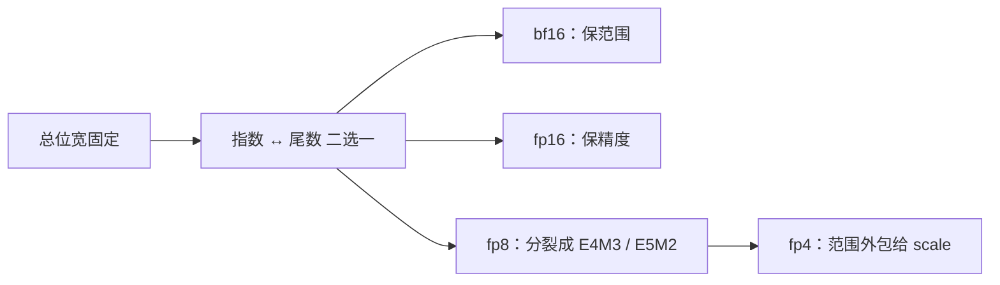

# 数值精度

浮点数在内存里怎么摆位，以及训练/推理为什么这么选。

## 01 浮点数的三段位

### 三个字段各管一件事

| 字段 | 位数 | 决定什么 |
| --- | --- | --- |
| **符号位** | 1 | 正负（0 正、1 负） |
| **指数位** | $e$ | **动态范围**——能表示多大、多小 |
| **尾数位** | $m$ | **精度**——能表示多少位有效数字 |

$$\text{值}=(-1)^{s}\times 1.M\times 2^{E-\text{bias}}$$

### 一句话分工

**指数管"刻度落在哪一段"，尾数管"这一段里切多少格"。**

所以看一个格式够不够用，要分开问两件事：

- 范围够不够（梯度会不会溢出/下溢）→ 看指数位
- 精度够不够（小更新会不会被舍掉）→ 看尾数位

### 为什么总位宽固定时必然要取舍

总位数一定，指数多一位，尾数就少一位。**加范围就要减精度，加精度就要减范围**——所有低精度格式的差别，本质都是在这条线上选了不同的点。

## 02 各格式的位分配

![[浮点位分配.svg|665]]

| 格式 | 字节 | 符号 | 指数 | 尾数 | 备注 |
| --- | --- | --- | --- | --- | --- |
| **fp32** | 4 | 1 | 8 | 23 | 基准，约 7.2 位十进制有效数字 |
| **TF32** | 4（只用 19 位） | 1 | 8 | 10 | A100 tensor core 用它做矩阵乘 |
| **fp16** | 2 | 1 | **5** | 10 | 范围窄，精度较高 |
| **bf16** | 2 | 1 | **8** | 7 | 范围同 fp32，精度低 |
| **fp8 E4M3** | 1 | 1 | 4 | 3 | 精度优先 |
| **fp8 E5M2** | 1 | 1 | 5 | 2 | 范围优先 |

### 读这张表的三个要点

**① fp16 与 bf16 是同一枚硬币的两面**

$$\text{fp16}: 1+5+10\qquad \text{bf16}: 1+8+7$$

同样 2 字节，**bf16 拿走 3 位尾数换 3 位指数**。5 位指数 vs 8 位指数，动态范围差出好几个数量级。

**② TF32 的奇特之处**

占用 32 位存储，但只用了 19 位有效位（8 位指数 + 10 位尾数）。**范围与 fp32 一样，精度降到 fp16 的水平**——它是给矩阵乘加速用的，不是存储格式。

**③ fp8 有两个变体**

8 位装不下"宽范围 + 高精度"，只能选一边，所以标准里并存 E4M3 与 E5M2（见 [[数值精度#07 fp8 的两种取舍]]）。

## 03 浮点数的间距随数量级翻倍

### “跳跃”指什么

整数等间距（0、1、2、3，每步 1），浮点数**不是**。以 fp32 为例：

```
[1, 2)        间距 1.19e-7
[2, 4)        间距 2.38e-7     ← 翻倍
[4, 8)        间距 4.77e-7     ← 再翻倍
[1024, 2048)  间距 1.22e-4     ← 已是 1e-7 的 1000 倍
```

**每跨过一个 2 的幂次，间距翻倍。** 数轴上是"近处密、远处疏"的分段跳变。

### 原因：尾数固定，指数量级在变

$$\text{值}=(-1)^{s}\times1.M\times2^{E-\text{bias}}$$

`1.M` 的小数位固定（fp32 是 23 位）。指数每加 1，数值翻倍，**绝对间距也跟着翻倍**：

$$\text{ulp}=2^{\,E-\text{bias}-23}$$

十进制类比：固定 3 位有效数字——`1.23` 精度到 0.01，`1230` 精度到 10，**有效位数没变，绝对误差涨了 1000 倍**。

### 具体数字

| 格式 | 区间 | 间距 | 后果 |
| --- | --- | --- | --- |
| fp32 | `[1,2)` | 1.19e-7 | 1.0 加 1e-7 存不住 |
| fp32 | `[1e9,2e9)` | 64 | 1e9 加 10 直接消失 |
| fp16 | `[1,2)` | 9.77e-4 | |
| fp16 | `[1024,2048)` | **1.0** | 1024 以上整数都表示不全 |

![[浮点动态范围.svg|652]]

*各种格式能表示的数值范围：bf16 与 fp32 的上下界一致，fp16 两端都窄得多。*

### 三个直接后果

**① 大数吃小数**

```python
1e8 + 1.0 == 1e8      # fp32 下为 True
```

`1e8` 附近 ulp 约 8，加 1 被完全吞掉。累加大量小量时误差滚雪球——这就是求和要求 Kahan 求和或 fp64 累加的原因。

**② 参数更新会"消失"**

$w=1.0$、$\eta g=10^{-7}$：fp32 的 ulp 是 1.19e-7，更新量与 ulp 同量级，经常被舍掉；fp16 的 ulp 是 9.77e-4，**必然被舍掉**。

**③ 溢出与下溢不对称**

指数位决定可表示区间：fp16 上限 65504、下限约 6e-5，梯度稍大就 `inf`、稍小就沉到 0，所以需要 loss scaling。

### 唯一均匀的是相对精度

$$\frac{\text{ulp}}{|x|}\approx2^{-24}\ \text{(fp32)}$$

不管数值多大，**有效数字位数不变**。

| | 定点数 | 浮点数 |
| --- | --- | --- |
| 绝对精度 | 处处相同 | 随量级变差 |
| 相对精度 | 随量级变差 | **处处相同** |
| 可表示范围 | 窄 | 极宽 |

**浮点牺牲"绝对均匀"，换来"跨几十个数量级仍保持相同有效位数"。**

### 一句话

**浮点数相当于"固定有效数字的科学计数法"：尾数决定每段切多少格，指数每加 1 格子尺寸翻倍。**

## 04 bf16 为什么取代 fp16

### 训练时最容易出事的是范围，不是精度

fp16 只有 5 位指数：梯度稍大 → `inf`，稍小 → 沉到 0。

为了让数值留在可表示区间，用 fp16 训练必须配 **loss scaling**：把 loss 放大若干倍再反传，更新前再缩回去。这套机制本身容易出错，倍率选错就训崩。

bf16 的指数位与 fp32 一样多（8 位），动态范围一致，**通常不需要 loss scaling**。这是它在大模型训练里取代 fp16 的主因。

### 计算效率

| 收益 | 说明 |
| --- | --- |
| 省存储与带宽 | 一份权重 4 B → 2 B，显存与搬运量减半 |
| 高吞吐 | 现代 GPU/TPU 对 bf16 有专门支持，矩阵乘比 fp32 快一截 |

**省带宽 + 高吞吐叠在一起**，才是 bf16 实际更快的原因，不是单靠"位数少"。

### 精度的代价

7 位尾数只够约 2.4 位十进制有效数字，**单独用会掉点**：参数更新量很小时会被舍入掉。

解决办法是混合精度：**前向反向用 bf16 算，主权重用 fp32 存**，梯度累加到 fp32 主权重上，再转回 bf16 供下一轮使用。

### 那笔 16 字节的账

| 项 | 字节 |
| --- | --- |
| bf16 权重 | 2 |
| bf16 梯度 | 2 |
| 优化器状态（Adam） | 12（含 4 字节的 fp32 主权重） |
| **合计** | **16 字节/参数** |

这也是 72B 模型显存账的底层依据（见 [[训练工程#02 显存四块账]]）。

### 一句话

**bf16 用 3 位尾数换成 3 位指数：精度降到"勉强够用"，换来"不用管溢出"。在大模型训练里，后者比前者值钱。**

## 05 为什么必须保留 fp32 主权重

### 现象

在 bf16 里直接做参数更新：

$$w=1.0,\qquad \eta g=10^{-7}$$

$$w\leftarrow w-\eta g=1.0-10^{-7}$$

结果**还是 1.0**——更新被舍掉了。

### 原因：更新量小于 ulp

| 格式 | $[1,2)$ 区间的 ulp | 1e-7 的更新能否留下 |
| --- | --- | --- |
| fp32 | 1.19e-7 | **勉强**，常被舍入 |
| fp16 | 9.77e-4 | **必然被舍掉** |
| bf16 | 7.8e-3（更粗） | 更保不住 |

**更新的绝对值与"最后一位的刻度"同量级，就会被四舍五入吃掉。**

### 所以混合精度要留一份 fp32 主权重

做法：

```text
bf16 权重 → 前向/反向（快）
     ↓ 梯度（bf16 或 fp32）
fp32 主权重 ← 梯度累加（精度够，更新留得住）
     ↓ 转回
bf16 权重（下一轮）
```

**留 fp32 主权重不是为了"算得更准"，而是为了让更新不被吃掉。** 这是很多人误解的一点：以为它在提精度，其实它在保"可更新性"。

### 代价

每个参数多 4 字节：

$$\text{优化器状态}=\underbrace{4\text{（fp32 主权重）}}_{\text{这一份}}+4\text{（动量）}+4\text{（方差）}=12\text{ B}$$

加上 bf16 权重 2 B 与梯度 2 B，正好 16 B/参数。

### 一句话

**低精度的毛病不在"算错"，而在"改了等于没改"——主权重放在 fp32，是为了让步子迈得出去。**

## 06 为什么不存在 bf8

### bf16 的定义

$$\text{bf16}=1\ \text{符号}+8\ \text{指数}+7\ \text{尾数}=16\ \text{位}$$

它唯一的卖点是**指数位与 fp32 完全一致**，因此动态范围不变、不需要 loss scaling。

### 压到 8 位就放不下

$$1\ (\text{符号})+8\ (\text{指数})=9>8$$

**连一位尾数都塞不进去。**

这样的"bf8"只能表示 $2^k$ 这种孤立的值，**存不了任何有效数字**，完全没有可用性。同理"bf4"需要 $1+8=9$ 位，更不可能。

**"bf"这套命名在 8 位以下无法成立。**

### 于是只能按 E/M 重新分配

8 位必须重新分：指数给几位、尾数给几位，于是产生了 `FP8 E4M3`、`FP8 E5M2` 这样的名字——**名字里必须写明分配方式**，因为没有唯一解。

| 命名 | 含义 | 出现在 |
| --- | --- | --- |
| **bf16** | "brain float"，绑定 fp32 的指数布局 | 16 位专用格式 |
| **fp8 / fp4** | "floating point"，**一族格式，必须标注 E/M** | 8/4 位，多标准并存 |

**bf 是某个具体格式的名字，fp 是一类格式的统称。**

### 还有一个组织层面的原因

`FP8` 是 **OCP（开放计算项目）** 联合 NVIDIA、Arm、Intel 定的标准，名字由联盟统一——不会为了对齐 bf16 而另造一个"bf8"。

### 一个容易混淆的点

**FP8 E5M2 看起来像"bf16 砍到 8 位"，但它不是。**

$$\text{E5M2}:1+5+2=8\qquad \text{bf16 砍半}:1+8+7\to1+5+2$$

指数从 8 降到 5，**动态范围大幅收窄**，所以 E5M2 依然需要 loss scaling，不能算"bf 系列"。

### 一句话

**bf16 的命名前提是"完整保留 8 位指数"；8 位总宽连符号加指数都不够，所以不存在 bf8。**

## 07 fp8 的两种取舍

### 8 位装不下"宽范围 + 高精度"

所以标准里并存两个变体，各自偏一边：

| 格式 | 符号 | 指数 | 尾数 | 动态范围 | 精度 | 用在哪 |
| --- | --- | --- | --- | --- | --- | --- |
| **fp8 E4M3** | 1 | 4 | 3 | 小 | 相对高 | **前向**：权重与激活 |
| **fp8 E5M2** | 1 | 5 | 2 | 稍大 | 更低 | **反向**：梯度（容易溢出） |

### 为什么这么分

- **前向**的数据分布相对稳定，值域窄，缺的是精度 → 给尾数多的 E4M3
- **反向**的梯度动态范围大，容易溢出，缺的是范围 → 给指数多的 E5M2

**这不是"哪个更好"，而是两侧的需求不对称**，所以必须并存两套；单一名字（如"bf8"）无法覆盖这两种分配。

### 与 bf16 的对照

| | bf16 | fp8 |
| --- | --- | --- |
| 指数位 | 8（同 fp32） | 4 或 5 |
| 需要 loss scaling | 否 | **是** |
| 单份大小 | 2 B | 1 B |

fp8 的范围比 bf16 小得多，所以精度上省一半字节，控制上要还回去——**这就是低精度一定要配缩放的原因**。

### 一句话

**fp8 不是"更小的 bf16"，而是一个在指数与尾数之间被迫二选一、于是分裂成两个标准的格式。**

## 08 fp4 与分块缩放

### 4 位只剩这么点

$$\text{E2M1}:1\ \text{符号}+2\ \text{指数}+1\ \text{尾数}=4\ \text{位}$$

能表示的绝对值只有这几个：

$$\{0,\ 0.5,\ 1,\ 1.5,\ 2,\ 3,\ 4,\ 6\}$$

**靠格式本身不可能覆盖神经网络权重的动态范围。**

### 解法：给每一小块配一个缩放因子

```
NVFP4 / MXFP4：
  每 16 或 32 个权重共享一个 fp8/fp32 的 scale
  真实值 = 4bit 码 × scale
```

**范围由 scale 提供，精度由 4 位提供。**

这套思路叫**微缩放（microscaling, MX）**：格式本身不负责范围，只负责"把这一小块的相对差异记下来"。

### 为什么能成立

一个权重块内部的数值往往**量级接近**（比如某层某一组通道），所以：

- 块内差异用 4 位足够
- 块间差异交给 scale 吸收

**把"跨块的大范围"和"块内的小差异"拆给两个东西管**——这是 fp4 能用的前提。

### 代价

| 代价 | 说明 |
| --- | --- |
| 额外的 scale 存储 | 每 16/32 个权重多一份 scale |
| 反量化计算 | 每次乘回 scale，多一步开销 |
| 对离群值敏感 | 一个异常大的值会把整块的 scale 拉偏 |

### 一句话

**位数越少，越不能"靠格式自己"表达范围——只能靠外挂的缩放因子，一块一块地校准。**

## 一条主线


