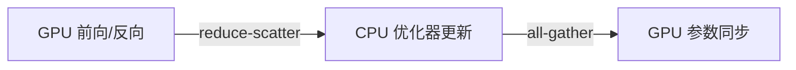
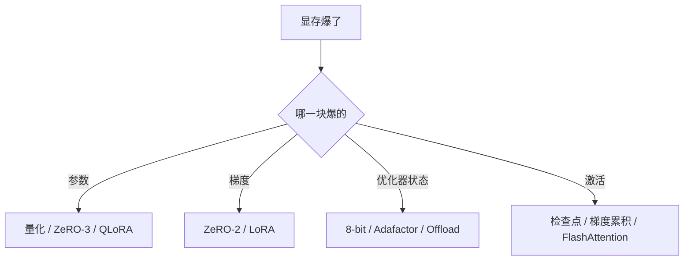

# 训练工程

大模型训练侧的显存与调参：先算清四块账，再决定砍哪一块。

## 学习地图：到底要学什么

整篇其实只有一条主线——**会算显存账，并知道爆了该动哪一块**。

### 必须背下来的地基

| 每参数占用 | 大小 | 是否随 batch 变 |
| --- | --- | --- |
| 参数（bf16） | 2 B | 否 |
| 梯度（fp32） | 4 B | 否 |
| 优化器状态（Adam） | 8 B | 否 |
| 激活值 | 与 $B\times S\times d\times L$ 成正比 | **是** |

72B 混合精度合计约 1008 GB，其中优化器状态 576 GB 占 57%。这组数字能背下来，一半的题就能答。

### 关键取舍（不是背结论，是知道代价）

- **batch**：太大泛化差、收益递减；太小噪声大、吞吐低 → 用梯度累积把「显存」和「梯度质量」解耦。
- **优化手段**：梯度检查点、8-bit AdamW、ZeRO 1/2/3、offload、LoRA 各省哪一块，代价分别是慢 20%、通信增加、吞吐降 20%–40%。
- **优化器**：AdamW 与 Adam 只差「衰减项要不要除以 $\sqrt{v}$」，但含义从正则化变成按梯度大小惩罚。

### 面试常考的三类题

1. **估算题**：给定模型规模与精度，算参数/梯度/优化器各占多少、需要几张卡。
2. **长上下文题**：为什么 32K 会爆——$S^2$ 项，以及 FlashAttention 如何把 $O(S^2)$ 降到 $O(S)$；推理侧则换成 KV Cache（线性）。
3. **辨析题**：Adam 与 AdamW 的差别；训练显存与推理显存的差别；offload 为什么对「激活爆」无效。

## 01 B 与 T：模型规模 vs 数据规模

### B = Billion

**模型参数量**，权重矩阵里一共有多少个可学习的数。

```
7B   = 70 亿      （手机上能跑）
13B  = 130 亿     （上一代主流）
72B  = 720 亿     （Qwen2.5-72B）
405B = 4050 亿    （Llama 3.1 405B）
```

注意是**千分位递进**，不是 1024：$7\text{B}=7\times10^9$。

### T = Trillion

通常指**训练用的 token 数**（数据规模），有时也指参数量。

```
15T tokens = 15 万亿个 token
```

量级感受：一本《三体》约 30 万字 ≈ 0.0000003T。

**Llama 3 的账**：8B 模型用 15T tokens 训练 → 每个参数平均"看"了约 1875 个 token。

### 一句话

**B 说"模型多大"，T 说"喂了多少数据"；看 B 想显存，看 T 想训练成本。**

## 02 显存四块账

### 以 72B 为例，逐项算

| 组成 | 每个参数占 | 72B 下的大小 |
| --- | --- | --- |
| 模型参数（bf16） | 2 B | **144 GB** |
| 模型参数（fp32） | 4 B | 288 GB |
| 梯度（fp32） | 4 B | **288 GB** |
| 优化器状态（Adam） | 8 B | **576 GB** |

### 合计

$$\text{fp32 参数：}288+288+576=1152\text{ GB}\approx1.12\text{ TB}$$

$$\text{混合精度（bf16 参数）：}144+288+576=1008\text{ GB}\approx1\text{ TB}$$

**混合精度省的是"参数那一份"，梯度和优化器状态仍是 fp32。**

### 为什么梯度是 4 B 不是 2 B

混合精度训练的标准做法：前向反向用 bf16 算，但**梯度累加、参数更新仍在 fp32 里做**，避免累积误差。这也叫"amp 的 master weights"。

### 三块固定成本

| 组成 | 与 batch 有关吗 |
| --- | --- |
| 参数 | 无关 |
| 梯度 | 无关 |
| 优化器状态 | 无关 |

**这三块只跟"模型多大"有关**。真正随 batch 变的是激活值（见 [[训练工程#03 激活值：唯一随 batch 线性的部分]]）。

### 占比感受

72B 的 1008 GB 里：

- 底座参数 144 GB（14%）
- 梯度 288 GB（29%）
- 优化器状态 576 GB（**57%**）

**优化器状态是最大的一块**——这也是 LoRA 冻结主干后收益巨大的原因（见 [[03 显存账：省的是梯度与优化器状态]]）。

## 03 激活值：唯一随 batch 线性的部分

### 激活值是什么

前向传播时，反向传播要用到的**中间结果**都得留着：每层 attention 输出、FFN 的中间高维张量、LayerNorm 的均值方差、softmax 输出……

不存的话反向时就得重算，所以默认全留着——这就是**激活显存**。

### 与 batch size 的关系

$$\text{激活显存}\propto B\times S\times d\times L$$

| 符号 | 含义 |
| --- | --- |
| $B$ | batch size |
| $S$ | seq_len |
| $d$ | hidden size |
| $L$ | 层数 |

**每个样本都要走一遍全部层**，样本翻倍，中间结果就翻倍——没有共享，也没有压缩。

粗略估算（bf16，含反向所需的多份中间量）：

$$\text{激活}\approx L\times B\times S\times d\times k,\qquad k\approx10\sim20\ \text{字节/元素}$$

### 算一笔账

72B 模型，$d=8192$，$L=80$，$k=16$：

| B | S | 激活显存 |
| --- | --- | --- |
| 1 | 2048 | ≈ 21 GB |
| 8 | 2048 | ≈ 172 GB |
| 8 | 8192 | ≈ 688 GB |

**B 从 1 到 8，激活直接涨 8 倍**——这就是大模型训练必须用[[训练工程#07 梯度累积：解耦显存与梯度质量|梯度累积]]，而不是单纯开大 batch 的原因。

### 四块里的地位

| 组成 | 与 B 的关系 |
| --- | --- |
| 参数 | 无关 |
| 梯度 | 无关 |
| 优化器状态 | 无关 |
| **激活值** | **正比** |

**参数、梯度、优化器是"固定成本"，激活是"变动成本"。** 显存不够时，砍 batch size 是唯一立刻见效的手段。

## 04 注意力的 S² 项

### 激活里还有一项不是线性的

$$\text{scores}\in\mathbb{R}^{B\times h\times S\times S}$$

注意力分数矩阵随 **$S^2$** 增长，而不是 $S$。

### 涨得有多快

| 序列长度 | 相对增长 |
| --- | --- |
| 2K → 32K | $16^2=$ **256 倍** |

**长上下文训练显存爆炸，主要来自这一项**，而不是来自层数或 hidden size。

### 所以有了 FlashAttention

核心思路：**不把 $S\times S$ 矩阵落到显存里**（tiling + 在线 softmax），边算边累加。

显存从 $O(S^2)$ 降到 $O(S)$，且结果是精确的，不是近似。

### 这一项影响谁

| 场景 | 是否受 $S^2$ 影响 |
| --- | --- |
| 短上下文训练（2K） | 影响小，$S^2$ 项还没成为主项 |
| 长上下文训练（32K+） | **主要瓶颈** |
| 推理 | 转成 KV Cache，随 $S$ 线性（见 [[训练工程#05 训练显存与推理显存的差别]]） |

## 05 训练显存与推理显存的差别

### 一句话

**训练要反向，所以得留全部中间结果；推理不反向，用完就扔。**

### 对照

| | 训练 | 推理 |
| --- | --- | --- |
| 激活 | 全部层都留 | 只留当前层，用完即弃 |
| 随 batch 增长 | 明显 | 明显，但绝对值小得多 |
| 主要占用 | 激活 + 优化器状态 | **参数 + KV Cache** |

### 推理的账怎么算

推理没有梯度、没有优化器状态，只有：

$$\text{显存}\approx\underbrace{W}_{\text{参数}}+\underbrace{B\times L\times S\times d\times 2}_{\text{KV Cache}}$$

KV Cache 随 $B$ 和 $S$ **线性**增长——注意是线性，不是平方。因为推理时不需要构造 $S\times S$ 的分数矩阵，只缓存历史 K、V。

### 一个常见误判

**"训练时 batch 开 8 能跑，推理开 8 应该更轻松"**——不一定。

推理省掉了梯度和优化器状态，但长上下文下 **KV Cache 会涨得很凶**：$S$ 翻倍，KV Cache 也翻倍，且它是每层都存。

## 06 batch size 的两头代价

大模型的 batch 通常用 **token 数**衡量（`batch_size × seq_len`），而不是"几条样本"。

### 太大：省了步数，赔了效果

**① 显存和算力直接爆**

激活随 $B$ 线性涨，$B$ 翻倍就多一份激活。这是最先撞到的墙。

**② 泛化变差（最反直觉）**

大 batch 梯度噪声小，优化会滑进**尖锐的极小值**——训练 loss 很漂亮，验证集更差。小 batch 的噪声反而像正则化，把模型推到平坦区域。

**③ 学习率必须跟着放大，还要重调**

$$\eta_{\text{new}}=\eta_{\text{old}}\cdot\frac{B_{\text{new}}}{B_{\text{old}}}\quad(\text{线性缩放})$$

放大后 warmup 必须更长，否则前期直接发散。

**④ 相同 token 数下更新次数变少**

训练 1T token：$B=4\text{M}$ 只更新 25 万次，$B=0.5\text{M}$ 更新 200 万次。**同样算力，小 batch 往往收敛到更低 loss**。

**⑤ 边际收益递减**

超过 **critical batch size** 后，再加 batch 只是白烧算力。

### 太小：稳了，但跑不动

| 问题 | 说明 |
| --- | --- |
| 梯度噪声大 | 单样本方向偏差极大，loss 抖，甚至训崩 |
| GPU 打不满 | 算力利用率低，wall time 变长（工程上最痛） |
| 通信占比升高 | 多卡每步 all-reduce，batch 太小则通信占比暴涨 |
| B=1 极端情况 | 用单个样本代表整体分布，收敛极慢 |

### 甜点区

```
loss
 │        ╭──── 太大：泛化变差、收益递减
 │    ╭───╯
 │  ╭─╯      ← 甜点
 │ ╱
 │╱  太小：噪声大、吞吐低
 └──────────── batch size
```

| 规模 | 常见全局 batch |
| --- | --- |
| 小模型 / 单机 | 0.1M–0.5M tokens |
| 中等规模 | 0.5M–2M tokens |
| 百亿级以上 | 2M–4M tokens |

**训练早期技巧**：batch 从小逐渐增大（batch size ramp），先稳后快。

### 一句话

**太大会泛化变差、收益递减；太小会噪声大、吞吐低。显存不够就降 micro-batch 加梯度累积，而不是硬降 effective batch。**

## 07 梯度累积：解耦显存与梯度质量

### 解决什么矛盾

- 显存只装得下小 batch
- 但小 batch 梯度噪声大、更新次数多、吞吐低

梯度累积把这两个需求**拆开**：用小 micro-batch 算，攒够步数再更新。

### 代码

```python
for i, batch in enumerate(loader):
    loss = model(batch) / accum_steps   # 小 micro-batch，省显存
    loss.backward()
    if (i + 1) % accum_steps == 0:
        optimizer.step()               # 大等效 batch，稳梯度
        optimizer.zero_grad()
```

**注意 `loss / accum_steps`**：不除的话，梯度是累积步数倍，等效学习率就变了。

### 等效 batch

$$B_{\text{effective}}=B_{\text{micro}}\times\text{accum\_steps}\times\text{data\_parallel}$$

**显存按 micro-batch 算，梯度质量按 effective batch 算。**

### 三个容易踩的点

**① 学习率要跟着 effective batch 调**

等效 batch 变大了，按线性缩放规则学习率也该放大，否则相当于学得慢了。

**② BatchNorm 会失真**

BN 用当前 micro-batch 的统计量，累积步数之间的分布不一样。Transformer 用 LayerNorm/RMSNorm，所以不受影响——这也是 LLM 里梯度累积能随便用的原因。

**③ 不能和"减少数据"混为一谈**

梯度累积**没有减少**看过的 token，只是把一次更新拆成几次前向。同样的数据，更新次数确实变少了。

### 一句话

**梯度累积是"用时间换显存"的典型：多跑几次前向反向，换一次和更大 batch 等价的更新。**

## 08 省显存的六类手段

### 全景

| 类别 | 手段 | 省哪一块 | 代价 |
| --- | --- | --- | --- |
| 训练策略 | 梯度累积 | 激活 | 多跑前向，wall time 变长 |
| | 梯度检查点 | 激活（$O(L)\to O(\sqrt L)$） | 重算，慢约 20% |
| 精度 | 混合精度（bf16 + fp32 主权重） | 参数 | 需要 loss scaling |
| 优化器 | Adafactor / 8-bit AdamW | 优化器状态（8B → 2B） | 收敛稍慢/精度损失 |
| 分片 | ZeRO-1/2/3 | 优化器/梯度/参数 | 通信量上升 |
| 旁路 | CPU/NVMe Offload | 把状态挪出显存 | 吞吐降 20%–40% |
| 结构 | LoRA / QLoRA | 梯度 + 优化器（只训一小块） | 需要额外适配器 |
| 实现 | FlashAttention | 消掉 $S^2$ 项 | 实现复杂 |

### 按"省哪一块"归类，最好记

| 显存块 | 对应手段 |
| --- | --- |
| **参数** | 量化（INT8/INT4）、ZeRO-3、LoRA（主干不改但可量化） |
| **梯度** | ZeRO-2、LoRA（99% 参数不产生梯度） |
| **优化器状态** | 8-bit AdamW、Adafactor、Lion、ZeRO-1、Offload |
| **激活** | 梯度检查点、梯度累积、FlashAttention、序列并行 |
| **KV Cache** | MQA/GQA、PagedAttention（推理侧） |

### 选择顺序（实践）

```text
1. 先上混合精度 → 几乎免费
2. 激活爆 → 梯度检查点 / 减小 micro-batch + 梯度累积
3. 优化器爆 → ZeRO-1/2 或 8-bit AdamW
4. 参数本身装不下 → ZeRO-3 / Offload / QLoRA
5. 长上下文 → FlashAttention + 序列并行
```

### 一句话

**先判断爆的是哪一块，再选手段——参数、梯度、优化器是"固定成本"，激活是"变动成本"，两者的解法完全不同。**

## 09 Adam 与 AdamW 的差别

> 完整推导、数值对比与代码对照见 [[Adam#和 AdamW 的区别]]。

一句话：**差别只在「衰减步要不要再被 $\sqrt{\hat s}+\epsilon$ 除一次」**。Adam+L2 把 $\lambda w$ 混进梯度，衰减强度被该参数的梯度幅度缩放，低频参数被惩罚得比高频重千倍；AdamW 把它拆出来单独减 $\eta\lambda w$，与梯度无关。

## 10 为什么 LLM 默认 AdamW

### 四个原因

> 对超参不敏感、稀疏更新友好、生态成熟、效果稳定——展开见 [[Adam#为什么大模型默认 AdamW]]。

### 与显存的直接关系

$$2\ \text{份状态}\times4\text{ B}=8\text{ B/参数}$$

这是 **Adam/AdamW 的固定开销**，也是 72B 模型 576 GB 优化器状态的来源（见 [[训练工程#02 显存四块账]]）。

| 优化器 | 每参数状态 |
| --- | --- |
| Adam / AdamW | **8 B** |
| Lion | 4 B（只有动量） |
| SGD + momentum | 4 B |
| SGD | 0 B |

**换优化器是省优化器状态最直接的办法**——代价通常是收敛更慢或需要重调学习率。

### 实际训练用的是"工程版"

> Fused AdamW（快 20%–30%）、8-bit AdamW（状态 8 B → 2 B）、Adafactor（低秩近似二阶矩）——对比表见 [[Adam#工程变体]]。

### 其他优化器（非主流但真实存在）

| 优化器 | 特点 |
| --- | --- |
| **Lion**（Google 2023） | 只用符号，状态减半；学习率要调小 10 倍 |
| **Muon**（2025） | 对矩阵参数做正交化更新，大规模下比 AdamW 省算力 |
| **Sophia** | 用二阶信息，收敛更快但工程复杂 |
| **SGD + momentum** | 视觉任务常见，LLM 少用（对学习率太敏感） |

### 一句话

**AdamW 是事实标准；Adam 是它的"前身有缺陷版"；其余优化器是特定规模/显存约束下的备选。**

## 11 CPU Offloading 的机制

### 是什么

把**显存敏感的数据**（优化器状态、梯度、模型参数）从 GPU 显存卸载到 **CPU 内存或 NVMe 磁盘**，突破单卡显存上限。

核心思想：**异构存储协作 + 计算-通信流水线**。

### 以 ZeRO-Offload 为例的三步

**① 数据划分**

- 优化器状态（动量、方差）存 CPU，每张 GPU 只保留部分梯度分片
- 反向传播后用 `reduce-scatter` 把梯度分片卸到 CPU
- 更新后的参数用 `all-gather` **从 CPU 回传 GPU**

**② 计算分离**

| 在哪算 | 算什么 |
| --- | --- |
| GPU | 前向、反向（吃并行算力） |
| CPU | 优化器参数更新（Adam 的逐元素运算） |

**③ 分块与异步**

- **Chunk 分块**：梯度、参数打包成固定大小的块（如 1 GB），减少内存碎片与通信次数
- **流水线重叠**：CUDA Stream 异步传输，让 CPU-GPU 通信与计算并行



### 为什么能省

优化器状态是 72B 模型里**最大的一块**（576 GB / 1008 GB）。把它挪到 CPU，单卡显存立刻下降一个量级。

**代价写在别处**：CPU 内存要扛得住，通信要花时间（见 [[训练工程#12 CPU Offloading 的配置与代价]]）。

## 12 CPU Offloading 的配置与代价

### DeepSpeed 配置文件里的关键项

| 参数 | 作用 | 建议 |
| --- | --- | --- |
| `offload_optimizer` | 优化器状态卸载到 CPU | 配 `pin_memory: true` 加速传输 |
| `offload_param` | 参数卸载到 NVMe | 设 `buffer_size` 优化吞吐 |
| `sub_group_size` | 分块大小 | 推荐 1 GB，过大碎片多、过小通信频繁 |
| `overlap_comm` | 通信与计算重叠 | 开启，配合 `reduce_bucket_size` |
| `fp16/bf16` | 混合精度 | 配 loss scaling |
| `optimizer.type` | 用 `DeepCPUAdam` | 避免 CPU 计算成为瓶颈 |

### 一个可直接用的配置

```json
{
  "zero_optimization": {
    "stage": 3,
    "offload_optimizer": {"device": "cpu", "pin_memory": true},
    "offload_param": {"device": "cpu", "buffer_size": "auto"},
    "sub_group_size": 1e9,
    "overlap_comm": true
  },
  "fp16": {"enabled": true, "loss_scale": "dynamic"},
  "train_batch_size": "auto"
}
```

### 效果与代价

| 指标 | 变化 |
| --- | --- |
| 单 V100 可训练 | 130 亿参数模型 |
| 显存 | 18 GB → **2.25 GB** |
| 吞吐 | **下降 20%–40%** |

**省显存是靠"把计算挪到更慢的设备"换来的**，不是免费的。

### 三个坑

**① CPU 内存可能 OOM**

全卸载时优化器状态全压在内存里，70B 模型要 70 GB 以上。监控内存，别只看显存。

**② NVMe 带宽是瓶颈**

卸载到磁盘时优先用高速 SSD，`buffer_size` 设太小会让 IO 成为新瓶颈。

**③ 必须先确认瓶颈在哪**

如果显存是被**激活值**吃掉的，卸载优化器状态没用——那要先做梯度检查点或减小 micro-batch（见 [[训练工程#08 省显存的六类手段]]）。

## 一张图定位


