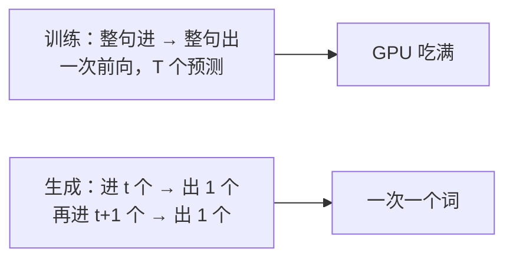
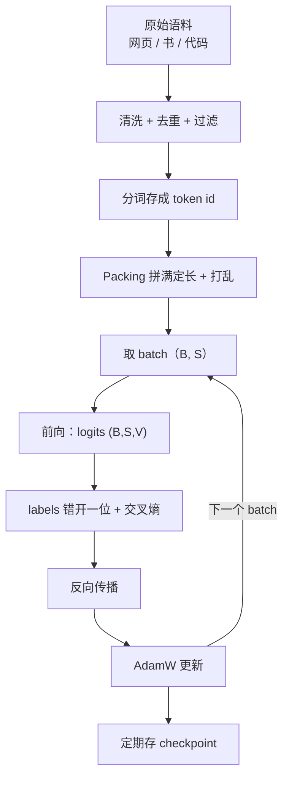

# 预训练

大模型的预训练，本质上是一场**零人工标注的「完形填空」流水线**：把人类积累的文本切碎，让模型看着前半句猜下一个字，猜错就调参。同一句话提供 $T$ 个训练信号，不需要人写任何标签。

按四步读：

| 模块 | 回答什么 |
| --- | --- |
| 一、核心直觉 | 一句话怎么变成 $T$ 个信号，标签从哪来 |
| 二、防作弊 | 掩码挡住未来，训练才能并行 |
| 三、Loss 与工程 | 损失怎么算，真实流水线怎么跑 |
| 四、与 SFT 的边界 | 两个阶段到底差在哪 |

---

## 模块一　核心直觉：一句话怎么变成 T 个训练信号

### 1.1 只干一件事：看着前面的词猜下一个

一条样本：

```text
BOS  今天  天气  真  好  EOS
```

模型一次前向会同时做五次猜测：

| 看到 | 猜下一个 |
| --- | --- |
| BOS | 今天 |
| BOS 今天 | 天气 |
| BOS 今天 天气 | 真 |
| BOS 今天 天气 真 | 好 |
| BOS 今天 天气 真 好 | EOS |

每一次猜测都是一个训练信号。末尾的 `EOS` 只作为答案出现、自己后面没有下一个词，**不产生信号**——所以序列长度为 $T$（含 BOS/EOS）时，信号数是 $T-1$。上例 $T=6$，得 5 个信号。

一句话被拆成 5 个小练习，全部来自同一段文本，**不需要任何人工标注**。

> [!note]- 练一练：`BOS 我 爱 学 习 EOS`
> 长度 6，信号 $6-1=5$ 个：看到 BOS 猜「我」，看到「BOS 我」猜「爱」，看到「BOS 我 爱」猜「学」，看到「BOS 我 爱 学」猜「习」，看到「BOS 我 爱 学 习」猜 EOS。

### 1.2 标签就是输入错开一格

同一句话既当输入又当答案，只是错开一位：

| | 内容 |
| --- | --- |
| 输入 | `BOS 今天 天气 真 好`（去掉最后一个） |
| 标签 | `今天 天气 真 好 EOS`（去掉第一个） |

第 $t$ 个位置的输出对第 $t+1$ 个 token 负责，位置严格对齐，不额外标注。

**方向不要被叫法绕晕**。这个操作有两种说法，指的是同一件事：

- 取原序列的 `[1:]`，看起来像「往后取一位」
- 相对输入（已去掉末位），标签整体**左移一格**

代码只有一种写法：

```python
labels = torch.cat([
    input_ids[:, 1:],                                    # 取后 T-1 位
    torch.full_like(input_ids[:, :1], -100)              # 末位补 -100
], dim=1)
```

| 位置 | 0 | 1 | 2 | 3 |
| --- | --- | --- | --- | --- |
| input_ids | BOS | 今天 | 天气 | 好 |
| labels | 今天 | 天气 | 好 | **-100** |

**为什么末位是 -100**：`nn.CrossEntropyLoss(ignore_index=-100)` 让标签等于 -100 的位置不参与 loss、不回传梯度。它有两个用途：屏蔽**末位**（没有下一个词）、屏蔽 **padding**（补齐出来的假位置）。

**一个常见错误**：忘了给末位补 -100，模型会被要求预测「BOS 之后第 $T+1$ 个词」，而这个标签不存在——要么报错，要么被错位对齐成第一个 token，训练信号全乱。

### 1.3 BOS 与 EOS：给边界一个可学习的符号

| 标记 | 作用 |
| --- | --- |
| `BOS` | 让第一个词也有「前文」可看；否则第 0 个位置空着手 |
| `EOS` | 让模型学会在合适的地方停；生成时吐出 `EOS` 就结束 |

**没有 BOS**：序列第一个位置的输入是空的，模型只能从第二个词开始学，第一个词的预测信号就浪费了。**没有 EOS**：模型不知道句子在哪里收尾，生成时会一直往下写。

它们也是普通 token：都在词表里，有各自的 id，和普通词一起参与 embedding 与 softmax——**不是外挂的开关，而是「学出来的标点」**。这也是生成终止可以完全交给模型的原因：它把「该结束了」表达成「下一个 token 大概率是 EOS」。

对话模型换了标记：GPT 系用 `<|im_start|>` / `<|im_end|>` 表达轮次边界，作用与 BOS/EOS 同源——**给边界一个可学习的符号**。

---

## 模块二　防作弊：掩码挡住未来，训练才能并行

### 2.1 因果掩码：不许看未来

如果不加约束，第 3 个位置就能看到后面的「真」「好」，等于**对着答案填空**，什么都学不到。因果掩码把右上角挡住：

$$\begin{pmatrix}1&0&0&0 \\ 1&1&0&0 \\ 1&1&1&0 \\ 1&1&1&1\end{pmatrix}$$

每一行是一个位置，1 表示「允许看」。第 $t$ 行只在前 $t$ 列为 1。

**padding 掩码**解决另一件事：补齐出来的假位置不该被注意。

$$\begin{pmatrix}1&1&0&0 \\ 1&1&0&0 \\ 1&1&0&0 \\ 1&1&0&0\end{pmatrix}$$

两张表逐元素与，得到每个位置能看谁的完整规则：

$$\text{causal}\ \&\ \text{padding}=\begin{pmatrix}1&0&0&0 \\ 1&1&0&0 \\ 1&1&0&0 \\ 1&1&0&0\end{pmatrix}$$

```python
attention_mask_combined = attention_mask & ~causal_mask
```

注意这里的 `causal_mask` 用 `torch.triu(diagonal=1)` 构造，是**上三角为 True**，取反后正好得到「允许看」的下三角。

合并后的 0/1 表送进注意力，**为 0 的位置分数打成 $-10^{20}$**，softmax 后权重精确为 0。

**causal 管「时间」，padding 管「真假」，两张表逐元素与，就得到每个位置能看谁的完整规则。**

### 2.2 工程现实：预训练几乎不 padding

上面那套 `causal & padding` 是基本功，写底层 Attention、做 SFT 时必须会。但要清楚一个事实：**预训练为了榨干 GPU，几乎不做 padding**。

做法叫 **Packing（打包）**：把多条短文本首尾相接拼满定长 `seq_len`，一批里几乎没有假位置。这样 GPU 每一格都在算真 token，不浪费算力。

拼接带来一个新问题：上一篇文章的结尾会影响下一篇文章的开头。解决办法是 **Document Mask（文档级因果掩码，也叫块对角掩码）**：除了因果下三角，再加一层限制——每个 token 只能看**同一篇文档内**的左边。

$$\begin{pmatrix}1&0&0&0&0&0 \\ 1&1&0&0&0&0 \\ 1&1&1&0&0&0 \\ 0&0&0&1&0&0 \\ 0&0&0&1&1&0 \\ 0&0&0&1&1&1\end{pmatrix}$$

前 3 个 token 属于文档 A，后 3 个属于文档 B。左下角那块全是 0，表示 B 看不到 A。这就是「块对角」这个名字的来源。

**一句话**：padding 掩码处理「假位置」，document mask 处理「拼进来的另一篇文档」，两者都是为了让注意力只在合法范围内发生。

### 2.3 为什么训练能把显卡吃满，推理却只能一个字往外蹦？

差别只在「手里有没有答案」：

| | 手里有答案吗 | 计算方式 |
| --- | --- | --- |
| **训练** | 有（标签就在旁边） | 整句一次算完，**并行** |
| **生成** | 没有 | 一个一个吐，每吐一个接到末尾再算一次，**串行** |



训练能并行，是因为因果掩码让每个位置只看左边，$T$ 个位置的预测**互不依赖**，可以同时算——这也是 Transformer 训练效率远高于 RNN 的根本原因。

生成不能并行，是因为第 $t+1$ 个词的输入里包含第 $t$ 个词的**输出**，而那个输出还没算出来。这是自回归的定义决定的，不是实现问题。推理侧为此发展出 KV Cache、连续批处理等技术来缓解串行代价。

---

## 模块三　Loss 与工程流水线

### 3.1 交叉熵在算什么

$$L=-\frac{1}{T}\sum_{t=1}^{T}\log p_\theta(x_t\mid x_{<t})$$

这个公式只干一件事：**把标准答案那个词的概率往 1 推**。

因为 $\log 1 = 0$，概率越接近 1，loss 越接近 0；模型给正确答案的概率越低，惩罚增长得越快（对数曲线在 0 附近极陡）。所以训练的过程，就是不断抬高「正确答案」那一格的概率。

单步形式是交叉熵：

$$L=-\sum_{k=1}^{K}y_k\log\hat y_k$$

$y$ 是标签分布（one-hot），$\hat y$ 是 softmax 输出。

### 3.2 代码骨架

```python
class DecoderOnlyTransformer(nn.Module):
    """抽象模型：只返回 logits，不内置 shift，也不内置 loss。"""
    def forward(self, input_ids, attention_mask): ...


class PretrainStep(nn.Module):
    def __init__(self, model, vocab_size):
        super().__init__()
        self.model = model
        self.loss_fct = nn.CrossEntropyLoss(ignore_index=-100)

    def forward(self, input_ids, attention_mask):
        logits = self.model(input_ids, attention_mask)   # (B, S, V)

        labels = torch.cat([
            input_ids[:, 1:],
            torch.full_like(input_ids[:, :1], -100),     # 末位屏蔽
        ], dim=1)

        loss = self.loss_fct(
            logits.view(-1, logits.size(-1)),            # (B*S, V)
            labels.view(-1),                             # (B*S,)
        )
        return loss
```

三个必须对齐的形状：

| 张量 | 形状 |
| --- | --- |
| `logits` | `(B, S, V)` |
| `labels` | `(B, S)` |
| 送进 CrossEntropy 前 | 都 `view(-1)` 展平 |

`CrossEntropyLoss` 要求 logits 是 `(N, V)`、labels 是 `(N,)`，所以展平成 $B\times S$ 个位置一次性算。它内部等于 `log_softmax` 加 `nll_loss`，合成一步是为了数值稳定——所以模型输出**直接给 logits**，不要自己先 softmax。

> [!warning] 用 HuggingFace 模型时的一个坑
> `GPT2LMHeadModel`、`LlamaForCausalLM` 这类 `*ForCausalLM` 模型，只要在 `forward` 里传了 `labels=`，**内部会自动做 shift**。
> 如果在外面先手动 shift 一遍、再把结果当 `labels` 传进去，就会**错位两次**，loss 看起来在降，但模型学的是错的东西。
> 要么用 `labels=` 让框架算 loss，要么自己算 loss 但只传 `input_ids`，两者只能选一个。

### 3.3 标签平滑：一个基本过时的技巧

> [!info] 先给结论
> 现代 LLM 预训练**几乎不用**标签平滑，`label_smoothing` 通常设 0.0。这一节只作为背景知识保留。

原理：把 one-hot 标签软化，不让模型被迫输出 100% 置信度。

$$\text{Smoothed Label}=[0,\ 0.9,\ 0,\ 0,\ 0]+[0.02,\ 0.02,\ 0.02,\ 0.02,\ 0.02]=[0.02,\ \mathbf{0.92},\ 0.02,\ 0.02,\ 0.02]$$

$$y_i'=(1-\epsilon)\,y_i+\frac{\epsilon}{V}$$

$\epsilon$ 是平滑系数，$V$ 是类别数。真实类从 1 降到 $1-\epsilon+\epsilon/V$，其余类各分到 $\epsilon/V$。

它在早期机器翻译（Transformer 原论文）和 CV 分类里很常见，作用是防过度自信、抑制过拟合、改善校准。

**为什么 LLM 不用了**：词表 $V$ 动辄 10 万以上。平滑把 $\epsilon$ 平均分给 10 万个无关词，等于给整个分布加了一层底色，输出会「发虚」；对代码、数学这类要求精确输出的任务，反而拉低生成质量，还增加计算量。

### 3.4 完整流水线

概念讲完，落到工程上就是：**数据 → 分词打包 → 前向 → 算 loss → 反向 → 更新 → 存档**，循环几千亿个 token。



#### 数据侧：比模型更花时间

| 步骤 | 做什么 | 为什么必须做 |
| --- | --- | --- |
| 清洗 | 去 HTML、模板、乱码、重复段落 | 垃圾文本会教模型说垃圾话 |
| 去重 | 段落级 / 文档级哈希去重 | 重复样本等于变相加权，容易背下来 |
| 过滤 | 按语言、质量分、敏感词打回 | 提升有效 token 的比例 |
| 分词 | 用固定词表转成 id，存成二进制 | 训练时不再跑 tokenizer，省 CPU |
| 打包 | 多条短文本拼满 `seq_len` | 减少 padding，GPU 不空转 |

数据规模通常用 token 数记：Llama 3 8B 级别模型约 15T tokens，平均每个参数看过近 2000 个 token。

#### 训练循环

```python
for step, batch in enumerate(loader):
    input_ids = batch["input_ids"].cuda()          # (B, S)
    attention_mask = batch["attention_mask"].cuda()

    with torch.autocast("cuda", dtype=torch.bfloat16):
        loss = pretrain_step(input_ids, attention_mask)

    loss.backward()
    torch.nn.utils.clip_grad_norm_(model.parameters(), 1.0)
    optimizer.step()
    scheduler.step()
    optimizer.zero_grad(set_to_none=True)
```

真实实现比这多三件事：**混合精度**（bf16 前反向 + fp32 主权重）、**梯度累积**（micro-batch 小、等效 batch 大）、**梯度裁剪**（防炸）。

#### 硬件：单卡装不下怎么办

| 手段 | 切什么 | 一句话 |
| --- | --- | --- |
| 数据并行 DP/DDP | 切数据 | 每卡一份完整模型，算完 all-reduce 梯度 |
| ZeRO 1/2/3 | 切优化器 / 梯度 / 参数 | 把「每卡都存一份」改成「每卡存一片」 |
| 张量并行 TP | 切单层矩阵 | 一层拆到多卡，层内通信 |
| 流水并行 PP | 切层 | 不同卡放不同层，微批次流水线 |
| 重计算 | 不存激活 | 反向时重算前向，省显存换时间 |

#### 收敛与稳定

- **学习率**：warmup 后余弦衰减，峰值常见 $10^{-4}$ 量级。细节见 [[学习率调度]]。
- **梯度裁剪**：全局范数超阈值就缩放，防个别 batch 把权重带崩。见 [[梯度裁剪]]。
- **loss spike**：偶发突增就回滚到上一个 checkpoint、跳过这批数据重跑。
- **监控**：除 loss 外，还要看梯度范数、各层激活尺度、吞吐（tokens/s）。

---

## 模块四　预训练与 SFT 的边界

### 4.1 规模差距

| | 预训练 | SFT |
| --- | --- | --- |
| 数据量 | **万亿 token 级**，网页 / 书籍 / 代码 | 几千到几十万条人工写的指令-回答对 |
| 数据成本 | 不用人写，靠爬与清洗 | **贵在质量**，一条好数据胜过一百条凑数的 |
| 算力 | 上千张卡，几周到几个月 | 几张到几十张卡，几小时到几天 |
| 学习率 | 常规（如 $10^{-4}$ 量级） | 通常 $10^{-5}$ 附近，只做小幅调整 |
| 损失范围 | 整句每个位置都算 | 只算回答部分 |

**为什么 SFT 学习率这么小**：预训练已经把参数推到一个不错的位置，SFT 只是在附近微调方向。学习率一大，就会冲掉预训练学到的语言能力（灾难性遗忘）。

**为什么 SFT 数据这么少还够**：要学的东西不一样。SFT 学的是回答的格式、长度、口吻，不是新知识。**格式是低熵的**，几千条高质量样本足以覆盖。

### 4.2 预训练能注入新知识吗

| | 预训练 | SFT |
| --- | --- | --- |
| 知识来源 | **主要来源**，见过的世界基本在这一步定型 | 主要是把已有能力**调出来** |
| 学到什么 | 语言规律、世界知识、事实 | 回答的格式、长度、口吻、步骤 |
| 能不能灌新知识 | 能，而且这是唯一能大规模灌的阶段 | 能注入一点，但量很有限 |

SFT 学不进大量新知识的三个原因：

1. **数据量差三个数量级**：几千条对话对比万亿 token 文本
2. **学习率小**：$10^{-5}$ 只为微调，改动幅度本身就受限
3. **目标不同**：SFT 的损失只算回答部分，模型优化的是「怎么答」，不是「记住什么」

要注入经常变化的事实、需要引用的私有知识，走 RAG，不走微调。微调擅长的是「把已有能力按某种风格表达出来」，不是「记住一本手册」。

### 4.3 一句话收尾

**预训练让模型「会说」，SFT 让模型「会答」；前者学语言，后者学规矩。**
