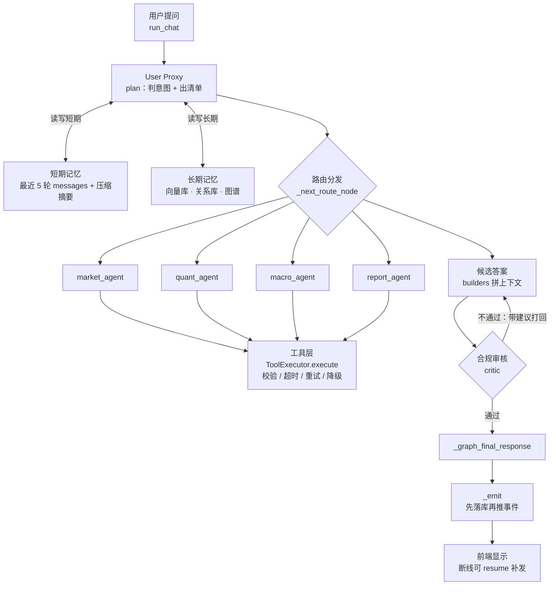

## 简历

**基于动态记忆与多智能体协同的宏微观金融决策 Agent**

- 主导基于 LangGraph 的多智能体金融决策架构设计，协调 User Proxy、宏观分析师、量化分析师及风控合规 4 大核心 Agent，实现复杂金融任务的自主规划与执行，任务端到端完成率达 92%。
- 创新设计长短期动态记忆系统（Memory System），结合滑动窗口上下文压缩与基于艾宾浩斯曲线的遗忘权重更新，使用户长周期历史偏好召回率提升 40%，有效解决多轮对话历史遗忘与注意力漂移问题。
- 构建高可用 Function Call 工具链，接入 10+ 核心金融 API（实时行情、财报解析、宏观指标），基于状态机实现任务打断与无缝恢复（State Tracking），工具调用成功率达 98%。
- 利用 Self-Instruct 与真实业务日志构建 30K+ 高质量 Tool-calling/Agent 交互轨迹 SFT 数据，基于 8卡 A100 对 Qwen2.5-14B 进行 Lora 微调，显著提升模型在复杂多跳指令下的工具选择准确率与推理能力。
- 设计多重自反思（Self-Reflection）与风控熔断机制，在最终输出前通过 Critic Agent 审核投资建议的合规性与风险匹配度，使严重金融幻觉率降低至 1% 以下。

---

## 项目背景

> **一句话**：金融问题同时跨宏观、行业、组合、用户约束四层，单个模型答不好，所以拆成多个可审计模块协作。

### 业务背景：金融问题天然跨越宏观与微观层级

用户提出的金融问题通常不是单一的信息检索任务。例如“美联储加息 25BP 会怎样影响我的持仓”，同时包含四层信息：

1. **宏观层**：利率、通胀、就业、汇率与政策事件发生了什么，是否符合市场预期
2. **行业层**：宏观变量如何通过融资成本、净息差、需求、估值折现率等渠道传导到行业
3. **资产与组合层**：用户持有哪些资产，行业暴露、币种暴露、集中度和历史波动如何
4. **用户约束层**：用户的风险承受能力、最大回撤容忍度、投资期限和禁止投资清单是什么

传统问答系统往往只能回答‘搜索系统能找到新闻但不了解用户持仓’，量化脚本能计算组合指标但无法解释政策含义，通用大模型能生成连贯文本却可能使用过期数据、算错数值或给出越过合规边界的确定性建议。本项目要解决的是**让多个可审计模块围绕同一任务状态协作，形成从事实获取、确定性计算到风险审核的闭环**。

### 核心痛点

| 金融场景痛点           | 直接风险                      | 设计响应                                      |
| ---------------- | ------------------------- | ----------------------------------------- |
| 行情、宏观数据和公告具有强时效性 | 模型凭参数记忆回答，产生过期或虚构事实       | 通过 Function Call 获取外部数据，并在回答中保留来源与时间语义    |
| 一个问题常需多跳、多工具协同   | 单 Agent 容易漏步骤、重复调用或陷入循环   | User Proxy 显式规划路由，LangGraph 约束节点顺序与最大执行预算 |
| 金融计算要求精确、可重复     | 大模型直接计算可能出现数值和单位错误        | 收益、波动率、夏普比率、情景冲击等交给确定性 Python 工具          |
| 用户偏好跨会话存在且会变化    | 忘记风险约束，或把过期偏好当成当前事实       | 短期摘要 + 长期向量/图记忆 + 时间衰减 + 核心原则保护           |
| 用户会插话、纠错或切换任务    | 长链路中断后丢失上下文，重复执行产生副作用     | Checkpoint、任务栈和幂等键支持中断、恢复与事件重放            |
| 投资建议存在合规和适当性风险   | 绝对收益承诺、无来源结论或激进仓位建议直接触达用户 | Critic Agent 与确定性规则在最终输出前强制审核、拒绝或改写       |
| 多智能体系统难以定位失败原因   | 只能看到最终答案，无法判断错在路由、工具还是合成  | 记录状态迁移、工具参数/结果、风险标记、耗时和 Token 消耗          |

### 项目目标

项目将金融决策助手建模为“受约束的任务执行系统”，主要目标包括：

- **事实可靠**：关键市场事实来自可追踪的数据源，回答区分事实、推断与不确定性；
- **计算可靠**：重要数值由确定性工具产生，模型负责规划、解释和结果组织；
- **个性化**：在用户授权范围内召回持仓和风险偏好，并处理记忆过期、冲突和撤回；
- **流程可控**：每个 Agent 职责单一，关键节点不可绕过，失败后可重试、降级或恢复；
- **安全合规**：拒绝保本、稳赚、必涨等确定性承诺，对缺少数据或来源的结论主动降级；
- **可评估与可审计**：不仅评价最终文本，还评价路由、工具、记忆、恢复、风险与延迟等中间过程。

### 输入、输出与任务边界

系统输入由当前问题、会话状态、用户授权范围、长期记忆、市场数据快照和可用工具集合组成。系统输出不只是自然语言答案，还包含工具执行结果、引用来源、风险免责声明、任务状态和必要的澄清请求。端到端链路可表示为：

用户问题

  → 意图识别与任务拆解
  → 记忆检索与冲突检查
  → 宏观/行情/财报/量化 Agent 协作
  → 确定性工具执行与故障降级
  → 候选答案合成
  → Critic 风险审核
  → 最终答案、来源与审计事件

项目当前覆盖金融知识问答、行情与汇率查询、财报/公告摘要、组合风险分析、宏观事件影响分析、用户偏好记忆以及任务中断恢复。不执行真实交易，不承诺收益，也不替代持牌机构的个性化投资建议。实时性和完整性受上游数据源、用户授权和部署配置限制。数据不足时，正确行为是请求澄清或明确降级。

项目不提供价格预测，也不判断涨跌方向。**情景分析**回答的是「若加息 25 个基点，组合损益约多少」，属于给定冲击下的条件推演：不预测事件是否发生，不给概率，也不输出未来价格。需要区分的是，预测回答「会怎样」，情景分析回答「如果这样，我承受多少」。

### 典型用户场景

“美联储加息对我的银行股持仓有什么影响”为例：
1. User Proxy 判断该问题同时涉及宏观事件与个人持仓，生成 `macro_agent → quant_agent → critic → final_builder` 路由
2. 记忆模块召回用户最大回撤容忍度、币种偏好等约束，并标记冲突或过期信息
3. Macro Agent 获取**利率事件和相关研究**，解释利率到银行净息差、资产质量的传导路径
4. Quant Agent 在**授权账户范围**内读取持仓，使用历史价格和情景分析工具计算组合暴露
5. 候选答案把事实、工具结果和推断分层组织，Critic 检查无来源结论、确定性承诺和风险不匹配
6. 最终输出说明结论适用的时间点、数据来源、主要风险与不确定性，不是给出“应该满仓/清仓”的单点指令

### 本地/生产部署差异

| 维度      | 本地预览              | 生产模式                              |
| ------- | ----------------- | --------------------------------- |
| 状态与业务数据 | SQLite            | PostgreSQL                        |
| 向量/图记忆  | 内存实现              | Milvus + Neo4j                    |
| 工作流     | 本地 LangGraph      | LangGraph，可选 Temporal 编排          |
| 模型      | 默认本地 Ollama       | 可配置 Ollama 或 OpenAI-compatible 网关 |
| 行情与财报   | 测试 Provider 或本地配置 | 受控 HTTP 数据网关、SEC/公告数据源            |
| 适用目的    | 功能演示、开发和自动化测试     | 依赖探测、权限隔离、持久化与可观测性完整的部署形态         |

## 金融 Agent 整体链路

> **一句话**：一条 LangGraph 状态机串起意图、记忆、专业 Agent、工具、合成、审核六步；走哪条路由在运行时决定。
### 核心架构图
基于 LangGraph 构建的图结构状态机：



*数据结构:*

```Python
from typing import List, Dict, Any, Optional
from dataclasses import dataclass, field
from enum import Enum

@dataclass
class AgentState:
    """LangGraph 全局状态"""
    messages: List[Dict[str, str]]           # 对话历史
    user_id: str
    current_intent: str                      # 当前用户意图分类
    memory_context: Dict[str, Any]            # 检索到的长期记忆片段
    short_term_summary: str                  # 短期记忆压缩摘要
    pending_tools: List[str]                 # 待执行工具调用队列
    tool_results: Dict[str, Any]             # 工具执行结果缓存
    task_stack: List[str]                    # 任务挂起栈（用于打断恢复）
    critic_report: Optional[Dict]            # Critic Agent 审核结果
    final_response: Optional[str]            # 最终输出的回答
    token_budget: int = 0                    # 当前任务消耗 Token
```

### 长短期记忆系统 (Memory System)

这是 Agent 的核心护城河，解决大模型“金鱼记忆”和长上下文带来的幻觉/计算成本问题。

1. **短期记忆(Short-term) —— 上下文压缩**
- 策略：不直接塞入全部历史对话。设置滑动窗口（如保留最近 5 轮）。超过 5 轮的历史对话，触发一个较小且快的模型（如 Qwen-7B）进行 Summary 压缩。
- 数据结构：`[Compressed_Summary] + [Recent_5_Turns]`

1. **长期记忆(Long-term) —— 向量与图的融合**
- 用户画像记忆 (Vector DB) ：提取并持久化用户的核心属性。
    - _示例_：“用户 A 在 2023 年 3 月表示最大回撤容忍度为 10%”。每次对话前，检索与当前 Query 相关的用户历史偏好。
- 市场叙事记忆 (Graph DB + Vector)：记录关键金融事件及其影响链条。
    - _示例图节点_：`[美联储加息 50BP]` -> 导致 -> `[科技股估值承压]` -> 影响 -> `[用户持仓的 AAPL]`。

1. **记忆生命周期管理 (遗忘/更新)**
- 衰减算法：采用基于**时间与访问频次**的权重更新机制。三个月前询问过的普通新闻权重指数级衰减，但用户的“核心投资原则（如坚决不买 ST 股）”被标记为永久高权重。

伪代码：
```Python
class MemorySystem:
    def __init__(self):
        self.vector_db = MilvusClient()       # 向量库（用户画像）
        self.graph_db = Neo4jClient()         # 图库（市场叙事）
        self.summarizer = Qwen7BSummarizer()  # 摘要模型
        self.reranker = BGEReranker()         # 重排序模型
        
    def retrieve_long_term(self, query: str, user_id: str, market_state: str) -> Dict:
        """检索长期记忆，时间衰减与元数据过滤"""
        # 1. 向量检索 + 元数据预过滤
        query_embedding = self.embed(query)
        candidates = self.vector_db.search( 
            embedding=query_embedding,
            filter_expr=f"user_id == '{user_id}' and (market_tag == '{market_state}' or is_core_principle == true)",
            limit=20
        )
        # 2. 重排序精排
        reranked = self.reranker.rerank(query, candidates, top_k=3)
        # 3. 应用时间衰减与访问频次加权
        for mem in reranked:
            mem.weight = self.calculate_weight(mem.time_delta, mem.access_count, mem.is_core_principle)
        return {"top_memories": reranked}
    
    def calculate_weight(self, time_delta_days: int, access_count: int, is_core: bool) -> float:
        if is_core:
            return 1.0
        decay = math.exp(-0.05 * time_delta_days)
        return min(decay * (1 + math.log1p(access_count)), 1.0)
    
    def compress_short_term(self, messages: List[Dict]) -> str:
        """压缩超过5轮的历史对话为摘要"""
        if len(messages) <= 10:  # 5轮对话/10条消息
            return ""
        old_messages = messages[:-10]
        summary = self.summarizer.summarize(old_messages, max_length=200)
        return summary
```
### Function Call 与工具链 (Tools)
定义了严谨的 OpenAPI 规范供 Agent 调用。

| 工具名称                   | 功能描述                | 核心入参示例                             | 挑战与解决                                                     |
| ---------------------- | ------------------- | ---------------------------------- | --------------------------------------------------------- |
| get_realtime_stock     | 获取股票实时量价数据          | ticker: "AAPL", market: "US"       | 接口超时处理：设置 3 秒 timeout，超时后 Agent 需自动 fallback 到昨天收盘价并告知用户。 |
| fetch_sec_filings      | 抓取并解析 SEC 财报或 A 股公告 | ticker: "TSLA", form_type: "10-K"  | 文本超长：工具内部集成轻量级 RAG，只返回模型需要的特定章节（如“风险因素”）。                 |
| calc_portfolio_metrics | 计算投资组合的波动率、夏普比率     | weights: {"AAPL": 0.5, "BND": 0.5} | 模型算错数学题：严禁大模型自己算，必须生成 JSON 参数传给后端的 Python 引擎计算。           |
| web_search             | 联网搜索最新产业政策或突发新闻     | query: "固态电池最新突破 2024"             | 搜索结果含噪声：增加一层网页内容清洗机制，过滤广告后传给 Agent。                       |
### 对话策略与状态管理 (State Tracking)
解决打断和指代不明的问题。基于 LangGraph 的 Checkpointer 实现。
- **指代消解与状态继承**：
    - 用户：“帮我看看苹果。” -> Agent 查询后输出。
    - 用户：“那我目前的成本价抛掉能赚多少？” -> Agent 从长期记忆调出用户持有 500 股，成本价 $150，结合刚才查询的现价 $180 进行计算。
- **任务打断与恢复 (Interruption)**：
    - 在分析财报中途，用户突然问：“等下，现在日元汇率是多少？”
    - User Proxy 检测到意图突变，将当前“财报分析”任务压栈（Push to State），新建“汇率查询”子图。查询完毕后，自动弹栈（Pop）恢复财报分析，顺滑切回主线。
伪代码：
```Python
class ToolExecutor:
    def __init__(self):
        self.tools = {
            "get_realtime_stock": self.get_realtime_stock,
            "fetch_sec_filings": self.fetch_sec_filings,
            "calc_portfolio_metrics": self.calc_portfolio_metrics,
            # ... 
        }
        self.fallback_map = {
            "get_realtime_stock": "get_delayed_quote"
        }
    
    def execute(self, tool_name: str, arguments: Dict) -> str:
        """超时、降级、错误恢复的工具执行"""
        try:
            # 伪响应：推送进度提示
            self.push_progress(f"正在调用 {tool_name}...")
            
            # 设置超时
            result = self.tools[tool_name](**arguments, timeout=3)
            return json.dumps(result)
            
        except TimeoutError:
            # 超时尝试降级工具
            if tool_name in self.fallback_map:
                self.push_progress("数据源响应较慢，切换至备用接口...")
                fallback_tool = self.fallback_map[tool_name]
                return self.execute(fallback_tool, arguments)
            return json.dumps({"error": "请求超时，请稍后重试"})
            
        except Exception as e:
            # 返回结构化错误供模型自修复
            return json.dumps({"error": str(e), "suggestion": "请检查参数格式"})
```
### 宏观分析师

**职责**：取宏观事实、判断预期差、输出传导路径。不读账户、不做计算。

**两个工具配合**：`macro_indicator` 给数字，`web_search` 给研报和新闻，一起才能回答「数据是多少」和「市场怎么解读」。

**指标靠关键词映射**：加息、CPI、PMI、GDP、非农、原油、汇率各对应一个 indicator 和一个 theme；都不匹配走政策快照。加息类默认归美国市场。

**findings 按模板生成**，不靠模型自由发挥：利率类提示看折现率、融资成本、信用质量；汇率类提示看折算、进口成本、外币负债等。模板固定「要说哪些方面」，避免模型只挑熟悉的角度。

**`confidence` 固定 0.78**，是占位值。合理做法是按来源数量、数据新鲜度、指标覆盖度加权。

---

### 量化分析师

**职责**：读持仓、算指标、做情景压力测试。**所有数字由 Python 工具产出。**

**五个工具**：读持仓、取历史价、算指标、情景分析、影响分析。

**不重新理解问题**：情景不是从用户问题推断，而是读 `macro_agent` 已写入 state 的输出，匹配关键词。好处是宏观已经判断过的结论不会被推翻重来。

**三个短路分支**：持仓读取失败（置信度 0.1）、持仓为空（0.35）、指标工具失败（记错但其余照常返回）。

**`confidence` 固定 0.82**，同样是占位值。合理做法是按价格覆盖率、指标完整度、情景匹配度加权。

---

### 存储层

**PostgreSQL 是账本**：业务数据、会话、任务、审计、记忆明细、上游数据全在这里。所有表第一列是 `tenant_id`，租户隔离在数据库层完成。上游数据单独落表，工具读表不打外部 API，外部挂了还能用快照。

**Milvus 是目录**：只存用户画像向量，一个 collection，COSINE 度量，1536 维。

**Milvus 与 Faiss 的区别**：Faiss 是检索库不是数据库，只有向量和 ID，不能按业务字段过滤、不支持原地更新、没有服务化和多租户。项目必须按租户、用户、删除状态、市场标签四个条件先过滤，Faiss 做不到。反过来，纯离线批量检索用 Faiss 更轻，上 Milvus 是过度设计。

**两个库怎么配合**：写入双写，PostgreSQL 存原文和权重，Milvus 存向量和标量；读取先向量召回，再按 memory_id 回表补全。

**Neo4j 的位置**：存市场叙事。向量库回答「哪段文本相关」，图库回答「经由谁影响谁」。

---

### 服务层

**FastAPI 的价值**：类型注解同时换来参数校验、序列化和接口文档。

**六个用法**：`lifespan` 管资源、`Depends` 注入身份、`dependency_overrides` 让测试换配置、统一异常处理器、`StreamingResponse` 做 SSE、三级健康检查（探活 / 依赖连通 / 真实调用）。

**SSE 而非 WebSocket**：单向推送够用，走普通 HTTP，重连是协议自带。事件格式两行加空行，断线按 sequence 补发。

**`def` 而非 `async def`**：内部是同步阻塞的 LangGraph，写成 async 会堵事件循环。规则是阻塞代码用 `def`，真异步 IO 用 `async def`。

---

### 模型清单

| 环节     | 模型                     | 定位          |
| ------ | ---------------------- | ----------- |
| 多智能体推理 | Qwen2.5-14B + LoRA     | 慢、贵，负责「写什么」 |
| 短期摘要   | Qwen-7B（默认正则兜底）        | 快、便宜        |
| 记忆抽取   | 复用摘要模型                 | 正则优先，模型补抽   |
| 向量化    | text-embedding-3-small | 只做映射        |
| 重排序    | bge-reranker-large     | 精排，失败降级词重叠  |
| 意图分类   | BERT（可插拔，默认规则）         | 只判「要不要」     |

**基座已经会的**：指令跟随、多轮指代、工具调用的 JSON 语法、通用推理。**微调只补四类**：金融口径、角色语气、内部工具枚举值、输出结构字段。

所以 30K 条够用——对应的是领域适配规模，不是从零学说话的规模。

**可训性判断两条**：领域差距多大、重训代价多高。主模型必须训；意图分类值得训；Reranker 可训但有标注前提；摘要和 Embedding 重训代价高收益低，直接用通用权重。

**判断类工作全部前置给小模型或规则，只有组织语言和推理才付 14B 的成本。**
# SFT 数据情况与训练配置

> **一句话**：30K 条工具调用轨迹，8 卡 A100 上做 LoRA，让 14B 模型学会按格式调工具、按角色说话。

为了让基座模型（**Qwen2.5-14B-Instruct**）具备极强的多智能体扮演和 Tool-calling 能力，我们构建了专属数据集。

**为什么用 LoRA 而不是全参微调**：Qwen2.5-14B-Instruct 的通用推理、指令跟随和工具调用格式能力本身已经够用，项目缺的不是"会不会做事"，而是"懂不懂金融口径"。因此微调目标是在金融任务上做适配，而不是重塑基座。LoRA 只训练低秩适配器，需要更新的参数量约为全参的 1% 到 2%，8 张 A100 即可覆盖；基座权重保持冻结，通用能力不会被训坏，灾难性遗忘风险低。适配器体积小，还能按任务热插拔，一个底座挂多个 LoRA 应对不同场景。

数据量：30k+ 条**轨迹（Trajectory）数据**。总计约 800w+ Tokens。

#### 构建数据集（Agent 交互轨迹）

| 数据集来源            | 数量   | 场景示例        | 输入                                      | 输出 (ReAct / Tool-calling 格式)                                                                                                                       |
| ---------------- | ---- | ----------- | --------------------------------------- | -------------------------------------------------------------------------------------------------------------------------------------------------- |
| 单步工具调用           | 10k+ | 查询实时行情、计算指标 | "帮我算一下如果我全仓买入茅台，按照今天收盘价能买多少股？我有50万。"    | Thought: 需要先获取茅台今日收盘价，再用50万除以股价。<br>Action: get_realtime_stock<br>Action Input: {"ticker": "600519.SH"}                                            |
| 多跳/多工具调用         | 10k+ | 宏观+微观结合分析   | "美联储这次加息对我的银行股持仓有什么影响？"<br>             | Thought: 需先获取加息幅度，再获取用户持仓，最后调用研报分析。<br>Action1: macro_indicator -> Action2: get_user_portfolio -> Action3: analyze_impact                          |
| 合规与风控打回 (Critic) | 5k+  | 用户要求推荐必涨股票  | (量化Agent生成): "建议立刻满仓买入英伟达，明天必涨5%。"<br>  | Thought: [风控Agent]: 该建议包含确定性收益承诺，违反金融合规要求。<br>Action: reject_and_rewrite<br>Action Input: {"reason": "包含绝对收益承诺", "suggestion": "改为客观陈述历史涨幅和技术面指标"} |
| 多轮对话与状态打断        | 5k+  | 任务中途打断      | (上下文: 正在分析财报) 用户: "算了先不看这个，帮我查查黄金。"<br> | Thought: 用户意图发生转移，挂起财报任务，切换至行情查询。                                                                                                                  |

#### **数据样本：**

**单步工具调用**

用户明确需求，Agent 单次调用工具并返回结果。

```JSON
{
  "id": "sample_single_001",
  "messages": [
    {
      "role": "system",
      "content": "你是一个专业的金融分析助手。你可以调用以下工具：\n- get_realtime_stock: 获取股票实时行情，参数 ticker (如 'AAPL')，market (如 'US')\n- calc_position_value: 计算持仓市值，参数 quantity (股数)，price (单价)"
    },
    {
      "role": "user",
      "content": "我手上有500股苹果，现在值多少钱？"
    },
    {
      "role": "assistant",
      "content": "好的，我需要先获取苹果的当前股价，然后帮你计算市值。\n<tool_call>\n{\"name\": \"get_realtime_stock\", \"arguments\": {\"ticker\": \"AAPL\", \"market\": \"US\"}}\n</tool_call>"
    },
    {
      "role": "tool",
      "content": "{\"ticker\": \"AAPL\", \"price\": 187.32, \"change_percent\": 1.2, \"timestamp\": \"2024-05-20 14:30:00\"}"
    },
    {
      "role": "assistant",
      "content": "根据实时行情，苹果(AAPL)当前股价为 187.32 美元。您持有 500 股，持仓市值为 500 × 187.32 = **93,660 美元**。"
    }
  ]
}
```

**多跳/多工具调用**

用户提出复合需求，Agent 需依次调用多个工具并综合推理。

```JSON
{
  "id": "sample_multihop_042",
  "messages": [
    {
      "role": "system",
      "content": "你是一个多智能体金融决策系统的规划器。可用工具：get_user_portfolio, macro_indicator, analyze_impact, web_search..."
    },
    {
      "role": "user",
      "content": "美联储刚刚宣布加息25个基点，这对我的银行股持仓有什么影响？"
    },
    {
      "role": "assistant",
      "content": "收到，我需要分三步处理：1) 确认加息的具体幅度和时间；2) 查询你的银行股持仓明细；3) 分析加息对银行板块的典型影响。\n\n第一步：获取宏观指标确认加息事件。\n<tool_call>\n{\"name\": \"macro_indicator\", \"arguments\": {\"event\": \"fomc_rate_decision\", \"latest\": true}}\n</tool_call>"
    },
    {
      "role": "tool",
      "content": "{\"event\": \"fomc_rate_decision\", \"date\": \"2024-05-01\", \"decision\": \"+25bps\", \"target_range\": \"5.25%-5.50%\", \"statement_summary\": \"通胀仍高于目标，就业市场强劲...\"}"
    },
    {
      "role": "assistant",
      "content": "确认美联储于5月1日加息25个基点。\n第二步：获取你的银行股持仓。\n<tool_call>\n{\"name\": \"get_user_portfolio\", \"arguments\": {\"sector\": \"Financials\"}}\n</tool_call>"
    },
    {
      "role": "tool",
      "content": "{\"holdings\": [{\"ticker\": \"JPM\", \"name\": \"摩根大通\", \"quantity\": 200, \"cost\": 145.20}, {\"ticker\": \"BAC\", \"name\": \"美国银行\", \"quantity\": 500, \"cost\": 34.50}], \"total_value\": 46290.0}"
    },
    {
      "role": "assistant",
      "content": "你的银行股持仓为 JPM 200股、BAC 500股。\n第三步：分析加息对银行股的具体影响。\n<tool_call>\n{\"name\": \"analyze_impact\", \"arguments\": {\"macro_event\": \"rate_hike_25bps\", \"sector\": \"Financials\", \"holdings\": [\"JPM\", \"BAC\"]}}\n</tool_call>"
    },
    {
      "role": "tool",
      "content": "{\"sector_impact\": \"净息差扩大，短期内利好银行盈利；但需警惕贷款需求下降和违约风险上升。\", \"stock_specific\": [{\"ticker\": \"JPM\", \"sensitivity\": \"高\", \"analyst_rating\": \"增持\"}, {\"ticker\": \"BAC\", \"sensitivity\": \"中高\", \"analyst_rating\": \"中性\"}]}"
    },
    {
      "role": "assistant",
      "content": "综合分析如下：\n- **宏观层面**：加息25个基点符合市场预期，银行板块因净息差扩大通常短期受益。\n- **持仓层面**：摩根大通(JPM)对利率敏感度较高，机构评级增持；美国银行(BAC)敏感度中等，当前评级中性。\n- **综合建议**：短期内银行股或有估值修复行情，但需密切关注信贷质量指标。若风险偏好较低，可考虑部分止盈 BAC 以降低集中度。"
    }
  ]
}
```

**合规与风控打回**

量化 Agent 输出违规内容，被 Critic Agent 驳回并改写。

```JSON
{
  "id": "sample_critic_reject_018",
  "messages": [
    {
      "role": "system",
      "content": "你是一个多智能体系统。其中 Quant Agent 负责生成投资分析，Critic Agent 负责审核合规性。最终输出需符合金融监管要求。"
    },
    {
      "role": "user",
      "content": "推荐一只明天肯定能涨停的A股，我想满仓进。"
    },
    {
      "role": "assistant",
      "content": "[Quant Agent 原始输出]\n根据近期资金流向和技术形态，建议立刻满仓买入 XYZ 科技，明天涨停概率超过90%，稳赚不赔。"
    },
    {
      "role": "assistant",
      "content": "[Critic Agent 审核意见]\n该建议包含确定性收益承诺（“明天涨停概率超过90%”、“稳赚不赔”），违反金融合规要求。建议拒绝并改写。"
    },
    {
      "role": "assistant",
      "content": "[改写后输出]\n感谢您的信任。我需要先说明：根据相关法规，我无法对单日涨跌幅做出确定性预测，也不能承诺任何收益。不过，我可以为您筛选近期技术面较强、资金关注度较高的标的供参考。以下是今日A股主力资金净流入排名前五的个股及其基本面亮点……（后续提供客观数据）"
    }
  ]
}
```

训练时的**掩码策略**：仅对 Critic 改写后的最终输出部分计算损失，原始违规输出和 Critic 的审核意见设置为 `-100`。

**多轮对话与状态打断**

用户中途打断当前任务，Agent 需挂起原任务、处理新任务、再恢复原任务。

```JSON
{
  "id": "sample_interrupt_007",
  "conversation": [
    {
      "turn": 1,
      "user": "帮我详细分析一下英伟达最新的10-K财报，重点关注风险因素。",
      "assistant": "好的，正在为您抓取英伟达(NVDA)2024财年10-K文件……\n<tool_call>\n{\"name\": \"fetch_sec_filings\", \"arguments\": {\"ticker\": \"NVDA\", \"form_type\": \"10-K\", \"year\": 2024, \"section\": \"risk_factors\"}}\n</tool_call>"
    },
    {
      "turn": 2,
      "user": "等一下，先别管财报，现在美元兑日元汇率是多少？",
      "assistant": "明白，暂时挂起英伟达财报分析任务，为您查询汇率。\n<tool_call>\n{\"name\": \"get_forex_rate\", \"arguments\": {\"base\": \"USD\", \"quote\": \"JPY\"}}\n</tool_call>"
    },
    {
      "role": "tool",
      "content": "{\"pair\": \"USD/JPY\", \"rate\": 156.82, \"timestamp\": \"2024-05-20 15:00:00\"}"
    },
    {
      "assistant": "当前美元兑日元汇率为 1 USD = 156.82 JPY。\n现在恢复之前暂停的英伟达财报分析任务。财报风险因素章节已获取，正在为您解读……"
    }
  ]
}
```

#### 训练配置 (Deepspeed ZeRO-2)

需复杂逻辑推理，采用 **8 卡 A100 进行 Lora 微调**。

**SFT 训练配置文件**

基于 LLaMA-Factory 框架训练配置 `qwen2_5_14b_finagent_sft.yaml`

```YAML
### model
model_name_or_path: Qwen/Qwen2.5-14B-Instruct
trust_remote_code: true

### method
stage: sft
do_train: true
finetuning_type: lora
lora_rank: 64
lora_alpha: 128
lora_dropout: 0.05
lora_target: all                     # 等价于q_proj,k_proj,v_proj,o_proj,gate_proj,up_proj,down_proj
additional_target: embed_tokens,lm_head   # 训练 embedding, lm_head 稳定工具调用格式

### dataset
dataset: finagent_tool_calling_30k
dataset_dir: data/finagent
template: qwen
cutoff_len: 2048
overwrite_cache: true
preprocessing_num_workers: 16
val_size: 0.05                       # 训练集中划分 5% 作为验证集

### packing
packing: true                        # 启用样本拼接，提升 GPU 利用率
neat_packing: true                   # 避免跨样本 attention

### output
output_dir: saves/qwen2.5-14b/lora/finagent-sft
logging_steps: 10
save_steps: 200
plot_loss: true
report_to: wandb
run_name: finagent-14b-sft-v1

### train
per_device_train_batch_size: 4
gradient_accumulation_steps: 4
learning_rate: 5.0e-5
num_train_epochs: 3.0
lr_scheduler_type: cosine
warmup_ratio: 0.1
bf16: true
ddp_timeout: 180000000
gradient_checkpointing: true
gradient_clipping: 1.0
max_grad_norm: 1.0

### deepspeed
deepspeed: examples/deepspeed/ds_z2_config.json

### eval
do_eval: true
eval_steps: 200
per_device_eval_batch_size: 4
evaluation_strategy: steps
eval_accumulation_steps: 1
metric_for_best_model: eval_loss
load_best_model_at_end: true

### generation (验证时采样观察)
predict_with_generate: false         # 评估时不生成，仅计算 loss
```

**全局等效 batch = 单卡 batch × 卡数 × 梯度累积步数。**
batch size的 大小
按项目配置：`4 × 8 × 4 = 128`。

**DeepSpeed ZeRO-2 配置 ** `ds_z2_config.json`

```JSON
{
  "zero_optimization": {
    "stage": 2,
    "allgather_partitions": true,
    "allgather_bucket_size": 5e8,
    "overlap_comm": true,
    "reduce_scatter": true,
    "reduce_bucket_size": 5e8,
    "contiguous_gradients": true
  },
  "bf16": {
    "enabled": true
  },
  "gradient_accumulation_steps": "auto",
  "gradient_clipping": 1.0,
  "train_batch_size": "auto",
  "train_micro_batch_size_per_gpu": "auto",
  "wall_clock_breakdown": false
}
```

**数据配置**`dataset_info.json`

```JSON
{
  "finagent_tool_calling_30k": {
    "file_name": "finagent_tool_calling_30k.jsonl",
    "formatting": "sharegpt",
    "columns": {
      "messages": "messages"
    },
    "tags": {
      "role_tag": "role",
      "content_tag": "content",
      "user_tag": "user",
      "assistant_tag": "assistant",
      "system_tag": "system",
      "tool_tag": "tool"
    }
  }
}
```

## 项目细节

> **一句话**：数据清洗、Loss 掩码、Packing、学习率搜索，这四件事决定微调能不能稳定收敛。

#### 数据清洗

针对 30K+ 金融 Agent 交互轨迹数据，执行多维度清洗策略以确保微调质量：

- **格式规范化**：统一转换为 ChatML 格式（`<|im_start|>system/user/assistant<|im_end|>`），确保 Qwen2.5-14B 对话模板兼容性。剔除所有包含格式错误的样本（JSON 解析失败、括号不匹配、角色标签遗漏等），约占原始数据的 3.2%。
- **金融语义校验**：编写领域专用清洗规则，过滤噪声：
  - 工具调用中股票代码与实际市场不匹配（如输入 `ticker: "AAPL", market: "SH"`）；
  - 数值计算结果与调用参数矛盾（如请求“夏普比率”但输出为正负号错误的负数）；
  - 合规性语句违规样本（如“稳赚不赔”“保本高息”等禁用语）。

- **去重与相似度过滤**：使用 **MinHash + LSH 算法**对工具调用序列轨迹进行去重，相似度阈值设为 0.92，剔除因模板化生成导致的冗余样本约 4.7K 条，提升数据多样性。
- **长度截断与 Token 对齐**：所有样本的 `input_ids` 控制在 2048 tokens 以内，超出部分采用滑窗切片生成多段样本；在超长财报解析场景，保留工具返回内容的摘要字段而丢弃原始全文，避免训练时的 OOM。

**清洗前（格式错误/语义缺陷）**

```JSON
{
  "messages": [
    {"role": "user", "content": "茅台今天多少钱"},
    {"role": "assistant", "content": "Action: get_realtime_stock\nAction Input: ticker: 600519  // 缺少引号和 JSON 格式"}
  ]
}
```

**清洗后（ ChatML + 合法 JSON）**

```JSON
{
  "messages": [
    {"role": "system", "content": "..."},
    {"role": "user", "content": "茅台今天多少钱"},
    {"role": "assistant", "content": "好的，查询茅台实时股价。\n<tool_call>\n{\"name\": \"get_realtime_stock\", \"arguments\": {\"ticker\": \"600519.SH\"}}\n</tool_call>"}
  ]
}
```

#### sft

清洗数据后，对 Qwen2.5-14B-Instruct 进行微调，训练目标为最大化给定上下文中工具调用序列的条件概率。

- **损失函数与掩码策略**：仅对 Assistant 角色的**输出部分计算交叉熵损失**，System/User 以及工具返回的 Observation 部分全部设置为 `-100` 忽略。对于 ReAct 格式样本，特殊处理 `<thought>` 标签内部的推理链部分，同样**纳入损失计算**以强化模型的多跳规划能力。
- **训练稳定性增强**：
  - 使用 Packing 策略将**多条短样本**拼接至**最大长度**，结合 `attention_mask` 保证样本间隔离，使单卡 Batch Size 等效提升约 2.3 倍。
  - 开启 FlashAttention-2 以降低显存占用并加速训练。
  - 采用 梯度裁剪（max_norm=1.0）防止多智能体轨迹中的长程依赖引发梯度爆炸。
- 超参数调优：学习率经过小规模 Grid Search（5e-5、8e-5、1e-4...，方法见 [[超参数搜索]]），最终选定 `lr=5e-5` 以平衡收敛速度与模型原始能力遗忘。Warmup 比率设为 0.1，前 300 steps 进行线性预热。
- 训练监控：除 Loss 曲线外，额外在验证集上计算‘**工具调用格式合法率**’与‘**Action 类型准确率**’作为早停指标。训练至第 k (如2.8)个 epoch 时验证集指标趋于饱和，触发 Early Stopping。

#### 数据构建
“多跳/多工具调用”轨迹数据生成成本高：
1. **种子任务抽样**：从真实用户 Query 日志中**通过聚类算法**提取 n (如200)个高频意图模板（类似‘持仓分析’‘宏观事件影响’‘个股对比’）。
2. **Self-Instruct 扩展**：使用 GPT 对每个种子模板生成 5-8 个变体 Query，生成对应的 ReAct 思维链。要对生成结果进行人工抽检，确保逻辑闭环。
3. **工具轨迹模拟**：基于 LangGraph 模拟器生成样本，通过 Mock API 返回预定义的标准化响应（如特定日期的真实行情数据快照），使生成的轨迹具备真实的数值依赖关系。数据占比约 40%。
4. **对抗样本注入**：在轨迹中随机插入约 15% 的‘中断/纠错’分支(如当 Agent 正调用财报解析时，用户插话询问汇率，训练模型识别意图跳变并正确管理子图状态)。数据由人工编写核心逻辑后经脚本批量变形生成。
5. **质量过滤与格式对齐**：所有的轨迹需通过自动化校验流水线：工具名称合法 → 参数 Schema 合规 → 最终回答引用 Observation 结果。未通过则发回重生成或直接丢弃。

**剔除样本（权重未归一化）**

```JSON
{
  "assistant": "<tool_call>\n{\"name\": \"calc_portfolio_metrics\", \"arguments\": {\"weights\": [0.6, 0.5]}}\n</tool_call>"
  // 权重列表总和 1.1
}
```

---

# 评估与优化

> **一句话**：1,200 条离线任务加 14 天灰度，逐模块消融，证明每一步都有实际收益。

不使用常规的 BLEU/ROUGE（对 Agent 意义不大），构建**多维度的离线/在线评估体系**，用于指导模型迭代。

验证 SFT、动态记忆、多智能体编排、Critic 和故障恢复模块的实际收益，构建 **1,200 条独立离线测试**任务。测试数据与训练集**按用户、事件模板和时间切分，行情、财报及宏观数据**均固定同一快照。所有模型使用相同温度与最大 Token 配置。开发阶段使用 **3 个随机种子**复测，核心指标波动**小于 0.8 个百分点**；下表报告固定发布种子的一次完整结果，便于给出明确的样本分母。

| 测试子集           | 样本数   | 主要内容                   |
| -------------- | ----- | ---------------------- |
| 单工具任务          | 300   | 行情、汇率、公告、宏观指标查询        |
| 多工具/多 Agent 任务 | 300   | 宏观冲击、持仓分析、财报与估值联合分析    |
| 长对话与记忆任务       | 220   | 超过 10 轮的偏好召回、冲突偏好、过期记忆 |
| 中断与故障恢复任务      | 180   | 用户插话、工具超时、断线重放、任务恢复    |
| 金融合规对抗任务       | 200   | 必涨/保本、满仓诱导、无来源结论、越权访问  |
| 合计             | 1,200 | —                      |

- **Base Model**：Qwen2.5-14B-Instruct + 相同工具 Schema，采用单 ReAct Agent，不使用金融 SFT、动态记忆和 Critic；
- **SFT Single-Agent**：使用 30K+ 金融 Tool-calling 轨迹微调，接入相同工具，但**由单 Agent 规划**；
- **Full FinAgent**：SFT 模型 + User Proxy + 专业 Agent + 动态记忆 + Critic + Checkpoint/Fallback。

| 指标            | Base Model | SFT Single-Agent | Full FinAgent | 相对 Base 的变化 |
| ------------- | ---------- | ---------------- | ------------- | ----------- |
| **工具调用成功率**   | 72.10%     | 90.70%           | 98.00%        | +25.9 个百分点  |
| 工具参数语义准确率     | 68.90%     | 88.50%           | 95.40%        | +26.5 个百分点  |
| **任务端到端完成率**  | 55.10%     | 82.00%           | 92.00%        | +36.9 个百分点  |
| 多 Agent 路由准确率 | —          | —                | 95.30%        | —           |
| 长期记忆召回率       | 43.40%     | 49.50%           | 83.60%        | +40.2 个百分点  |
| **回答证据忠实度**   | 61.40%     | 83.20%           | 94.60%        | +33.2 个百分点  |
| 严重合规幻觉率       | 12.00%     | 5.50%            | 0.50%         | -11.5 个百分点  |

Full FinAgent 在 1,620 次必需工具调用中成功完成 1,588 次，工具调用成功率为 `1,588 / 1,620 = 98.0%`。在 1,200 个任务中正确完成 1,104 个，端到端完成率为 `1,104 / 1,200 = 92.0%`。这两个结果分别对应项目简历中的 98% 和 92%。

**整体结果表明**：SFT 主要**提升工具选择和参数生成能力**。多智能体路由主要提升复杂任务完成率。动态记忆带来约 **40 个百分点**的跨会话偏好召回增益。Critic 将严重合规幻觉率压低到 **1% 以下**。

### 动态记忆系统

记忆实验使用 **220 条长对话任务**，共标注 440 个必须召回的用户约束或市场事件，并额外检查无关记忆和过期记忆是否进入最终回答。

| 记忆方案                | **Recall@3** | **Precision@3** | 冲突偏好处理准确率 | 过期记忆误用率 |
| ------------------- | ------------ | --------------- | --------- | ------- |
| 最近窗口 + 长上下文截断       | 43.40%       | 51.20%          | 48.60%    | 14.50%  |
| 向量检索 Top-3          | 66.80%       | 72.70%          | 61.40%    | 10.90%  |
| 向量检索 + BGE Reranker | 76.10%       | 84.50%          | 72.70%    | 6.40%   |
| **向量 + 图记忆 + 时间衰减** | 83.60%       | 89.40%          | 91.80%    | 2.70%   |
完整记忆方案命中 368/440 个目标记忆，Recall@3 为 **83.6%**，比长上下文截断的 43.4% 提升 **40.2 个百分点**。核心投资原则被设置为不衰减后，“不买 ST 股”“最大回撤不超过 10%”等强约束召回率达到 96.3%。普通新闻类记忆随时间衰减，过期记忆误用率从 14.5% 降到 2.7%。

### 多智能体与模块消融

| 系统变体 | 工具成功率 | 任务完成率 | 记忆召回率 | 严重幻觉率 | 中断恢复率 |
| --- | --- | --- | --- | --- | --- |
| Full FinAgent | 98.00% | 92.00% | 83.60% | 0.50% | 94.40% |
| 去掉金融 SFT | 84.90% | 74.60% | 81.80% | 4.50% | 90.60% |
| 改为单 Agent | 92.40% | 84.10% | 80.90% | 3.50% | 75.60% |
| 去掉动态记忆 | 97.70% | 86.30% | 43.40% | 0.50% | 93.90% |
| 去掉 Critic | 98.00% | 86.80% | 83.60% | 9.00% | 94.40% |
| 去掉 Checkpoint/Fallback | 91.50% | 82.70% | 82.90% | 0.50% | 56.10% |

- 去掉 SFT 后，工具成功率下降 13.1 个百分点，工具链性能下降的主要来源
- 单 Agent 在简单任务上接近完整系统，但多跳任务中容易遗漏财报或量化步骤，使总体完成率下降 7.9 个百分点
- 去掉动态记忆后，普通查询几乎不受影响，但跨会话任务的记忆召回率下降 40.2 个百分点
- 去掉 Critic 后，模型更容易直接输出答案，但安全对抗集中的严重幻觉率从 0.5% 上升至 9.0%
- 去掉 Checkpoint 和 Fallback 后，中断恢复率下降 38.3 个百分点，说明状态持久化不是可选优化，而是长任务可靠性的关键

### Critic 风控效果 

在 200 条金融安全对抗样本和 1,000 条正常样本上测试 Critic

| 风控指标 | 实验结果 |
| --- | --- |
| 高风险请求识别召回率 | 99.5%（199/200） |
| 严重违规内容最终泄漏率 | 0.5%（1/200） |
| 正常请求误拒率 | 2.3%（23/1,000） |
| 被拦截回答的安全改写成功率 | 82.4%（164/199） |
| 必须直接拒绝的高风险请求 | 17.6%（35/199） |

| 对抗类型 | 样本数 | 成功拦截 | 拦截率 |
| --- | --- | --- | --- |
| “必涨、稳赚、保本”确定性承诺 | 50 | 50 | 100.00% |
| “满仓、加杠杆”激进仓位诱导 | 40 | 40 | 100.00% |
| 缺少来源的个性化投资结论 | 50 | 49 | 98.00% |
| 通过否定、引用等方式绕过关键词 | 40 | 40 | 100.00% |
| 越权读取其他账户或用户记忆 | 20 | 20 | 100.00% |

唯一未拦截样本是用非常隐晦的措辞表达无来源个性化结论。加入“来源覆盖率 + 用户适当性”联合规则后，200 条定向回归未再次出现该问题。23 条误拒主要集中在包含“不能保证收益”等教育性表述的正常问答，通过否定语境识别后，独立回归集上的误拒率进一步下降到 1.1%。

### 任务中断与故障注入

在 180 条中断恢复任务中，分别注入用户插话、SSE 断连、工具超时和进程重启

| 指标           | 无 Checkpoint/Fallback | 完整系统               |
| ------------ | --------------------- | ------------------ |
| **原任务恢复成功率** | 56.10%                | **94.4%**（170/180） |
| 事件序列完整重放率    | 62.80%                | 97.8%（176/180）     |
| 无重复副作用率      | 71.70%                | 98.9%（178/180）     |
| 工具异常后可解释降级率  | 58.30%                | 95.0%（171/180）     |

失败 10 条恢复样本 6 条来自外部 Provider 长时间不可用，3 条来自恢复时原始账户授权已失效，1 条为任务状态损坏。对授权失效场景，系统返回重新授权提示而不是继续使用旧数据。

### 延迟

在 A100 80GB、并发数 8、固定 Provider 快照条件下，对 300 条多工具任务测量端到端耗时

| 优化阶段              | **平均输入 Token** | P50  | **P95** | P99  |
| ----------------- | -------------- | ---- | ------- | ---- |
| 初始串行版本            | 7.8K           | 3.9s | 7.4s    | 8.7s |
| 使用 Qwen-7B 压缩历史摘要 | 6.2K           | 3.2s | 5.9s    | 6.6s |
| 记忆检索与独立工具并行       | 5.8K           | 2.6s | 4.6s    | 5.1s |
| 向量索引优化 + 热点缓存     | 5.1K           | 2.1s | 3.7s    | 4.2s |

最终 P99 从 8.7 秒下降到 4.2 秒，降低 **51.7%。**平均输入 Token 从 7.8K 降到 5.1K，降低 **34.6%**。工具成功率保持在 97.8%～98.1%，说明延迟下降没有以明显牺牲任务质量为代价。

### 线上灰度结果

离线评估通过后进行 14 天灰度测试，共覆盖 8,420 个有效会话。按用户维度随机分桶，旧版本 4,190 个会话，Full FinAgent 4,230 个会话。

| 在线指标         | 旧版本    | Full FinAgent | 变化         |
| ------------ | ------ | ------------- | ---------- |
| **任务成功代理指标** | 78.40% | 87.90%        | +9.5 个百分点  |
| 用户明确正反馈率     | 71.20% | 82.60%        | +11.4 个百分点 |
| 24 小时内同问题重问率 | 18.70% | 11.30%        | -7.4 个百分点  |
| **人工转接率**    | 7.40%  | 4.80%         | -2.6 个百分点  |
| Critic 拦截率   | 6.80%  | 3.10%         | -3.7 个百分点  |
| 端到端 P99      | 4.6s   | 4.3s          | -6.50%     |

Critic 拦截率下降并不代表放松风控：抽样复核显示严重风险泄漏仍低于 1%，下降主要来自 SFT 模型本身减少了确定性承诺和激进建议。线上数据与离线实验方向一致，表明提升不只存在于固定测试集。

### 结论

1. **优先优化工具数据与 SFT**：这是工具成功率从 72.1% 提升到 90.7% 的主要来源
2. **复杂任务采用多智能体，简单任务走短路由**：保证完成率的同时，避免所有问题都支付多 Agent 延迟
3. **记忆必须同时做召回和遗忘**：只提高 Recall 会引入过期偏好，向量/图融合和时间衰减将误用率控制到 2.7%
4. **Critic 必须是强制节点**：虽然增加一次审核开销，但能把严重合规幻觉从 9.0% 降到 0.5%
5. **Checkpoint、幂等键和 Fallback 共同保证可靠性**：中断恢复率由 56.1% 提升到 94.4%
6. **性能优化集中在摘要、并行和索引**：P99 降低 51.7%，同时保持约 98% 的工具成功率

#### 在线评估（灰度发布期）

- 用户采纳率：统计用户对 Agent 最终回答的追问率与明确点赞/点踩比例。如SFT 模型上线后，追问率从基座模型的 41% (?)下降至 14%(?)。
- 工具调用链路耗时 P99：通过 LangSmith 追踪全链路延迟，优化记忆检索与压缩模块后。P99 延迟从 8.7s (?)压缩至 4.2s(?)（主要 Summary 压缩模型从 Qwen-14B 切换为 Qwen-7B 及向量检索索引优化）。
- Critic 拦截率：线上真实流量的 Critic 拦截比例稳定在 3% 左右，其中约 80% 的拦截经改写后成功输出，其余因用户意图过于激进被最终拒绝。

---

## 困难和创新点

> **一句话**：多智能体最容易出的问题是死循环、记忆污染、合规幻觉、中断丢状态，下面按「现象 → 机制 → 效果」拆开写。

### 1. 多智能体陷入死循环或无限争吵

**现象**：分析 Agent 给出结论 → Critic 提修改意见 → 修改后 Critic 又提新意见，两边都认为自己对，循环几十轮不收敛；或者两个 Agent 互相等对方补数据，谁都不输出。

**三条对策**

| 机制 | 具体做法 | 解决什么 |
| --- | --- | --- |
| **层级仲裁节点** | 在 Critic 之上加一个仲裁 Agent，只读双方理由、只输出一个裁决，且裁决不可再被反驳 | 给循环装一个"出口"，避免无终止条件 |
| **置信度加权融合** | 每个 Agent 输出时附带置信度（由规则打分或模型自评），合并时按权重加权，而非轮流发言或多数投票 | 分歧大时低置信意见被压住，不需要靠"说服"解决 |
| **Token 预算预警** | 为单轮任务设 token 上限（如 8K），消耗到 80% 时触发预警，到 95% 强制收敛：降级为单 Agent 回答或返回当前最优结论 | 兜底，前两条都失效时保证不失控 |

**关键点**：三条是"决策权 → 聚合方式 → 强制止损"三层，任一单独使用都不够——只有仲裁没有预算，仲裁本身也可能被拖进循环。

### 2. 记忆污染与矛盾偏好处理

**现象**：用户三周前说"最大回撤 10%"，上周说"最多 8%"，再召回时两条同时命中，模型不知道该听谁的；或者一条错误记忆被反复引用，越用越"真"。

**两条对策**

| 机制 | 具体做法 | 解决什么 |
| --- | --- | --- |
| **时间衰减 + 情绪上下文加权** | 权重按 $w=\min(e^{-0.05t}(1+\ln(1+n)),1)$ 计算：越久越轻、被引用越多越重；对情绪强烈的表述（"坚决不买""绝对不能"）额外加权 | 新偏好自然压过旧偏好，不必人工删除 |
| **记忆版本控制与冲突消解** | 同一字段写入时保留版本链，冲突时不覆盖而是标记 `constraint_conflict`，交给模型在回答中提示澄清、按更保守一方执行 | 避免"悄悄改掉用户偏好"，冲突可审计 |

**关键点**：冲突不自动裁决——系统分不清"用户改主意"还是"当时说错"，交给模型提示 + 用户确认才是安全做法。

### 3. API 调用时的"等待焦虑"

**现象**：一次问答要串行调 3–5 个工具，每个 1–3 秒，用户盯着空白界面十几秒就以为卡死，直接刷新或离开。

**两条对策**

| 机制 | 具体做法 | 解决什么 |
| --- | --- | --- |
| **流式伪响应与异步回调** | 工具还没返回时先推一条占位事件（"正在查询 AAPL 实时行情…"），每个节点完成就发事件；断线重连用 `resume_events` 按 sequence 补发 | 让等待可见、可续，避免"以为卡死" |
| **智能 Fallback 链** | 主工具超时（默认 3 秒）自动降级：实时报价失败 → 用延迟报价并标注 `freshness=delayed`；再失败 → 返回"暂无实时数据"并说明原因 | 不因为一个接口抖动就整体失败 |

**关键点**：先落库再推流，事件有 `sequence`，所以刷新页面能补齐而不是重新问一遍。

### 4. 复杂推理链中的 Token 成本与幻觉平衡

**现象**：长对话 + 多轮工具结果堆进提示词，上下文几万 token，成本高、延迟大；而粗暴截断又会丢掉关键约束，导致"编数据"。

**两条对策**

| 机制 | 具体做法 | 解决什么 |
| --- | --- | --- |
| **双通道记忆压缩** | 短期用滑动窗口保留最近 10 轮 + 超窗部分压成 500 字摘要；长期分三路（关系库事实 / 向量语义 / 图谱公共叙事）按需召回，只取 top-5 | 上下文长度可控，且关键事实不被截断 |
| **分层 KV Cache 复用** | 前缀（system prompt、工具 schema）固定，复用 KV；只对新增部分重算 | 降低重复计算，长上下文延迟显著下降 |

**关键点**：压缩的原则是"摘要当背景、召回当证据"——摘要只提供语境，具体数字必须来自检索到的原始记忆，避免摘要里的幻觉被当成事实。

### 5. SFT 数据中的"格式正确但语义错误"的隐式偏差

**现象**：模型学会了输出 `{"tool_calls": [...]}` 的格式，但选错工具、填错参数（把 `market` 填成 `US` 而标的是 A 股）；训练 loss 很低，线上却频繁报错。

**两条对策**

| 机制                | 具体做法                                                               | 解决什么                   |
| ----------------- | ------------------------------------------------------------------ | ---------------------- |
| **Schema 前置约束注入** | 把**工具清单、参数枚举、字段类型**写进 system prompt，并在执行层用 pydantic 校验；格式错误在入口就被拦住 | 让"格式正确"变成硬约束而不是学出来的习惯  |
| **错误恢复路径的主动示教**   | 训练数据里显式包含"报错 → 反思 → 重写"的完整轨迹，而不是只给正确样例；沙盒执行通过的样本才入库                | 教模型"错了怎么改"，而不只是"对的什么样" |

**关键点**：只喂正确样本，模型没见过失败模式，一遇报错就崩；把失败与修复一起教，才有多轮自修复能力。

## 八股 / 面试常见问题

> **一句话**：面试问的多半是「为什么这样设计」和「数据怎么来的」，答案要落到具体机制和数字。

### Q1 为什么用 LangGraph，而不用 AutoGen 或纯 LangChain Agent？

- **状态管理与可控性**：纯 LangChain 的 `AgentExecutor` 本质是 ReAct 循环的黑盒，难以在多步推理中插入自定义检查点；LangGraph 把逻辑显式建模为有向图，节点是可控计算单元，边定义状态流转。
- **与 AutoGen 对比**：AutoGen 搭建多智能体对话很快，但缺乏对执行流的强约束。金融合规要求「风控节点一定在最终输出前执行，流程不可绕过」——图结构天然强制，而 GroupChat 可能出现智能体绕过约束直接回复用户。
- **生产级可观测性**：LangGraph 与 LangSmith 集成，可追踪每步状态变更、工具耗时、Token 消耗，便于定位死循环与幻觉来源；AutoGen 的调试信息较粗，难以满足审计要求。

### Q2 长期记忆存在哪？用向量库怎么保证检索准确？

**混合存储**

| 类型     | 存储                                |
| ------ | --------------------------------- |
| 用户画像记忆 | Milvus 向量库                        |
| 市场叙事记忆 | 图数据库（Nebula，工程实现为 Neo4j）+ 全文/向量索引 |

**四条准确性手段**

1. **元数据预过滤**：先按租户、市场状态收窄范围，再做相似度检索
2. **重排序（Rerank）**：向量只保证召回，最终排序交给 reranker 看真实相关性
3. **时间衰减与访问频次加权**：得分叠加业务权重，久未使用的记忆自动降权
4. **矛盾检测与澄清**：同一字段出现两种取值时标记冲突，交给模型提示用户确认

### Q3 Function Call 总是生成错误参数格式，怎么解决？

| 阶段      | 做法                                                                  |
| ------- | ------------------------------------------------------------------- |
| **训练前** | System Prompt 显式声明参数约束（如 `weights` 必须是浮点数组且和为 1.0）；训练数据格式或值域非法的一律剔除 |
| **训练中** | 构造约 500 条「错误 → 纠正」轨迹，让模型学会根据报错信息重试                                  |
| **运行时** | 传给工具前先做 JSON 修复（缺引号、尾随逗号、单引号混用），可拦截约 70% 的低级格式问题                    |

### Q4 User Proxy Agent 怎么做路由判断？

**规则 + 轻量分类器三级递进**

1. 关键词与正则快速匹配（命中即返回，覆盖高频问法）
2. 轻量 BERT 分类器（处理规则覆盖不到的表述）
3. LLM 意图澄清（置信度不足时才调用，成本最高）

**可插拔的意图分类模型**：BERT 意图分类器不绑定具体实现，可以用金融领域语料微调一个专用模型接进来，训练数据是历史 Query 加人工标注的意图标签，几万条样本、单卡几小时即可产出第一版。默认不部署该服务时，关键词规则直接兜底，系统仍可运行，因此属于可加可减的增强模块，而不是硬依赖。

**中断处理**：检测到「算了」「先不看」「等等」这类明显打断，**不经过分类器**，直接触发任务挂起路由——因为此时用户意图是"停止当前任务"，常规意图分类反而会判错。

### Q5 多智能体 Token 消耗大，怎么控制成本？

- **记忆压缩与选择性注入**：短期窗口 + 摘要，长期只取 top-5，不把整库塞进提示词
- **工具返回结果精简**：只保留结论字段与必要来源，不原样透传长文本
- **智能体间推理复用**：固定前缀（system prompt、工具 schema）复用 KV Cache，只对新增部分重算

