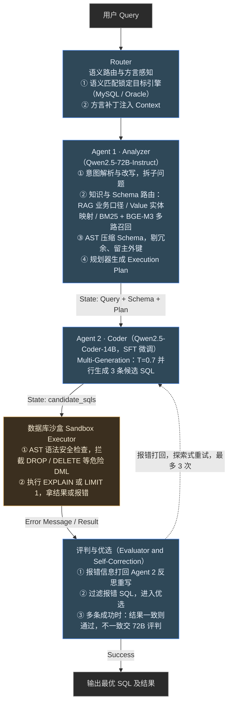
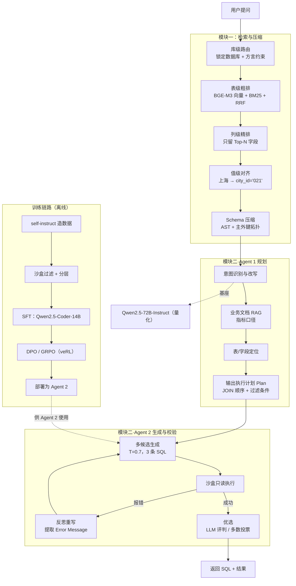

# 前置资料

- **text2sql 常见 benchmark**
- self-instrut 重点
  - 假设你是一个 sql 专家，单独/多轮
  - Few-shot 提示，
  - 种子专家，有经验的 sqler 去写。
  - 种子生种子，大模型想一些，根据种子专家再生成一些例子
- **多智能体 text2sql 代码**

# 核心逻辑与流转图 (Agentic Workflow)




```text
工作流示例:

用户: "帮我查一下华东区上个月卖得最好的商品"

  Agent1 (Analyzer):
  ├── 语义改写: "华东区=[上海,浙江,江苏,安徽]，时间=上月，维度=销量"
  ├── 业务RAG检索: "爆款商品定义：月销量 > 1000 件"
  ├── Schema检索: 召回 sales, products, dim_region 三张表
  ├── 输出Plan:
  │   1. 关联 products 和 sales 表 (product_id)
  │   2. 关联 dim_region 过滤华东区 (region_id IN [...])
  │   3. 过滤 create_time BETWEEN '2026-03-01' AND '2026-03-31'
  │   4. 按 product_name GROUP BY，COUNT(*) AS 销量
  │   5. ORDER BY 销量 DESC LIMIT 3

  Agent2 (Coder):
  ├── 接收Plan，生成3条候选SQL:
  │   ├── SQL1: SELECT ... LEFT JOIN ...
  │   ├── SQL2: SELECT ... INNER JOIN ...
  │   └── SQL3: SELECT ... USING(product_id)
  ├── 沙盒验证 → SQL1 成功
  └── 输出最终SQL
```

# 项目细节

## Agent架构设计 (Agentic RAG for Text2SQL)

系统分为**两大核心模块**：预处理与检索模块（多粒度检索+Schema压缩）、LangGraph 双智能体模块。



## 双 Agent 工作流 (LangGraph)

- **Agent 1 (Analyzer/Planner - 分析智能体)**
  - **职能**：问题理解、知识库与元数据检索、生成 SQL 编写的**逻辑方案 (Execution Plan)**。
  - **动作**：
    1. 意图识别与 Query 改写。
    2. 触发**业务文档检索**（如“什么是活跃用户”的定义，来自 FAQ 库）。
    3. 触发**表检索**（定位可能用到的**表和字段**）。
    4. 输出带约束的 Prompt（如：“计算活跃用户需要关联用户表和登录表，注意时间字段需转换格式”）。
- **Agent 2 (Coder/Executor - 执行智能体)**
  - **职能**：根据 Agent 1 的方案生成 SQL、执行校验、反思报错。
  - **动作**：
    1. **多次生成 (Multi-Generation)**：利用较高 Temperature（如 0.7）同时生成 3 条候选 SQL。
    2. **沙盒执行**：将 SQL 丢入只读数据库沙盒执行。
    3. **探索性学习 (Exploratory Learning)**：如果 SQL 报错（如列名不存在、GROUP BY 报错），提取 Error Message 给大模型，要求其反思并重新生成。
    4. **优选机制**：对比成功执行的 SQL 结果，通过 LLM-as-a-judge 或 多数投票（Majority Voting）选出最优结果并返回。

## 基座模型选择

- **Agent 1 (分析与规划)**：使用 `Qwen2.5-72B-Instruct` 量化模型
- **Agent 2 (代码生成与修正)**：使用本地微调的 `Qwen2.5-Coder-14B`（专门针对内部数据库方言和格式 SFT，推理速度快，适合多轮生成和修正）。

## Agent 1深度剖析

Analyzer 是整个系统的大脑，它的核心使命是**降噪**和**逻辑对齐**。

### 动作拆解与方法论

- **意图识别与 Query 改写**：
  - **方法**：使用 Few-shot Prompt 引导 72B 模型将**口语化**表述转为**标准数据查询维度**。
  - **示例**：用户输入“看看上个月华东区卖得最好的三个爆款”。模型将其改写为：“查询时间维度为上个月，区域为华东区，按销量降序排列的 Top 3 商品名称及销量”。

**改写前后对照**：

```text
用户原始 query：
  看看上个月华东区卖得最好的三个爆款

Agent1 改写后的标准查询维度：
  查询时间维度为【上月：2026-03-01 至 2026-03-31】，
  区域为【华东区：包含上海、浙江、江苏、安徽】，
  按【销量】降序排列的 Top 3 商品名称及销量
```

**改写用的 Few-shot Prompt**（72B 模型）：

```python
PLANNER_PROMPT = """你是一个资深的数据分析师。请将用户的口语化问题改写为清晰的数据查询维度。

【示例】
用户问："查看北京销量最高的产品"
改写为："查询城市='北京'，按销量降序排列，取 Top 1 产品及其销量"

用户问："看看上个月华东区卖得最好的三个爆款"
改写为：{query}

请直接输出改写后的查询描述，不要输出 SQL。"""
```

- **触发业务文档检索 (Business RAG)**：
  - **方法**：将 Query 向量化，去 **FAQ 库**或**指标字典库**（如飞书文档提取的 Markdown）中检索。匹配到“华东区”包含“上海、浙江、江苏、安徽”。
- **触发表检索 (Schema Retrieval)**：
  - **方法**：将改写后的 Query 送入**多粒度检索模块**，提取表（如 `sales_record`, `dim_region`, `dim_product`）及其压缩后的 DDL。
- **输出逻辑方案 (Execution Plan)**：
  - **逻辑**：不让大模型直接写 SQL，而是让它写“伪代码”或“计算逻辑”。这被称为 **Chain-of-Thought (CoT) 分离**，能大幅减少语法错误。

```text
用户问题：
  查询 2023 年销售额排名前三的部门名称及对应总额

Agent1 输出的 Execution Plan：

  1. 确定主表与关联表
     - 主表：departments（部门信息）
     - 关联表：sales（销售记录）
     - 连接条件：departments.id = sales.dept_id

  2. 过滤条件
     - 时间过滤：sales.year = 2023

  3. 聚合与分组策略
     - 按 departments.name 分组
     - 聚合函数：SUM(sales.amount) AS total_sales

  4. 排序与限制
     - 按 total_sales 降序排列
     - 限制前 3 条

  5. 注意事项
     - 部门可能重名，按 id 分组后再取 name
     - 金额保留 2 位小数
```

- **为什么 Agent1 不直接输出 SQL？**
  - Chain-of-Thought (CoT) 分离
  - 传统方式（差）：用户 Query → 直接生成 SQL（容易出错）
  - 该方式（好）：用户 Query → Agent1 规划逻辑 → Agent2 写 SQL
    1. 降低语法错误：逻辑步骤比 SQL 更不容易出错
    2. 便于调试：SQL 错了可以回查是哪一步逻辑有问题
    3. 业务对齐：72B 更擅长理解「净利润 = 营收 − 成本」这类业务口径

#### Agent 1 提示词模板 (Prompt Engineering)

```python
你是一个资深的数据库架构师。请根据用户问题、业务知识和表结构，制定 SQL 查询逻辑步骤。
【用户问题】：{query}
【业务知识】：{business_knowledge}
【相关表结构】：{compressed_schema}

请按以下格式输出规划（切勿直接写出完整 SQL，只写逻辑）：
1. 确定主表与关联表：...
2. 过滤条件：...
3. 聚合与分组策略：...
4. 排序与限制：...
```

#### Agent1 出问题的旁路路线

- 链路动态剪枝：跳过 Analyzer，直达 Coder
  如果 Agent 1 的 RAG 检索或意图解析发生超时或异常，可以设计一个“快速通道” 语义缓存：
  - **语义缓存（Semantic Cache）降级：** 优先查询向量数据库中**已有的“Query - SQL”对**。如果当前问题与历史高分问题相似度极高（如 $>0.95$），直接返回历史 SQL，完全不经过 Agent 1。
  - **默认 Schema 注入：** 若 Agent 1 无法产出压缩 Schema，自动加载该业务域下的“**高频核心表全量 DDL**”给 Agent 2。虽然 Token 消耗会增加，但保证了链路不中断。
- 基于**规则的“启发式解析”** 兜底
  在 Agent 1 瘫痪时，引入一个不依赖 LLM 的 **Heuristic Parser**：
  - **关键词提取：** 使用传统的 NLP 工具（如 Jieba/HanLP）提取 Query 中的表名和字段关键词。
  - **实体映射（Value Lookup）：** 直接利用已经建好的 Elasticsearch 倒排索引进行值映射（如“北京” -> `city_id='010'`）。
  - **直接交付：** 将这些提取到的“硬知识”直接喂给 Agent 2。Agent 2 虽然没有了详细的 Execution Plan，但有了正确的过滤条件和表，依然有**概率**生成正确的 SQL。

## Agent 2 (Coder/Executor) 深度剖析

Coder 是执行单元，核心是利用小模型的推理速度优势，进行**并发生成**和**低成本试错**。

### 动作拆解与方法论

- **多次生成 (Self-Consistency / Multi-Generation)**：
  - **参数配置**：设置**温度系数 T=0.7和 Top-p=0.9**。因为 SQL 生成如果 T=0，每次生成的都一样，无法容错；稍微调高温度，模型可能会在 **JOIN** 方式（如 `LEFT JOIN` vs `INNER JOIN`）或函数选择（如 `IFNULL` vs `COALESCE`）上产生不同方案。
- **沙盒执行 (Sandbox Validation)**：
  - **方法**：不仅用 `EXPLAIN` 验证语法，还需要加上 `LIMIT 1` 真实跑一下。很多逻辑错误（如类型不匹配：将 `VARCHAR` 类型的金额进行 `SUM` 导致截断）只有真实执行才能发现。
- **探索性学习 (Self-Correction)**：
  - **机制**：闭环反馈系统。提取数据库**返回的 Driver 级错误信息**（如 `ORA-00904: invalid identifier` 或 MySQL 的 `Unknown column`），将其拼接到历史对话中，让模型“看着报错改代码”。

#### LangGraph 核心代码实现细节

```python
from typing import TypedDict, List
from langgraph.graph import StateGraph, END


# 1. 定义图的全局状态
class Text2SQLState(TypedDict):
    query: str
    business_knowledge: str
    schema: str
    execution_plan: str
    candidate_sqls: List[str]
    valid_sqls: List[str]
    error_msg: str
    retry_count: int
    final_sql: str


# 2. Agent 1: 生成执行计划
def planner_node(state: Text2SQLState):
    # 模拟外部 RAG 检索
    business_kb = retrieve_business_docs(state["query"])
    schema_info = retrieve_compressed_schema(state["query"])

    prompt = PLANNER_PROMPT.format(
        query=state["query"],
        business_knowledge=business_kb,
        compressed_schema=schema_info,
    )

    # 调用 72B 接口
    plan = llm_72b.invoke(prompt)
    return {
        "execution_plan": plan,
        "schema": schema_info,
        "business_knowledge": business_kb,
        "retry_count": 0,
    }


# 3. Agent 2: 编写与修正 SQL
def coder_node(state: Text2SQLState):
    if state["retry_count"] > 0:
        # 自我修正（Exploratory Learning）
        prompt = REPAIR_PROMPT.format(
            schema=state["schema"],
            plan=state["execution_plan"],
            error=state["error_msg"],
        )
    else:
        # 初次生成
        prompt = CODER_PROMPT.format(
            schema=state["schema"],
            plan=state["execution_plan"],
        )

    # 高温并发生成 3 条
    responses = llm_14b_coder.generate(prompt, n=3, temperature=0.7)
    sqls = [extract_sql(r) for r in responses]
    return {"candidate_sqls": sqls}


# 4. Agent 2: 验证节点
def executor_node(state: Text2SQLState):
    valid = []
    last_err = ""

    for sql in state["candidate_sqls"]:
        status, err_or_result = sandbox_db.execute(f"EXPLAIN {sql}")
        if status == "SUCCESS":
            valid.append(sql)
        else:
            last_err = err_or_result

    if valid:
        # 多条时可在此时加入多数投票或 LLM Judge
        return {"valid_sqls": valid, "final_sql": valid[0], "error_msg": ""}
    return {"error_msg": last_err, "retry_count": state["retry_count"] + 1}


# 5. 条件边控制路由
def route_next(state: Text2SQLState):
    if state["final_sql"]:
        return "success_end"
    if state["retry_count"] >= 3:
        return "fail_end"
    return "retry"


# 6. 构建流转图
workflow = StateGraph(Text2SQLState)
workflow.add_node("Planner", planner_node)
workflow.add_node("Coder", coder_node)
workflow.add_node("Executor", executor_node)

workflow.set_entry_point("Planner")
workflow.add_edge("Planner", "Coder")
workflow.add_edge("Coder", "Executor")
workflow.add_conditional_edges(
    "Executor",
    route_next,
    {
        "success_end": END,
        "fail_end": END,
        "retry": "Coder",   # 报错且重试 < 3 时打回 Coder
    },
)

app = workflow.compile()
```

## 数据构造：

我们不是给模型 `<问题, SQL>`，而是利用 **DeepSeek-R1** 蒸馏出一套带有**思维链（CoT）** 的训练集。深度思考 SFT 数据（50K+）基于 **Spider/BIRD** 通过拒绝采样蒸馏，关键区别在于构造方式：
- 不是直接用 Spider/BIRD 的 `<问题, SQL>` 对
- 而是将 Spider/BIRD 的 `Query + Schema` 输入 DeepSeek-R1，并发生成 5 组 `(Reason, 候选 SQL)`
- 通过**沙盒执行或 AST** 对比过滤，只保留"SQL 执行结果正确"的那一组对应的 `Reason`
- 最终形成 `{instruction, schema, thought, output}` 格式的训练数据
这样做是为了确保思维链（CoT）是**原生的、正向推理**的，而不是拿着答案强行编解释。


纠错对抗数据（20K+）构造错误 SQL + DeepSeek-R1 修复，不来自 Spider/BIRD，是人为构造的：
- 故意生成带有**微小错误**的 SQL（如字段名错误、缺少 GROUP BY）
- 将 `{错误 SQL, 真实报错信息, Schema}` 输入 **DeepSeek-R1**
- 让模型生成修正后的 SQL 和**反思过程**
- 用于训练 Agent 2（Coder）的**探索性学习**（Self-Correction）能力


企业私有数据 / 简单查询平衡数据（~20%），日志/构造的单表查询；训练集混合：
- 历史查询日志：从真实业务数据库日志中抽取**高频/长尾 SQL**
- 简单查询数据：为了避免模型"矫枉过正"（只学会复杂推理，忘了简单 SQL），文档明确提到引入了 20% 的经典高频单表/双表查询数据（不带 `<think>` 标签，直接输出 SQL）与长链条数据混合训练

| 数据类型   | 来源                              | 数量   | 用途                   |
| ------ | ------------------------------- | ---- | -------------------- |
| 深度思考数据 | Spider/BIRD 样本 + DeepSeek-R1 蒸馏 | 50K+ | Agent 2 的正向 SQL 生成能力 |
| 纠错对抗数据 | 人为构造错误 SQL + DeepSeek-R1 修复     | 20K+ | Agent 2 的自纠错/探索性学习   |
| 简单平衡数据 | 自有日志/构造的单表查询                    | ~20% | 防止灾难性遗忘，保持简单查询能力     |


**蒸馏：重点**
- 问题给ds、拿到reason+sql：
  - 问题：幻觉比较大，sql结合场景和数据
- 问题+sql给ds， 造reason：
  - 不符合人类直觉解题步骤
- 背景问题 给ds，多次生成reason +sql，如果sql和你最终的sql，就用这个reason。
  - 后续扩展：调用多个模型

### 构造「深度思考」SFT 数据（50K+）

- **任务描述**：利用 DeepSeek-R1 强大的推理能力，针对复杂的 **Spider/BIRD** 样本生成思考过程。

**数据结构**：
```json
{
  "history": "<上下文> + 错误反馈",
  "instruction": "查询2023年销售额排名前三的部门名称及对应总额。",
  "schema": "Table departments (id, name); Table sales (dept_id, amount, year);",
  "thought": "<think>\n1. 目标：统计部门销售额并排序。\n2. 涉及表：departments (d) 和 sales (s)。\n3. 连接条件：d.id = s.dept_id。\n4. 过滤：s.year = 2023。\n5. 聚合：SUM(s.amount) AS total_sales，按 d.name 分组。\n6. 排序：ORDER BY total_sales DESC，LIMIT 3。\n7. 注意：departments 表可能存在同名，需按 ID 分组后再取 Name 以保严谨。\n</think>",
  "output": "SELECT d.name, SUM(s.amount) AS total_sales FROM departments d JOIN sales s ON d.id = s.dept_id WHERE s.year = 2023 GROUP BY d.id, d.name ORDER BY total_sales DESC LIMIT 3;"
}
```

#### 构造“纠错”对抗数据 (20K+)

- **模拟报错**：人为制造一些带有微小错误的 SQL（如字段名写错、缺少 GROUP BY）。
- **修复过程**：让 DeepSeek 生成修正后的 SQL，并解释为什么要这么改。
- **价值**：这是 Agent 2 实现“探索性学习”的关键，让模型在面对数据库报错信息（Exception）时不再“一脸懵逼”，而是能根据 `error_msg` 自动打补丁。


### 一、 蒸馏探索试错

在分享数据构造思路时，可以按照这个逻辑展开：
1. **踩坑路径一：直接 Query -> Reason + SQL (纯生成)**
  - **问题**：闭卷考试，幻觉极大。模型生成的 SQL 往往脱离了企业真实的物理表结构（Schema）和特有的业务口径。
2. **踩坑路径二：Query + Target SQL -> Reason (事后诸葛亮 / 后置解释)**
  - **问题**：违背人类直觉。拿着答案写解题步骤，模型会产生“马后炮”式的强行解释逻辑，这种“伪造的思维链”在训练时会导致模型学不到真正的推理跳跃（Reasoning leaps）。
3. **最终方案：基于拒绝采样的多路并发提取 (Rejection Sampling)**
  - **做法**：把 Query 和 Schema 给到 DeepSeek-R1，设置较高的 Temperature（如 0.7），让它并发生成 5 个不同的 `(Reason, 候选 SQL)` 对。
  - **过滤**：将这 5 个候选 SQL 在沙盒中执行，或者与金标准 SQL（Gold SQL）进行 AST（抽象语法树）对比。如果某个候选 SQL 结果正确，我们就把**生成它的那个 Reason** 提取出来作为 SFT 的金标准。
  - **优势**：确保了思维过程是**原生的、正向的、且绝对通向正确答案的**。

### 二、 R1 蒸馏 Prompt 设计与格式

为了让 DeepSeek-R1 稳定吐出我们需要的数据，Prompt 设计必须简洁且具有强制约束力。

#### 场景一：构造“深度思考”数据 (SFT 50K+)

**目标**：教会模型拿到需求和表结构后，先规划，再写代码。

**发给 DeepSeek-R1 的 Prompt 模板：**

```text
你是一个资深的数据库架构师。请根据给定的数据库表结构，为用户的查询需求编写 SQL。

【表结构】：
{compressed_schema}

【用户需求】：
{query}

【要求】：
1. 必须包含完整的思考过程。在思考阶段，请明确指出：涉及哪些表、连接条件是什么、过滤条件是什么、有哪些边缘情况（如空值或重复数据）需要注意。
2. 思考过程请严格包裹在 <think> 和 </think> 标签内。
3. 思考结束后，请直接输出纯净的 SQL 语句，不要有任何多余的解释文字。

输出格式示例：
<think>
1. 目标是...
2. 涉及的表...
...
</think>
SELECT ...
```

#### 场景二：构造“探索性学习/纠错”数据 (20K+)

**目标**：教会 Agent 2（Coder）在面对数据库抛出异常时，能够读懂报错，反思自己之前的 SQL 哪里写错了，并给出正确的补丁。

**前置准备**：我们用**稍微弱一点的模型**（或者屏蔽掉大模型的 Context）故意**生成一批有瑕疵的 SQL**，丢进数据库执行，拿到真实的 `error_msg`（如 MySQL 的 `1054 - Unknown column 'xxx' in 'field list'`）。

**发给 DeepSeek-R1 的 Prompt 模板（用于生成带反思的修复数据）：**

```text
你是一个数据库排错专家。系统执行了一段 SQL 并报告了错误。请分析报错原因，并给出修复后的 SQL。

【表结构】：
{compressed_schema}

【原始需求】：
{query}

【报错的 SQL】：
{bad_sql}

【数据库真实报错信息】：
{error_msg}

【要求】：
1. 你的思考过程必须严格包裹在 <think> 和 </think> 标签内。
2. 在 <think> 中，请明确指出：这个报错信息意味着什么？原始 SQL 违反了什么语法规则或表结构定义？应该如何修改？
3. 思考结束后，直接输出修复后的正确 SQL。

输出格式示例：
<think>
1. 报错提示 "Unknown column 'dept_name' in 'field list'"。
2. 检查表结构发现，departments 表中的部门名称字段是 'name' 而不是 'dept_name'。
3. 原始 SQL 的 SELECT 子句中使用了错误的列名。需要将 d.dept_name 修改为 d.name。
</think>
SELECT ...
```

---

### 三、 最终落库用于训练的 JSON 数据结构

经过清洗和格式化，最终送给 LLaMA-Factory 训练的 JSON 格式如下。注意，`history` 字段完美模拟了 Agent 2 在多轮对话中“提交错误 SQL -> 收到沙盒报错 -> 触发思考与重新生成”的流转过程。

```json
[
  {
    "instruction": "查询2023年销售额排名前三的部门名称及对应总额。",
    "input": "【表结构】: Table departments (id, name); Table sales (dept_id, amount, year);",
    "output": "<think>\n1. 目标：统计部门销售额并排序。\n2. 涉及表：departments (d) 和 sales (s)。\n3. 连接条件：d.id = s.dept_id。\n4. 过滤：s.year = 2023。\n5. 聚合：SUM(s.amount) AS total_sales，按 d.name 分组。\n6. 排序：ORDER BY total_sales DESC，LIMIT 3。\n7. 注意：departments 表可能存在同名，需按 ID 分组后再取 Name 以保严谨。\n</think>\nSELECT d.name, SUM(s.amount) AS total_sales FROM departments d JOIN sales s ON d.id = s.dept_id WHERE s.year = 2023 GROUP BY d.id, d.name ORDER BY total_sales DESC LIMIT 3;",
    "history": []
  },
  {
    "instruction": "请根据报错信息修复 SQL。",
    "input": "【原始需求】: 查询2023年销售额排名前三的部门名称及对应总额。\n
          【表结构】: Table departments (id, name); Table sales (dept_id, amount, year);\n
          【报错的SQL】: SELECT d.dept_name, SUM(s.amount) AS total_sales FROM departments d JOIN sales s ON d.id = s.dept_id WHERE s.year = 2023 GROUP BY d.dept_name ORDER BY total_sales DESC LIMIT 3;\n
          【数据库报错】: 1054 - Unknown column 'd.dept_name' in 'field list'",
    "output": "<think>\n
            1. 分析报错：数据库提示找不到列 `d.dept_name`。\n
            2. 校验 Schema：检查传入的 `departments` 表结构，发现字段为 `id` 和 `name`，确实没有 `dept_name`。\n
            3. 修复方案：原始 SQL 中开发者凭主观臆想伪造了字段。需要将 SELECT 和 GROUP BY 中的 `d.dept_name` 替换为真实的 `d.name`，并且为了严谨，GROUP BY 中应加入主键 `d.id`。\n
           </think>\n
           SELECT d.name, SUM(s.amount) AS total_sales FROM departments d JOIN sales s ON d.id = s.dept_id WHERE s.year = 2023 GROUP BY d.id, d.name ORDER BY total_sales DESC LIMIT 3;",
    "history": [
      ["查询2023年销售额排名前三的部门名称及对应总额。", "SELECT d.dept_name, SUM(s.amount) AS total_sales FROM departments d JOIN sales s ON d.id = s.dept_id WHERE s.year = 2023 GROUP BY d.dept_name ORDER BY total_sales DESC LIMIT 3;"]
]
  }
]
```

通过这种格式的蒸馏，模型不仅学到了 **“怎么写对 SQL”**（正向逻辑），更学到了 **“写错了该怎么根据 Error Log 自救”**（反向纠错）。

## 训练策略：针对 Coder 的定向微调

我们使用 **LlamaFactory + DeepSpeed ZeRO-2** 框架，对 **Qwen2.5-Coder-14B** 进行**两阶段训练**。

### 阶段一：全场景 SFT (Supervised Fine-Tuning) 70k+样本

- **目标**：掌握**金融/企业私有数据库**的语法细节（如特定的日期函数、空值处理 `COALESCE`）。
- **关键参数**：
  - **Context Length**: 8K（足够容纳压缩后的 Schema + 思维链）。
  - **Learning Rate**: 5e-6（长文本训练建议使用较小的学习率）。
  - **Loss Weight**: 只计算 `<thought>` 和 sql 部分的 Loss，忽略 Instruction。

### 阶段二：DPO 偏好对齐 (Direct Preference Optimization)

- **数据对**：
  - **Chosen (优)**：执行结果正确、SQL 简洁、符合索引优化的语句。
  - **Rejected (劣)**：执行报错、或者虽然结果对但逻辑冗余（如无意义的嵌套、全表扫描）的语句。
- **效果**：通过 DPO，模型生成的 SQL 执行成功率（Execution Accuracy）通常能提升 **5-8%**。


#### DPO 数据构造的路径

**A. 修复链路的「负向遗产」——执行报错**

利用 Agent 2 的探索性学习（Self-Correction）过程。

- **Rejected (劣)：** Agent 2 第一次生成的、导致数据库报错（如 `Unknown column`）或逻辑死循环的 SQL。
- **Chosen (优)：** 经过 3 轮以内修正，最终在沙盒中执行成功且结果正确的 SQL。

> **价值：** 这能精准教会模型避开它最容易犯的语法和方言错误。

**B. 性能退化对抗（针对复杂查询）- 逻辑冗余（如无意义的嵌套、全表扫描）**

利用强模型（如 DeepSeek-R1）对已有的正确 SQL 进行“降级改写”：

- **Chosen：** 使用了**窗口函数**、**CTE（公用表表达式）** 且符合索引命中的标准 SQL。
- **Rejected：** 将其改写为**多层嵌套子查询**、去掉索引字段过滤、或者在 `WHERE` 子句中对**索引列**使用函数（导致索引失效）的 SQL。

#### 如何保证构造数据的“标准”？

**第一层：结果集硬对齐 (Execution Alignment)**

这是最高准则。Chosen SQL 必须在沙盒中跑出结果，且该结果集（DataFrame）必须与 **Ground Truth（金标准答案）** 的内容、列名、顺序完全一致。如果结果不对，这条数据直接丢弃。

**第二层：专家模型（LLM-as-a-Judge）二次确认**

对于“语义对但风格不同”的情况，调用 `GPT-4o` 或 `DeepSeek-V3` 作为**裁判**，并给出打分理由。只有当专家模型也认为 Chosen 显著优于 Rejected 时，才入库。

注意事项：宁缺毋滥

**探索性学习 (Exploratory Learning)**

这是 Agent 2 在 LangGraph 中最具“灵性”的部分。当 SQL 在沙盒执行失败时，模型会根据反馈自我进化。

```python
# 核心 Prompt：引导模型进行自我修复
REPAIR_PROMPT = """
你刚才生成的 SQL 在执行时报错了。请参考以下信息进行修正：
【数据库类型】：MySQL 8.0
【原始问题】：{query}
【表结构描述】：{schema}
【执行方案】：{plan}
【错误信息】：{error_msg}

请反思报错原因（是否引用了不存在的列？是否缺少聚合？），并给出修正后的 SQL：
"""


def self_correction_logic(state: Text2SQLState):
    """Agent 2 的纠错节点逻辑"""
    # 提取最后一次报错信息
    error_feedback = state["error_msg"]

    # 构造修复请求
    repair_input = REPAIR_PROMPT.format(
        query=state["query"],
        schema=state["schema"],
        plan=state["execution_plan"],
        error_msg=error_feedback,
    )

    # 调用 14B-Coder：Temperature=0.2，保证稳定收敛
    correction_res = llm_14b_coder.invoke(repair_input)
    new_sql = extract_sql(correction_res)

    return {"candidate_sqls": [new_sql], "retry_count": state["retry_count"] + 1}
```

数据配比

### 硬件底座与全局策略

- **算力集群**：单机 8 卡 NVIDIA A100 (80GB NVLink)
- **训练框架**：LLaMA-Factory + DeepSpeed ZeRO-2 + FlashAttention-2
- **精度策略**：全程启用 `bf16` 混合精度训练，避免长文本场景下的溢出问题。

### 参数配置：SFT（全场景指令微调）

在 8 卡 A100 上，面对 **14B 模型和 8K 长上下文**（容纳 Schema 和 `<think>` 过程），我们采用了**全量**目标模块的 LoRA 微调（也可根据实际情况平移为全参数微调）。

**LLaMA-Factory `sft_qwen.yaml` 核心配置：**

```yaml
# 基本模型与数据配置
model_name_or_path: Qwen/Qwen2.5-Coder-14B
stage: sft
do_train: true
finetuning_type: lora
lora_target: all                   # 作用于所有线性层 (q_proj, v_proj, k_proj, o_proj等)，提升拟合能力
lora_rank: 64                      # 较高 Rank 以捕获复杂的 SQL 语法特征
lora_alpha: 32
lora_dropout: 0.05
dataset: text2sql_sft_cot          # 70K+ 混合训练集 (含 DeepSeek-R1 蒸馏数据)
template: qwen
cutoff_len: 8192                   # 强开 8K Context，容纳压缩后的 AST Schema 和复杂推理链路
overwrite_cache: true
preprocessing_num_workers: 16

# 训练超参 (8卡分布式)
per_device_train_batch_size: 2     # 单卡显存 80G 跑 8K context，设为 2 比较极限且安全
gradient_accumulation_steps: 4     # 全局 Batch Size = 2 * 8卡 * 4 = 64
learning_rate: 1.0e-5              # 相比 4卡，8卡增大了全局 BS，LR 微调至 1e-5
num_train_epochs: 3.0
lr_scheduler_type: cosine
warmup_ratio: 0.1                  # 10% steps 用于预热，防止初始 Loss 爆炸
weight_decay: 0.1

# 精度与加速优化
bf16: true
flash_attn: fa2                    # FlashAttention-2 是长文本训练的必需品
deepspeed: deepspeed/ds_z2_config.json # 引入 ZeRO-2 优化显存占用

# 评估与日志
val_size: 0.05
per_device_eval_batch_size: 1
evaluation_strategy: steps
eval_steps: 500
save_strategy: steps
save_steps: 500
logging_steps: 10
train_on_inputs: false             # 关键！Loss Masking：不对 Prompt 和 Schema 计算 Loss，只对输出计算
```

- **训练耗时**：8 卡满载并行下，70K 数据 3 个 Epoch 耗时约 **7-8 小时**。
- 显存占用：启用梯度检查点后峰值约 **65 GB/卡**，batch_size=2 可安全运行。

| 阶段 | 模型权重 | 激活值(梯度检查点后) | 其他 | 区间 |
| --- | --- | --- | --- | --- |
| SFT | 28.5GB | 25-35GB(bs=2,8K) | ~3GB | ~62-68GB |

### 参数配置：DPO (人类偏好对齐)

DPO 阶段对显存的压力极大（需要同时加载 **Policy Model** 和 **Reference Model**）。ZeRO-2 下参数不分片，双模型权重合计 ~56GB，必须**依赖 CPU Offload** 将 Reference 卸载至内存，才能在 8 卡 80G 上跑通 8K Context 的偏好对齐。

**LLaMA-Factory `dpo_qwen.yaml` 核心配置：**

```yaml
# 基本模型与数据配置
model_name_or_path: path/to/sft/checkpoint  # 继承 SFT 阶段的产出
stage: dpo
do_train: true
finetuning_type: lora
lora_target: all
dataset: text2sql_dpo_aligned               # 20K+ 探索性学习的正负样本对
template: qwen
cutoff_len: 8192                   # 与 SFT 阶段保持一致的 8K Context，依赖 CPU Offload 缓解 ZeRO-2 双模型显存压力

# DPO 专属超参
pref_beta: 0.1                     # KL 散度惩罚系数 (Beta)。设为 0.1 保证模型学到偏好的同时，不偏离 SFT 学到的 SQL 语法基础
pref_loss: sigmoid                 # 标准 DPO 损失函数

# 训练超参 (显存极度敏感)
per_device_train_batch_size: 1     # DPO 显存占用翻倍，单卡降为 1
gradient_accumulation_steps: 8     # 维持全局 Batch Size = 1 * 8卡 * 8 = 64
learning_rate: 5.0e-7              # 极低的学习率，DPO 阶段只做微调对齐，不破坏基础表征
num_train_epochs: 1.0              # DPO 极易过拟合，通常 1 到 1.5 个 Epoch 即可
lr_scheduler_type: cosine
warmup_ratio: 0.05

# 精度与加速
bf16: true
flash_attn: fa2
deepspeed: deepspeed/ds_z2_config.json
```

- **训练耗时**：20K 数据对，1 个 Epoch 耗时约 **5-6 小时**。
- 显存占用：

| 阶段 | 模型权重 | 激活值(梯度检查点后) | 其他 | 区间 |
| --- | --- | --- | --- | --- |
| DPO(无Offload) | 56.5GB(双模型) | 35-40GB(双份前向) | ~4GB | ~100GB → OOM |
| DPO(CPU Offload) | 28.5GB(仅Policy) | 25-30GB | ~4GB | ~58-65GB |

### 训练过程问题

**1. 克服 DPO 的显存墙（Memory Wall）**

> 做 DPO 时遇到了显存 OOM 危机。虽然是 8 卡 80G A100，但由于要同时加载 Policy 与 Reference 模型，ZeRO-2 下参数不分片、双模型权重合计 56GB + ~20GB（8K 激活值），显存直接爆了。我果断将单卡 Batch Size 降到 1，并通过 DeepSpeed ZeRO-2 将 Reference Model 开启 **CPU Offload 卸载至内存**，GPU 仅需 ~48GB，释放 GPU 显存后顺利跑通 8K Context 的 DPO 训练，Reward Margin 稳定收敛在 1.5 以上。

**2. 学习率的断崖式管理**

> 从 SFT 到 DPO，将学习率从 `1e-5` 直接下调到了 `5e-7`。实践证明，DPO 的学习率一旦超过 `1e-6`，模型极易发生策略崩溃（Policy Collapse），表现为写出的 SQL 甚至连基础的 `SELECT *` 语法都会乱掉。

**3. 问题：格式崩溃与灾难性遗忘**

> 在 SFT 阶段引入 50K `<think>` 推理数据后，我们发现 Qwen2.5-Coder-14B 出现了严重的「格式崩溃」与「灾难性遗忘」。模型在评测时会生成极其冗长、陷入死循环的思考过程（无限输出 `<think>`），且原本能写对的单表简单 SQL 准确率反而下降了 15%。同时，TensorBoard 显示在训练到 1500 步左右时，Loss 出现了不可控的尖峰（Spike，直接从 0.8 飙升至 3.5）。

**Task**：必须在不丢失复杂 JOIN 逻辑推理能力的前提下，稳定训练过程，抑制模型的「幻觉式思考」，并恢复基础 SQL 的生成准确率。

**Action**：
- **数据重配与动量截断（Data Re-weighting）**：发现蒸馏数据全是**复杂长链条**，导致模型「矫枉过正」。我引入了 20% 的**经典高频单表/双表查询数据**（不带 `<think>` 标签，直接输出 SQL），与长链条数据进行**混合洗牌**（Shuffle），强迫模型保持对简单指令的直觉反应。
- **梯度裁剪与 NEFTune 引入（Optimization）**：针对 Loss 尖峰，分析发现是部分极大 Schema 压缩后仍有**脏数据**导致的异常梯度。我将 `max_grad_norm` 从**默认的 1.0 下调至 0.5** 严格裁剪梯度。
- **动态截断机制（Penalty for endless thinking）**：在推理侧的生成阶段，增加对于 `<think>` Token 的 Repetition Penalty（**重复惩罚**），强制限制思考环节的 **Max Tokens 为 1024**，一旦超过立即**截断**并强制输出 `</think>SELECT...`。

**Result**：经过调整后重新训练，SFT 的 Loss 曲线极其平滑，再未出现 Spike。

## 阶段二：基于 veRL 的 GRPO 强化学习对齐 (Replacing DPO)

### 核心动机（Motivation）：为什么弃用 DPO 改用 GRPO？

- **DPO 的局限性（静态且缺乏探索）**：DPO 依赖提前构造好的 `<Chosen, Rejected>` 静态数据对。在 Text2SQL 场景中，SQL 的写法千变万化，错误的原因也千奇百怪。DPO 只能告诉模型“A 比 B 好”，但无法让模型在训练中主动探索未知解空间。此外，长文本下的 DPO 极易过拟合。
- **引入 GRPO (Group Relative Policy Optimization)**：参考 DeepSeek-R1 的思路，放弃训练庞大且极易崩溃的 **Critic 模型（PPO 痛点）**。对于同一个 Query 和 Schema，让模型并发生成一组（Group, 如 G=4）回答，通过**定制化的打分函数**（Reward Functions）对这组回答进行评分，计算**相对优势**（Advantage）后更新策略。
- **极致的显存优势**：相比 PPO，GRPO 省去了同等参数量的 Critic 模型；相比 DPO，GRPO 通过 vLLM 进行**极速 Rollout（经验采样）**，在 8K 长上下文场景下，能显著缓解显存压力，是 14B 模型进行 RL 的最优解。

### 多维度打分函数设计 (Reward Function Design)

在 GRPO 中，Reward 的设计决定了模型的上限。我们将 Reward **拆分为绝对规则与相对偏好**（基于 Gemini 2.5）两部分：

**最终奖励公式**：

$R_{total} = R_{format} \times (R_{exec} + \lambda R_{judge})$

- **$R_{exec}$ (沙盒执行奖励 - 绝对客观)**：
  - 语法错误 (Syntax Error) 或 幻觉字段：`Score = 0`
  - 执行成功但结果集 (DataFrame) 与 Ground Truth 不一致：`Score = 0.2`
  - 执行成功且结果集完全一致：`Score = 1.0`
- **$R_{judge}$ (Gemini 2.5 偏好打分 - 优雅度与性能)**：
  - **痛点**：多条 SQL 可能都跑出了正确结果（比如全表扫描 vs 索引 JOIN），沙盒无法区分谁更优。
  - **方案**：调用 **Gemini 2.5 Pro** 作为**裁判模**型。我们将生成的 SQL 和 Schema 发给 Gemini 2.5，让其从 0.0 到 1.0 打分。
  - **打分维度**：是否滥用 `SELECT *`、是否正确使用**该库方言**（Dialect）、**逻辑冗余度**（是否存在无意义的多层子查询）、JOIN 方式是否合理。
- **$R_{format}$ (格式控制奖励 - 约束思维链)**：
  - 严格正则匹配 `<think>...</think>SELECT...`。若**格式崩坏**（如标签未闭合），直接判定 $R_{format} = 0$，一票否决，强迫模型保持规范的 CoT 输出。

### veRL 训练框架与配置详情

基于分布式强化学习框架 **veRL**（天然整合了 vLLM 和 Megatron/FSDP），我们在单机 8 卡 A100 上跑通了包含 **Rollout（采样）和 Actor Update** 的完整闭环。

**硬件与训练耗时**：
- **算力**：单机 8 卡 NVIDIA A100 (80GB)
- **显存占用**：使用 **FSDP/ZeRO-2**。vLLM Rollout 引擎与 Actor 训练引擎共享权重（Weight Sharing）。峰值显存占用约 70GB/卡。

| 阶段   | 模型权重                    | 激活值(梯度检查点后)          | 其他   | 区间       |
| ---- | ----------------------- | -------------------- | ---- | -------- |
| GRPO | 28GB(vLLM) + FSDP/Actor | 20GB + KV Cache 11GB | ~5GB | ~65-72GB |

- **训练时长**：10K 级别高质量 Query，Group Size = 4。总计约 2500 个 Steps，耗时约 **10-12 小时**（瓶颈主要在每次 Rollout 生成 4 个 8K 长度的回复和沙盒验证阶段）。

**veRL 核心配置文件（`grpo_text2sql.yaml`）：**

```yaml
data:
  train_files: "data/text2sql_rl_train.jsonl"
  max_prompt_length: 6144     # Schema + 历史报错信息
  max_response_length: 2048   # 容纳 <think> 和最终 SQL

actor:
  strategy: "fsdp"            # 使用 FSDP (ZeRO-2 等效)，节省显存
  model_name_or_path: "path/to/sft_qwen2.5_coder_14b"
  optim:
    lr: 1e-6                  # RL 阶段学习率必须极小
    weight_decay: 0.01

rollout:
  engine: "vllm"              # 强依赖 vLLM 提供极速采样
  temperature: 0.7            # 保证 Group 内部的探索多样性
  n: 4                        # Group Size (G=4)，ZeRO-2 下显存更为紧张，4 是均衡解
  enable_prefix_caching: true # 极重要！Group 内 prompt 一致，命中 Prefix Cache 大幅加速

ref:
  model_name_or_path: "path/to/sft_qwen2.5_coder_14b"

grpo:
  kl_coef: 0.05               # 控制策略更新步子，防止灾难性遗忘
  reward_fns:
    - "sandbox_execution_reward"
    - "gemini_25_judge_reward"
    - "format_verification_reward"
```

### 训练踩坑与解决方案

在实际推进 GRPO 训练时，并非一帆风顺，遇到下面三坑

**坑一：Reward Hacking（模型学会了“作弊”）**

- **现象**：模型发现，只要输出 `WHERE 1=0` 或者是**对一些不存在的数据**进行过滤，导致结果集为空（Empty DataFrame），而刚好有些测试用例的 Ground Truth 结果也是空集，模型就能轻易骗取 $R_{exec} = 1.0$ 的高分。它开始大量生成“确保什么都查不出来”的安全 SQL。
- **解决方案**：我重构了测试集，确保每一条**用于 RL 的数据必须有非空的结果集**；同时在沙盒验证中加入惩罚项，如果模型的 SQL 导致全表扫描后返回空集，不但没有奖励，反而**给予 `-0.5` 的负反馈**。

**坑二：Rollout 阶段的 OOM（显存爆炸）**

- **现象**：最初设定的 Group Size $G=8$，在 8K Context 下，vLLM 需要同时维护 **8 个极长的 KV Cache**，直接导致显存 OOM 崩溃。
- **解决方案**：
  1. 将 Group Size 下调至 $G=4$。
  2. 在 veRL 中强行开启了 `enable_prefix_caching: true`。因为同一个 Group 内的 4 次并发生成，其前置的 Prompt（包含极长的 Schema 和业务逻辑）是完全一样的。利用 **PagedAttention** 的 **Prefix Caching**，显存消耗骤降 40%。

**坑三：思维链坍塌 (Thought Collapse) 与懒惰输出**

- **现象**：由于写复杂的 `<think>` 过程会增加生成长度，且对直接通过**沙盒**测试并没有“即时且立竿见影”的加分，模型开始变“懒”，输出 `<think>直接写代码</think>` 然后马上吐出 SQL，放弃了复杂的多表关联推理。
- **解决方案**：修改了 Format Reward 函数。不仅**正则检查标签闭合**，还引入了 **Length Penalty（长度惩罚）**。如果 `<think>` 内部的 Token 数少于 50 或者未包含对关键表名的提及，即便最终 SQL 跑对了，**总 Reward 也要强制打 5 折**。同时通过 **Gemini 2.5 的裁判机制**（$R_{judge}$），要求 Gemini 对推理逻辑的**连贯性**进行扣分。这成功逼迫模型重新找回了深度思考的能力。

## RAG多粒度检索模块

我们采用**级联漏斗架构**，将检索分为**库、表、列、值**四个维度，逐级过滤噪音。

### 库级路由

先通过路由 Agent 锁定**目标数据库**，同时将该库的引擎类型、方言的特定约束（如日期处理、分页逻辑）作为动态上下文注入到 **Prompt** 中。

#### Table-Level 粗排 (海选 Top 10-20)

- **向量检索 (Dense Retrieval)**：预先将库中所有表的 `Table_Name` + `Table_Comment` 拼接，使用 **BGE-M3** 模型生成 Embedding。
- **关键词检索 (Sparse Retrieval)**：使用 **BM25** 对表名和注释进行字面匹配。
- **混合对齐 (RRF)**：通过 Reciprocal Rank Fusion 算法融合两路结果，确保即使注释写得差，只要表名命中（如 `ods_user_info`）也能召回。

#### Column-Level 精排 (定位核心字段)

- **语义扩展**：利用 LLM 将用户 Query 中的业务词扩展为**候选字段名**。例如“销售额” -> `[amount, revenue, sales, price]`。
- **字段打分**：计算 Query 与所有已召回表下的 `Column_Name` 和 `Column_Comment` 的**相似度**。
- **Top-K 截断**：每张表只保留**得分最高的 Top N 个字段**，防止上下文过长。

#### Value-Level 实体对齐 (Entity Linking)

- **痛点**：用户问“查询上海的订单”，但库里存的是 `city_id = '021'`。直接写 SQL 必错。
- **方案**：构建**高频枚举值索引**。对维度表中的重点字段（城市、品类、品牌名）建立 Elasticsearch 倒排索引。
- **注入**：若 Query 命中“上海”，自动在 Prompt 中注入：`{已知映射: "上海" -> city_id='021'}`。

## 智能 Schema 压缩算法 (Smart Compression)

单纯的向量召回会破坏数据库的**完整性**（丢失主外键），导致模型无法进行正确的 `JOIN`。我们研发了一套基于 **AST（抽象语法树）解析与依赖拓扑** 的压缩算法。

### 算法流程

1. **种子选取**：将多粒度检索确定的**核心表和核心字段**作为“种子节点”。
2. **血缘补全 (Schema Linking)**：
  - 遍历数据库的 `Foreign Key` 约束。
  - 如果种子表 A 与种子表 B 之间存在关联表 C（即使 C 没被检索到），算法会自动将 C 的关联键（Join Keys）加入白名单。
3. **语法树裁剪 (DDL Pruning)**：
  - 使用 Python 的 `sqlglot` 工具解析原始 DDL。
  - **移除冗余**：剔除 DDL 中的 `INDEX`（索引）、`PARTITION BY`（分区说明）、`DEFAULT`（默认值）、`CHARACTER SET`（字符集）等与生成 SQL 无关的元数据。
  - **字段保留**：只保留：`字段名` + `数据类型` + `注释`。

#### 压缩前后对比示例：

**原始 DDL (约 2000 Tokens)**：

```text
CREATE TABLE orders (
  order_id bigint(20) NOT NULL AUTO_INCREMENT COMMENT '订单唯一ID',
  user_id bigint(20) NOT NULL COMMENT '用户ID',
  price decimal(18,2) DEFAULT '0.00' COMMENT '总价',
  create_time datetime DEFAULT CURRENT_TIMESTAMP,
  update_time datetime DEFAULT NULL ON UPDATE CURRENT_TIMESTAMP,
  -- ... 还有50个杂乱字段 ...PRIMARY KEY (order_id),
  KEY idx_user (user_id),
  CONSTRAINT fk_user FOREIGN KEY (user_id) REFERENCES users(u_id)
) ENGINE=InnoDB DEFAULT CHARSET=utf8mb4 COMMENT='订单主表';
```

**压缩后 (约 150 Tokens)**：

```text
Table orders (订单主表):
- order_id (bigint): 订单唯一ID (PK)
- user_id (bigint): 用户ID (FK -> users.u_id)
- price (decimal): 总价
```

#### 核心实现代码片段 (Python)

使用 `sqlglot` 或正则构建一个轻量级的 Schema 提取器：

```python
import sqlglot
from sqlglot.optimizer import optimize


def is_relationship_key(col_def):
    """判断字段是否为主外键：名字含 id / key"""
    name = col_def.this.this.lower()
    return "id" in name or "key" in name


def compress_ddl(full_ddl: str, target_columns: list) -> str:
    """输入原始 DDL 与检索命中的字段，输出压缩后的 DDL"""
    # 1. 解析 SQL
    expression = sqlglot.parse_one(full_ddl)

    # 2. 提取表名与核心字段
    table_name = expression.this.this.this
    cols = []

    for col_def in expression.find_all(sqlglot.exp.ColumnDef):
        col_name = col_def.this.this
        # 只保留命中字段，或主外键字段
        if col_name in target_columns or is_relationship_key(col_def):
            col_type = col_def.kind.this
            col_comment = extract_comment(col_def)
            cols.append(f"  - {col_name} ({col_type}): {col_comment}")

    # 3. 重新组装极简描述
    return f"Table {table_name}:\n" + "\n".join(cols)
```

## 为什么要这么做？

1. **突破 Token 限制**：金融或电商数仓往往有 1000+ 张表，如果不做多粒度检索，Prompt 会直接超出 LLM 的处理上限。
2. **防止“Lost in the Middle”**：大模型在长文本中间的信息提取能力较弱。通过压缩，将最相关的字段推到模型“眼皮底下”。
3. **提高幻觉防御**：DDL 越干净，模型生造（Hallucinate）字段的概率越低。实验证明，压缩后的 Schema 使得模型对非相关字段的引用率降低了 **40%**。

## 处理“多库/多方言”场景下的路由逻辑

“在处理多库场景时，我们没有采用‘一个 Prompt 治百病’的方法。我们设计了一套‘语义路由 + 方言补丁’的机制。先通过路由 Agent 锁定目标库的引擎类型，然后将该方言的特定约束（如日期处理、分页逻辑）作为动态上下文注入到 Prompt 中。针对复杂的跨库查询，我们采用了基于内存聚合的多步查询方案，由 Agent 协调多个子查询并利用 Python 环境进行最终的数据汇总。”

在大型企业环境中，数据往往散落在不同的数据库引擎中（如 Oracle 存财务数据、MySQL 存业务流水、ClickHouse 存埋点日志）。不同数据库的 SQL 方言（Dialect）差异极大（如日期函数、窗口函数语法）。

为了应对这种复杂场景，我们需要在 **Agent 1 (Analyzer)** 之前或内部引入一个 **路由层 (Router)**，并结合 **方言感知 (Dialect Awareness)** 技术。

### 多库路由逻辑架构

我们将路由分为两层：**物理位置路由**（去哪个库查）和**逻辑方言适配**（用什么语法写）。

#### 语义路由 (Semantic Router)

- **技术实现**：构建一个“元数据地图”，记录每个库（Schema）的业务边界。
- **动作**：Agent 1 利用 `Semantic Router` 对用户 Query 进行向量检索。
  - *输入*：“查询上个月的财报盈亏。”
  - *路由结果*：命中“财务域”，目标库：`Oracle_Production`。
  - *输入*：“统计昨天 APP 的点击转化率。”
  - *路由结果*：命中“日志分析域”，目标库：`ClickHouse_OLAP`。

#### 方言感知 Prompt (Dialect-Specific Prompting)

一旦确定了目标库，Agent 1 会在生成 `Execution Plan` 时自动挂载该库的“方言补丁”。

- **补丁内容**：常用函数对照表、特定的语法约束（如 Hive 不支持非等值连接）。

### 具体实现流程

#### 元数据描述符 (Database Descriptors)

我们为每个数据库实例维护一个 JSON 描述文件：

```json
{
  "db_id": "hr_oracle_01",
  "engine": "Oracle",
  "domain": "人力资源, 薪酬分析",
  "special_rules": [
    "日期格式必须使用 TO_DATE",
    "分页查询使用 ROWNUM",
    "所有的表名需要加 HR_PROD 前缀"
  ],
  "tables": ["emp_info", "salary_log"]
}
```

#### LangGraph 中的路由节点

在 LangGraph 中增加一个 `Router` 节点，动态修改 State 中的 `db_config`。

```python
def router_node(state: Text2SQLState):
    query = state["query"]

    # 1. 语义匹配目标库
    db_metadata = vector_db.similarity_search(query, k=1)[0]
    target_engine = db_metadata.metadata["engine"]

    # 2. 取出该方言的特殊规则（日期处理、分页写法等）
    dialect_rules = db_metadata.metadata["special_rules"]

    return {
        "target_db": db_metadata.metadata["db_id"],
        "dialect": target_engine,
        "dialect_rules": dialect_rules,
    }
```

### 跨库联邦查询 (Cross-DB Federated Query) 挑战

如果用户的提问涉及跨库（例如：对比“MySQL里的订单金额”和“Oracle里的财务实收”），单一 Agent 无法生成一条 SQL 运行。

**解决方案：分步执行 Agent (Step-wise Agent)**

1. **拆解任务**：Analyzer 将 Query 拆分为两个子查询任务。
2. **并行取数**：两个 Coder Agent 分别在对应的数据库生成并执行 SQL。
3. **内存聚合 (In-memory Join)**：Agent 1 接收到两个子任务返回的数据集（DataFrame 格式），利用内部的 `Python REPL` 或 `DuckDB` 进行二次计算和合并。

### 针对多方言的 SFT 数据增强

为了让 **Agent 2 (Coder)** 成为“语言专家”，我们在训练数据中加入了 **Dialect Tag**：

**数据样式**：

```text
<Instruction>: 统计各部门人数。
<Dialect>: Oracle
<Output>: SELECT dept_name, COUNT(*) FROM emp GROUP BY dept_name;

<Instruction>: 统计各部门人数。
<Dialect>: BigQuery
<Output>: SELECT dept_name, COUNT(*) FROM `project.dataset.emp` GROUP BY 1;
```

- **训练技巧**：在微调时，将 `Dialect` 放入系统提示词（System Prompt）。由于我们使用的是 **Qwen2.5-Coder**，该模型本身对多种编程语言敏感度极高，只需少量（约 5K 条）特定方言的样本，即可实现精准的语法切换。

## 评测

评测分为**数据集构建**、**RAG 模块评测**、**端到端 Agent 评测**三个维度，

### 评测数据集构建 (Evaluation Dataset)

评测的基石是高质量的数据。在传统的 Spider/BIRD 开源数据集之外，我们专门构建了**企业私有化评测集**。

- **数据来源**：从**数据库历史查询日志**（Query Logs）中**抽取高频与长尾 SQL**，结合业务方日常提问（如飞书/钉钉的真实聊天记录），由人工（Data Engineer + 业务分析师）清洗并标注 Ground Truth SQL。
- **测试集量级**：共 **2,500 条** 高质量 `<自然语言问题, 真实SQL, 数据库环境>` 数据对。
- **难度分级**：
  - **Easy (占比 30%)**：单表查询，基础聚合（如 `COUNT`, `SUM`），无复杂条件。
  - **Medium (占比 50%)**：2-3 张表 `JOIN`，包含 `GROUP BY`、`HAVING`、日期函数转换、基础子查询。
  - **Hard (长尾复杂查询，占比 20%)**：4 张表以上 `JOIN`，包含复杂窗口函数（`ROW_NUMBER() OVER()`）、同表自连接、跨时序对比（同环比计算）。

### RAG 与预处理模块评测 (Retrieval & Schema Compression) 重点

RAG 模块的核心是“找得准”且“给得精”，我们主要评测召回率和压缩率。

#### 多粒度检索召回率 (Recall@K)

- **评测指标**：
  - **Table Recall@5 (表级召回率)**：**97.5%**
  - **Column Recall@10 (列级召回率)**：**94.2%**
- **指标怎么计算的**：
- `召回率 = (检索出的 Top-K 表/列中包含 Ground Truth SQL 实际所需表/列的样本数) / 总测试样本数`
- **细节与 Case**：
  - *用户 Query*：“统计上个月各省份的客单价。”
  - *真实所需表*：`dim_province` (省份维表), `dwd_order_detail` (订单明细表)。
  - *评测表现*：BM25+BGE-M3 成功将这两张表排在了召回结果的前两名。

#### 智能 Schema 压缩率 (Compression Ratio)
- **评测指标**：
  - **平均 Token 消耗下降**：**75%**（平均从 30K Tokens 骤降至 5K 以内）。
  - **核心外键保留率 (FK Retention)**：**100%**（确保压缩不破坏数据库拓扑）。
- **指标怎么计算的**：
- `压缩率 = (1 - 压缩后传入 Prompt 的 Token 数量 / 原始全库 DDL 的 Token 数量)`

### 端到端 Agent 工作流评测 (End-to-End & Agentic Workflow)

这是整个系统最核心的评测，主要衡量大模型最终输出的 SQL 能否直接在业务中跑通。

#### 执行准确率 (Execution Accuracy - EX) 【核心指标】

- **评测指标**：整体执行准确率达 **92%**（其中长尾复杂 Hard 样本准确率较传统单模型方案提升 **25%**）。
- **指标怎么计算的**：
- 摒弃了传统的“字符串精确匹配（Exact Match）”（因为同一逻辑有多种 SQL 写法）。我们采用**结果集比对法**：将 Agent 生成的 SQL 与 Ground Truth SQL 在隔离的测试沙盒中同时执行，若返回的 DataFrame 结果集完全一致（`df_pred.equals(df_gold)`），则记为 1（正确），否则记为 0。
- **Case 示例 (复杂同环比)**：
  - *Query*：“帮我对比一下华东区各个门店今年一季度和去年一季度的营业额增幅，只要增幅大于20%的。”
  - *传统单模型*：容易把时间条件写错，或者忘记使用 `LEFT JOIN` 对齐去年无业绩的门店，导致 EX 测试失败。
  - *我们的 Agent*：Analyzer 规划出同环比 CoT 步骤，Coder 生成包含 `WITH` 语句的子查询，最终结果集与预期完全一致，计为成功。

#### 在线闭环修正提升率 (Self-Correction Lift)

- **评测指标**：探索性学习让在线闭环成功率绝对提升 **18%**（即一次性生成准确率约为 74%，经过最大 3 轮自我迭代后，最终成功率达到 92%）。
- **指标怎么计算的**：
- 分别记录 `第一次生成的 EX 准确率` 与 `Agent 经过沙盒报错反馈、自我修正后的最终 EX 准确率`，两者的差值即为提升率。
- **Case 示例 (自动纠错)**：
  - *初始生成 SQL*：`SELECT dept_id, SUM(salary) FROM employee GROUP BY department_id;`
  - *沙盒报错 (Error Message)*：`Unknown column 'department_id' in 'group statement'` (其实表里的列名叫 `dept_id`)。
  - *Agent 动作*：捕获该报错打回给 Coder Agent。Coder 看到报错和 Schema，意识到字段名写错，第二轮输出修正后的 SQL：`SELECT dept_id, SUM(salary) FROM employee GROUP BY dept_id;`，执行通过，评测计为修正成功。

#### 语法有效率 (Valid Execution Rate - VES)

- **评测指标**：**98.5%**
- **指标怎么计算的**：
- 不管最终数据结果对不对，只要生成的 SQL 在数据库引擎中**没有报语法错误（Syntax Error）**，能成功执行出结果（哪怕是空结果），即算 **Valid**。这证明了经过 SFT 微调的 14B Coder 模型已经彻底掌握了内部数据库的特定“方言”。

## 模型上线迭代

在项目上线后，我们通常会建立一个 **“Bad Case 自动捕获流水线”**，评测同学负责：

1. 记录所有用户反馈“不准确”或者 Agent 最终重试失败的 Query。
2. 由人工（或更强的模型 GPT-4o）进行**标注**，生成正确的 SQL。
3. 将这些 Bad Case 喂回微调数据集，实现**周迭代**的模型进化。

# 技术亮点详解

## 自动提示词生成（处理与组装 Pipeline）

由于原始数据库的 Schema 可能包含上百张表、几千个字段，且带有大量噪音，自动 Prompt 生成是成败的关键：

- **业务文档检索**：使用 **FAISS 检索业务口径**。比如用户问“上个月高净值客户的流失率”，RAG 检索业务文档得到补充信息 `[业务口径：高净值客户指存款>100万；流失指30天无交易]`。
- **Value 检索 (Entity Linking)**：用户问“查找北京的门店”，如果数据库存的是 `city_code='010'`，模型直接写会查不到。引入 **Elasticsearch 或 LSH**，对高频枚举值做倒排索引，将“北京”预处理映射为 `city_code='010'`，注入到 Prompt 中。

## 多粒度向量检索 (Multi-granularity Retrieval)

对于拥有上千张表的数仓，直接放进 LLM 必崩。采取**级联漏斗**方案：

1. **Table 级检索**：基于表描述（Table Comment），计算 Query 与表描述的 Dense Embedding (BGE-M3) 余弦相似度，召回 Top 10 张表。
2. **Column 级检索**：对召回的表进行进一步过滤，计算 Query 与列名/列注释的 BM25 词频匹配 + 向量相似度，召回 Top 30 个关联字段。

## 智能 Schema 压缩 (Intelligent Schema Compression)

召回后的 Schema 依然冗长。进行智能压缩：

- **外键保留规则**：如果保留了表 A 的列和表 B 的列，即使表 A 的主键与问题无关，也**强制保留主键和外键关系**，因为 LLM 写 JOIN 需要它们。
- **类型与注释裁剪**：只保留匹配字段的 `字段名`、`类型`、`中文注释`，剔除其他无用 DDL（如索引定义、字符集设置）。
- **效果**：原始全库 DDL > 100K tokens；通过多粒度检索降至 10K；通过 Schema 压缩降至 **2K-5K Tokens**，极大提升推理速度和注意力集中度。

## 探索性学习 (Exploratory Learning / Self-Correction)

LLM 生成的 SQL 往往有微小错误（幻觉字段、SQL方言不兼容）。
- 机制：执行生成的 SQL，捕获数据库抛出的 Exception（如 `Unknown column 'user_name' in 'field list'`）。
- Agent 将错误信息组合为 Prompt：`"你刚才生成的SQL在执行时报错: {error_msg}，请结合之前给定的 Schema 进行反思并修改你的 SQL。注意：不要捏造字段。"`
- 限制最多重试 3 次，这让闭环准确率（Execution Accuracy）从单次生成的 74% 飙升至 92%。

## 总结：为什么这套方案比 Naive RAG 强？

| 维度        | 传统 Text2SQL 方案   | 我们的 Agentic 方案               |
| --------- | ---------------- | ---------------------------- |
| 准确率控制     | 一次性生成，错了就报失败     | 3次重试机会，结合报错信息在线修正            |
| Schema 压力 | 直接塞 DDL，模型容易找不到北 | **多粒度检索+智能压缩，只给核心字段**        |
| 复杂查询      | 嵌套 JOIN 极易幻觉     | DeepSeek-R1 蒸馏**思维链**，先规划后写码 |
| 性能均衡      | 全用大模型（慢）或小模型（菜）  | 72B 规划 + 14B 执行，兼顾脑力和速度      |

## 重点面试 Q&A

### Q1：为什么采用双 Agent 架构，而不是用一个模型端到端解决？

**答**：单一模型在处理极长上下文时容易发生“注意力涣散（Lost in the middle）”。我们解耦了任务：分析阶段（Agent1）需要发散思维、理解业务名词，适合使用参数量更大的通用模型（如 DeepSeek-V3）；代码编写与纠错阶段（Agent2）**是一个严谨的收敛任务，适合使用专门经过代码 SFT 的特定方言模型（Qwen-Coder）**。解耦后既提高了准确率，又方便对各个模块单独评测和迭代。

### Q2：智能 Schema 压缩是怎么做的？如果因为压缩把需要的列给裁掉了怎么办？

**答**：

- **做法**：我们不仅看 Embedding 相似度。针对问题，我们会利用 LLM 先提取实体（比如“订单表，金额”）。如果表 A 的列被选中，我们会通过 **AST（抽象语法树）解析数据库 DDL**，**强行把表 A 的主键、以及能跟其他被选表关联的外键（Foreign Keys）保留下来**。
- **防丢策略**：如果 Agent2 在执行 SQL 时报错“Unknown Column”，探索性学习（Self-Correction）机制会捕获报错，此时我们将放宽该表的阈值，重新触发全量列补充给模型进行自修正。

### Q3：多候选生成（Self-Consistency）具体是怎么优选出最佳 SQL 的？

**答**：我们会设置温度系数 T=0.7 让 Agent2 并发生成 3 条 SQL。

1. 首先执行语法检查和 SQL 注入拦截。
2. 然后放入备库（或限制 LIMIT 10）执行。
3. 剔除执行报错的 SQL。
4. 如果剩下多条 SQL，比较它们的结果集。如果结果集完全一致，随机选一条；如果不一致，调用更强的大模型（LLM-as-a-judge）通过对比 Query 意图，判定哪条 SQL 逻辑更符合用户原意。

### Q4：你的项目中，团队分工是怎样的？你主要负责了什么？

我们团队主要有 3 个人。

- 一人负责底层数据清洗和数据库对齐（Data Engineer）；
- 一人专职负责 LlamaFactory 的模型训练集群维护和参数调优。
- **我（作为核心骨干）**：主导了整体业务框架的设计。设计并手写了基于 LangGraph 的双 Agent 工作流架构，研发了智能 Schema 压缩算法，并设计了从数据库捕获 Error 交给模型进行**探索性自修正**（Self-Correction）的完整闭环。同时，我也主导了 20K Reasoning 数据的 Prompt 构建与蒸馏工作。

### Q5：项目中遇到的最大困难是什么？

**答**：是“幻觉字段（Hallucinated Columns）”和“值不匹配”。

1. 模型经常生造不存在的列。解决办法是通过 **Schema 压缩降噪**，让它视野里只有真实列；同时依靠 **Agent 探索性学习**，一旦执行报错立马告诉模型“这个字段不存在，请用 xxx”，模型能很快纠正。
2. 值不匹配（如用户说“男”，库里存的是“1”）。解决办法是在 Agent1 分析阶段，加入 **Value Retrieval（枚举值检索）**，提前将字典映射规则作为业务知识注入到 Context 中。

### Q6：LangGraph 是一个状态机（State Graph），在你的探索性学习（Self-Correction）中，最多会重试 3 次。这会导致 State（上下文）急剧膨胀。你是如何防止上下文超载（Context Overflow）的？

- **专业解答切入点：**
  - **滑动窗口与状态瘦身（State Pruning）：** 坦诚表示如果把每次重试生成的 3 条候选 SQL、冗长的错误堆栈都塞进 State，很快就会突破 8K 的限制。
  - **具体做法：** 在 `executor_node` 到 `coder_node` 的回传边上，不传递完整的历史，而是让程序对 `error_msg` 进行正则截断（例如只保留头尾 500 个 Token的 Driver 报错），并且在下一次迭代时，**主动丢弃**上一轮未被选中的冗余 SQL，只保留“当前最优的执行计划”和“最新的报错信息”。

### Q7：Agent 1（72B）规划 + Agent 2（14B）并发生成 3 条 + 沙盒执行 + 报错重试。这个链路听起来非常重，端到端的延迟（Latency）是多少？在 ToB 业务中，用户能忍受这种等待吗？

- **专业解答切入点：**
  - 这是必考的工程 Trade-off。坦白端到端 P95 延迟可能在 8-15 秒左右。
  - **流式输出（Streaming）与中间态透出：** 不要让用户面对一个干转的 loading 圈。在 Agent 1 规划出 Execution Plan 时，立刻通过 WebSocket 流式返回给前端（“正在为您关联订单表和用户表…”），掩盖 Agent 2 在后台的重试时间。
  - **并发与缓存策略：** 针对高频查询（如“昨天营收总额”），在 Router 侧直接前置一个 Semantic Cache（语义缓存），命中后 $0.1$ 秒内直接返回 SQL，根本不进 LangGraph。

### Q8：你的 AST Schema 压缩算法是基于“召回字段”和“主外键”来剪枝的。但如果用户问“统计员工的综合收入”，而他实际上需要相加 `base_salary` 和 `bonus` 两个字段，但由于字面上没有命中，这俩字段在召回阶段就被漏掉了，导致 AST 压缩时把它俩直接砍了。这种“召回遗漏导致剪枝过度”的问题怎么解？

- **专业解答切入点：**
  - **业务知识扩展（Query Expansion）：** 这就是为什么要在 Agent 1 中先做 Business RAG 的原因。当检索“综合收入”时，知识库应返回“综合收入 = base_salary + bonus”，此时把这两个实体强行推入后续的多粒度检索关键词中。
  - **动态阈值放宽：** 如果探索性学习报错提示“Unknown Column: bonus”，我们在 LangGraph 的重试机制中，不仅要求 Agent 2 重写 SQL，还会向回触发一个“召回补偿”动作，将该表的压缩阈值放宽，甚至把整张表的列重新暴露给模型一次。

### Q9：在 Entity Linking（值检索）中，如果用户输入存在错别字（如“查询乌鲁木齐的订单”，但用户打成了“乌鲁木奇”），Elasticsearch 倒排索引匹配不上，导致映射失败，你怎么处理？

- **专业解答切入点：**
  - **Fuzzy Matching（模糊匹配）：** 强调在 ES 查询时启用了 Fuzziness 参数（编辑距离设为 1 或 2），或者引入了拼音分词器（Pinyin Tokenizer）。
  - **向量化兜底：** 仅仅靠字面量不够，对于核心维度表（如城市、高阶品类），我们会单独维护一个小型的 FAISS 向量库，把用户输入转成 Embedding 后求最近邻，这样哪怕字打错了，语义上也能映射到 `city_name='乌鲁木齐'`。

### Q10：你提到用 DeepSeek-R1 蒸馏了 20K 的 Reasoning 数据用于 SFT。R1 本身也是大模型，它在复杂 JOIN 场景下也会产生幻觉或者写错逻辑。如果你用带有逻辑错误的 CoT 数据去微调 14B，会导致“模型崩塌”。你是如何把控蒸馏数据质量的？

- **专业解答切入点：**
  - **基于执行器的自动清洗（Execution-based Filtering）：** 坚决不能直接拿 R1 的输出就去训练。对于 R1 蒸馏出来的 `<Instruction, Schema, Thought, Output_SQL>`，必须把 `Output_SQL` 放到测试数据库中跑一遍。如果报错，或者返回的数据集跟人工标注的 Ground Truth 不一致，这条蒸馏数据**直接丢弃**或打回重做。
  - 确保喂给 Qwen-Coder-14B 的每一条 SFT 数据的 Thought（思维链）最终导向的 SQL 都是能在物理机上跑通且结果正确的。

### Q11：对 14B Coder 进行垂直领域的 SQL 微调后，有没有出现“灾难性遗忘”（Catastrophic Forgetting）？比如它变得只会写特定方言的 SQL，连正常的 Python 代码或者日常对话都不会了？

- 展示模型训练的实操经验。承认确实会有遗忘。
- **混合训练（Data Mixing）：** 在构建 SFT 数据集时，我们不仅放了 Text2SQL 的数据，还按照 10%-20% 的比例，掺入了一些开源的通用指令微调数据（如 Alpaca 或 Qwen 官方的通用对话数据）。
- **权衡（Trade-off）：** 即使牺牲了一部分通用写代码的能力也不要紧，因为在这个双 Agent 架构中，Agent 2 的**唯一职责**就是写 SQL 和修 SQL，我们把它当成一个“专用执行引擎”来用，不需要它会写 Python 或是聊天。

### Q12：你在沙盒执行（Sandbox Executor）里说拦截了 DROP/DELETE。但这防不住 DoS（拒绝服务）攻击。如果大模型写出了一个极度糟糕的 SQL，比如 5 张千万级大表无条件的笛卡尔积（Cartesian Join），直接把生产库的 CPU 打满、内存撑爆，这怎么防？

- **EXPLAIN 成本分析阻断：** 沙盒不仅仅跑语法检查，更重要的是跑执行计划（`EXPLAIN`）。我们会解析数据库返回的 Cost（代价）或 Rows（扫描行数）预估值。如果预估扫描行数超过千万，直接在沙盒层拦截，并判定该 SQL 为 Failed，打回给 Agent 2 要求优化（例如提示它“缺少连接条件，会导致全表扫描”）。
- **资源隔离：** 沙盒验证库和生产库在物理上必须是隔离的从库（Read-only Replica），并且在该账号级设置严格的 `STATEMENT_TIMEOUT`（比如 5 秒超时自动 Kill）。

### Q13：你的优选机制提到，如果生成的多条 SQL 结果不一致，会调用 72B 作为 LLM-as-a-judge 来评判。72B 那么大，调用一次成本很高且慢，有没有更轻量级的裁判方式？

- **启发式规则先行：** 没必要一上来就请 72B。先用代码逻辑看结果集的统计特征：比如哪条 SQL 的执行时间最短（Cost 最低）？哪条 SQL 的代码长度最精简？哪条包含了 `WHERE` 过滤？
- **回退策略（Fallback）：** 很多时候结果不一致是因为大模型对模棱两可的问题理解不同（比如“上半年”包不包含 6 月）。此时与其让 72B 去强行猜，不如**终止执行，将有歧义的结果和过滤条件一并返回给用户**，让用户通过前端点击（Human-in-the-loop）来确认哪一个是他们想要的。

#### Agent 1：使用 Qwen2.5-72B-Instruct

- **为什么用 72B？**
  - **业务泛化性**：Text2SQL 最大的难点不在 SQL 语法，而在“业务黑话对齐”。72B 模型具备庞大的世界知识，能精准推断“净利润 = 营收 - 成本”。
  - **Prompt 遵循能力**：Analyzer 需要同时处理复杂的表结构输入和严格的 JSON/Markdown 输出格式要求，小模型容易出现上下文遗忘。
- **部署建议**：
  - 考虑到你的算法背景，可以使用 **vLLM** 部署 **AWQ 4-bit 量化版**的 72B，结合 PagedAttention 优化长上下文推理。在并发不高的情况下，单张或两张 A100 80G 即可支撑 Agent 1 的调用需求。

#### Agent 2：使用 Qwen2.5-Coder-14B (本地 SFT 微调)

- **为什么用 14B Coder？**
  - **专注代码**：Qwen-Coder 系列在基座预训练时就注入了海量代码库，14B 的 SQL 语法能力甚至超越了部分 70B 级别的通用大模型。
  - **生成速度**：Agent 2 需要并发生成 3 条 SQL，并在报错时快速迭代重试（可能走 3 遍）。如果用 72B 会导致系统响应时间超过 10 秒，用户体验极差。14B 可以在 1-2 秒内完成生成。

# 整体伪代码

## 第一部分：环境准备与核心依赖 (Environment & Repositories)

在开始撸代码之前，我们需要准备好模型微调框架（LLaMA-Factory）、推理框架（vLLM）以及核心的 Python 依赖库。

1. **核心开源库克隆**

```bash
# 1. 克隆 LLaMA-Factory 用于 Qwen2.5-Coder-14B 的 SFT 与 DPO 微调
git clone https://github.com/hiyouga/LLaMA-Factory.git
cd LLaMA-Factory
pip install -e .[metrics]

# 2. (可选) 安装 vLLM 用于 Qwen2.5-72B 的高性能推理部署
pip install vllm
```

2. **Python 环境依赖安装**

```bash
# 安装 LangGraph, RAG 检索, AST 解析等核心依赖
pip install langgraph langchain langchain-core
pip install sqlglot               # 用于 AST 语法树解析与 Schema 压缩
pip install sentence-transformers # 用于 BGE-M3 向量化
pip install rank_bm25             # 用于 Sparse 稀疏检索
pip install faiss-cpu             # 用于本地向量库 (业务文档与表结构召回)
pip install elasticsearch         # 用于 Value Level 实体对齐
```

## 第二部分：多粒度检索与智能 Schema 压缩

这部分对应简历中的“级联漏斗架构”，从库、表、列、值四个维度逐级降噪，并使用 AST 压缩 DDL。

```python
import sqlglot
import numpy as np
from sqlglot.expressions import ColumnDef
from sentence_transformers import SentenceTransformer
from rank_bm25 import BM25Okapi


class MultiGranularityRetriever:
    def __init__(self):
        # BGE-M3 用于 Dense Retrieval
        self.embedding_model = SentenceTransformer("BAAI/bge-m3")
        self.tables_metadata = {}   # 实际应接入 ES + FAISS
        self.es_client = None       # 预留：用于 Entity Linking

    def _dense_retrieval(self, query: str, top_k: int = 10):
        # 伪代码：向量相似度召回 Top K 张表
        return ["orders", "users", "products"]

    def _sparse_retrieval(self, query: str, top_k: int = 10):
        # 伪代码：BM25 召回
        return ["orders", "dim_region"]

    def rrf_fusion(self, dense_results, sparse_results, k=60):
        """混合对齐（RRF）"""
        scores = {}
        for rank, item in enumerate(dense_results):
            scores[item] = scores.get(item, 0) + 1 / (k + rank + 1)
        for rank, item in enumerate(sparse_results):
            scores[item] = scores.get(item, 0) + 1 / (k + rank + 1)
        return sorted(scores.keys(), key=lambda x: scores[x], reverse=True)

    def retrieve_tables(self, query: str) -> list:
        """Table-Level 粗排"""
        dense = self._dense_retrieval(query)
        sparse = self._sparse_retrieval(query)
        return self.rrf_fusion(dense, sparse)[:5]

    def entity_linking(self, query: str) -> str:
        """Value-Level 实体对齐：如「北京」→ city_code='010'"""
        known_mappings = {"北京": "city_code='010'", "上海": "city_code='021'"}
        injections = [
            f"已知映射: {k} -> {v}" for k, v in known_mappings.items() if k in query
        ]
        return " | ".join(injections)


class SchemaCompressor:
    @staticmethod
    def is_relationship_key(col_name: str) -> bool:
        """血缘补全：判断是否为主外键"""
        name = col_name.lower()
        return "id" in name or "key" in name or name.endswith("_no")

    @staticmethod
    def compress_ddl(full_ddl: str, target_columns: list) -> str:
        """基于 AST 剔除冗余字段"""
        try:
            expression = sqlglot.parse_one(full_ddl)
        except Exception:
            return full_ddl      # 解析失败则原样返回

        table_name = (
            expression.this.this.this
            if hasattr(expression.this.this, "this")
            else "unknown_table"
        )
        cols = []

        for col_def in expression.find_all(ColumnDef):
            col_name = col_def.this.this
            # 保留目标列，或强制保留主外键
            if col_name in target_columns or SchemaCompressor.is_relationship_key(col_name):
                col_type = col_def.kind.this.name if col_def.kind else "VARCHAR"
                cols.append(f"  - {col_name} ({col_type})")

        return f"Table {table_name}:\n" + "\n".join(cols)


# 使用示例
# compressor = SchemaCompressor()
# print(compressor.compress_ddl(
#     "CREATE TABLE users (id int PRIMARY KEY, name varchar, age int)", ["name"]))
```

## 第三部分：基于 LangGraph 的双智能体协同与探索性学习

这部分是整个系统的“大脑”与“执行器”，打通了 Analyzer (72B) 的规划与 Coder (14B) 的并发编写及 Self-Correction。

```python
from typing import TypedDict, List
from langgraph.graph import StateGraph, END
import random  # 用于模拟大模型调用和沙盒


# 1. 定义图的全局状态
class Text2SQLState(TypedDict):
    query: str
    business_knowledge: str
    schema: str
    execution_plan: str
    candidate_sqls: List[str]
    valid_sqls: List[str]
    error_msg: str
    retry_count: int
    final_sql: str


# 预设 Prompt
PLANNER_PROMPT = """你是一个资深的数据库架构师。
【用户问题】：{query}
【业务知识】：{business_knowledge}
【相关表结构】：{compressed_schema}
请输出 SQL 执行逻辑规划（切勿写出完整 SQL，只写逻辑）："""

CODER_PROMPT = """根据规划编写 SQL：
【表结构】：{schema}
【执行方案】：{plan}
只输出 SQL 代码。"""

REPAIR_PROMPT = """你刚才生成的 SQL 在执行时报错了，请修正：
【原始问题】：{query}
【表结构】：{schema}
【错误信息】：{error}
请反思报错原因，并给出修正后的 SQL。"""


# 2. Mock LLM（实际项目替换为 langchain_openai 等客户端）
class MockLLM:
    def invoke_72b(self, prompt):
        return "1. 关联 users 和 orders 表
2. 过滤 status='active'
3. 按 amount 降序"

    def generate_14b_coder(self, prompt, n=3, temperature=0.7):
        # 模拟 Multi-Generation：并发生成 3 条不同写法
        return [
            "SELECT * FROM orders LEFT JOIN users ON users.id = orders.user_id",
            "SELECT * FROM orders INNER JOIN users ON users.id = orders.user_id",
            "SELECT * FROM orders JOIN users USING(id)",
        ]


llm = MockLLM()


# 3. 节点定义
def planner_node(state: Text2SQLState):
    """Agent 1: Analyzer（Qwen2.5-72B-Instruct）"""
    # 触发业务知识与 Schema 检索（此处用静态文本模拟）
    state["business_knowledge"] = "高净值：amount > 10000"
    state["schema"] = "Table orders: id, user_id, amount"

    plan = llm.invoke_72b(PLANNER_PROMPT.format(
        query=state["query"],
        business_knowledge=state["business_knowledge"],
        compressed_schema=state["schema"],
    ))
    return {"execution_plan": plan, "retry_count": 0}


def coder_node(state: Text2SQLState):
    """Agent 2: Coder（Qwen2.5-Coder-14B）"""
    if state.get("retry_count", 0) > 0:
        # 探索性学习：带报错信息重写，低温保证稳定
        prompt = REPAIR_PROMPT.format(
            query=state["query"],
            schema=state["schema"],
            error=state["error_msg"],
        )
        sqls = llm.generate_14b_coder(prompt, n=1, temperature=0.2)
    else:
        # 初次生成：高温并发
        prompt = CODER_PROMPT.format(schema=state["schema"], plan=state["execution_plan"])
        sqls = llm.generate_14b_coder(prompt, n=3, temperature=0.7)

    return {"candidate_sqls": sqls}


def executor_node(state: Text2SQLState):
    """Sandbox Executor：沙盒执行与优选"""
    valid_sqls = []
    last_err = ""

    for sql in state["candidate_sqls"]:
        # 真实实现应加 LIMIT 1 执行：db.execute(f"EXPLAIN {sql}")
        if "LEFT" in sql:      # 模拟：只有 LEFT JOIN 的写法通过校验
            valid_sqls.append(sql)
        else:
            last_err = "Unknown column 'user_id' in 'on clause'"

    if valid_sqls:
        # 多条时可在此时加入 LLM-as-a-judge 优选
        return {"valid_sqls": valid_sqls, "final_sql": valid_sqls[0], "error_msg": ""}
    # 全部失败，准备重试
    return {"error_msg": last_err, "retry_count": state["retry_count"] + 1}


def route_next(state: Text2SQLState):
    """条件边：三条出口"""
    if state.get("final_sql"):
        return "success_end"
    if state["retry_count"] >= 3:
        return "fail_end"
    return "retry"


# 4. 构建 LangGraph 工作流
workflow = StateGraph(Text2SQLState)
workflow.add_node("Planner", planner_node)
workflow.add_node("Coder", coder_node)
workflow.add_node("Executor", executor_node)

workflow.set_entry_point("Planner")
workflow.add_edge("Planner", "Coder")
workflow.add_edge("Coder", "Executor")
workflow.add_conditional_edges(
    "Executor",
    route_next,
    {
        "success_end": END,
        "fail_end": END,
        "retry": "Coder",   # 失败且重试 < 3，打回 Coder
    },
)

text2sql_app = workflow.compile()


# 5. 运行测试
# inputs = {"query": "查询高净值用户的订单信息"}
# for output in text2sql_app.stream(inputs):
#     print(list(output.keys()))
```

## 第四部分：模型训练 (基于 LLaMA-Factory 的 SFT 与 DPO)

这部分展示了如何配置 LLaMA-Factory 对 `Qwen2.5-Coder-14B` 进行定向训练。

**阶段一：全场景 SFT 训练配置文件**（`sft_qwen_coder.yaml`）

这步的目的是让模型掌握“方言”和“思维链（CoT）”。使用 DeepSpeed ZeRO-2 支持长文本。

```yaml
# sft_qwen_coder.yaml
model_name_or_path: Qwen/Qwen2.5-Coder-14B-Instruct
stage: sft
do_train: true
finetuning_type: lora
lora_target: all # 建议全量 LoRA
dataset: text2sql_cot_dataset # 指向由 DeepSeek-R1 蒸馏的数据集
template: qwen
cutoff_len: 8192 # 8K 上下文容纳 Schema
learning_rate: 5.0e-6
num_train_epochs: 3.0
per_device_train_batch_size: 2
gradient_accumulation_steps: 8
lr_scheduler_type: cosine
logging_steps: 10
save_steps: 100
plot_loss: true
deepspeed: examples/deepspeed/ds_z2_config.json # 启用 ZeRO-2
```

**阶段二：DPO 偏好对齐配置文件**（`dpo_qwen_coder.yaml`）

这步的目的是通过优劣数据对，教会模型避免全表扫描、减少幻觉。

```yaml
# dpo_qwen_coder.yaml
model_name_or_path: Qwen/Qwen2.5-Coder-14B-Instruct
adapter_name_or_path: path_to_sft_checkpoint # 基于 SFT 的产物继续训练
stage: dpo
do_train: true
finetuning_type: lora
dataset: text2sql_dpo_dataset # Chosen vs Rejected 数据集
template: qwen
cutoff_len: 4096
learning_rate: 1.0e-6 # DPO 学习率更低
num_train_epochs: 2.0
per_device_train_batch_size: 1
gradient_accumulation_steps: 8
pref_beta: 0.1 # DPO beta 参数
pref_loss: sigmoid
deepspeed: examples/deepspeed/ds_z2_config.json
```

**启动训练脚本**

```bash
# 执行 SFT 阶段
llamafactory-cli train sft_qwen_coder.yaml

# 融合权重后，执行 DPO 阶段
llamafactory-cli train dpo_qwen_coder.yaml
```

先 DPO 再 GRPO 的二阶段尝试见下文。

# 补充问题

## Q1

> 为什么agent1中已经输出plan了agent2中还要根据这个plan先做思维链再输出sql；

- Agent 1 的 plan 是业务层规划：查什么，用什么表等。
- Agent 2 是将 plan 落实到具体的字段、join 条件、方言等。

## Q2

> sft的时候说避免矫枉过正所以用了些简单样本不带think的但是grpo中会严格根据think计算格式奖励函数是否矛盾；

- 不矛盾。SFT 中的 Easy 样本 70% 不带 `<think>` 是为了避免模型对简单 SQL 过度思考。
- GRPO 主要是长尾复杂样本，格式奖励约束的是 GRPO rollout 的 `<think>`。

## Q3

> sft的数据和grpo数据集数量和具体构造方式？SFT和GRPO准备的数据集是同一套吗，还是不同呢？

- 看一下  文档中的数据构建方式。
- 不是同一套。

## Q4

> 关于模型微调的评测：coder agent的qwen2.5-coder-14B在sft微调之前，sft微调之后，grpo对齐之前和对齐之后分别指标优化了多少。

- 文档有数据。

## Q5

> 三条原始sql都错误后是会拼在一起送入模型在生成三条sql还是一条sql；

- 首轮 T = 0.7 生成 3 条，都失败后将 SQL 和 error_msg 放入 error_history，只 T = 0.3 生成 1 条 SQL。

## Q6

> 为什么不生成统一sql语句然后再通过联邦引擎生成相应的方言；

- 企业 Text2SQL 的差异不只是语法：日期函数、窗口函数、分页、类型转换、分区字段、业务口径、性能约束都依赖具体引擎
- 多一层转换误差，自然语言 → 抽象 SQL → 方言 SQL。
- 直接生成目标方言 SQL，准确率、性能和可控性都更好。

## Q7

> 查询最多支持多少张表的join关联？单表的评测准确率多少，复杂查询对应的多表评测准确率多少，4-5 个表JOIN连接时准确率能达到多少？

- 无上限，但召回 表 TopK=10、列 TopK=20，血缘补全默认 2 跳。
- 文档中有具体数值。

## Q8

> 支持多轮对话、多轮交互，还是只能一轮？查询意图不明确的话，会反问用户吗？需要进一步确认要怎么做？

- 支持一轮。
- 不会，但有置信度。

## Q9

> 上线后生成 SQL 时延会不会高？

- 有些高，具体查看文档

## Q10

> 框架扩展性如何？表加字段 / 改结构要不要重训LoRA SFT 和GRPO？

- 拓展性较好，因为把表和字段这些会变的东西与模型的能力拆开。
- 不需要，模型学的是 SQL 方言和推理。只需要更新检索部分的内容即可。当有大量 badcase 集中出现才需要增量 SFT/GRPO。

---

1. text2sql，SFT的数据长什么样？自有的还是构造的？构造的话，是怎么构造的？
2. 项目里遇到了哪些难点？你在这个项目里主要做到工作是什么？
3. 为什么想要跨专业从事算法工作？
4. text2sql，SFT里的简单平衡数据里没有思考链，是用规则截断的，还是数据驱动的？除了这个地方，其他后训练里有没有对思考链有处理？（我答的GRPO，reward里对短链要施加惩罚）
5. 训练用的卡是什么配置？rag和text2sql的后训练分别花了多长时间？
6. text2sql，为什么要用两个agent？两个agent都是开源模型，有没有试过更先进的闭源模型？有没有试过用Claude Code或Codex之类的工具优化？
7. 对多模态的了解有多少？
8. 算法题：不包含重复元素的子串最大长度

字节-大模型应用算法实习生（抖音电商部门）一面

项目问题：

（1）rag项目里，GraphRAG是怎么实现的，怎么建的知识图谱？

（2）chunk切块怎么实现的？

（3）怎样评估rag的整体性能？召回率和准确率的区别是什么？

（4）当你用Claude code里的闭源大模型做了一个rag产品，闭源模型本身没法让你微调，但rag的准确率/召回率不高，你会用怎样的思路去提升你的准确率/召回率？（这题比较严苛，我说会检查query改写里的few shot提示是否到位，以及检查三路召回知识库里的数据情况。面试官不满意，要求我再补充。我说还可以增加联网功能，更新实时金融咨询，面试官说联网的实质还是rag，要求我继续补充，我说不出来了。）

（5）rag的DPO数据怎么构造的？DPO的评测标准是什么？

（6）rag的意图识别用的什么模型？

（7）rag的SFT阶段的评测指标是什么？提升有多大？提升的比较对象是什么？（比较的是只有chunk单路检索的rag）

（8）除了bleu和rouge，评估整个rag输出的正确率是多少？（我说我们的rag里没有正确率这个指标，就是准确率、召回率、DPO合规问答题正确率、bleu、rouge）

（9）text2SQL这个项目里，详细说说你遇到的1-2个关键难点？（我说的库表列值多级检索，和GRPO的reward hacking和思维链崩塌）

（10）text2SQL里，DPO和GRPO的区别？说说GRPO的底层原理？

八股：

（1）self-attention里的q，k，v的意义是什么？qk点积后为什么还要除一个根号d？

算法题：

给一个未排序的数组，求数组中最长递增子序列的长度？要求O(N)时间复杂度。

例如：[200, 4, 100, 2, 3, 1]，最长递增子序列为[1, 2, 3, 4]，长度为4。

力扣hot 100改编题，我不会O(N)，用O(NlogN)的快排做的。

拼多多大模型算法实习生二面

项目问题：

1.text2SQL项目，Agent 2的SFT和GRPO是怎么做的？

2.GRPO的clip的公式里，最外层为什么要多加一个min？直接clip不行吗？

3.PPO、GRPO里的重要性采样，分母为什么是旧模型的概率？

4.GRPO的clip会裁掉一部分token吗？（没懂面试官在问什么）

5.GRPO的局限性和改进有了解吗？

整个项目问题对GRPO挖的很深，要求对具体的参数有细致了解。

算法题：

1.数学题：两个人扔硬币，正反概率都是0.5。谁先扔出正面即为获胜。先手丢硬币的人胜率是多少？

2.数学题：100B的大模型，只考虑参数、梯度和Adam优化器，要占用多少显存？

3.算法题：leetcode hot 100 第74题

反问环节
