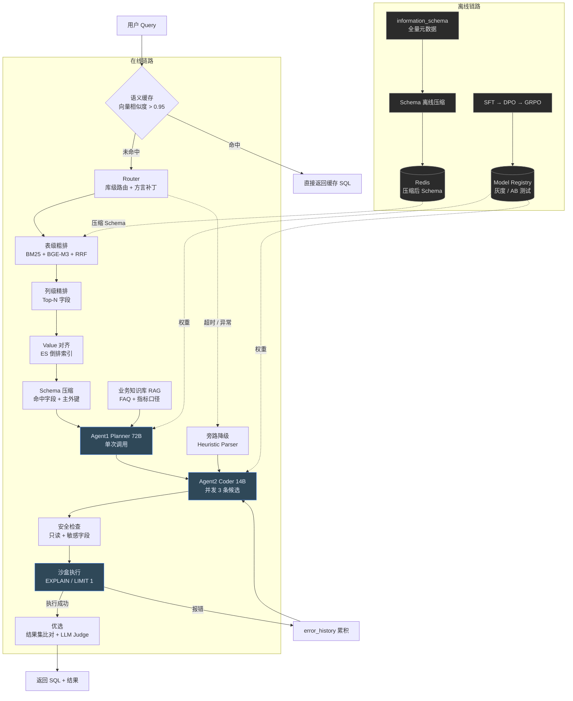
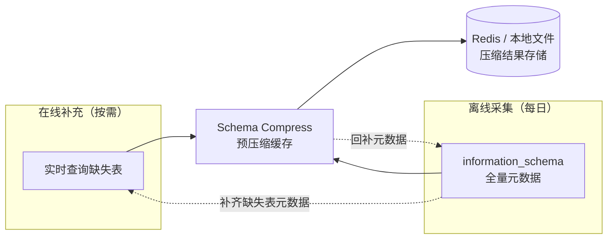
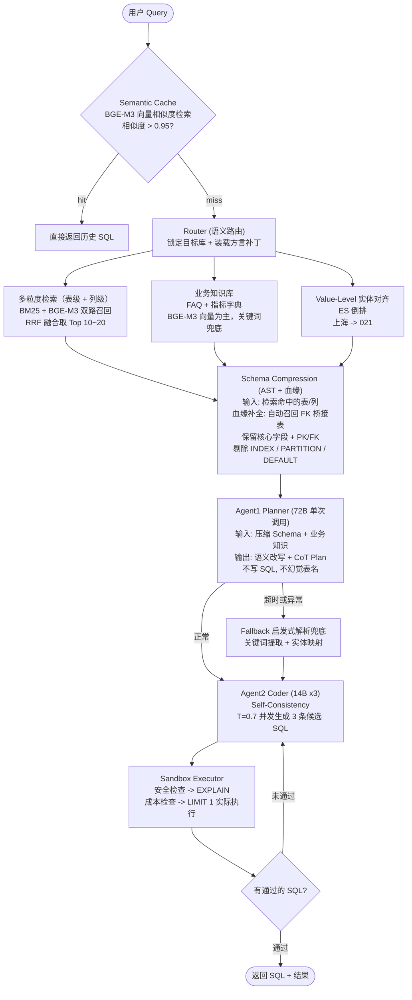
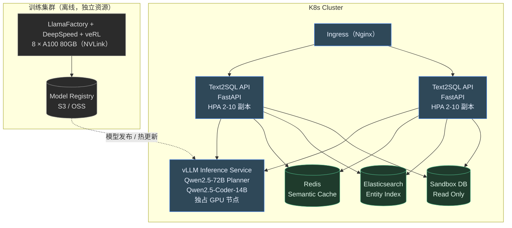

## 一、问题与解决方案

### 问题 Agent1 调用 72B 次数过多且幻觉风险高

planner_node 调用 3 次 72B（语义改写、业务RAG、Plan生成），且让 72B 直接生成 `candidate_tables` 和 `value_mappings`，存在**表名/字段名**幻觉风险。

**解决**：
1. 业务 RAG、表检索、值映射**由外部多粒度检索模块完成**（BM25 + BGE-M3），不依赖 72B 生成。
2. 将检索结果注入 Prompt，72B **单次调用**只负责：语义改写 + 执行计划生成（CoT 文本逻辑）。


### 问题 错误历史未累积

**error_msg** 只保留最后一轮

**解决**：增加 **error_history** 列表

### 问题 Schema 压缩算法错误

`_compress_ddl()` 仅 保留 PK/FK/`_id` 字段，**未保留多粒度检索命中的核心业务字段**，导致模型看不到所需字段。

**解决**：压缩时传入 `target_columns`（检索命中字段），保留**核心字段 + 关系键**。

### 问题 业务 RAG 检索方式过于简单

`business_kb.search()` 仅**使用 Redis 关键词**子串匹配（`pattern in query`），无向量语义检索能力，召回率差。

**解决**：引入 **BGE-M3 向量检索**作为主力，**关键词匹配**作为兜底，构建 FAQ + 指标字典的混合检索。

### 问题 语义缓存为精确匹配

Semantic Cache 使用 `MD5(normalized_query)` 精确匹配，无法处理语义相同但表述不同的问题。

**解决**：改为**向量相似度检索**（相似度 > 0.95 命中），支持语义等价查询缓存。

### 问题 缺少多库路由与旁路降级

需支持多库/多方言语义路由，以及 Agent1 超时/异常时的旁路降级（语义缓存、启发式解析兜底）。当前缺失。

**解决**：**增加 Router 节点、多库 Database Descriptors、以及旁路 Fallback 链路**。

## 二、完整系统架构



## 三、详细模块设计

### 3.1 Agent1: Planner 单次调用设计

#### 3.1.1 设计原则

Agent 1 的核心使命是**降噪**和**逻辑对齐**，而非直接生成数据库实体。根据项目规范：

- **候选表、列、值映射** 必须由外部 **多粒度检索模块**（BM25 + BGE-M3）提供，避免 72B 幻觉编造表名/字段名。
- 72B **单次调用**只负责：语义改写、业务知识整合、执行计划（CoT 文本逻辑）。
- **CoT 分离**：不让大模型直接写 SQL，而是写"伪代码"或"计算逻辑"，能大幅减少语法错误。

#### 3.1.2 检索注入后的 PLANNER_PROMPT

```python
PLANNER_PROMPT = """你是一个资深的数据库架构师。请根据用户问题、业务知识和表结构，制定 SQL 查询逻辑步骤。

【用户问题】：{query}

【检索到的业务知识】：
{business_knowledge}

【检索到的相关表及压缩结构】：
{compressed_schema}

【检索到的值映射】：
{value_mappings}

【数据库方言】：{dialect}
【方言特殊规则】：{dialect_rules}

请按以下格式输出规划（切勿直接写出完整 SQL，只写逻辑）：
1. 确定主表与关联表：...
2. 过滤条件：...
3. 聚合与分组策略：...
4. 排序与限制：...
5. 边缘情况与注意事项：...

同时输出以下内容：
- 语义改写：将口语化查询转为标准数据查询维度
- 业务知识摘要：关键口径定义
- 警告信息：如缺少关键信息、存在歧义等
"""

# 72B 调用方式（检索结果先注入，再单次调用 72B）
def planner_node(state: Text2SQLState) -> dict:
    """Agent1: 单次调用 72B，检索结果注入 Prompt"""
    query = state["query"]

    # 多粒度检索（外部模块，非 LLM 生成）
    retrieved_tables = schema_retriever.retrieve_tables(query, top_k=10)      # BM25 + BGE-M3
    retrieved_columns = schema_retriever.retrieve_columns(query, tables=retrieved_tables, top_k=20)
    value_mappings = entity_linker.lookup_values(query)                        # ES 倒排索引
    business_kb = business_knowledge_base.search(query)                        # 向量检索 FAQ

    # Schema 压缩（保留检索命中的核心字段 + 关系键）
    compressed_schema = schema_collector.get_compressed_schema(
        tables=retrieved_tables,
        target_columns=retrieved_columns
    )

    # 方言补丁注入
    dialect_rules = state.get("dialect_rules", [])

    # 单次调用 72B
    prompt = PLANNER_PROMPT.format(
        query=query,
        business_knowledge=business_kb,
        compressed_schema=compressed_schema,
        value_mappings="\n".join(value_mappings),
        dialect=state.get("dialect", "mysql"),
        dialect_rules="\n".join(dialect_rules)
    )
    raw_output = llm_72b.invoke(prompt)

    # 解析输出（CoT 文本 + 结构化字段）
    result = parse_planner_output(raw_output)

    return {
        "planner_output": result,
        "compressed_schema": compressed_schema,
        "business_knowledge": business_kb,
        "value_mappings": value_mappings,
        "candidate_tables": retrieved_tables,
        "dialect": state.get("dialect", "mysql"),
        "dialect_rules": state.get("dialect_rules", []),
        "target_db": state.get("target_db", ""),
        "candidate_sqls": [],
        "valid_sqls": [],
        "error_history": [],
        "error_msg": "",
        "retry_count": 0,
        "final_sql": "",
        "fallback": False,
        "cached": False
    }

def parse_planner_output(text: str) -> dict:
    """解析 Planner 的 CoT 文本输出为结构化数据"""
    import re

    result = {
        "semantic_rewrite": "",
        "business_knowledge": "",
        "execution_plan": "",
        "warnings": []
    }

    # 提取语义改写
    rewrite_match = re.search(r'语义改写[：:]\s*(.+)', text)
    if rewrite_match:
        result["semantic_rewrite"] = rewrite_match.group(1).strip()

    # 提取业务知识摘要
    biz_match = re.search(r'业务知识摘要[：:]\s*(.+)', text)
    if biz_match:
        result["business_knowledge"] = biz_match.group(1).strip()

    # 提取执行计划（CoT 文本）
    plan_match = re.search(r'(1\.\s*确定主表.*)', text, re.DOTALL)
    if plan_match:
        result["execution_plan"] = plan_match.group(1).strip()

    # 提取警告
    warn_matches = re.findall(r'警告[：:]\s*(.+)', text)
    result["warnings"] = warn_matches

    return result
```

#### 3.1.3 输出结构定义

```python
class PlannerOutput(TypedDict):
    """Agent1 输出（CoT 文本为主，避免过度结构化导致解析失败）"""
    semantic_rewrite: str        # 语义改写后的标准查询描述
    business_knowledge: str      # 业务知识摘要
    execution_plan: str          # 执行计划（CoT 文本，非 JSON）
    warnings: list               # 警告信息

class Text2SQLState(TypedDict):
    """LangGraph 工作流全局状态"""
    query: str
    target_db: str               # 目标数据库 ID（Router 输出）
    dialect: str
    dialect_rules: list
    planner_output: PlannerOutput
    compressed_schema: str       # 压缩后的 Schema（含检索命中的核心字段）
    business_knowledge: str
    candidate_tables: list       # 多粒度检索模块输出的候选表
    value_mappings: list         # 实体对齐后的值映射
    candidate_sqls: list
    valid_sqls: list
    error_history: list
    retry_count: int
    final_sql: str
```

### 3.2 元数据采集模块

#### 3.2.1 设计思路



#### 3.2.2 核心代码

```python
# metadata/collector.py

from sqlalchemy import create_engine, inspect
from typing import Dict, List, Optional
import json
from datetime import datetime
import redis

class SchemaCollector:
    """数据库元数据采集器"""

    def __init__(self, db_config: dict, redis_client: redis.Redis):
        self.engine = create_engine(db_config["url"])
        self.inspector = inspect(self.engine)
        self.redis = redis_client
        self.prefix = "schema:compression:"

    def collect_all_schemas(self) -> Dict[str, dict]:
        """从 information_schema 采集全量元数据"""
        schemas = {}

        # 采集所有表
        tables = self.inspector.get_table_names()

        for table in tables:
            schemas[table] = {
                "columns": self._get_columns(table),
                "primary_keys": self.inspector.get_pk_constraint(table),
                "foreign_keys": self._get_foreign_keys(table),
                "indexes": self.inspector.get_indexes(table),
                "ddl": self._get_ddl(table)
            }

        return schemas

    def _get_columns(self, table: str) -> List[dict]:
        """获取列信息（含注释）"""
        columns = []
        for col in self.inspector.get_columns(table):
            columns.append({
                "name": col["name"],
                "type": str(col["type"]),
                "nullable": col["nullable"],
                "default": col.get("default"),
                "comment": col.get("comment", "")  # 提取字段注释
            })
        return columns

    def _get_foreign_keys(self, table: str) -> List[dict]:
        """获取外键信息"""
        fks = []
        for fk in self.inspector.get_foreign_keys(table):
            fks.append({
                "column": fk["constrained_columns"],
                "referred_table": fk["referred_table"],
                "referred_columns": fk["referred_columns"]
            })
        return fks

    def _get_ddl(self, table: str) -> str:
        """获取完整 DDL"""
        # 使用 SHOW CREATE TABLE
        with self.engine.connect() as conn:
            result = conn.execute(text(f"SHOW CREATE TABLE {table}"))
            row = result.fetchone()
            return row[1] if row else ""

    def collect_and_compress(self, hot_columns: Optional[Dict[str, List[str]]] = None):
        """采集 + 压缩 + 存储

        Args:
            hot_columns: 从查询日志统计的高频字段 {table_name: [col1, col2]}
        """
        schemas = self.collect_all_schemas()

        for table, schema in schemas.items():
            # 离线压缩时传入高频字段
            target_cols = hot_columns.get(table, []) if hot_columns else []
            compressed = self._compress_ddl(schema["ddl"], schema, target_columns=target_cols)

            # 存储到 Redis
            key = f"{self.prefix}{table}"
            self.redis.set(key, json.dumps({
                "compressed": compressed,
                "full_ddl": schema["ddl"],
                "target_columns": target_cols,
                "metadata": {
                    "columns": schema["columns"],
                    "primary_keys": schema["primary_keys"],
                    "foreign_keys": schema["foreign_keys"]
                },
                "updated_at": datetime.now().isoformat()
            }))

    def _compress_ddl(
        self,
        ddl: str,
        schema: dict,
        target_columns: Optional[List[str]] = None
    ) -> str:
        """压缩 DDL - 保留检索命中的核心字段 + 主外键关系键 + 注释

        Args:
            ddl: 原始 DDL 语句
            schema: 表结构元数据
            target_columns: 多粒度检索命中的核心字段名列表（必须保留）
        """
        import sqlglot

        target_columns = target_columns or []
        target_set = {c.lower() for c in target_columns}

        try:
            expr = sqlglot.parse_one(ddl)
            table_name = expr.find(sqlglot.exp.Table).name
            table_comment = self._extract_table_comment(expr)

            pk_cols = set()
            for c in schema.get("primary_keys", {}).get("constrained_columns", []):
                pk_cols.add(c.lower())

            fk_cols = set()
            fk_refs = {}  # col -> "FK -> table.col"
            for fk in schema.get("foreign_keys", []):
                for src_col, dst_col in zip(fk.get("constrained_columns", []), fk.get("referred_columns", [])):
                    src_lower = src_col.lower()
                    fk_cols.add(src_lower)
                    fk_refs[src_lower] = f"FK -> {fk['referred_table']}.{dst_col}"

            cols = []
            for col in schema["columns"]:
                col_name = col["name"]
                col_lower = col_name.lower()
                col_type = str(col["type"]).split("(")[0]  # 简化类型，去掉长度
                col_comment = col.get("comment", "")

                # 判断是否应该保留
                is_target = col_lower in target_set
                is_pk = col_lower in pk_cols
                is_fk = col_lower in fk_cols
                is_relationship = (
                    col_lower.endswith("_id") or
                    col_lower.endswith("_key") or
                    col_lower == "id"
                )

                if is_target or is_pk or is_fk or is_relationship:
                    tags = []
                    if is_pk:
                        tags.append("PK")
                    if col_lower in fk_refs:
                        tags.append(fk_refs[col_lower])
                    tag_str = f" ({', '.join(tags)})" if tags else ""
                    comment_str = f": {col_comment}" if col_comment else ""
                    cols.append(f"  - {col_name} ({col_type}){tag_str}{comment_str}")

            header = f"Table {table_name}"
            if table_comment:
                header += f" ({table_comment})"
            return header + ":\n" + "\n".join(cols)

        except Exception as e:
            # 降级：返回原始 DDL 前 500 字符
            return ddl[:500]

    @staticmethod
    def _extract_table_comment(expr) -> str:
        """从 DDL AST 中提取表注释"""
        for prop in expr.find_all(sqlglot.exp.Property):
            if isinstance(prop.this, sqlglot.exp.Comment):
                return prop.this.expression.this
        return ""

    def get_compressed_schema(
        self,
        tables: List[str],
        target_columns: Optional[List[str]] = None
    ) -> str:
        """获取指定表的压缩 Schema（支持按需重新压缩）"""
        schemas = []
        for table in tables:
            key = f"{self.prefix}{table}"
            data = self.redis.get(key)

            if data:
                cached = json.loads(data)
                # 检查缓存是否使用了相同的 target_columns
                cached_target_cols = cached.get("target_columns", [])
                if set(target_columns or []) == set(cached_target_cols):
                    schemas.append(cached["compressed"])
                else:
                    # target_columns 不匹配，重新压缩
                    self._collect_single_table(table, target_columns=target_columns)
                    data = self.redis.get(key)
                    schemas.append(json.loads(data)["compressed"])
            else:
                # 缺失则实时采集
                self._collect_single_table(table, target_columns=target_columns)
                data = self.redis.get(key)
                if data:
                    schemas.append(json.loads(data)["compressed"])

        return "\n\n".join(schemas)

    def bloodline_completion(self, seed_tables: List[str], max_hops: int = 2) -> List[str]:
        """
        血缘补全：基于 FK 约束自动召回桥接表（支持间接关联）

        性能优化：启动时缓存全库 FK 拓扑，避免重复查询 information_schema。

        Args:
            seed_tables: 多粒度检索命中的种子表
            max_hops: 最大召回深度（2 跳可覆盖绝大多数 JOIN 场景）

        Returns:
            补全后的表列表（含桥接表）
        """
        # 缓存 FK 拓扑（首次调用时构建）
        if not hasattr(self, '_fk_graph_cache'):
            self._fk_graph_cache = self._build_fk_graph()

        fk_graph = self._fk_graph_cache
        all_tables = set(seed_tables)
        current_frontier = set(seed_tables)

        for hop in range(max_hops):
            next_frontier = set()
            for table in current_frontier:
                # 正向 + 反向一次查询（基于缓存的图）
                related = fk_graph.get(table, set())
                for related_table in related:
                    if related_table not in all_tables:
                        all_tables.add(related_table)
                        next_frontier.add(related_table)

            current_frontier = next_frontier
            if not current_frontier:
                break

        return list(all_tables)

    def _build_fk_graph(self) -> Dict[str, set]:
        """构建全库 FK 有向图（表 -> 关联表集合）"""
        graph = {}
        all_tables = self.inspector.get_table_names()

        for table in all_tables:
            graph.setdefault(table, set())
            # 正向：当前表的外键指向哪些表
            for fk in self._get_foreign_keys(table):
                referred = fk["referred_table"]
                graph[table].add(referred)
                graph.setdefault(referred, set()).add(table)

        return graph

    def _collect_single_table(self, table: str, target_columns: Optional[List[str]] = None):
        """实时采集单表元数据（支持传入检索命中的核心字段）"""
        schema = {
            "columns": self._get_columns(table),
            "primary_keys": self.inspector.get_pk_constraint(table),
            "foreign_keys": self._get_foreign_keys(table),
            "ddl": self._get_ddl(table)
        }
        compressed = self._compress_ddl(schema["ddl"], schema, target_columns=target_columns)
        key = f"{self.prefix}{table}"
        self.redis.set(key, json.dumps({
            "compressed": compressed,
            "full_ddl": schema["ddl"],
            "target_columns": target_columns or [],
            "metadata": schema,
            "updated_at": datetime.now().isoformat()
        }))
```

#### 3.2.3 采集调度

```python
# metadata/scheduler.py

from apscheduler.schedulers.asyncio import AsyncIOScheduler

scheduler = AsyncIOScheduler()

@scheduler.scheduled_job("cron", hour=2, minute=0)  # 每天凌晨 2 点
async def daily_schema_collection():
    """每日全量元数据采集"""
    collector = SchemaCollector(db_config, redis_client)
    collector.collect_and_compress()
    print(f"Schema collection completed at {datetime.now()}")

# 启动调度器
scheduler.start()
```

### 3.3 业务知识库构建

#### 3.3.1 知识库结构

```text
business_knowledge/
├── faq/                          # 业务 FAQ
│   ├── 客户分层定义.json
│   ├── 活跃用户判定.json
│   └── 爆款商品标准.json
├── metrics/                      # 指标字典
│   ├── 营收类.json
│   ├── 流量类.json
│   └── 转化类.json
└── mappings/                     # 值映射
    ├── 地区映射.json
    └── 品类映射.json
```

#### 3.3.2 知识库格式

```json
// faq/爆款商品标准.json
{
  "id": "hot_selling_def",
  "question_patterns": ["爆款", "热销", "畅销", "热卖"],
  "definition": "月销量超过1000件，或月销售额超过50万元的商品",
  "filters": {
    "sales_threshold": 1000,
    "revenue_threshold": 500000,
    "period": "monthly"
  },
  "sql_example": "WHERE monthly_sales > 1000 OR monthly_revenue > 500000"
}

// metrics/营收类.json
{
  "metrics": [
    {
      "name": "销售额",
      "alias": ["收入", "营业额", "营收"],
      "sql_template": "SUM(amount)",
      "unit": "元"
    },
    {
      "name": "净利润",
      "alias": ["利润", "纯利"],
      "sql_template": "SUM(amount - cost)",
      "unit": "元"
    }
  ]
}

// mappings/地区映射.json
{
  "dimension": "region",
  "values": [
    {"name": "华东", "codes": ["01", "02", "03"], "includes": ["上海", "浙江", "江苏", "安徽"]},
    {"name": "华北", "codes": ["11", "12", "13"], "includes": ["北京", "天津", "河北"]}
  ]
}
```

#### 3.3.3 知识库检索（混合检索：向量语义 + 关键词兜底）

```python
# retrieval/business_kb.py

import json
import redis
from typing import List, Dict
import glob
import numpy as np

class BusinessKnowledgeBase:
    """业务知识库检索：BGE-M3 向量检索为主，关键词匹配兜底"""

    def __init__(self, redis_client: redis.Redis, embedding_model=None):
        self.redis = redis_client
        self.prefix = "kb:business:"
        self.vec_prefix = "kb:vec:"
        # 默认使用 BGE-M3（或外部注入的 Embedding 模型）
        self.embedding_model = embedding_model or self._load_bge_m3()

    def _load_bge_m3(self):
        """加载 BGE-M3 嵌入模型"""
        from sentence_transformers import SentenceTransformer
        return SentenceTransformer("BAAI/bge-m3")

    def build_index(self):
        """构建知识库索引（启动时调用）：加载到 Redis + 向量库"""
        kb_files = glob.glob("business_knowledge/**/*.json", recursive=True)

        for filepath in kb_files:
            with open(filepath, encoding="utf-8") as f:
                data = json.load(f)

            doc_id = data.get("id", filepath)
            key = f"{self.prefix}{doc_id}"
            self.redis.set(key, json.dumps(data, ensure_ascii=False))

            # 生成向量索引文本（问题模式 + 定义 + 指标别名）
            texts_to_embed = []
            if "question_patterns" in data:
                texts_to_embed.extend(data["question_patterns"])
            if "definition" in data:
                texts_to_embed.append(data["definition"])
            if "metrics" in data:
                for m in data["metrics"]:
                    texts_to_embed.append(m["name"])
                    texts_to_embed.extend(m.get("alias", []))

            embed_text = " | ".join(texts_to_embed)
            embedding = self.embedding_model.encode(embed_text, normalize_embeddings=True)

            # 存储向量（使用 RedisJSON 或简化存储）
            vec_key = f"{self.vec_prefix}{doc_id}"
            self.redis.set(vec_key, json.dumps(embedding.tolist()))

    def search(self, query: str, rewritten_query: str = None, top_k: int = 3) -> str:
        """混合检索业务知识

        Args:
            query: 用户原始问题
            rewritten_query: 语义改写后的查询
            top_k: 向量检索返回条数

        Returns:
            匹配的业务知识描述（按相关性排序）
        """
        search_text = f"{query} {rewritten_query or ''}"
        results = []
        seen_ids = set()

        # 向量语义检索（主通道）
        vec_results = self._vector_search(search_text, top_k=top_k)
        for doc_id, score, content in vec_results:
            if doc_id not in seen_ids:
                seen_ids.add(doc_id)
                results.append(content)

        # 关键词匹配（补充召回）
        keyword_results = self._keyword_search(search_text)
        for doc_id, content in keyword_results:
            if doc_id not in seen_ids:
                seen_ids.add(doc_id)
                results.append(content)

        if not results:
            return "无相关业务知识"

        return "\n".join([f"- {r}" for r in results])

    def _vector_search(self, query: str, top_k: int = 3) -> List[tuple]:
        """基于 BGE-M3 的向量语义检索

        TODO: 生产环境建议使用专用向量数据库（Milvus/FAISS）替代 Redis 全量遍历，
        当前实现仅适用于小规模知识库（<10K 条）。
        """
        query_vec = self.embedding_model.encode(query, normalize_embeddings=True)

        candidates = []
        for key in self.redis.scan_iter(f"{self.vec_prefix}*"):
            doc_id = key.decode().replace(self.vec_prefix, "")
            vec_data = json.loads(self.redis.get(key))
            doc_vec = np.array(vec_data)
            # 余弦相似度
            score = float(np.dot(query_vec, doc_vec))
            candidates.append((doc_id, score))

        # 排序取 Top-K
        candidates.sort(key=lambda x: x[1], reverse=True)
        top_candidates = candidates[:top_k]

        results = []
        for doc_id, score in top_candidates:
            data = json.loads(self.redis.get(f"{self.prefix}{doc_id}"))
            content = self._format_content(data)
            results.append((doc_id, score, content))
        return results

    def _keyword_search(self, query: str) -> List[tuple]:
        """关键词子串匹配兜底"""
        results = []
        for key in self.redis.scan_iter(f"{self.prefix}*"):
            if key.decode().startswith(self.vec_prefix):
                continue
            data = json.loads(self.redis.get(key))
            doc_id = data.get("id", key.decode())

            matched = False
            # 匹配 FAQ 问题模式
            for pattern in data.get("question_patterns", []):
                if pattern in query:
                    matched = True
                    break
            # 匹配指标名/别名
            if not matched and "metrics" in data:
                for m in data["metrics"]:
                    if m["name"] in query or any(a in query for a in m.get("alias", [])):
                        matched = True
                        break

            if matched:
                results.append((doc_id, self._format_content(data)))
        return results

    def _format_content(self, data: dict) -> str:
        """格式化知识库条目为文本"""
        if "definition" in data:
            return f"【{data['id']}】{data['definition']}"
        elif "metrics" in data:
            parts = []
            for m in data["metrics"]:
                parts.append(f"{m['name']}: {m['sql_template']}")
            return f"【指标】{'; '.join(parts)}"
        return json.dumps(data, ensure_ascii=False)
```

### 3.4 多粒度 Schema 检索模块 (SchemaRetriever)

Agent1 Planner 的核心依赖模块，负责从海量表/列中精准召回uery 相关与 Q的数据库实体。

#### 3.4.1 设计原则

采用 **BM25（稀疏）+ BGE-M3（稠密）双路召回 + RRF 融合** 的级联漏斗架构：

1. **表级粗排**：召回 Top-10 相关表
2. **列级精排**：在已召回的表下定位核心字段
3. **向量化存储**：表名+注释、列名+注释分别建索引

#### 3.4.2 实现代码

```python
# retrieval/schema_retriever.py

import json
import redis
from typing import List, Dict, Tuple
import numpy as np
from rank_bm25 import BM25Okapi
import jieba

class SchemaRetriever:
    """多粒度 Schema 检索：BM25 + BGE-M3 双路召回"""

    def __init__(self, redis_client: redis.Redis, embedding_model=None):
        self.redis = redis_client
        self.prefix = "schema:retrieve:"
        self.embedding_model = embedding_model or self._load_bge_m3()
        # 内存中缓存 BM25 索引（启动时加载）
        self.bm25_table_index = None
        self.table_names_cache = []

    def _load_bge_m3(self):
        """加载 BGE-M3 嵌入模型"""
        from sentence_transformers import SentenceTransformer
        return SentenceTransformer("BAAI/bge-m3")

    def build_index(self, db_inspector):
        """构建表级和列级检索索引（启动时调用）

        Args:
            db_inspector: SQLAlchemy Inspector 实例
        """
        tables = db_inspector.get_table_names()

        # 1. 表级索引
        table_texts = []
        table_metadata = []
        for table in tables:
            comment = self._get_table_comment(db_inspector, table)
            text = f"{table} {comment}"
            table_texts.append(text)
            table_metadata.append({
                "table": table,
                "comment": comment
            })

        # BM25 索引
        tokenized = [self._tokenize(t) for t in table_texts]
        self.bm25_table_index = BM25Okapi(tokenized)
        self.table_names_cache = tables

        # BGE-M3 向量索引（存储到 Redis）
        embeddings = self.embedding_model.encode(table_texts, normalize_embeddings=True)
        for i, meta in enumerate(table_metadata):
            key = f"{self.prefix}table_vec:{meta['table']}"
            self.redis.set(key, json.dumps({
                "embedding": embeddings[i].tolist(),
                "metadata": meta
            }))

        # 2. 列级索引（每张表单独建索引）
        for table in tables:
            columns = db_inspector.get_columns(table)
            col_texts = []
            col_metadata = []
            for col in columns:
                col_comment = col.get("comment", "")
                text = f"{col['name']} {col_comment}"
                col_texts.append(text)
                col_metadata.append({
                    "table": table,
                    "column": col["name"],
                    "type": str(col["type"]),
                    "comment": col_comment
                })

            if col_texts:
                col_embeddings = self.embedding_model.encode(col_texts, normalize_embeddings=True)
                for i, meta in enumerate(col_metadata):
                    key = f"{self.prefix}col_vec:{table}:{meta['column']}"
                    self.redis.set(key, json.dumps({
                        "embedding": col_embeddings[i].tolist(),
                        "metadata": meta
                    }))

    def _tokenize(self, text: str) -> List[str]:
        """中文分词（BM25 用）"""
        return list(jieba.cut(text.lower()))

    def _get_table_comment(self, inspector, table: str) -> str:
        """获取表注释（适配不同方言）"""
        try:
            # MySQL: SHOW CREATE TABLE 中解析 COMMENT
            # 简化处理，实际可从 information_schema 读取
            return ""
        except:
            return ""

    def retrieve_tables(self, query: str, top_k: int = 10) -> List[str]:
        """表级粗排：BM25 + BGE-M3 RRF 融合召回

        Returns:
            表名列表（按相关性排序）
        """
        # BM25 检索
        query_tokens = self._tokenize(query)
        bm25_scores = self.bm25_table_index.get_scores(query_tokens)
        bm25_ranking = np.argsort(bm25_scores)[::-1][:top_k * 2]

        # BGE-M3 向量检索
        query_vec = self.embedding_model.encode(query, normalize_embeddings=True)
        vec_scores = []
        for table in self.table_names_cache:
            key = f"{self.prefix}table_vec:{table}"
            data = self.redis.get(key)
            if data:
                cached = json.loads(data)
                table_vec = np.array(cached["embedding"])
                score = float(np.dot(query_vec, table_vec))
                vec_scores.append((table, score))

        vec_scores.sort(key=lambda x: x[1], reverse=True)
        vec_ranking = [t for t, _ in vec_scores[:top_k * 2]]

        # RRF 融合 (Reciprocal Rank Fusion)
        rrf_scores = {}
        k_rrf = 60

        for rank, idx in enumerate(bm25_ranking):
            table = self.table_names_cache[idx]
            rrf_scores[table] = rrf_scores.get(table, 0) + 1.0 / (k_rrf + rank + 1)

        for rank, table in enumerate(vec_ranking):
            rrf_scores[table] = rrf_scores.get(table, 0) + 1.0 / (k_rrf + rank + 1)

        # 排序取 Top-K
        sorted_tables = sorted(rrf_scores.items(), key=lambda x: x[1], reverse=True)
        return [t for t, _ in sorted_tables[:top_k]]

    def retrieve_columns(self, query: str, tables: List[str], top_k: int = 20) -> List[str]:
        """列级精排：在已召回的表下定位核心字段

        Returns:
            字段名列表（格式：table.column，用于 target_columns）
        """
        query_vec = self.embedding_model.encode(query, normalize_embeddings=True)
        all_columns = []

        for table in tables:
            # 获取该表下所有列的向量
            pattern = f"{self.prefix}col_vec:{table}:*"
            for key in self.redis.scan_iter(pattern):
                data = json.loads(self.redis.get(key))
                col_vec = np.array(data["embedding"])
                score = float(np.dot(query_vec, col_vec))
                all_columns.append({
                    "table": data["metadata"]["table"],
                    "column": data["metadata"]["column"],
                    "score": score
                })

        # 按相似度排序，每张表保留 Top-N，总体不超过 top_k
        all_columns.sort(key=lambda x: x["score"], reverse=True)

        # 返回 target_columns 格式（后续 _compress_ddl 使用）
        # 返回的是 "column_name"，_compress_ddl 匹配列名（不区分大小写）
        return [c["column"] for c in all_columns[:top_k]]
```

### 3.5 多库路由与方言感知 (Router Node)

#### 3.5.1 设计原则

在处理多库/多方言场景时，不采用单一 Prompt。通过 **语义路由** 锁定目标库的引擎类型，后将该方言的特定约束作为动态上下文注入 Prompt。

#### 3.5.2 Database Descriptors

```json
{
  "db_id": "hr_oracle_01",
  "engine": "Oracle",
  "domain": "人力资源, 薪酬分析",
  "special_rules": [
    "日期格式必须使用 TO_DATE",
    "分页查询使用 ROWNUM",
    "所有的表名需要加 HR_PROD 前缀"
  ],
  "tables": ["emp_info", "salary_log"]
}
```

#### 3.5.3 Router 实现

```python
# retrieval/router.py

class SemanticRouter:
    """语义路由：锁定目标数据库 + 提取方言规则"""

    def __init__(self, vector_db, redis_client: redis.Redis):
        self.vector_db = vector_db  # 存储 Database Descriptors 的向量库
        self.redis = redis_client
        self.prefix = "router:db:"

    def route(self, query: str) -> dict:
        """路由到目标数据库"""
        # 向量检索最相关 Database Descriptor
        db_meta = self.vector_db.similarity_search(query, k=1)[0]
        metadata = db_meta.metadata

        return {
            "target_db": metadata["db_id"],
            "dialect": metadata["engine"],
            "dialect_rules": metadata.get("special_rules", []),
            "domain": metadata.get("domain", "")
        }

    def build_db_index(self, descriptors: List[dict]):
        """构建数据库元数据向量索引"""
        from langchain_community.vectorstores import FAISS
        from langchain_community.embeddings import HuggingFaceEmbeddings

        embeddings = HuggingFaceEmbeddings(model_name="BAAI/bge-m3")
        texts = [f"{d['db_id']} {d['domain']} {' '.join(d['tables'])}" for d in descriptors]
        metadatas = descriptors

        vectorstore = FAISS.from_texts(texts, embeddings, metadatas=metadatas)
        vectorstore.save_local("db_router_index")
        return vectorstore
```

### 3.6 跨库联邦查询（可选）

当用户提问涉及跨库（如对比 "MySQL 订单金额" 和 "Oracle 财务实收"）时，单一 SQL 无法直接运行。

**方案：分步执行 Agent**

1. **跨库检测**：Router 识别到 Query 命中多个 Database Descriptor（相似度均高于阈值）
2. **任务拆分**：Analyzer 将 Query 拆分为多个子查询任务（每个子查询对应一个库）
3. **并行取数**：多个 Coder Agent 分别在对应数据库生成并执行 SQL
4. **内存聚合**：利用 DuckDB 或 Python REPL（Pandas）对多个子结果集进行二次计算和合并

**LangGraph 扩展**：

- 增加 `FederatedPlanner` 节点（替换普通 Planner）
- 增加 `ParallelCoder` 节点（并行调用多个 Coder）
- 增加 `InMemoryJoin` 节点（DuckDB 聚合）

高级可选功能，可暂不实现，架构预留扩展。

### 3.7 Value-Level 实体对齐 (Entity Linking)

#### 3.7.1 设计原则

用户问 "查询上海的订单"，但库里存的是 `city_id = '021'`。无法直接写 SQL。构建 **高频枚举值索引**，对维度表中的重点字段（城市、品类、品牌名）建立 **Elasticsearch 倒排索引**。

#### 3.7.2 实现

```python
# retrieval/entity_linker.py

from elasticsearch import Elasticsearch
from typing import List, Dict

class EntityLinker:
    """值级实体对齐：业务词 → 数据库代码值"""

    def __init__(self, es_client: Elasticsearch):
        self.es = es_client
        self.index_name = "text2sql_entity_index"

    def build_index(self, mappings: List[dict]):
        """构建 ES 倒排索引（含显式 Mapping 定义）"""
        # 先创建索引并定义 Mapping（防止 ES 默认分词导致精确匹配失败）
        index_body = {
            "mappings": {
                "properties": {
                    "dimension": {"type": "keyword"},     # 精确匹配，不分词
                    "name": {
                        "type": "text",
                        "analyzer": "ik_max_word",        # 中文分词
                        "fields": {
                            "keyword": {"type": "keyword"}  # 保留 keyword 子字段用于精确匹配
                        }
                    },
                    "includes": {
                        "type": "text",
                        "analyzer": "ik_max_word"
                    },
                    "codes": {"type": "keyword"}          # 代码值精确匹配
                }
            },
            "settings": {
                "number_of_shards": 1,
                "number_of_replicas": 0,
                "analysis": {
                    "analyzer": {
                        "ik_max_word": {
                            "type": "custom",
                            "tokenizer": "ik_max_word"
                        }
                    }
                }
            }
        }

        # 删除旧索引（如存在）并创建新索引
        if self.es.indices.exists(index=self.index_name):
            self.es.indices.delete(index=self.index_name)
        self.es.indices.create(index=self.index_name, body=index_body)

        # 批量写入文档
        for mapping in mappings:
            dimension = mapping["dimension"]  # 如 region, category
            for value in mapping["values"]:
                doc = {
                    "dimension": dimension,
                    "name": value["name"],          # 如 "华东"
                    "includes": value.get("includes", []),  # 如 ["上海", "浙江"]
                    "codes": value["codes"]         # 如 ["01", "02", "03"]
                }
                self.es.index(index=self.index_name, body=doc)

        # 刷新索引确保立即可搜索
        self.es.indices.refresh(index=self.index_name)

    def lookup_values(self, query: str) -> List[str]:
        """检索查询中的实体映射"""
        # 对 query 进行分词（或直接用 match_phrase）
        response = self.es.search(index=self.index_name, body={
            "query": {
                "multi_match": {
                    "query": query,
                    "fields": ["name^3", "includes"]
                }
            },
            "size": 10
        })

        mappings = []
        for hit in response["hits"]["hits"]:
            source = hit["_source"]
            codes = ",".join([f"'{c}'" for c in source["codes"]])
            mappings.append(f"{source['name']} -> {source['dimension']}_id IN ({codes})")

        return mappings
```

### 3.8 Self-Consistency 优选机制

Agent 2 并发生成 3 条 SQL，若多条通过沙盒验证，需选出最优结果。

```python
# agents/consistency_selector.py

from typing import List
import pandas as pd

class ConsistencySelector:
    """多路生成结果优选：Majority Voting + LLM-as-a-Judge"""

    def __init__(self, judge_llm=None):
        self.judge_llm = judge_llm  # 可选：GPT-4o / DeepSeek-V3 作为裁判

    def select_best(self, sqls: List[str], query: str, sandbox) -> str:
        """从多条有效 SQL 中选出最优"""
        if len(sqls) == 1:
            return sqls[0]

        # 执行所有 SQL，获取结果集签名（列名 + 前 N 行哈希）
        signatures = []
        for sql in sqls:
            result = sandbox.execute(sql, limit=10)
            if result["success"]:
                df = pd.DataFrame(result["data"])
                sig = self._result_signature(df)
                signatures.append((sql, sig, df))

        # Majority Voting：结果集相同的 SQL 归为一组，选票数最多的组
        vote_groups = {}
        for sql, sig, df in signatures:
            vote_groups.setdefault(sig, []).append((sql, df))

        best_group = max(vote_groups.values(), key=len)
        candidates = [s for s, _ in best_group]

        if len(candidates) == 1:
            return candidates[0]

        # 若仍有多条，启用 LLM-as-a-Judge
        if self.judge_llm:
            return self._llm_judge(candidates, query)

        # 兜底：选 SQL 最简洁的一条
        return min(candidates, key=len)

    def _result_signature(self, df: pd.DataFrame) -> str:
        """生成结果集签名用于比对"""
        cols = tuple(df.columns)
        # 取前 3 行数据的字符串拼接作为内容签名
        content = df.head(3).to_json()
        return f"{cols}|{hash(content)}"

    def _llm_judge(self, sqls: List[str], query: str) -> str:
        """LLM 作为裁判，从正确 SQL 中选出最优"""
        prompt = f"""你是一个 SQL 优化专家。以下多条 SQL 均能正确回答用户问题，请选出最优的一条。

【用户问题】：{query}

【候选 SQL】：
"""
        for i, sql in enumerate(sqls, 1):
            prompt += f"{i}. {sql}\n"

        prompt += """
请从以下维度打分（0-1）：
- 是否滥用 SELECT *
- 逻辑是否简洁（无冗余子查询）
- 是否正确使用索引字段
- JOIN 方式是否合理

直接输出最优 SQL 的编号（如 1），不要解释。
"""
        response = self.judge_llm.invoke(prompt)
        # 简单解析第一个数字
        import re
        match = re.search(r'\d+', response)
        idx = int(match.group()) - 1 if match else 0
        return sqls[max(0, min(idx, len(sqls) - 1))]
```

### 3.9 旁路降级与 Fallback 策略

当 Agent 1（Analyzer）发生超时、异常或 JSON 解析失败时，系统不能中断，需走旁路降级。

```python
# agents/fallback.py

import jieba
from typing import List, Dict

class FallbackPlanner:
    """Agent 1 瘫痪时的启发式解析兜底"""

    def __init__(self, schema_collector, entity_linker):
        self.schema_collector = schema_collector
        self.entity_linker = entity_linker

    def heuristic_parse(self, query: str) -> dict:
        """基于规则的启发式解析，提取关键词和实体"""
        # 关键词提取
        tokens = list(jieba.cut(query))

        # 实体映射（值查找）
        value_mappings = self.entity_linker.lookup_values(query)

        # 表名关键词匹配（简单子串匹配，从全量表名中找）
        all_tables = self.schema_collector.get_all_table_names()
        matched_tables = [t for t in all_tables if any(t in tok or tok in t for tok in tokens)]

        # 加载高频核心表全量 DDL（默认 Schema 注入）
        if not matched_tables:
            matched_tables = self.schema_collector.get_hot_tables(top_k=5)

        compressed_schema = self.schema_collector.get_compressed_schema(matched_tables)

        return {
            "semantic_rewrite": query,
            "business_knowledge": "无（Agent1 降级模式）",
            "execution_plan": "基于启发式解析自动关联表，无详细执行计划",
            "warnings": ["Agent1 异常，使用启发式解析兜底"],
            "candidate_tables": matched_tables,
            "value_mappings": value_mappings,
            "dialect": "mysql",
            "fallback": True
        }

def planner_node_with_fallback(state: Text2SQLState) -> dict:
    """带旁路降级的 Planner Node

    旁路 1: 语义缓存命中 → 直接返回历史 SQL（仍需保留 Router 输出的方言信息）
    旁路 2: Agent1 超时/异常 → FallbackPlanner 启发式解析兜底
    """
    query = state["query"]

    # 先查语义缓存（旁路 1）
    cached = semantic_cache.get(query)
    if cached:
        return {
            "planner_output": {
                "semantic_rewrite": query,
                "business_knowledge": "缓存命中，跳过 Planner",
                "execution_plan": "缓存命中",
                "warnings": []
            },
            "compressed_schema": "",
            "business_knowledge": "缓存命中",
            "value_mappings": [],
            "candidate_tables": [],
            "dialect": state.get("dialect", "mysql"),
            "dialect_rules": state.get("dialect_rules", []),
            "target_db": state.get("target_db", ""),
            "candidate_sqls": [],
            "valid_sqls": [],
            "error_history": [],
            "error_msg": "",
            "retry_count": 0,
            "final_sql": cached,
            "fallback": False,
            "cached": True
        }

    # 正常调用 Agent1
    try:
        result = planner_node(state)
        result["cached"] = False
        result["fallback"] = False
        return result
    except Exception as e:
        # Agent1 异常，走启发式解析兜底（旁路 2）
        fallback = FallbackPlanner(schema_collector, entity_linker)
        fb_result = fallback.heuristic_parse(query)

        # 血缘补全 + Schema 压缩（Fallback 模式下也需要）
        expanded_tables = schema_collector.bloodline_completion(
            fb_result["candidate_tables"], max_hops=1
        )
        compressed_schema = schema_collector.get_compressed_schema(expanded_tables)

        return {
            "planner_output": fb_result,
            "compressed_schema": compressed_schema,
            "business_knowledge": fb_result["business_knowledge"],
            "value_mappings": fb_result["value_mappings"],
            "candidate_tables": fb_result["candidate_tables"],
            "dialect": state.get("dialect", "mysql"),
            "dialect_rules": state.get("dialect_rules", []),
            "target_db": state.get("target_db", ""),
            "candidate_sqls": [],
            "valid_sqls": [],
            "error_history": [],
            "error_msg": f"Agent1 异常: {str(e)}",
            "retry_count": 0,
            "final_sql": "",
            "fallback": True,
            "cached": False
        }
```

### 3.10 语义缓存（向量相似度检索）

```python
# cache/semantic_cache.py

from sentence_transformers import SentenceTransformer
import numpy as np
from typing import Optional

class SemanticCache:
    """基于向量相似度的语义缓存（非精确 MD5 匹配）"""

    def __init__(self, redis_client, embedding_model=None):
        self.redis = redis_client
        self.prefix = "cache:semantic:"
        self.embedding_model = embedding_model or SentenceTransformer("BAAI/bge-m3")
        self.threshold = 0.95

    def _embed(self, text: str) -> np.ndarray:
        return self.embedding_model.encode(text, normalize_embeddings=True)

    def get(self, query: str) -> Optional[str]:
        """向量检索语义缓存"""
        query_vec = self._embed(query)

        # 遍历所有缓存的向量（生产环境应使用专用向量库如 Milvus/FAISS）
        best_score = -1
        best_sql = None

        for key in self.redis.scan_iter(f"{self.prefix}vec:*"):
            doc_id = key.decode().replace(f"{self.prefix}vec:", "")
            cached_vec = np.array(json.loads(self.redis.get(key)))
            score = float(np.dot(query_vec, cached_vec))

            if score > best_score:
                best_score = score
                best_sql = self.redis.get(f"{self.prefix}sql:{doc_id}")

        if best_score >= self.threshold and best_sql:
            return best_sql.decode()
        return None

    def set(self, query: str, sql: str):
        """写入语义缓存"""
        import hashlib
        doc_id = hashlib.md5(query.encode()).hexdigest()
        vec = self._embed(query)

        self.redis.set(f"{self.prefix}vec:{doc_id}", json.dumps(vec.tolist()))
        self.redis.set(f"{self.prefix}sql:{doc_id}", sql)
```

### 3.11 错误历史累积机制

#### 3.11.1 State 定义

```python
class Text2SQLState(TypedDict):
    """LangGraph 工作流全局状态"""
    # 输入
    query: str
    # Agent1 输出
    planner_output: dict              # PlannerOutput 结构
    compressed_schema: str            # 压缩后的 Schema
    business_knowledge: str          # 业务知识
    # Agent2 相关
    candidate_sqls: List[str]        # 当前候选 SQL
    valid_sqls: List[str]            # 通过验证的 SQL
    error_history: List[dict]        # 错误历史 (新增！)
    retry_count: int
    final_sql: str
    # 元数据
    dialect: str
    value_mappings: List[str]
```

#### 3.11.2 Executor Node

```python
def executor_node(state: Text2SQLState) -> dict:
    """沙盒执行与结果验证 - 增强错误历史"""

    valid_sqls = []
    last_err = ""
    current_errors = []

    for sql in state["candidate_sqls"]:
        # SQL 安全检查
        if security_check(sql):
            err = "SQL contains forbidden operations"
            current_errors.append({"sql": sql, "error": err, "stage": "security"})
            last_err = err
            continue

        # 语法检查 (EXPLAIN)
        explain_result = sandbox.explain(sql, state["dialect"])
        if not explain_result["success"]:
            current_errors.append({"sql": sql, "error": explain_result["error"], "stage": "explain"})
            last_err = explain_result["error"]
            continue

        # 成本检查
        if explain_result.get("estimated_rows", 0) > 10_000_000:
            err = f"Estimated rows {explain_result['estimated_rows']} > 10M, possible cartesian product"
            current_errors.append({"sql": sql, "error": err, "stage": "cost_check"})
            last_err = err
            continue

        # 实际执行 (LIMIT 1)
        exec_result = sandbox.execute(sql, timeout=5)
        if exec_result["success"]:
            valid_sqls.append(sql)
        else:
            current_errors.append({"sql": sql, "error": exec_result["error"], "stage": "execution"})
            last_err = exec_result["error"]

    # 累积错误历史
    error_history = state.get("error_history", [])
    if current_errors:
        error_history.append({
            "retry": state["retry_count"],
            "errors": current_errors
        })

    if valid_sqls:
        final_sql = select_best_sql(valid_sqls, state["query"])
        return {
            "valid_sqls": valid_sqls,
            "final_sql": final_sql,
            "error_history": error_history,
            "error_msg": ""
        }
    else:
        return {
            "valid_sqls": [],
            "error_history": error_history,
            "error_msg": last_err,
            "retry_count": state["retry_count"] + 1
        }
```

#### 3.11.3 REPAIR_PROMPT（探索性学习 / Self-Correction）

```python
REPAIR_PROMPT = """你是一个数据库排错专家。系统执行了一段 SQL 并报告了错误。请分析报错原因，并给出修复后的 SQL。

【用户原始问题】：{query}
【数据库方言】：{dialect}
【表结构】：{schema}
【执行计划】：{plan}
【值映射】：{value_mappings}

【历史错误记录】：
{error_history_text}

【要求】：
1. 你的思考过程必须严格包裹在 <think> 和 </think> 标签内。
2. 在 <think> 中，请明确指出：这个报错信息意味着什么？原始 SQL 违反了什么语法规则或表结构定义？应该如何修改？
3. 思考结束后，直接输出修复后的正确 SQL，不要有任何多余的解释文字。

输出格式示例：
<think>
1. 报错提示 "Unknown column 'dept_name' in 'field list'"。
2. 检查表结构发现，departments 表中的部门名称字段是 'name' 而不是 'dept_name'。
3. 原始 SQL 的 SELECT 子句中使用了错误的列名。需要将 d.dept_name 修改为 d.name。
</think>
SELECT ...
"""

def build_error_history_text(error_history: List[dict]) -> str:
    """构建错误历史文本"""
    if not error_history:
        return "无历史错误"

    lines = []
    for entry in error_history:
        lines.append(f"第 {entry['retry'] + 1} 轮尝试:")
        for err in entry["errors"]:
            lines.append(f"  - SQL: {err['sql'][:100]}...")
            lines.append(f"    错误: {err['error']}")
            lines.append(f"    阶段: {err['stage']}")

    return "\n".join(lines)

CODER_PROMPT = """你是一个资深的数据库架构师。请根据给定的数据库表结构，为用户的查询需求编写 SQL。

【表结构】：
{schema}

【用户需求】：
{query}

【执行计划】：
{plan}

【业务知识】：
{business_knowledge}

【数据库方言】：{dialect}
【值映射】：{value_mappings}

【要求】：
1. 必须包含完整的思考过程。在思考阶段，请明确指出：涉及哪些表、连接条件是什么、过滤条件是什么、有哪些边缘情况（如空值或重复数据）需要注意。
2. 思考过程请严格包裹在 <think> 和 </think> 标签内。
3. 思考结束后，请直接输出纯净的 SQL 语句，不要有任何多余的解释文字。
4. 确保语法严格符合 {dialect} 方言。

输出格式示例：
<think>
1. 目标是...
2. 涉及的表...
...
</think>
SELECT ...
"""
```

### 3.12 SQL 安全检查 (Security Check)

沙盒执行前的必需操作，防止 SQL 注入和危险操作。

```python
# sandbox/security.py

import re
from typing import List

# 危险操作黑名单（正则模式）
DANGEROUS_PATTERNS = [
    r"\bDROP\s+(TABLE|DATABASE|INDEX|VIEW)",
    r"\bDELETE\s+FROM\b(?!\s+WHERE)",  # 无 WHERE 的 DELETE
    r"\bTRUNCATE\s+TABLE",
    r"\bALTER\s+TABLE\b.*\bDROP\b",
    r"\bINSERT\s+INTO\b",               # 沙盒只读，禁止写入
    r"\bUPDATE\b.*\bSET\b",              # 沙盒只读，禁止更新
    r"\bCREATE\s+(TABLE|INDEX|VIEW)",
    r"\bEXEC\s*\(",                      # 存储过程执行
    r"\bUNION\s+SELECT\b",               # UNION 注入（可选，视安全策略）
    r"--",                               # SQL 注释（简单的注释注入）
    r"/\*",                              # 块注释
    r";\s*\w+",                         # 多语句（分号后还有内容）
]

# 允许的只读操作白名单前缀（用于快速放行）
SAFE_PREFIXES = [
    r"^\s*SELECT\s+",
    r"^\s*WITH\s+",
    r"^\s*EXPLAIN\s+",
]

class SQLSecurityChecker:
    """SQL 注入与危险操作检查器"""

    def __init__(self, custom_blacklist: List[str] = None):
        self.patterns = [re.compile(p, re.IGNORECASE) for p in DANGEROUS_PATTERNS]
        if custom_blacklist:
            self.patterns.extend([re.compile(p, re.IGNORECASE) for p in custom_blacklist])
        self.safe_patterns = [re.compile(p, re.IGNORECASE) for p in SAFE_PREFIXES]

    def check(self, sql: str) -> dict:
        """检查 SQL 安全性

        Returns:
            {"safe": bool, "reason": str, "matched_pattern": str}
        """
        # 快速白名单检查
        is_safe_prefix = any(p.match(sql) for p in self.safe_patterns)
        if not is_safe_prefix:
            return {
                "safe": False,
                "reason": "SQL 必须以 SELECT/WITH/EXPLAIN 开头",
                "matched_pattern": "INVALID_PREFIX"
            }

        # 黑名单检查
        for pattern in self.patterns:
            match = pattern.search(sql)
            if match:
                return {
                    "safe": False,
                    "reason": f"检测到危险操作: {match.group()}",
                    "matched_pattern": pattern.pattern
                }

        # 深度检查：括号/引号匹配（防止截断注入）
        if not self._check_quote_balance(sql):
            return {
                "safe": False,
                "reason": "引号/括号不匹配，可能存在注入",
                "matched_pattern": "QUOTE_IMBALANCE"
            }

        return {"safe": True, "reason": "", "matched_pattern": ""}

    def _check_quote_balance(self, sql: str) -> bool:
        """检查单引号、双引号、括号是否成对"""
        stack = []
        in_single_quote = False
        in_double_quote = False

        i = 0
        while i < len(sql):
            ch = sql[i]

            if ch == "'" and not in_double_quote:
                # 处理转义 ''
                if in_single_quote and i + 1 < len(sql) and sql[i + 1] == "'":
                    i += 1
                else:
                    in_single_quote = not in_single_quote
            elif ch == '"' and not in_single_quote:
                in_double_quote = not in_double_quote
            elif not in_single_quote and not in_double_quote:
                if ch in "(":
                    stack.append(ch)
                elif ch == ")":
                    if not stack or stack[-1] != "(":
                        return False
                    stack.pop()

            i += 1

        return not in_single_quote and not in_double_quote and len(stack) == 0

# 全局单例
checker = SQLSecurityChecker()

def security_check(sql: str) -> bool:
    """便捷函数：返回 True 表示检测到危险"""
    result = checker.check(sql)
    return not result["safe"]
```

### 3.13 Agent2 并发方案

#### 3.13.1 vLLM Batch 接口

```python
# agents/coder_batch.py

from vllm import LLM, SamplingParams
from typing import List

class CoderAgent:
    """Agent2: 使用 vLLM Batch 实现并发"""

    def __init__(self, model_path: str):
        self.llm = LLM(
            model=model_path,
            tensor_parallel_size=1,  # 1 卡推理
            gpu_memory_utilization=0.9,
            max_num_seqs=16  # 最大并发序列数
        )
        self.sampling_base = SamplingParams(
            temperature=0.7,
            max_tokens=1024,
            stop=["</s>", "``` "]
        )
        self.sampling_retry = SamplingParams(
            temperature = 0.2,
            max_tokens = 1024,
            stop =["</s>", "```"]
        )

    def generate_multiple(self, prompts: List [str], is_retry: bool = False) -> List [str]:
        "" " 并发生成多条 SQL

        Args:
            prompts: 相同的 prompt 列表（用于并发生成不同结果）
            is_retry: 是否为重试模式

        Returns:
            生成的 SQL 列表
        "" "
        sampling_params = self.sampling_retry if is_retry else self.sampling_base

        # vLLM batch 推理
        outputs = self.llm.generate(prompts, sampling_params)

        # 提取 SQL
        sqls = []
        for output in outputs:
            sql = extract_sql_from_output(output.outputs [0].text)
            sqls.append(sql)

        return sqls

    def generate_with_retry(self, base_prompt: str, n: int = 3) -> List [str]:
        "" "生成 n 条候选 SQL（首次生成用）" ""
        # 复制 n 份 prompt
        prompts = [base_prompt] * n
        return self.generate_multiple(prompts, is_retry = False)

    def single_repair(self, repair_prompt: str) -> str:
        "" "单次修正（重试时用）" ""
        results = self.generate_multiple([repair_prompt], is_retry = True)
        return results [0] if results else ""

def extract_sql_from_output(text: str) -> str:
    "" "从 LLM 输出中提取 SQL（支持 <think> 标签格式）" ""
    import re

    # 优先提取 </think> 标签之后的纯 SQL（项目标准格式）
    think_end = text.find("</think>")
    if think_end != -1:
        sql_part = text [think_end + len("</think>"):].strip()
        # 清理可能的前导换行或 ```sql
        sql_part = re.sub(r'^```sql\s*', '', sql_part)
        sql_part = re.sub(r'\s*```$', '', sql_part)
        if sql_part:
            return sql_part.strip()

    # 兜底：提取 sql 
    match = re.search(r'```sql\s*(.*?)\s*```', text, re.DOTALL)
    if match:
        return match.group(1).strip()

    # 兜底：直接提取 SELECT/INSERT/UPDATE/DELETE/CREATE/WITH ...
    match = re.search(r'((?: SELECT|INSERT|UPDATE|DELETE|CREATE|WITH)\s+.*)', text, re.IGNORECASE | re.DOTALL)
    if match:
        return match.group(1).strip()

    return text.strip()
```

#### 3.13.2 Coder Node 重构

```python
def coder_node(state: Text2SQLState) -> dict:
    "" "Coder Agent - 使用并发生成" ""

    if state ["retry_count"] > 0:
        # 重试模式：单次低温度生成
        error_history_text = build_error_history_text(state.get("error_history", []))

        prompt = REPAIR_PROMPT.format(
            query = state ["query"],
            dialect = state ["dialect"],
            schema = state ["compressed_schema"],
            plan = state ["planner_output"]["execution_plan"],
            error_history_text = error_history_text,
            value_mappings = state.get("value_mappings", [])
        )

        sql = coder_agent.single_repair(prompt)
        return {"candidate_sqls": [sql]}

    else:
        # 首次生成：高温并发生成多条
        prompt = CODER_PROMPT.format(
            query = state ["query"],
            execution_plan = state ["planner_output"]["execution_plan"],
            compressed_schema = state ["compressed_schema"],
            business_knowledge = state ["business_knowledge"],
            dialect = state ["dialect"],
            value_mappings = state.get("value_mappings", [])
        )

        # 并发生成 3 条
        sqls = coder_agent.generate_with_retry(prompt, n = 3)
        return {"candidate_sqls": sqls}
```

### 3.14 数据库连接池

```python
# sandbox/connection_pool.py

from sqlalchemy import create_engine, text
from sqlalchemy.pool import QueuePool
from contextlib import contextmanager
from typing import Optional
import redis

class SandboxConnectionPool:
    "" "沙盒数据库连接池" ""

    def __init__(
        self,
        db_url: str,
        redis_url: str,
        pool_size: int = 10,
        max_overflow: int = 20,
        pool_timeout: int = 30
    ):
        # SQLAlchemy 连接池
        self.engine = create_engine(
            db_url,
            poolclass = QueuePool,
            pool_size = pool_size,
            max_overflow = max_overflow,
            pool_timeout = pool_timeout,
            pool_pre_ping = True  # 连接前检查
        )

        # Redis 连接（用于缓存/限流）
        self.redis = redis.from_url(redis_url)

        # 查询超时设置（PostgreSQL 为例）
        self.query_timeout = "5s"

    @contextmanager
    def get_connection(self):
        "" "获取数据库连接（上下文管理器）" ""
        conn = self.engine.connect()
        try:
            yield conn
        finally:
            conn.close()

    def explain(self, sql: str, dialect: str = "mysql") -> dict:
        "" "执行 EXPLAIN 并解析结果" ""
        with self.get_connection() as conn:
            if dialect == "mysql":
                explain_sql = f "EXPLAIN FORMAT = JSON {sql}"
            elif dialect == "postgresql":
                explain_sql = f "EXPLAIN (FORMAT JSON) {sql}"
            else:
                explain_sql = f "EXPLAIN {sql}"

            try:
                result = conn.execute(text(explain_sql))
                rows = result.fetchall()

                return {
                    "success": True,
                    "plan": rows,
                    "estimated_cost": self._extract_cost(rows),
                    "estimated_rows": self._extract_rows(rows)
                }
            except Exception as e:
                return {"success": False, "error": str(e)}

    def execute(self, sql: str, limit: int = 1, timeout: int = 5) -> dict:
        "" " 执行 SQL（带 LIMIT 和超时）

        安全说明：
        - SQL 主体在前置 `security_check()` 中已做注入防护（正则过滤危险操作）
        - 沙盒数据库为只读权限，禁止 DDL/DML
        - LIMIT 子句为系统追加，不可由用户输入直接控制
        "" "
        try:
            with self.get_connection() as conn:
                # 设置会话超时（PostgreSQL 示例）
                if "postgresql" in self.engine.url.drivername:
                    conn.execute(text(f "SET statement_timeout = '{timeout}s'"))

                # 追加 LIMIT（沙盒只读 + 前置安全检查已保障）
                full_sql = f "{sql} LIMIT {limit}"
                result = conn.execute(text(full_sql))
                rows = result.fetchall()
                columns = result.keys()

                return {
                    "success": True,
                    "data": [dict(zip(columns, row)) for row in rows],
                    "row_count": len(rows)
                }
        except Exception as e:
            return {"success": False, "error": str(e)}

    def _extract_cost(self, explain_rows) -> Optional [float]:
        "" "从 EXPLAIN 结果中提取成本估算" ""
        import json
        for row in explain_rows:
            row_str = str(row)
            if "cost" in row_str.lower():
                try:
                    if isinstance(row, dict):
                        return row.get("Cost")
                    # 尝试解析 JSON
                    data = json.loads(row_str)
                    return data.get("成本") or data.get("cost")
                except:
                    pass
        return None

    def _extract_rows(self, explain_rows) -> Optional [int]:
        "" "从 EXPLAIN 结果中提取预估扫描行数（多数据库兼容）" ""
        import json

        def _extract_recursive(obj, key = "rows"):
            "" "递归提取 JSON 中第一个出现的 key 值" ""
            if isinstance(obj, dict):
                if key in obj:
                    return obj [key]
                for k, v in obj.items():
                    result = _extract_recursive(v, key)
                    if result is not None:
                        return result
            elif isinstance(obj, list):
                for item in obj:
                    result = _extract_recursive(item, key)
                    if result is not None:
                        return result
            return None

        for row in explain_rows:
            row_str = str(row)
            try:
                if isinstance(row, dict):
                    # 已经是字典格式（某些 driver 直接返回 dict）
                    val = _extract_recursive(row, "rows")
                    if val is not None:
                        return int(val) if val != "NULL" else None
                    # PostgreSQL 格式
                    val = _extract_recursive(row, "Plan Rows")
                    if val is not None:
                        return int(val)
                else:
                    # JSON 字符串格式
                    data = json.loads(row_str)
                    val = _extract_recursive(data, "rows")
                    if val is not None:
                        return int(val) if val != "NULL" else None
                    val = _extract_recursive(data, "Plan Rows")
                    if val is not None:
                        return int(val)
            except (json.JSONDecodeError, ValueError, TypeError):
                continue
        return None
```

### 3.15 完整工作流整合

```python
# main.py

from langgraph.graph import StateGraph, END
from typing import TypedDict

# =================== 初始化 ======================

# 1. 初始化 Agent2 (vLLM)
coder_agent = CoderAgent(model_path = "Qwen/Qwen2.5-Coder-14B-Instruct")

# 2. 初始化 Redis
redis_client = redis.from_url("redis://localhost: 6379")

# 3. 初始化语义缓存
semantic_cache = SemanticCache(redis_client)

# 4. 初始化业务知识库（含 BGE-M3 向量检索）
business_kb = BusinessKnowledgeBase(redis_client)
business_kb.build_index()

# 5. 初始化值映射检索（ES 实体对齐）
from elasticsearch import Elasticsearch
es_client = Elasticsearch(["http://localhost: 9200"])
entity_linker = EntityLinker(es_client)

# 6. 初始化多粒度检索与 Schema 压缩
schema_collector = SchemaCollector(db_config, redis_client)
schema_retriever = SchemaRetriever(redis_client, embedding_model = business_kb.embedding_model)  # BM25 + BGE-M3

# 7. 初始化语义路由
router = SemanticRouter(vector_db = load_router_index(), redis_client = redis_client)

# 8. 初始化数据库连接池
sandbox_pool = SandboxConnectionPool(db_url, redis_url)

# 9. 初始化 Self-Consistency 优选器
selector = ConsistencySelector(judge_llm = optional_judge_llm)

# 10. 初始化 LLM (Agent1)
llm_72b = LLM(model = "Qwen/Qwen2.5-72B-Instruct", tensor_parallel_size = 2)

# =================== LangGraph 节点 ========================

def router_node(state: Text2SQLState) -> dict:
    "" "Router: 语义路由 + 方言感知" ""
    route_info = router.route(state ["query"])
    return {
        "target_db": route_info ["target_db"],
        "dialect": route_info ["dialect"],
        "dialect_rules": route_info ["dialect_rules"]
    }

def planner_node(state: Text2SQLState) -> dict:
    "" "Agent1: 单次调用 72B，检索结果注入 Prompt" ""
    query = state ["query"]

    # 多粒度检索（外部模块，非 LLM 生成）
    retrieved_tables = schema_retriever.retrieve_tables(query, top_k = 10)
    retrieved_columns = schema_retriever.retrieve_columns(query, tables = retrieved_tables, top_k = 20)
    value_mappings = entity_linker.lookup_values(query)
    business_knowledge = business_kb.search(query)

    # 血缘补全：自动召回桥接表（支持 2 跳间接关联）
    expanded_tables = schema_collector.bloodline_completion(retrieved_tables, max_hops = 2)

    # Schema 压缩（保留检索命中的核心字段 + 关系键）
    compressed_schema = schema_collector.get_compressed_schema(
        tables = expanded_tables,
        target_columns = retrieved_columns
    )

    # 单次调用 72B（CoT 文本输出）
    prompt = PLANNER_PROMPT.format(
        query = query,
        business_knowledge = business_knowledge,
        compressed_schema = compressed_schema,
        value_mappings = "\n".join(value_mappings),
        dialect = state.get("dialect", "mysql"),
        dialect_rules = "\n".join(state.get("dialect_rules", []))
    )
    raw_output = llm_72b.invoke(prompt)
    planner_output = parse_planner_output(raw_output)

    return {
        "planner_output": planner_output,
        "compressed_schema": compressed_schema,
        "business_knowledge": business_knowledge,
        "value_mappings": value_mappings,
        "candidate_tables": retrieved_tables,
        "dialect": state.get("dialect", "mysql"),
        "candidate_sqls": [],
        "valid_sqls": [],
        "error_history": [],
        "retry_count": 0,
        "fallback": False
    }

def fallback_planner(query: str, raw_output: str) -> dict:
    "" "JSON 解析失败时的降级 Planner（已废弃，统一使用 FallbackPlanner）" ""
    fallback = FallbackPlanner(schema_collector, entity_linker)
    return fallback.heuristic_parse(query)

def coder_node(state: Text2SQLState) -> dict:
    "" "Coder Agent - 使用并发生成" ""
    if state ["retry_count"] > 0:
        # 重试模式：低温度稳定收敛
        error_history_text = build_error_history_text(state.get("error_history", []))

        prompt = REPAIR_PROMPT.format(
            query = state ["query"],
            dialect = state ["dialect"],
            schema = state ["compressed_schema"],
            plan = state ["planner_output"]["execution_plan"],
            error_history_text = error_history_text,
            value_mappings = state.get("value_mappings", [])
        )

        sql = coder_agent.single_repair(prompt)
        return {"candidate_sqls": [sql]}
    else:
        # 首次生成：高温并发生成 3 条（Self-Consistency）
        prompt = CODER_PROMPT.format(
            query = state ["query"],
            plan = state ["planner_output"]["execution_plan"],
            schema = state ["compressed_schema"],
            business_knowledge = state ["business_knowledge"],
            dialect = state ["dialect"],
            value_mappings = state.get("value_mappings", [])
        )

        sqls = coder_agent.generate_with_retry(prompt, n = 3)
        return {"candidate_sqls": sqls}

def executor_node(state: Text2SQLState) -> dict:
    "" "沙盒验证 + 错误累积 + Self-Consistency 优选" ""
    valid_sqls = []
    error_history = state.get("error_history", [])
    current_errors = []

    for sql in state ["candidate_sqls"]:
        # SQL 安全检查
        if security_check(sql):
            current_errors.append({"sql": sql, "error": "forbidden", "stage": "security"})
            continue

        # EXPLAIN 语法检查
        explain_result = sandbox_pool.explain(sql, state ["dialect"])
        if not explain_result ["success"]:
            current_errors.append({"sql": sql, "error": explain_result ["error"], "stage": "explain"})
            continue

        # 成本检查（防止笛卡尔积）
        if explain_result.get("estimated_rows", 0) > 10_000_000:
            current_errors.append({"sql": sql, "error": "cost too high", "stage": "cost"})
            continue

        # 实际执行
        exec_result = sandbox_pool.execute(sql)
        if exec_result ["success"]:
            valid_sqls.append(sql)
        else:
            current_errors.append({"sql": sql, "error": exec_result ["error"], "stage": "execution"})

    # 累积错误历史
    if current_errors:
        error_history.append({"retry": state ["retry_count"], "errors": current_errors})

    if valid_sqls:
        # Self-Consistency 优选：Majority Voting + LLM-as-a-Judge
        final_sql = selector.select_best(valid_sqls, state ["query"], sandbox_pool)

        # 写入语义缓存
        semantic_cache.set(state ["query"], final_sql)

        return {
            "valid_sqls": valid_sqls,
            "final_sql": final_sql,
            "error_history": error_history,
            "error_msg": ""
        }
    else:
        last_err = current_errors [-1]["error"] if current_errors else "unknown"
        return {
            "valid_sqls": [],
            "error_history": error_history,
            "error_msg": last_err,
            "retry_count": state ["retry_count"] + 1
        }

def route_next(state: Text2SQLState) -> str:
    "" "路由控制" ""
    if state.get("final_sql"):
        return "success_end"
    if state.get("retry_count", 0) >= 3:
        return "fail_end"
    return "retry"

# ====================== 构建工作流 ======================

workflow = StateGraph(Text2SQLState)
workflow.add_node("Router", router_node)
workflow.add_node("Planner", planner_node_with_fallback)  # 使用带旁路降级的 Planner
workflow.add_node("Coder", coder_node)
workflow.add_node("Executor", executor_node)

workflow.set_entry_point("Router")
workflow.add_edge("Router", "Planner")
workflow.add_edge("Planner", "Coder")
workflow.add_edge("Coder", "Executor")
workflow.add_conditional_edges("Executor", route_next, {
    "success_end": END,
    "fail_end": END,
    "retry": "Coder"
})

app = workflow.compile()

# ===================== API ======================

from fastapi import FastAPI

app_api = FastAPI()

@app_api.post("/query")
async def query_text2sql(request: dict):
    "" "Text2SQL 查询接口" ""
    query = request ["query"]

    # 检查语义缓存（向量相似度检索）
    cached_sql = semantic_cache.get(query)
    if cached_sql:
        return {"sql": cached_sql, "cached": True, "source": "semantic_cache"}

    # 执行工作流
    result = app.invoke({"query": query})

    return {
        "sql": result.get("final_sql", ""),
        "error_history": result.get("error_history", []),
        "cached": False,
        "fallback": result.get("fallback", False)
    }

```

## 四、数据流总结



## 五、配置文件

```yaml
# config.yaml

llm:
  planner:
    model: "Qwen/Qwen2.5-72B-Instruct"
    tensor_parallel: 2
    gpu_memory_utilization: 0.9
  coder:
    model: "Qwen/Qwen2.5-Coder-14B-Instruct"
    tensor_parallel: 1
    max_concurrent: 3
    temperature: 0.7
    top_p: 0.9
  judge:
    model: "gpt-4o"  # LLM-as-a-Judge 可选

database:
  sandbox:
    url: "mysql+pymysql://user: pass@localhost: 3306/sandbox"
    pool_size: 10
    query_timeout: 5s
  cache:
    redis_url: "redis://localhost: 6379"

retrieval:
  embedding_model: "BAAI/bge-m3"
  schema_cache_prefix: "schema:compression:"
  kb_cache_prefix: "kb:business:"
  kb_vec_prefix: "kb:vec:"
  similarity_threshold: 0.95
  table_top_k: 10
  column_top_k: 20

elasticsearch:
  hosts: ["http://localhost: 9200"]
  entity_index: "text2sql_entity_index"

router:
  db_descriptors: "config/db_descriptors.json"
  router_index_path: "db_router_index"

agent:
  max_retries: 3
  max_candidates: 3
  cost_threshold_rows: 10_000_000
  fallback_enabled: true
  semantic_cache_enabled: true
```

## 六、训练侧详细配置

### 6.1 SFT 配置 (sft_qwen.yaml)

```yaml
model_name_or_path: Qwen/Qwen2.5-Coder-14B
stage: sft
finetuning_type: lora
lora_target: all
lora_rank: 64
lora_alpha: 32
dataset: text2sql_sft_cot  # 70K+ 混合训练集
template: qwen
cutoff_len: 8192                   # 开 8K Context，容纳压缩后的 AST Schema 和复杂推理链路
per_device_train_batch_size: 2     # 单卡显存 80G 跑 8K context，设为 2 比较极限且安全
gradient_accumulation_steps: 4     # 全局 Batch Size = 2 * 8卡 * 4 = 64
learning_rate: 1.0e-5
num_train_epochs: 3.0
bf16: true
flash_attn: fa2                    # FlashAttention-2 长文本训练必需品
deepspeed: deepspeed/ds_z2_config.json     # 引入 ZeRO-2 加速训练
train_on_inputs: false    # Loss Masking：不对 Prompt 和 Schema 计算 Loss，只对输出计算
```

- **算力**：单机 8 卡 NVIDIA A100 (80GB NVLink)
- **训练耗时**：8 卡满载并行下，70K 数据 3 个 Epoch 耗时约 **7 - 8 小时**。
- **显存开销**：启用梯度检查点后峰值约 **62 - 68 GB/卡**，batch_size=2 可安全运行。

### 6.2 DPO 配置 (dpo_qwen.yaml)

```yaml
model_name_or_path: path/to/sft/checkpoint
stage: dpo
finetuning_type: lora
lora_target: all
dataset: text2sql_dpo_aligned  # 20K+ 探索性学习的正负样本对
template: qwen
cutoff_len: 8192      # 依赖 CPU Offload 缓解 ZeRO-2 双模型显存压力
pref_beta: 0.1
pref_loss: sigmoid
per_device_train_batch_size: 1    # DPO 显存占用翻倍，单卡降为 1
gradient_accumulation_steps: 8    # 全局 Batch Size = 1 * 8卡 * 8 = 64
learning_rate: 5.0e-7
num_train_epochs: 1.0
bf16: true
flash_attn: fa2
deepspeed: deepspeed/ds_z2_config.json
```

- **算力**：单机 8 卡 NVIDIA A100 (80GB NVLink)
- **训练耗时**：20K 数据对，1 个 Epoch 耗时约 **5 - 6 小时**。
- **显存开销**：不开 Offload 时峰值超 100GB 直接 OOM（ZeRO-2 参数不分片，双模型权重合计 ~56GB + 激活值 ~35GB）；开启 Reference CPU Offload 后降至 **58 - 65 GB/卡**。

### 6.3 GRPO 配置 (grpo_text2sql.yaml)

```yaml
data:
  train_files: "data/text2sql_rl_train.jsonl"
  max_prompt_length: 6144     # Schema + 历史报错信息
  max_response_length: 2048   # 容纳 <think> 和最终 SQL

actor:
  strategy: "fsdp"            # 使用 FSDP (ZeRO-2 等效)
  model_name_or_path: "path/to/sft_qwen2.5_coder_14b"
  optim:
    lr: 1e-6                  # RL 阶段学习率必须极小
    weight_decay: 0.01

rollout:
  engine: "vllm"              # 依赖 vLLM 提供采样
  temperature: 0.7            # 保证 Group 内部的探索多样性
  n: 4                        # Group Size (G=4)，ZeRO-2 下显存更为紧张，4 是均衡值
  enable_prefix_caching: true # Group 内 prompt 一致，命中 Prefix Cache 大幅加速

ref:
  model_name_or_path: "path/to/sft_qwen2.5_coder_14b"

grpo:
  kl_coef: 0.05
  reward_fns:
    - "sandbox_execution_reward"
    - "gemini_25_judge_reward"
    - "format_verification_reward"
```

- **算力**：单机 8 卡 NVIDIA A100 (80GB NVLink)
- **显存占用**：使用 FSDP/ZeRO-2。vLLM Rollout 引擎与 Actor 训练引擎共享权重（Weight Sharing）。峰值显存占用约 70GB/卡。
- **训练时长**：10K 级别高质量 Query，Group Size = 4。总计约 2500 个 Steps，耗时约 **10 - 12 小时**（瓶颈主要在每次 Rollout 生成 4 个 8K 长度的回复和沙盒验证阶段）。

### 6.4 数据构造

| 数据类型           | 数量   | 来源                                              | 构造方式                                                                                          | 训练用途                                   |
| -------------- | ---- | ----------------------------------------------- | --------------------------------------------------------------------------------------------- | -------------------------------------- |
| SFT 深度思考数据     | 50K+ | DeepSeek-R1 蒸馏 + Spider/BIRD 复杂样本 + 企业历史 SQL    | 对同一 Query 并发生成 5 组 <think>CoT</think>SQL，通过沙盒执行、AST 对齐、结果集比对做拒绝采样，只保留能导向正确 SQL 的推理链           | 让 Coder 学会先规划再写 SQL，强化复杂 JOIN、子查询、窗口函数 |
| SFT 纠错数据       | 20K+ | 沙盒报错日志 + 人工注入错误 SQL + R1 修复                     | 构造 query + schema + bad_sql + error_msg -> fixed_sql，覆盖字段不存在、类型不匹配、GROUP BY 缺失、方言函数错误         | 支撑在线 Self-Correction，提升多轮修复成功率         |
| DPO 偏好对        | 20K+ | SFT 模型候选 SQL、线上 Bad Case、沙盒执行负样本                | 对同一 Query 生成 Chosen/Rejected：Chosen 为结果集正确且成本更低 SQL，Rejected 为语法可执行但结果错、全表扫描或逻辑冗余 SQL         | 做静态偏好对齐，降低明显坏 SQL 概率                   |
| GRPO 训练 Prompt | 10K  | 高质量长尾 Query、线上低置信样本、企业私有评测集、改写后的 Spider/BIRD 样本 | 每条 Prompt 只包含 Query、压缩 Schema、业务知识、值映射、方言规则，不暴露 Gold SQL；训练时按 Group=4 Rollout，单轮产生约 40K 条候选回复 | 让模型在沙盒 Reward 下主动探索，优化复杂长尾首发准确率        |

#### 6.4.1 SFT 数据来源与数据量

SFT 训练集规模为 **70K+ 样本**，核心目标不是让模型死记 SQL，而是让模型学会企业内部 Schema 表达、SQL 方言、业务口径和报错修复模式。数据按“基础 SQL 能力 + 复杂推理 + 纠错闭环”三类混合，避免模型只会写长 CoT，却退化掉简单查询能力。

| 来源                  | 样本数 | 占比  | 数据形态                                              | 作用                              |
| ------------------- | --- | --- | ------------------------------------------------- | ------------------------------- |
| 企业历史 SQL 反译         | 22K | 31% | 真实 SQL -> 自然语言 Query -> SQL                       | 学习内部表命名、字段风格、常用 JOIN 路径和方言函数    |
| DeepSeek-R1 CoT 蒸馏  | 16K | 23% | query + schema + 业务知识-> <think> + SQL             | 强化复杂 JOIN、窗口函数、同环比、多指标推理        |
| Spider/BIRD 方言迁移    | 8K  | 11% | 开源样本 -> 内部方言/表名改写                                 | 增强泛化能力，补齐开源复杂 SQL 模式            |
| DBA/数仓专家标注          | 4K  | 6%  | 业务问题 + Gold SQL + 口径说明                            | 覆盖桥接表、分区字段、SCD 维表、空值边界等高风险 Case |
| 沙盒报错修复数据            | 20K | 29% | query + schema + bad_sql + error_msg -> fixed_sql | 支撑 Coder 根据数据库报错自动修复            |

难度分布控制为 Easy 25%、Medium 50%、Hard 25%。其中 Easy 样本约 70% 不带 `<think>`，直接输出 SQL；Medium/Hard 样本要求保留结构化 `<think>`，防止模型在简单查询上过度思考，在复杂查询上又缺少规划。

#### 6.4.2 SFT 数据构建流程

1. **历史 SQL 清洗**：从查询日志中抽取只读 SELECT SQL，剔除 DDL/DML、临时表污染、非确定性函数、执行失败 SQL 和包含敏感字段的样本。
2. **自然语言 Query 构造**：对有用户原始问题的日志直接保留；对只有 SQL 的日志，用 72B/R1 反向生成 2-3 种自然语言问法，再由规则校验 SQL 涉及的表、字段、过滤条件是否被 Query 覆盖。
3. **Schema 与业务上下文注入**：使用线上同款 Schema Compression，只注入目标表、核心字段、主外键、业务知识和枚举值映射，保证训练输入分布贴近线上推理。
4. **R1 拒绝采样蒸馏**：对复杂样本并发生成 5 条 `<think> + SQL`，执行沙盒校验和结果集比对，只保留 SQL 正确且推理链能解释关键表、连接条件、过滤条件的样本。
5. **纠错样本构造**：基于真实失败日志和人工扰动生成 `bad_sql`，扰动类型包括错列名、漏 JOIN 条件、GROUP BY 缺失、日期函数方言错误、枚举值未映射、分区字段遗漏。
6. **格式统一**：转换为 LLaMA-Factory Alpaca 格式，`instruction` 放用户问题，`input` 放 Schema/业务知识/历史报错，`output` 放 `<think>...</think>\nSQL` 或纯 SQL，纠错样本使用 `history` 保留上一轮失败 SQL。
7. **去重与防泄漏**：按 Query embedding、SQL AST、结果集 signature 三层去重；与 2,500 条评测集做语义相似度过滤，相似度大于 0.92 的训练样本直接剔除。

SFT 训练样本格式如下：

```json
{
  "instruction": "查询上个月华东区销售额排名前三的商品",
  "input": "【压缩Schema】...\n【业务知识】华东区包含上海、浙江、江苏、安徽\n【值映射】华东区 -> region_code in (...)",
  "output": "<think>\n1. 需要使用订单明细表统计销售额。\n2. 需要关联区域维表过滤华东区，关联商品维表取商品名称。\n3. 时间过滤为上个月，按商品聚合并按销售额倒序取前三。\n</think>\nSELECT ...",
  "history": []
}
```

纠错样本格式如下：

```json
{
  "instruction": "请根据数据库报错修复 SQL",
  "input": "【原始问题】查询2025年各部门销售额\n【压缩Schema】...\n【报错SQL】SELECT dept_name, SUM(amount) FROM sales GROUP BY dept_name\n【数据库报错】Unknown column 'dept_name'",
  "output": "<think>\n1. 报错说明 sales 表不存在 dept_name 字段。\n2. Schema 中部门名称来自 dim_department.name，需要通过 dept_id 关联。\n3. 修复时补充 JOIN，并按部门主键和名称分组。\n</think>\nSELECT d.name, SUM(s.amount) FROM sales s JOIN dim_department d ON s.dept_id = d.id WHERE s.year = 2025 GROUP BY d.id, d.name;",
  "history": [
    ["查询2025年各部门销售额", "SELECT dept_name, SUM(amount) FROM sales GROUP BY dept_name"]
  ]
}
```

#### 6.4.3 SFT 数据质量评测

SFT 数据入库前先过自动质检，只有通过质检的数据才进入训练集；失败样本进入 Bad Case 池等待人工或更强模型二次修复。

| 质检项 | 检查方式 | 通过标准/结果 |
| --- | --- | --- |
| SQL 可执行率 | 沙盒执行 EXPLAIN + LIMIT 1 | 入库样本 99.1% 可执行，失败样本剔除 |
| 结果集一致性 | 与 Gold SQL 执行结果做 DataFrame 对齐 | 蒸馏样本保留阈值 100%，不一致直接拒绝 |
| Schema Grounding | 校验 SQL 中表/字段是否存在于压缩 Schema 或血缘补全 Schema | 字段合法率 99.4% |
| CoT-SQL 一致性 | 检查 <think> 中提到的主表、过滤字段、聚合目标是否能在 SQL AST 中找到 | 一致率 95.8%，低于阈值样本回流重写 |
| 格式合规率 | 正则校验 <think> 闭合、SQL 单语句、禁止解释性尾巴 | 合规率 98.6% |
| 去重率 | Query embedding + SQL AST + 结果 signature 三层去重 | 去除重复/近重复样本 7.8% |
| 评测集泄漏 | 与测试集做 Query 语义相似度和 SQL AST 相似度检查 | 相似度 > 0.92 样本全部剔除 |

#### 6.4.4 GRPO 数据来源与数据量

GRPO 不直接复用全部 SFT 样本，而是只选“有探索价值”的高难样本，避免大量 Easy Query 把强化学习奖励稀释掉。最终训练集规模为 **10K 条 Prompt**，每条 Prompt 采样 **4 条 Rollout**，因此每个 epoch 约产生 **40K 条候选 SQL** 参与 Reward 计算。

| 来源 | Prompt 数量 | 占比 | 选择标准 |
| --- | --- | --- | --- |
| 线上低置信/失败 Query | 3,500 | 35% | Coder 首发失败、需要 2-3 轮修复、用户反馈不准确或 LLM Judge 低分 |
| 企业私有评测集 Hard/Medium 样本 | 2,500 | 25% | 2 张表以上 JOIN、窗口函数、同环比、复杂业务口径、跨维度聚合 |
| DeepSeek-R1 复杂改写样本 | 2,000 | 20% | 基于真实 Schema 生成多种自然语言问法，并通过 Gold SQL 结果集校验 |
| Spider/BIRD 方言迁移样本 | 1,200 | 12% | 将开源样本改写为内部 MySQL/ClickHouse/Oracle 方言，替换为企业风格命名 |
| DBA/数仓专家手工 Hard Case | 800 | 8% | 典型坑位：桥接表、缓慢变化维、枚举值映射、分区字段、空值边界 |

数据切分采用 `8:1:1`：8K 用于 GRPO 训练，1K 用于训练中验证 Reward 趋势，1K 作为 Holdout，只在阶段性评测时使用。

#### 6.4.5 GRPO 样本构造方式

1. **样本筛选**：从历史日志、评测集、Bad Case 库中抽取 Query，过滤掉 Gold SQL 结果为空、Schema 不完整、业务口径无法确认的样本，避免模型通过 `WHERE 1=0` 获取虚假高分。
2. **Prompt 组装**：使用和线上一致的输入格式，注入 `query`、`compressed_schema`、`business_knowledge`、`value_mappings`、`dialect_rules`。Gold SQL 只进入 Reward 计算，不进入模型上下文。
3. **难度打标**：按表数量、JOIN 深度、是否包含窗口函数/子查询/多指标口径标注 Easy、Medium、Hard。GRPO 训练集中 Hard 占比控制在 45% 左右，保证 RL 主要优化长尾能力。
4. **Group Rollout**：基于 SFT checkpoint 启动 vLLM，设置 `temperature=0.7`、`top_p=0.9`、`group_size=4`，同一 Prompt 并发生成 4 条 `<think>...</think>SQL`。
5. **Reward 计算**：依次执行格式校验、SQL 安全检查、EXPLAIN 成本检查、沙盒执行、结果集比对、Gemini 2.5 Judge。最终奖励为 `R_total = R_format * (R_exec + 0.2 * R_judge - R_penalty)`。
6. **有效样本保留**：只保留 Group 内至少存在 1 条正样本和 1 条负样本的 Prompt，因为这种样本才有相对优势学习信号；如果 4 条全部正确或全部失败，则回流到 SFT/Bad Case 池而不是进入 GRPO。
7. **去重与防泄漏**：按 Query 语义指纹、SQL AST 指纹、Schema 指纹去重；同一业务模板只允许出现在 train/valid/test 的一个切分中。

GRPO 训练文件格式如下：

```json
{
  "id": "rl_hard_000123",
  "difficulty": "hard",
  "dialect": "mysql",
  "query": "对比华东区各门店今年一季度和去年一季度营业额增幅，筛选增幅大于20%的门店",
  "prompt": "【用户问题】...\n【压缩Schema】...\n【业务知识】...\n【值映射】...\n【方言规则】...",
  "gold_sql": "仅用于离线 reward，不拼入 prompt",
  "gold_result_signature": "sha256(df_gold)",
  "reward_meta": {
    "required_tables": ["dwd_order_detail", "dim_store", "dim_region"],
    "non_empty_result": true,
    "max_estimated_rows": 10000000
  }
}
```

### 6.5 SFT 与 GRPO 指标提升

离线评测集采用 **2,500 条企业私有 Text2SQL 样本**：Easy 30%、Medium 50%、Hard 20%。核心指标为 Execution Accuracy（EX，结果集完全一致）、First-pass EX（不经过修复的首发准确率）、Final EX（最多 3 轮沙盒修复后的最终准确率）、VES（SQL 可执行率）和字段幻觉率。

| 阶段 | 训练/对齐方式 | First-pass EX | Final EX | Hard First-pass EX | Hard Final EX | VES | 字段幻觉率 |
| --- | --- | --- | --- | --- | --- | --- | --- |
| Base Coder | Qwen2.5-Coder-14B-Instruct 原始模型 | 68.40% | 78.10% | 46.00% | 57.00% | 88.70% | 11.20% |
| SFT 后 | 70K+ 混合 SFT 数据，LlamaFactory + ZeRO-2 | 81.60% | 88.30% | 64.80% | 75.40% | 96.80% | 4.60% |
| SFT + GRPO 后 | 10K GRPO Prompt，Group=4，沙盒执行 + Judge Reward | 86.90% | 92.00% | 71.80% | 82.00% | 98.50% | 3.10% |

#### 6.5.1 SFT 阶段专项评测

SFT checkpoint 评测时固定使用同一套 RAG、Schema 压缩、Planner Prompt 和沙盒环境，只替换 Coder 模型权重。这样可以把收益归因到 SFT 数据本身，而不是检索链路或 Agent 编排变化。

| SFT 数据配置 | 训练样本 | First-pass EX | Final EX | Easy EX | Medium EX | Hard EX | VES | 字段幻觉率 |
| --- | --- | --- | --- | --- | --- | --- | --- | --- |
| Base Coder，无 SFT | 0 | 68.40% | 78.10% | 82.50% | 69.80% | 46.00% | 88.70% | 11.20% |
| 仅企业历史 SQL 反译 | 22K | 74.90% | 82.00% | 88.10% | 75.60% | 55.20% | 92.40% | 7.80% |
| 反译 + R1 CoT 蒸馏 | 38K | 79.30% | 86.10% | 89.00% | 81.70% | 62.50% | 94.90% | 5.90% |
| 反译 + R1 CoT + 开源方言迁移 + 专家样本 | 50K | 80.40% | 86.80% | 90.20% | 82.50% | 63.70% | 95.60% | 5.20% |
| 完整 SFT：再加入 20K 纠错样本 | 70K+ | 81.60% | 88.30% | 91.40% | 83.80% | 64.80% | 96.80% | 4.60% |

SFT 专项评测结论：

- **企业历史 SQL 反译** 主要提升内部 Schema 和方言适配，字段幻觉率从 11.2% 降到 7.8%。
- **R1 CoT 蒸馏** 对 Hard 样本收益最大，Hard EX 从 55.2% 提升到 62.5%，说明复杂 JOIN 和窗口函数推理能力被明显拉起。
- **纠错数据** 对 Final EX 更敏感，加入 20K 报错修复样本后 Final EX 从 86.8% 提升到 88.3%，证明模型能更好利用沙盒错误信息完成二次修复。
- **完整 SFT 后仍保留 GRPO 空间**，Hard First-pass EX 为 64.8%，说明 SFT 已经学到语法和常见路径，但复杂长尾仍需要 GRPO 用执行 Reward 继续优化。

关键提升结论：

- **SFT 带来的主要收益**：整体 First-pass EX 从 68.4% 提升到 81.6%，绝对提升 **13.2%**；VES 从 88.7% 提升到 96.8%，说明模型掌握了内部 SQL 方言和 Schema 表达方式。
- **GRPO 带来的主要收益**：在 SFT 基础上，整体 First-pass EX 再提升 **5.3%**，Final EX 提升 **3.7%**；Hard First-pass EX 从 64.8% 提升到 71.8%，绝对提升 **7.0%**，符合“强化学习主要改善复杂长尾首发准确率”的预期。
- **端到端最终效果**：完整系统 Final EX 达到 **92.0%**；Hard Final EX 相比传统单模型 Base Coder 的 57.0% 提升到 82.0%，绝对提升 **25.0%**。

#### 6.5.2 GRPO 阶段专项评测

GRPO 评测的目标不是重复验证 SQL 语法能力，而是验证模型是否真的通过执行反馈学会了更优策略，尤其是复杂长尾问题的首发准确率、候选质量上限和 Reward Hacking 抑制效果。评测时固定使用同一套线上链路，只替换 Coder checkpoint：`SFT checkpoint`、`GRPO-exec-only checkpoint`、`GRPO-full-reward checkpoint`。

**评测集设置**：

| 评测集 | 数量 | 来源 | 用途 |
| --- | --- | --- | --- |
| 企业私有主评测集 | 2,500 | 历史 Query、业务方标注、专家 Gold SQL | 评估端到端 EX、VES、字段幻觉率 |
| GRPO Holdout Hard Set | 1,000 | 从 GRPO 数据中切出的未训练样本 | 评估 RL 对长尾复杂问题的泛化收益 |
| Reward Safety Set | 500 | 空结果、超大扫描、歧义口径、枚举值陷阱样本 | 检查 WHERE 1=0、全表扫描、懒惰 CoT 等 Reward Hacking |

**核心指标定义**：

| 指标 | 含义 | 价值 |
| --- | --- | --- |
| First-pass EX | 首次生成 SQL 与 Gold SQL 结果集一致的比例 | 衡量 GRPO 是否减少线上重试成本 |
| Final EX | 最多 3 轮沙盒修复后的最终准确率 | 衡量完整 Agent 闭环效果 |
| Group Best@4 EX | 同一 Prompt 采样 4 条候选，只要有 1 条结果正确即算成功 | 衡量策略探索空间上限 |
| Reward-EX Corr | Reward 分数与真实 EX 标签的 Spearman 相关系数 | 衡量 Reward 是否可信 |
| Format Pass | <think>...</think>SQL 格式合规率 | 防止 RL 后格式崩坏 |
| Empty-Hack Rate | 输出空结果 SQL 且不符合 Gold 的比例 | 检查 WHERE 1=0 类作弊 |
| Cost Violation | EXPLAIN 预估扫描行数超过阈值的比例 | 检查模型是否用低质量全表扫描换准确率 |

**GRPO checkpoint 评测结果**：

| 模型阶段 | First-pass EX | Final EX | Hard First-pass EX | Hard Final EX | Group Best@4 EX | Reward-EX Corr | Format Pass | Empty-Hack Rate | Cost Violation |
| --- | --- | --- | --- | --- | --- | --- | --- | --- | --- |
| SFT checkpoint | 81.60% | 88.30% | 64.80% | 75.40% | 84.90% | 0.61 | 97.20% | 3.80% | 5.60% |
| GRPO-exec-only | 84.00% | 89.40% | 68.50% | 78.00% | 87.60% | 0.68 | 94.80% | 7.10% | 4.90% |
| GRPO-full-reward | 86.90% | 92.00% | 71.80% | 82.00% | 91.60% | 0.79 | 98.10% | 1.20% | 2.70% |

结论：只使用沙盒执行奖励时，模型已经能提升 EX，但会出现更高的 Empty-Hack Rate 和格式退化；加入 `format_verification_reward`、`gemini_25_judge_reward`、空集惩罚和成本惩罚后，准确率、格式合规率、Reward 可信度同时提升。

**GRPO Reward 消融**：

| Reward 配置 | First-pass EX | Hard First-pass EX | Format Pass | Empty-Hack Rate | 说明 |
| --- | --- | --- | --- | --- | --- |
| 仅 R_exec | 84.00% | 68.50% | 94.80% | 7.10% | 容易学会空结果和短 CoT 捷径 |
| R_exec + R_format | 85.10% | 69.30% | 98.00% | 5.00% | 格式稳定，但 SQL 优雅度和成本控制一般 |
| R_exec + R_format + R_judge | 86.20% | 70.90% | 98.20% | 3.60% | Judge 能区分可执行但低质量的 SQL |
| Full Reward：再加入空集惩罚和成本惩罚 | 86.90% | 71.80% | 98.10% | 1.20% | 最终采用版本，准确率与安全性最均衡 |

**按难度分层的 GRPO 收益**：

| 难度 | SFT First-pass EX | GRPO First-pass EX | 绝对提升 | 主要收益来源 |
| --- | --- | --- | --- | --- |
| Easy | 91.40% | 92.60% | 0.012 | 方言函数和枚举值映射更稳定 |
| Medium | 83.80% | 88.10% | 0.043 | JOIN 路径、GROUP BY、日期过滤更准 |
| Hard | 64.80% | 71.80% | 0.07 | 窗口函数、同环比、复杂子查询和桥接表选择明显改善 |

**训练过程监控口径**：

| 训练阶段 | 监控指标 | 健康区间 | 异常处理 |
| --- | --- | --- | --- |
| Rollout | Group 内 Reward 方差 | 0.08-0.25 | 方差过低说明样本太简单，回流重采 Hard Query |
| Actor Update | KL Divergence | 0.02-0.08 | KL 过高则降低学习率或增大 kl_coef |
| Reward | Reward-EX Corr | > 0.70 | 低于阈值说明 Judge 或执行奖励被 hack，需要人工抽检 |
| 格式 | Format Pass | > 97% | 低于阈值加大格式奖励权重并缩短最大生成长度 |
| 安全 | Empty-Hack Rate | < 2% | 超阈值时启用非空 Gold 过滤和空集负奖励 |

关键提升结论：

- **SFT 带来的主要收益**：整体 First-pass EX 从 68.4% 提升到 81.6%，绝对提升 **13.2%**；VES 从 88.7% 提升到 96.8%，说明模型掌握了内部 SQL 方言和 Schema 表达方式。
- **GRPO 带来的主要收益**：在 SFT 基础上，整体 First-pass EX 再提升 **5.3%**，Final EX 提升 **3.7%**；Hard First-pass EX 从 64.8% 提升到 71.8%，绝对提升 **7.0%**，符合“强化学习主要改善复杂长尾首发准确率”的预期。
- **端到端最终效果**：完整系统 Final EX 达到 **92.0%**；Hard Final EX 相比传统单模型 Base Coder 的 57.0% 提升到 82.0%，绝对提升 **25.0%**。

### 6.6 消融实验数据

消融实验采用单因素关闭策略：除被移除模块外，其余检索、Prompt、沙盒、模型版本和评测集保持一致。

| 实验配置                                                          | First-pass EX | Final EX | Hard Final EX | VES    | 平均 Prompt Token | P95 延迟 | 结论                     |
| ------------------------------------------------------------- | ------------- | -------- | ------------- | ------ | --------------- | ------ | ---------------------- |
| Full：SFT + GRPO + 多粒度检索 + Schema 压缩 + Self-Consistency + 沙盒修复 | 86.90%        | 92.00%   | 82.00%        | 98.50% | 4.8K            | 8.7s   | 完整链路最优                 |
| 去掉 GRPO，仅使用 SFT checkpoint                                    | 81.60%        | 88.30%   | 75.40%        | 96.80% | 4.8K            | 8.4s   | 长尾首发准确率下降最明显           |
| 去掉 SFT/GRPO，使用原始 Coder                                        | 68.40%        | 78.10%   | 57.00%        | 88.70% | 4.8K            | 8.1s   | 方言、字段和复杂 JOIN 错误显著增加   |
| 去掉多粒度检索，仅 BM25 表级召回                                           | 80.80%        | 85.60%   | 70.20%        | 96.00% | 5.2K            | 8.2s   | 表/列漏召回导致后续 Agent 无法修复  |
| 去掉 Schema 压缩，直接注入全量 DDL                                       | 83.10%        | 87.50%   | 73.00%        | 96.70% | 28.6K           | 15.2s  | 上下文过长导致注意力分散和延迟上升      |
| 去掉值映射检索                                                       | 82.40%        | 87.00%   | 73.80%        | 97.10% | 4.6K            | 8.0s   | 城市、品类、枚举值条件最容易写错       |
| 去掉 Self-Consistency，首轮只生成 1 条 SQL                             | 84.10%        | 89.20%   | 78.10%        | 97.90% | 4.8K            | 6.3s   | 延迟下降，但缺少候选多样性          |
| 去掉沙盒修复，只返回首发 SQL                                              | 86.90%        | 86.90%   | 74.90%        | 98.50% | 4.8K            | 5.4s   | 失去 3 轮纠错后，最终准确率下降 5.1% |
| 去掉 Agent1 Planner，让 Coder 直接写 SQL                             | 78.90%        | 84.50%   | 68.60%        | 95.40% | 4.2K            | 6.9s   | 复杂业务口径和跨表路径规划能力下降      |

### 6.7 训练问题与解决方案

| 问题 | 现象 | 解决方案 |
| --- | --- | --- |
| Loss Spike | 训练到 1500 步 Loss 从 0.8 飙升至 3.5 | 梯度裁剪 max_grad_norm=0.5 + 数据重配（20% 简单查询不带 <think>） |
| 格式崩溃 | 无限输出 <think> 标签 | Repetition Penalty + Max 1024 tokens 截断 |
| DPO 显存 OOM | 双模型权重 ~56GB + 8K 激活值 ~35GB > 80GB 直接 OOM | Batch Size 降为 1，Reference 开启 CPU Offload 后降至 ~60GB |
| GRPO Reward Hacking | 模型生成 WHERE 1=0 骗取高分 | 测试集确保非空结果 + 空集惩罚 -0.5 |
| GRPO 思维链坍塌 | <think>直接写代码</think> 逃避思考 | Length Penalty（<50 tokens 打 5 折）+ Gemini 裁判逻辑分 |

| 指标                   | 数值                      | 场景                      |
| -------------------- | ----------------------- | ----------------------- |
| LoRA 可训练参数量          | ~140M (1% of 14B)       | target=all, r=64        |
| SFT 显存占用             | 35G / A100-40G          | 含 activation checkpoint |
| DPO 显存占用             | 38G / A100-40G          | Policy + Ref 双模型        |
| GRPO Rollout 耗时      | ~2.3s / group           | vLLM prefix caching 命中  |
| Clip Ratio 峰值        | 12%                     | 健康范围                    |
| Response Length（初→终） | 180 tokens → 220 tokens | 思维链变丰富，但无坍塌             |
| Empty Result 比例      | 18% → 3%                | 加空集惩罚后下降                |

| 指标 | SFT | DPO | GRPO |
| --- | --- | --- | --- |
| 初始 Loss | 2.7 | 0.65 | — |
| 收敛 Loss | 0.38 | 0.12 | — |
| Reward Mean（初→终） | — | — | 0.28 → 0.78 |
| KL Divergence（峰值/稳定） | — | — | 0.048 / 0.025 |
| Learning Rate | 1.00E-05 | 5.00E-07 | 1.00E-06 |
| Effective Batch Size | 32 | 32 | 32 |
| 训练步数（约） | ~6,500 | ~625 | ~1,250 |
| Loss Spike 节点 | ~1,500 步（0.82→3.4） | 无 | 无 |
| 收敛周期 | 2.8 epochs | 0.8 epochs | ~600 steps 后稳定 |

| 方案 | Execution Accuracy | 说明 |
| --- | --- | --- |
| 规则引擎（关键词映射） | ~35% | 只能处理单表，JOIN 场景全失败 |
| 单模型 14B（Zero-shot） | ~48% | 直接用 SFT 前的基座，few-shot 后约 55% |
| 单模型 14B（SFT） | ~78% | 学会了方言，但复杂 JOIN 仍易幻觉 |
| 单模型 72B（Zero-shot） | ~65% | 通用能力强，但不懂企业内部方言 |
| Agent 架构（14B SFT + 无 Self-Correction） | ~82% | 引入 Planner 降噪，但无纠错 |
| Agent 架构（14B SFT + Self-Correction 3轮） | 92% | 完整链路 |

#### 6.7.1 为什么你们是三阶段（SFT→DPO→GRPO），而不是直接SFT或直接用GRPO？

这是一个典型的能力奠基→偏好对齐→强化探索的递进过程。

SFT阶段：让14B模型先学会Text2SQL的基本范式

DPO阶段：在多个正确SQL中选最优的。

GRPO阶段：解决复杂**长尾查询**的Hard Case。

#### 6.7.2 SFT阶段你的Loss曲线大概什么样？训练过程中遇到过什么问题？

SFT训练 3个epoch，前500步loss下降很快，从初始2.8左右降到1.0以下。但在1500步左右遇到过一次Loss Spike，loss从0.8突然升到3.5。排查是数据分布问题：那批数据里高难度的多表JOIN样本过于集中，加上长上下文（8K）导致梯度不稳定。

解决：梯度裁剪 `max_grad_norm=0.5`；数据重配，把20%的简单查询去掉`<think>`标签作为'格式锚点'，防止模型在复杂样本上过度震荡。调整后loss恢复平稳，最终收敛到0.3-0.5的平台期

模糊回答：初始loss ~2.8，收敛loss ~0.35，spike发生在1500步附近，裁剪阈值0.5。

#### 6.7.3 DPO的beta为什么设0.1？有没有试过其他值？

DPO的beta控制policy偏离reference model的程度。Text2SQL任务对格式要求很严格（必须有`<think></think>`），如果beta太大（比如0.5），模型为了迎合偏好会剧烈偏离SFT学到的格式，导致输出结构崩溃。

试过beta=0.05和0.1。0.05时chosen-rejected的margin拉得太开，模型对'简洁SQL'过度偏好，省略必要的JOIN条件；0.1时margin增长更平缓，KL散度可控。最终选0.1。

#### 6.7.4 GRPO的Group Size为什么设4？KL coef 0.05是怎么定的？

GRPO的advantage是用组内reward归一化估计的：`A_i = (r_i - mean(r)) / std(r)`。如果**G**太小（比如2），方差估计不稳定，advantage噪声大，策略更新震荡；如果**G**太大（比如8），vLLM Rollout的显存和耗时翻倍。G=4时batch内prompt可以命中Prefix Cache，这是效率最优点。

KL coef=0.05是因为Text2SQL任务中，SQL的token分布相对集中（关键词少）。如果设0.1，模型更新过慢，reward涨不上去；设0.01则policy漂移太快，出现过reward hacking（比如生成`WHERE 1=0`骗分）。

#### 6.7.5 SFT/DPO 到什么程度，你判断"够了，该上GRPO了"？

SFT→DPO的信号：

1. Loss饱和：lr=1e-5训练3epoch后，验证集loss连续5个step不再下降，进入0.3-0.5平台期。
2. 指标瓶颈：在标准测试集上，Execution Accuracy（EX）涨到75%-80%后停滞，但模型生成多个正确SQL时不会选最简洁的。
3. 过拟合迹象：训练集loss继续降，但验证集loss开始轻微回升。

DPO→GRPO的信号：

1. 静态偏好天花板：DPO后EX涨到82%-85%，但复杂查询（涉及3+表JOIN、子查询、窗口函数）的EX始终上不去。
2. Reward Margin饱和：DPO训练时，chosen和 rejected 的logprob差距不再扩大。
3. Hard Case遗留：从沙盒执行日志看，错误集中在"多表关联歧义"和"聚合粒度错误"，这些需要在线环境交互才能修正。

#### 6.7.6 GRPO训练时，你看哪些指标判断训练健康不健康？

| 指标 | 健康状态 | 危险信号 |
| --- | --- | --- |
| reward_mean | 稳步上升，最终稳定在0.7-0.9 | 突然暴跌或长期平台期 |
| KL divergence | < 0.05（低于kl_coef） | 超过0.1，说明policy偏离ref太远 |
| clip_ratio | 5%-15% | >20%说明更新幅度太大，可能崩溃 |
| advantage_variance | 相对稳定 | 剧烈震荡说明group内reward分布太宽，G可能太小 |
| response_length | 稳定或轻微上升 | 突然暴跌（<50 tokens）说明思维链坍塌，模型在逃避思考 |

#### 6.7.7 你说遇到过Reward Hacking，从日志里怎么发现的？

GRPO训练中期，发现reward_mean在涨，但测试集的Execution Accuracy在降。日志中：

- `sandbox_execution_reward`分数高但`gemini_judge_reward`分数低
- response长度突然变短（<50 tokens）
- KL散度异常低（模型找到了一个稳定的'作弊'策略）

修复：空集惩罚-0.5，<50 tokens的reward打5折，测试集增加'非空结果'约束。

#### 6.7.8 你能把当时GRPO训练的WandB/TensorBoard截图给我看看吗？或者描述一下KL散度曲线第几步开始发散的？

日志和模型checkpoint都存储在内网，离职后我无法直接展示截图。

前200步KL散度缓慢上升，在400-600步区间达到峰值约0.04，之后reward模型逐渐稳定，KL回落到0.02-0.03的平台期。没有遇到持续发散的情况，因为一旦KL超过0.05会触发early stop检查。

## 七、部署与运维

### 7.1 部署架构



### 7.2 Docker Compose 本地开发环境

```yaml
# docker-compose.dev.yml
version: "3.8"
services:
  text2sql-api:
    build: .
    ports:
      - "8000:8000"
    environment:
      - REDIS_URL = redis://redis: 6379
      - ES_URL = http://elasticsearch: 9200
      - SANDBOX_DB_URL = mysql+pymysql://user: pass@sandbox-db: 3306/sandbox
      - VLLM_PLANNER_URL = http://vllm-72b: 8000/v1
      - VLLM_CODER_URL = http://vllm-14b: 8000/v1
    depends_on:
      - redis
      - elasticsearch
      - sandbox-db

  redis:
    image: redis: 7-alpine
    ports:
      - "6379:6379"

  elasticsearch:
    image: docker.elastic.co/elasticsearch/elasticsearch: 8.11.0
    environment:
      - discovery.type = single-node
      - xpack.security.enabled = false
    ports:
      - "9200:9200"

  sandbox-db:
    image: mysql: 8.0
    environment:
      - MYSQL_ROOT_PASSWORD = root
      - MYSQL_DATABASE = sandbox
    ports:
      - "3306:3306"
    volumes:
      - ./sandbox_schema.sql:/docker-entrypoint-initdb.d/init.sql
```

### 7.3 Kubernetes 生产部署

```yaml
# k8s/text2sql-deployment.yaml
apiVersion: apps/v1
kind: Deployment
metadata:
  name: text2sql-api
spec:
  replicas: 3
  selector:
    matchLabels:
      app: text2sql-api
  template:
    metadata:
      labels:
        app: text2sql-api
    spec:
      containers:
      - name: api
        image: text2sql-api: latest
        ports:
        - containerPort: 8000
        resources:
          requests:
            memory: "2Gi"
            cpu: "1000m"
          limits:
            memory: "4Gi"
            cpu: "2000m"
        env:
        - name: REDIS_URL
          valueFrom:
            secretKeyRef:
              name: text2sql-secrets
              key: redis-url
        livenessProbe:
          httpGet:
            path: /health
            port: 8000
          initialDelaySeconds: 30
          periodSeconds: 10
        readinessProbe:
          httpGet:
            path: /ready
            port: 8000
          initialDelaySeconds: 5
          periodSeconds: 5
---
# k8s/vllm-gpu-deployment.yaml
apiVersion: apps/v1
kind: Deployment
metadata:
  name: vllm-coder-14b
spec:
  replicas: 1
  selector:
    matchLabels:
      app: vllm-coder
  template:
    metadata:
      labels:
        app: vllm-coder
    spec:
      nodeSelector:
        accelerator: nvidia-gpu
      containers:
      - name: vllm
        image: vllm/vllm-openai: latest
        command:
        - python3
        - -m
        - vllm.entrypoints.openai.api_server
        - --model
        - "/models/Qwen2.5-Coder-14B-Instruct"
        - --tensor-parallel-size
        - "1"
        - --gpu-memory-utilization
        - "0.9"
        resources:
          limits:
            nvidia.com/gpu: "1"
        volumeMounts:
        - name: model-volume
          mountPath: /models
      volumes:
      - name: model-volume
        persistentVolumeClaim:
          claimName: model-pvc
```

### 7.4 监控

| 指标             | 类型      | 阈值             | 告警方式  |
| -------------- | ------- | -------------- | ----- |
| API 请求延迟 (P99) | Gauge   | > 5s           | 钉钉/飞书 |
| SQL 执行准确率      | Gauge   | < 90%          | 钉钉/飞书 |
| vLLM GPU 利用率   | Gauge   | < 30% 持续 10min | 邮件    |
| vLLM GPU 显存占用  | Gauge   | > 95%          | 钉钉/飞书 |
| 沙盒连接池等待数       | Gauge   | > 5            | 钉钉/飞书 |
| Redis 缓存命中率    | Gauge   | < 80%          | 邮件    |
| Agent 重试率      | Counter | > 20%          | 钉钉/飞书 |

### 7.5 日志

```python
# 统一日志格式（JSON，便于 ELK/Loki 采集）
import structlog

logger = structlog.get_logger()

# 每个请求生成唯一的 trace_id
logger.info(
    "text2sql_request",
    trace_id = trace_id,
    query = user_query,
    stage = "planner",
    latency_ms = 120,
    model = "qwen2.5-72b",
    tokens_in = 2048,
    tokens_out = 256,
)

# 错误日志必须包含上下文
logger.error(
    "sql_execution_failed",
    trace_id = trace_id,
    sql = generated_sql,
    error_msg = db_error,
    retry_count = 2,
    fallback = True,
)
```

### 7.6 模型热更新流程

1. **训练完成** → 新模型保存到 Model Registry（S3/MinIO）
2. **AB 测试** → 10% 流量切换到新模型，监控准确率/延迟
3. **全量发布** → 滚动更新 vLLM Pod（先扩容新版本，再缩容旧版本）
4. **回滚策略** → 保留最近 3 个模型版本，一键切换

```bash
# 模型切换脚本
kubectl set image deployment/vllm-coder-14b \
  vllm = registry/text2sql-model: v2.1.0
kubectl rollout status deployment/vllm-coder-14b
```

## 八、代码封装

