# 深度学习知识点整合

## 01 监督学习 无监督学习 强化学习

| 范式    | 一句话        | 数据          | 典型任务             |
| ----- | ---------- | ----------- | ---------------- |
| 监督学习  | 带着正确答案学    | $(x, y)$ 成对 | 分类、回归  **深度学习**  |
| 无监督学习 | 没有答案，自己找规律 | 只有 $x$      | 聚类、降维            |
| 强化学习  | 试错，靠奖惩学    | 与环境交互产生的经验  | 游戏 AI、机器人控制、自动驾驶 |

![[Pasted image 20261102094839.png|581]]

- 有标签 → 监督
- 无标签 → 无监督
- 没有标准答案，只有**行动之后的奖励** → 强化学习


## 02 数据集划分

![[Pasted image 20261102095057.png|640]]

**训练集 + 测试集**
- 训练集：喂给模型调**权重**。
- 测试集：完全没见过的数据，最后测一次**泛化能力**。
**训练集 + 验证集 + 测试集**
- 训练集：调参数（$W$、$b$）。
- 验证集：训练过程中"模拟考"，用来 **选超参数**（学习率、层数、正则强度）。
- 测试集："终极裁判"，所有配置敲定后才用一次。

## 03 分类评价指标 准确率、精确率、召回率、F1

![[Pasted image 20261102095705.png|620]]

|         | 实际有病（10）   | 实际健康（90） |
| ------- | ---------- | -------- |
| 判有病（18） | **TP = 8** | FP = 10  |
| 判健康（82） | FN = 2     | TN = 80  |
交叉重合
$$\text{Precision}=\frac{TP}{TP+FP}=\frac{8}{8+10}\approx0.44$$

$$\text{Recall}=\frac{TP}{TP+FN}=\frac{8}{8+2}=0.80$$

$$\text{F1}=\frac{2PR}{P+R}=\frac{2\times0.44\times0.80}{0.44+0.80}\approx0.57$$

$$\text{Accuracy}=\frac{TP+TN}{N}=\frac{8+80}{100}=0.88$$


## 04 过拟合与欠拟合


![[Pasted image 20261101101241.png|620]]

*欠拟合（直线切不开）、合适（平滑曲线）、过拟合（曲线穿过每个点、开始抖）。*
### 过拟合为什么发生

**学到的噪声被当成了规律。** 噪声只属于这一批样本，换一批就没了，记住的那部分全部变成误差。

## 05 回归与分类

|        | **输出** | 意思    | 例子             |
| ------ | ------ | ----- | -------------- |
| **回归** | 连续值    | 值是多少  | 房价、温度、身高       |
| **分类** | 离散类别   | 属于哪一类 | 是不是垃圾邮件、数字 0–9 |

| | 损失 | 评价 |
| --- | --- | --- |
| 回归 | 均方误差 MSE | MAE、RMSE |
| 分类 | 交叉熵 | 准确率、F1 |

## 06 均方误差与 L1-L2 损失

$$\text{MSE} = \frac{1}{N}\sum_{i=1}^{N}(y_i - \hat{y}_i)^2$$
**回归任务**的标准损失（房价、温度、股价这类连续量）。

### L2 损失
$$l(y, y') = \frac{1}{2}(y - y')^2$$
### L1 损失
$$l(y, y') = |y - y'|$$

|        | L1        | L2         |
| ------ | --------- | ---------- |
| 大误差的惩罚 | 线性，涨得慢    | **平方**，涨得快 |
| 对离群点   | 更稳健       | 被少数离群点主导   |
| 零点附近   | 不可导       | 光滑可导       |
| 梯度     | $\pm1$，恒定 | 与误差成正比     |

## 07 Softmax

把一组任意实数（logits）压成**和为 1 的概率分布**：
$$\hat{y}_i = \frac{\exp(o_i)}{\sum_j \exp(o_j)}$$
![[Pasted image 20261102092022.png|620]]

> 输入向量 $\mathbf{x}$ → 线性层 `nn.Linear(d, C)` 算出 $C$ 个 logits $o_i$ → softmax 归一化成 $C$ 个概率 $\hat{y}_i$，且 $\sum_i \hat{y}_i = 1$。

### 三个性质
- **保序**：大小次序不变，$\arg\max$ 不变
- **归一**：$\sum_i \hat{y}_i = 1$
- **拉差**：exp 放大差距

### 数值稳定性：先减最大值

$$\frac{\exp(o_i - \max_j o_j)}{\sum_j \exp(o_j - \max_j o_j)}$$

多分类网络的最后一层：线性层出 logits → softmax 出概率 → 交叉熵算损失

## 08 交叉熵损失

> 完整内容已独立成篇：[[交叉熵损失]]（含数值表、梯度推导、KL 散度、掩码用法）

## 09 神经元与多层感知机

### 一个神经元

$$\mathbf{h} = \sigma(\mathbf{W}\mathbf{x} + \mathbf{b})$$

### 一层网络

把 $n$ 个神经元堆在一起，就是一次矩阵乘法：

$$\mathbf{H} = \sigma(\mathbf{X}\mathbf{W} + \mathbf{b})$$

形状：$\mathbf{X}$ 是 $(B, d_{\text{in}})$，$\mathbf{W}$ 是 $(d_{\text{in}}, d_{\text{out}})$，$\mathbf{H}$ 是 $(B, d_{\text{out}})$。

### 多层感知机 MLP

$$\mathbf{y} = f_L(\cdots f_2(f_1(\mathbf{x})))$$

**Depth**（层数）× **Width**（每层宽度）决定容量。

### 参数量怎么数

一层 = $d_{\text{in}} \times d_{\text{out}}$（权重）+ $d_{\text{out}}$（偏置）。

例：输入 784 → 隐藏 256 → 输出 10：

$$(784 \times 256 + 256) + (256 \times 10 + 10) = 200{,}960 + 2{,}570 = 203{,}530$$

### 易错

**只堆线性层等于一层。** 没有激活函数时 $\mathbf{W}_2\mathbf{W}_1\mathbf{x}$ 还是线性变换，深度毫无意义。

## 10 激活函数

### 为什么必须要有

不用激活函数，每层输出都是输入的**线性函数**，多少层叠起来还是线性组合，退化回最原始的感知机。

用了激活函数，就给网络**引入非线性**，理论上**可以任意逼近连续函数**。

### 三个常见激活函数

|             | 形式                                   | 输出范围          | 问题                                  |
| ----------- | ------------------------------------ | ------------- | ----------------------------------- |
| **Sigmoid** | $\dfrac{1}{1+e^{-x}}$                | $(0,1)$       | 两端饱和、梯度接近 0 → 梯度消失；输出不以 0 为中心       |
| **Tanh**    | $\dfrac{e^x - e^{-x}}{e^x + e^{-x}}$ | $(-1,1)$      | 仍会饱和，但以 0 为中心，比 sigmoid 好           |
| **ReLU**    | $\max(0, x)$                         | $[0,+\infty)$ | 正区间梯度恒为 1，缓解梯度消失；负区间梯度为 0，可能"神经元死亡" |

### 怎么选

- 隐藏层默认 ReLU（或其变体 LeakyReLU / GELU）。
- 二分类输出层用 sigmoid，多分类输出层用 softmax。
- 需要严格有界、且网络不深时用 tanh。

### 易错

ReLU 的"死亡"是指：某个神经元的输入长期为负，梯度恒为 0，权重再也不更新。学习率过大时最容易发生。

## 11 反向传播与链式法则

### 标量链式法则

$$y = f(u),\ u = g(x) \;\Rightarrow\; \frac{dy}{dx} = \frac{dy}{du}\frac{du}{dx}$$

### 推广到向量

$$\frac{\partial \mathbf{y}}{\partial \mathbf{x}} = \frac{\partial \mathbf{y}}{\partial \mathbf{u}}\frac{\partial \mathbf{u}}{\partial \mathbf{x}}, \qquad (m,n) = (m,k)\,(k,n)$$

**形状先对上，再算数**——这一步能挡掉大部分错误。

### 例：$z = (\langle\mathbf{x},\mathbf{w}\rangle - y)^2$

拆成 $a = \langle\mathbf{x},\mathbf{w}\rangle$、$b = a - y$、$z = b^2$：

$$\frac{\partial z}{\partial \mathbf{w}} = \frac{\partial z}{\partial b}\frac{\partial b}{\partial a}\frac{\partial a}{\partial \mathbf{w}} = 2b \cdot 1 \cdot \mathbf{x}^\top = 2(\langle\mathbf{x},\mathbf{w}\rangle - y)\mathbf{x}^\top$$

### 例：$z = \|\mathbf{X}\mathbf{w} - \mathbf{y}\|^2$

$$\frac{\partial z}{\partial \mathbf{w}} = 2(\mathbf{X}\mathbf{w} - \mathbf{y})^\top\mathbf{X}$$

### 前向与反向

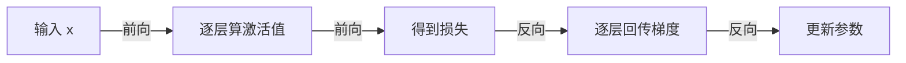

- **前向**：算并**存下**每层中间结果（反向要用）。
- **反向**：从损失往回走，每层乘上本层的局部导数（雅可比），得到对该层参数的梯度。

### 要点

反向传播不是新算法，它就是**链式法则 + 动态规划**：同一个中间量只算一次，从后往前复用。

## 12 自动求导与计算图

### 三种求导方式

| 方式 | 做法 | 问题 |
| --- | --- | --- |
| 符号求导 | 按公式推解析式 | 表达式爆炸 |
| 数值求导 | $\dfrac{f(x+h)-f(x)}{h}$ | 有截断误差，每维算一次太慢 |
| **自动求导** | 记录运算过程，按链式法则反着算 | 需要存中间结果（内存） |

自动求导算的是**一个函数在指定点上的导数值**，不是解析式。

### 计算图

把代码拆成算子，用**无环图**表示计算：

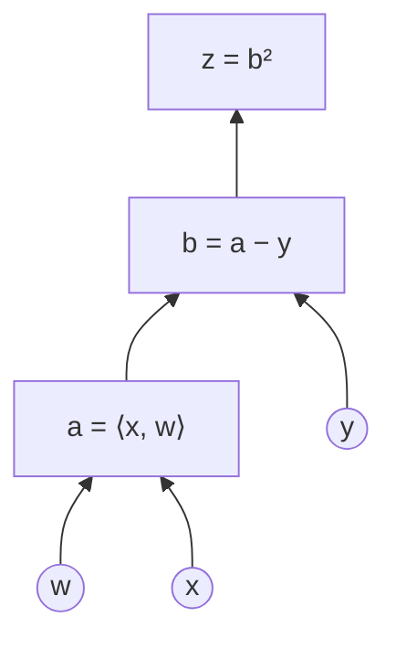

### 两种累积模式

**正向累积**：从输入往前推，一次得到一个输入对所有输出的影响。

$$\frac{\partial y}{\partial x} = \frac{\partial y}{\partial u_n}\Big(\cdots\Big(\frac{\partial u_2}{\partial u_1}\frac{\partial u_1}{\partial x}\Big)\Big)$$

**反向累积**（反向传播）：从输出往回推，一次得到所有输入对一个输出的影响。

$$\frac{\partial y}{\partial x} = \Big(\Big(\frac{\partial y}{\partial u_n}\frac{\partial u_n}{\partial u_{n-1}}\Big)\cdots\Big)\frac{\partial u_2}{\partial u_1}\frac{\partial u_1}{\partial x}$$

### 为什么深度学习用反向

![[反向累积.svg|561]]

*正向走一遍存下激活值，反向走一遍把梯度逐段乘回去。*

神经网络是**很多输入（参数）、一个输出（损失）**。反向累积一次就能拿到全部梯度，正向累积要对每个参数各跑一遍。

| | 计算复杂度 | 内存 |
| --- | --- | --- |
| 反向累积 | $O(n)$ 拿到全部梯度 | $O(n)$，要存正向中间结果 |
| 正向累积 | $O(n)$ 只拿到一个变量 | $O(1)$ |

### 要点

反向传播的 $O(n)$ 内存开销，正是 [[#46 FlashAttention 与 ZeRO]] 这类技术要解决的问题。

## 13 权重衰退（L2 正则化）

> 完整内容已独立成篇：[[正则项]]（含 L1 / Elastic Net、Dropout / 早停 / 标签平滑、与优化器的关系）

## 14 Dropout 丢弃法

### 做法

训练时随机把隐藏层的一部分激活值**置 0**。

$$\mathbf{h} = \sigma(\mathbf{W}_1\mathbf{x}+\mathbf{b}_1),\qquad \mathbf{h}' = \text{dropout}(\mathbf{h}),\qquad \mathbf{o} = \mathbf{W}_2\mathbf{h}' + \mathbf{b}_2$$

通常作用在**隐藏全连接层的输出**上。

![[Pasted image 20261101105107.png|600]]

*训练时每个隐藏单元以概率 $p$ 被临时摘掉，网络结构每次都不一样。*

### 关键：留下的要放大

以概率 $p$ 置 0，留下的分量乘 $\dfrac{1}{1-p}$：

$$h_i' = \begin{cases} 0, & \text{概率 } p \\[4pt] \dfrac{h_i}{1-p}, & \text{其余情况} \end{cases}$$

**这样期望不变**：

$$E[h_i'] = p\cdot 0 + (1-p)\cdot\frac{h_i}{1-p} = h_i$$

若不做缩放，训练时的期望就被压小了，测试时会系统性偏移。这种"训练时缩放"的叫 inverted dropout，是框架里的默认做法。

### 为什么能防过拟合

每次迭代随机丢掉一部分神经元，网络结构都在变，**逼着每个神经元不能依赖特定的邻居**，相当于训练了很多共享权重的子网络，测试时做集成。

### 训练 / 推理的区别

| | 行为 |
| --- | --- |
| 训练 | 随机丢弃 + 缩放（缩放已内置） |
| 推理 | **不丢弃、不缩放**，用完整网络 |

忘了切换 `model.eval()` 会导致推理结果随机抖动，这是极常见的 bug。

$p$ 常用 0.5。

## 15 数据增强

### 是什么

对训练样本随机做一些变换，产生**跟原图相似但不完全相同**的新样本，从而扩大训练集。

### 常见手段（图像）

平移、缩放、裁剪、旋转、翻转、增减亮度。

### 为什么有用

- 模型**避免过度依赖某些属性**（比如"天空一定在上方"），学到更本质的特征。
- 用几乎零成本"造"出更多数据，直接抑制过拟合，见 [[#04 过拟合与欠拟合]]。
- 增强方式本身是一种**先验**：只做水平翻转，就是在告诉模型"左右翻转不该改变类别"。

### 注意

- 增强必须**保持标签不变**。对数字 6 做 180° 旋转就变成 9 了，这类增强会引入错误标签。
- 训练时做，**验证/测试时不随机增强**（最多做确定性的 resize / center crop）。
- AlexNet 正是靠数据增广 + Dropout + ReLU 三件套拿下 ImageNet，见 [[#31 LeNet 与 AlexNet]]。

## 16 批量归一化 BN

### 一句话

对**每个 mini-batch、每个通道**做归一化：减均值、除标准差，再乘 $\gamma$ 加 $\beta$ 还原表达能力。

$$\hat{x} = \frac{x - \mu_B}{\sqrt{\sigma_B^2 + \epsilon}},\qquad y = \gamma\hat{x} + \beta$$

### 解决什么

- 加快**收敛速度**（可以用更大学习率）。
- 缓解深层网络的**梯度弥散**，让深层网络更好训练、更稳定。

### 为什么能堆更多层

每层输入分布随前面层参数变化而漂移（internal covariate shift）。BN 把每层输入**拉回稳定分布**，后面的层不用追着一个到处移动的分布跑。

### 训练 / 推理的差别（重点）

| | 均值方差从哪来 |
| --- | --- |
| 训练 | 当前 batch 现算 |
| 推理 | 用训练中累积的**滑动平均** |

推理时 batch 可能只有 1 个样本，现算没有意义，所以必须用滑动统计量。这也是要切 `model.eval()` 的原因之一。

### 易错

- BN 依赖 batch 维度，**batch 太小时统计量不可靠**，此时改用 LayerNorm / GroupNorm。
- BN 是"对每个通道归一化"，不是对整个样本归一化。
- 有 BN 后，卷积层可以不用偏置（因为减均值会把它消掉）。

## 17 早停与超参数

### 早停 Early Stopping

训练过程中同时监控验证损失：**验证损失开始上升时就停下来**，取验证损失最低处的参数。

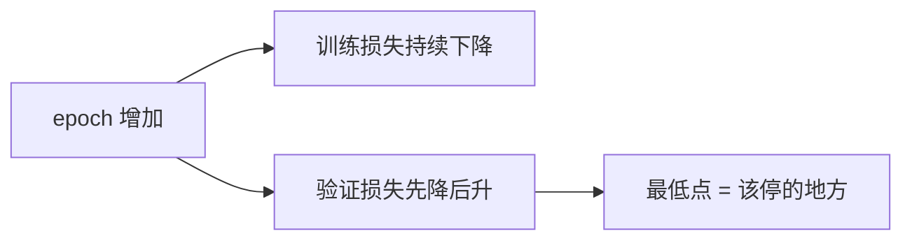

它相当于一种隐式的正则：不让模型有足够时间把噪声记牢。

### 主要超参数

| 超参数                        | 影响            | 常用起点            |
| -------------------------- | ------------- | --------------- |
| 学习率 $\eta$                 | 太大震荡/发散，太小收敛慢 | $10^{-3}$（Adam） |
| 批量大小 $B$                   | 太小噪声大、太浪费显存   | 32–256          |
| 网络深度 / 宽度                  | 容量            | 由任务与算力定         |
| 正则强度 $\lambda$、dropout $p$ | 抑制过拟合的力度      | 取验证最优           |

### 自动调参

网格搜索：给每个超参数列候选值，全部组合跑一遍，按验证集挑最好。开销随维度指数增长，实践多用随机搜索或贝叶斯优化。

### 要点

- 超参数用**验证集**选，绝不能用测试集（见 [[#02 数据集划分]]）。
- 学习率是最值得先调的那个，它比网络结构影响更大。

## 18 梯度消失与梯度爆炸

### 怎么来的

反向传播要连乘每层的局部导数：

$$\frac{\partial l}{\partial \mathbf{W}_1} = \frac{\partial l}{\partial \mathbf{h}_L}\prod_{k=2}^{L}\frac{\partial \mathbf{h}_k}{\partial \mathbf{h}_{k-1}}$$

每项都小于 1 → 连乘趋向 0，**梯度消失**；每项都大于 1 → 连乘炸开，**梯度爆炸**。层数越深、连乘次数越多，问题越严重。

RNN 尤其明显：它要在时间维上迭代上百次，同一套权重反复相乘。

### 三种应对

| 手段    | 原理                                              |
| ----- | ----------------------------------------------- |
| 换激活函数 | ReLU 正区间导数恒为 1，不像 sigmoid 那样两端饱和（见 [[#10 激活函数]]） |
| 归一化   | BN 把每层输入拉回稳定分布（见 [[#16 批量归一化 BN]]）              |
| 残差连接  | 多一条恒等通路，梯度不必只靠连乘（见 [[#33 ResNet 与残差连接]]）        |

### 初始化也很关键

- **Xavier**：适用于 tanh / sigmoid，按前后层维度平衡方差。
- **He**：适用于 ReLU，因为 ReLU 把一半激活打成 0，方差要相应放大。

初始化不当，训练刚开始梯度就已经消失或爆炸了。

## 19 优化问题与局部/全局最小

### 优化问题的标准形式

$$\min f(x)\quad \text{s.t.}\quad x \in C$$

- 目标函数 $f:\mathbb{R}^n \to \mathbb{R}$
- 约束集合 $C$：等式约束 $h_i(x)=0$、不等式约束 $g_j(x)\le 0$
- $C=\mathbb{R}^n$ 时就是**无约束优化**

### 全局最小 vs 局部最小

- **全局最小** $x^*$：$f(x^*) \le f(x)$，对所有 $x \in C$ 成立。
- **局部最小** $x^*$：存在邻域，在该邻域内 $f(x^*) \le f(x)$。


![[Pasted image 20261101221140.png|440]]

*局部最小是一段谷底，全局最小是整条曲线的最低点——两者未必重合。*

### 关键事实

**迭代算法一般只能保证找到局部最小。** 深度学习里的损失是非凸的，无数个局部最小，我们通常也只需要一个"够好"的点。

### 驻点不等于最小点

$\nabla f(x)=0$ 的点叫**驻点**，它可能是极小、极大，也可能是**鞍点**。要判断得看二阶条件（海森矩阵正定 → 极小）。

## 20 凸集、凸函数、凸优化

### 三个定义

**凸集**：集合内任取两点，连线上的点仍在集合内。

$$\alpha x + (1-\alpha)y \in C,\quad \forall\alpha\in[0,1],\ \forall x,y\in C$$

**凸函数**：任意两点之间，函数曲线都在弦的下方（或重合）。

$$f(\alpha x+(1-\alpha)y) \le \alpha f(x) + (1-\alpha)f(y)$$

**凸优化**：$f$ 是凸函数，且约束集 $C$ 是凸集。

![[Pasted image 20261101221931.png|300]] ![[Pasted image 20261101222159.png|380]]

*左：凸集——任取两点，连线不跑到集合外面；右：凸函数——曲线始终在弦的下方。*

### 凸优化最重要的一条

**局部最小一定是全局最小。**

直观理由：若别处还有更低的点，从局部最小走向它的那条线段上，函数值会先降下去——与"局部最小"矛盾。严格凸时，全局最小点至多一个。

### 哪些是凸的

| 凸 | 非凸 |
| --- | --- |
| 线性回归 $\|Wx-b\|_2^2$ | MLP |
| Softmax 回归 | CNN、RNN、Attention |

**几乎所有深度模型都是非凸的**，所以深度学习才需要各种优化技巧（动量、自适应步长、好的初始化）。

### 要点

凸性给的是"**保证**"：凸问题上梯度下降一定收敛到全局最优。非凸问题上只能求"经验上好用"。

## 21 梯度下降 GD

### 先用一个数走一遍：loss 是怎么变小的

单个参数最直观。设模型就是 $\hat y = w x$，现在 $x=1$、$w=2$，正确答案 $y=5$，损失用平方误差 $L=(w x-y)^2$。

> 这里用**平方误差** $L=(\hat y-y)^2$ 只是教学方便：导数 $2(\hat y-y)x$ 一眼能算。真实任务按类型选——**回归用平方误差，分类用交叉熵**（见 [[交叉熵损失]]）。

> $y=5$ 是**随便取的**，只为好算。它代表「标准答案」这个角色；换成 $y=10$，过程一模一样，只是 $w$ 最终会往 10 收敛。

**第 1 轮**

$$\begin{aligned}
\text{前向：}&\quad \hat y = w x = 2\times 1 = 2\\
\text{损失：}&\quad L = (2-5)^2 = 9\\
\text{反向：}&\quad \frac{\partial L}{\partial w} = 2(\hat y - y)x = -6\\
\text{更新：}&\quad w \leftarrow 2 - 0.1\times(-6) = 2.6
\end{aligned}$$

**第 2 轮**（什么都不改，再跑一遍）

$$\begin{aligned}
\text{前向：}&\quad \hat y = 2.6\times 1 = 2.6\\
\text{损失：}&\quad L = (2.6-5)^2 = 5.76\\
\text{反向：}&\quad \frac{\partial L}{\partial w} = 2(2.6-5) = -4.8\\
\text{更新：}&\quad w \leftarrow 2.6 - 0.1\times(-4.8) = 3.08
\end{aligned}$$

继续跑，$w$ 会逼近 5，loss 逼近 0。**loss 就是这么变小的：不需要谁"控制"，只靠每一步都往下降的方向挪一小步。**

三个角色分清楚：

| 环节  | 产出          | 一句话              |
| --- | ----------- | ---------------- |
| 前向  | 预测 $\hat y$ | 我猜是多少            |
| 损失  | 一个标量 $L$    | 我错得多严重（越小越好）     |
| 反向  | 每个参数的梯度     | 每个参数该往哪个方向改、改多敏感 |

**梯度不是"答案"，只是"方向 + 斜率"**：`dL/dw = -6` 意思是"$w$ 变大能让 loss 变小，而且变化率是 6"。真正改多少由学习率决定，`w -= lr * grad` 这一行就是全部动作。

这也解释了两件常见困惑：

- **为什么必须乘学习率**：梯度只给方向，直接按梯度大小改会一步跨过头（$w$ 从 2 直接变 8，loss 反而暴涨）。
- **loss 不降反而涨**：多半是学习率太大，跨过了谷底；调小再试。

### 更新式

$$\mathbf{w}_t = \mathbf{w}_{t-1} - \eta\nabla f(\mathbf{w}_{t-1})$$

从起点 $\mathbf{w}_0$ 出发，重复 $t=1,\dots,T$。

### 为什么沿负梯度走

一阶展开：$f(\mathbf{w}+\Delta) \approx f(\mathbf{w}) + \nabla f(\mathbf{w})^\top\Delta$。

取 $\Delta = -\eta\nabla f(\mathbf{w})$，代入得 $f$ 约下降 $\eta\|\nabla f\|^2$——**负梯度是函数值下降最快的方向**。

### 学习率的两端

| $\eta$ | 现象 |
| --- | --- |
| 太小 | 收敛慢，走半天到不了 |
| 太大 | 来回震荡，甚至发散 |


### 痛点

每一步都要**遍历全部样本**算梯度，代价 $O(n)$。数据上百万时一步都算不完，于是有了 [[#22 随机梯度下降 SGD]]。

## 22 随机梯度下降 SGD

### 它要解决的问题

训练目标是**所有样本损失的平均**：

$$f(\mathbf{w})=\frac{1}{n}\sum_{i=1}^{n}\ell_i(\mathbf{w})$$

梯度下降（GD）每一步都要把 $n$ 条样本全算一遍再平均。数据一百万条时，**走一步就要算一百万次**，根本跑不动。

SGD 的做法很粗暴：**每次只抽一条样本，用它的梯度代替整体梯度**。

### 一个类比

想知道全班 50 人的平均身高，GD 是把 50 个人都量一遍；SGD 是**随手抓一个人量**，用他的身高估计全班平均。

单次估计一定不准——抓到 1.9 m 的会高估，抓到 1.6 m 的会低估。但**抽很多次平均下来是对的**，而且每次只要量一个人。

### 数值看一下

三个样本的梯度分别是 $+2$、$0$、$-4$，真实整体梯度是 $(2+0-4)/3=-0.67$——**应该往下走**。

| 这一轮抽到谁 | SGD 用的梯度 | 走的方向 |
| --- | --- | --- |
| 样本 1 | $+2$ | 往上走（方向反了） |
| 样本 2 | $0$ | 原地不动 |
| 样本 3 | $-4$ | 往下走（方向对，但跨太大） |

单看一步经常是错的，但把很多步加起来，平均方向就是 $-0.67$。**这就是"无偏"的含义：单步有噪声，长期方向不错。**

### 噪声带来的两个后果

| 后果 | 说明 | 应对 |
| --- | --- | --- |
| **停不下来** | 到最优点附近时，单样本梯度仍不为 0，参数一直抖 | 学习率随训练衰减，或取最后几步的平均 |
| **方向抖** | 相邻两步可能一上一下 | 用小批量（[[#23 小批量 SGD]]）减小方差 |

### 两个"意外好处"

- **噪声能帮忙跳坑**：参数容易被抖出尖锐的局部最小，落到更平坦的区域，测试集上往往更好。
- **每步极便宜**：代价从 $O(n)$ 降到 $O(1)$，同样时间里能走几万步。

### 一句话

**GD 是"问遍所有人再决定"，SGD 是"随手问一个就走"——方向会抖，但便宜得多，长期也不偏。**

## 23 小批量 SGD

### 更新式

每步随机抽一个子集 $I_t$，大小 $|I_t| = b$：

$$\mathbf{w}_t = \mathbf{w}_{t-1} - \frac{\eta_t}{b}\sum_{i\in I_t}\nabla\ell_i(\mathbf{w}_{t-1})$$

### 三个好处

- **仍然无偏**：平均梯度期望等于整体梯度。
- **方差更小**：样本独立时约缩小为 $1/b$，比单样本稳。
- **硬件用得满**：GPU 上算一批和算一个的耗时差不多，批量越大，单位时间看到的样本越多。

![[Pasted image 20261102085331.png|622]]

*批量越大，梯度估计越稳，但每一步也更贵。*

### 批量怎么选

| $b$ | 后果 |
| --- | --- |
| 太小 | 噪声大、GPU 利用率低 |
| 太大 | 每步更贵，方差改善递减（$\propto 1/b$），还费显存 |

所以批量不是越大越好，收益是递减的。实践里 32–256 是常见起点。

### 结论

**小批量 SGD 是最常用的基础形式**，几乎所有"训练一个网络"的默认骨架都是它。

## 24 冲量法 Momentum

### 做法

不直接用当前梯度，而是用**平滑过的梯度**：

$$g_t = \frac{1}{b}\sum_{i\in I_t}\nabla\ell_i(\mathbf{w}_{t-1}),\qquad v_t = \beta v_{t-1} + g_t,\qquad \mathbf{w}_t = \mathbf{w}_{t-1} - \eta v_t$$

### 展开看本质

$$v_t = g_t + \beta g_{t-1} + \beta^2 g_{t-2} + \beta^3 g_{t-3} + \cdots$$

**历史梯度的指数加权和**：越久远的梯度权重越小。

### 两个直观效果

- **同向加速**：一直指向同一方向的梯度会累加，越走越快，像球滚下坡带惯性。
- **震荡抵消**：左右来回摆的分量正负相加互相抵消，抖动被压平。

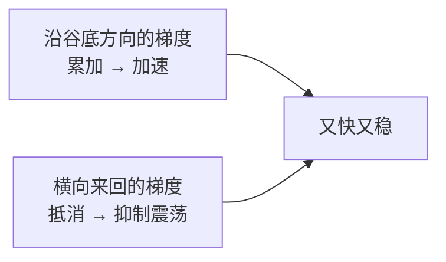

### 超参数

- $v_t$ 的有效平均窗口约 $\dfrac{1}{1-\beta}$ 步，$\beta = 0.9$ 时约等于最近 10 步。
- 梯度恒为 $g$ 时 $v \to \dfrac{g}{1-\beta}$，$\beta=0.9$ 步长放大 10 倍 → **加冲量后学习率要相应调小**。
- $\beta$ 常用 0.5、0.9、0.95、0.99。


## 26 优化器速查

> 从 BGD 到 AdamW 的完整演进与公式对比见 [[优化策略]]。

### 同一个骨架

$$\mathbf{w}_t = \mathbf{w}_{t-1} - \eta\cdot(\text{某种"方向"})$$

所有优化器的区别只在**"方向"怎么算**。

### 对比表

| 算法 | 每步代价 | 方向噪声 | 步长 | 备注 |
| --- | --- | --- | --- | --- |
| GD | $O(n)$ | 无 | 全局一个 $\eta$ | 精确但贵 |
| SGD | $O(1)$ | 大 | 全局一个 $\eta_t$ | 需要学习率衰减 |
| 小批量 SGD | $O(b)$ | 中，约 $1/b$ | 全局一个 $\eta_t$ | 最常用的基础形式 |
| 冲量法 | 同上 | 平滑后变小 | 全局一个 $\eta$ | 抑制震荡 |
| Adam | 同上，多存 $v,s$ | 平滑后变小 | 每个参数各自自适应 | 默认超参常能直接用 |

### 怎么选

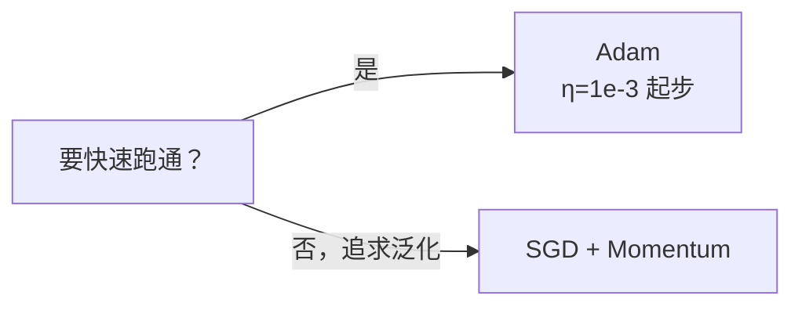

- 快速验证、Transformer、大模型 → Adam / AdamW。
- 经典 CNN、追求极致泛化 → SGD + 动量 + 学习率调度。

## 27 卷积层

### 两个核心特性

| 特性 | 含义 | 好处 |
| --- | --- | --- |
| **局部感知** | 每个输出只看输入的一小块区域（感受野） | 参数量与图像尺寸无关 |
| **参数共享** | 同一个卷积核在整张图上滑动复用 | 参数极少、天然具备平移等变性 |

对比全连接：输入 $1000\times1000$ 的图像接一个 1000 维全连接层，光权重就有 $10^9$ 个；换成 $3\times3$ 卷积核只需要 9 个参数。

![[Pasted image 20261101144659.png|560]]

*卷积核在输入上滑动，每滑一次产出一个数；同一个核走遍全图，就是参数共享。*

### 运算方式

卷积核从左上角开始滑动，每步往右挪一列或往下挪一行，逐位置做**加权求和**：

$$y_{i,j} = \sum_{u,v} w_{u,v}\,x_{i+u,\ j+v} + b$$

（严格说深度学习里的"卷积"其实是互相关，不翻转核；叫法沿用了数学卷积的名。）

### 输出尺寸

$$H_{\text{out}} = \left\lfloor\frac{H_{\text{in}} + 2P - K}{S}\right\rfloor + 1$$

其中 $K$ 是核大小、$P$ 是填充、$S$ 是步幅。

### 要点

- 卷积核尺寸、通道数、层间连接关系决定了网络容量与计算量。
- 一层卷积 = 若干"特征检测器"，浅层抓边缘/颜色，深层抓语义。

## 28 填充与步幅

### 填充 Padding

在输入矩阵边界补一圈值（通常是 0），**增大尺寸**，让边缘像素也能被核"照顾"到，同时控制输出尺寸。

- $P=0$：输出会越来越小
- $P=(K-1)/2$（$K$ 为奇数）：输出尺寸与输入相同，叫 "same padding"

![[Pasted image 20261101145045.png|280]]

*在输入矩阵四周补一圈 0，边缘像素才有机会被核扫到。*

### 步幅 Stride

卷积核每次滑动的行数/列数。

- $S=1$：逐格滑
- $S=2$：跳一格滑

**作用：成倍缩小尺寸。** 步幅为 2 输出约为输入的 $1/2$，步幅为 3 约为 $1/3$。

### 合起来算输出尺寸

$$H_{\text{out}} = \left\lfloor\frac{H_{\text{in}} + 2P - K}{S}\right\rfloor + 1$$

例：输入 $32\times32$、核 $5\times5$、填充 2、步幅 2：

$$\frac{32 + 4 - 5}{2} + 1 = \frac{31}{2} + 1 = 15 + 1 = 16$$

输出 $16\times16$。

### 易错

- 步幅 >1 时下取整，除不尽的那部分会被丢掉。
- 填充用 0 不是随便选的：0 在卷积里表示"这里没有信号"，等价于边界外无信息。

## 29 通道与 1×1 卷积

### 两条对照记

- **输入图像的通道数 == 卷积核的通道数**
- **输出通道数 == 卷积核的数量**

### 为什么

一个卷积核要跟输入"逐通道配对"做加权求和，所以核的深度必须等于输入深度；每个卷积核产出一张特征图，所以有几个核就有几个输出通道。

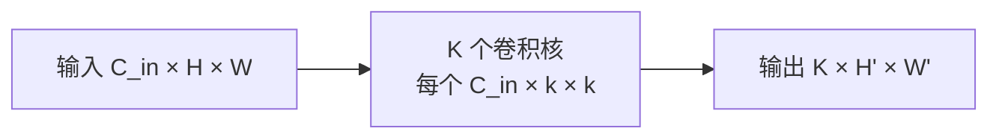

### 参数量公式

$$C_{\text{out}} \times (C_{\text{in}} \times k \times k + 1)$$

**与图像的高宽无关**——这是卷积相对全连接最大的优势。

例：3 通道输入、16 通道输出、$5\times5$ 核 → $16\times(3\times25+1) = 1216$。

### 1×1 卷积

核只有 1 个像素，看起来"什么都没看"，但它做的是**跨通道的线性组合**：

- 把 $C_{\text{in}}$ 个通道压成 $C_{\text{out}}$ 个 → 降维/升维
- 参数量只有 $C_{\text{out}}\times C_{\text{in}}$
- 常用来减少计算量（GoogLeNet 的瓶颈结构、ResNet 的 bottleneck）

### 易错

通道数不是"图像有几个颜色"，中间层的通道数是**特征图的数量**，由上一层卷积核个数决定。

## 30 池化层

### 本质

池化（pooling）在卷积之后，本质是**采样 + 降维压缩**，用来加快运算、扩大感受野。

### 两种常见方式

| 方式 | 做法 | 效果 |
| --- | --- | --- |
| **最大池化** Max Pooling | 取窗口内最大值 | 保留最显著的特征 |
| **平均池化** Average Pooling | 取窗口内平均值 | 特征更平滑、更杂糅 |

![[Pasted image 20261101145856.png|420]] ![[Pasted image 20261101145911.png|520]]

*左：最大池化取窗口最大值，保留最显著的那一票；右：平均池化取平均，更平滑。*

### 三条关键性质

- **没有参数**（这句话要记牢）：池化不学习任何权重。
- **没有参数** → 不增加模型复杂度，只改变形状。
- 通常取 $2\times2$、步幅 2，尺寸减半。

### 作用

1. 保留主要特征的同时**减少参数量与计算量**，抑制过拟合。
2. 带来**不变性**：平移、轻微旋转、尺度变化下输出基本不变。

### 代价

池化是**特征选择和信息过滤**：它丢弃了一部分信息，换来计算性能。这是一种妥协，随着算力提升，这个妥协可以做得更小（比如用步幅卷积替代池化）。

## 31 LeNet 与 AlexNet

### LeNet-5

**结构**：卷积 → 池化 → 卷积 → 池化 → 全连接 ×3。

![[A0YCbINJ8otcwgxpJUHceFSUnGe.png|620]]

*LeNet-5：输入 $32\times32$ → 卷积得 6 张特征图 → 下采样 → 再卷积得 16 张 → 再下采样 → 三层全连接 → 10 类输出。*

**核心特征：不统一。** 卷积核尺寸、通道数、层间连接关系都是**逐层独立设计**的（C3 层还用稀疏连接），没有统一模块。

**设计目的**：早期算力极紧，靠"逐层缩小尺寸、增加通道"加稀疏连接，**极力压缩参数量**。

**演进影响**：灵活但难标准化。后来的 VGG、ResNet 吸取了"空间换通道"的思想，转向**模块统一化**，便于硬件加速。

### AlexNet

ImageNet 冠军，把深度学习的时代打开了。

**与 LeNet 相比**：更深（5 层卷积 + 3 层全连接），并用了三招改进训练：

| 手段 | 解决什么 |
| --- | --- |
| 数据增广 | 平移、缩放、裁剪、旋转、翻转、调亮度 → 抑制过拟合（见 [[#15 数据增强]]） |
| Dropout | 抑制过拟合（见 [[#14 Dropout 丢弃法]]） |
| ReLU | 减少梯度消失（见 [[#10 激活函数]]） |

### 一句话对比

**LeNet 是"能不能做"，AlexNet 是"能不能做大"**：结构思路一致，AlexNet 用更深的网络 + 三件套训练技巧把它推到了实用规模。

## 32 VGG 与 NiN

### VGG

**结构**：与 AlexNet 类似，但**更深、更规整**。5 段卷积 + 3 层全连接 + softmax 输出，段与段之间用 maxpool 隔开，隐藏层全用 ReLU。

**关键设计：用重复的小卷积核堆叠。**

- 两个 $3\times3$ 卷积的感受野等于一个 $5\times5$，三个 $3\times3$ 等于一个 $7\times7$。
- 但参数更少、非线性层数更多，表达能力更强。

**代价**：全连接层参数巨大（VGG-16 一半以上参数在 FC 层），显存和计算都不便宜。

![[Pasted image 20261101151538.png|560]]

*VGG 的规整结构：一段卷积块 + 一次池化，重复五段，尺寸减半、通道翻倍。*

### NiN（Network in Network）

**核心思想：用 $1\times1$ 卷积 + 非线性代替全连接层，做"网络中的网络"。**

- 每个卷积后面接 $1\times1$ 卷积（相当于逐像素的小 MLP），增强通道间的非线性组合。
- 用**全局平均池化**替代最后的全连接层，参数量骤减，也不容易过拟合。

![[Pasted image 20261101152035.png|560]]

*NiN 块：普通卷积后接 $1\times1$ 卷积，相当于在每个像素位置上做一个小 MLP。*

### 两者的位置

| | 贡献 | 局限 |
| --- | --- | --- |
| VGG | 证明"深 + 小核堆叠"有效，结构统一好实现 | 参数多、计算重 |
| NiN | 提出 $1\times1$ 卷积与全局平均池化 | 结构不主流，思想被后来者吸收 |

这两个思想后来都进了 ResNet、GoogLeNet 的血脉里。

## 33 ResNet 与残差连接

### 解决的问题

网络加深到一定程度后，**训练误差反而变大**——这不是过拟合，而是退化（degradation）：优化器找不到恒等映射这条"什么都不做"的路。

### 残差块

$$H(\mathbf{X}) = F(\mathbf{X}) + \mathbf{X}$$

- $F$ 是这一块要学的残差，$\mathbf{X}$ 由**快捷连接**原样送到输出。
- 学习目标从"拟合 $H$"变成"拟合 $H - \mathbf{X}$"——残差通常更小，更好优化。
- 最差情况把 $F$ 压成 0，这一块退化为**恒等映射**，于是**加深网络不会让训练误差变差**。

![[Pasted image 20261101153525.png|560]]

*残差块：主路学 $F(\mathbf{X})$，右侧那条绕过卷积层的弧线把 $\mathbf{X}$ 原样送到加法处。*

### 梯度为什么能通

普通结构：

$$\frac{\partial H}{\partial \mathbf{X}} = \frac{\partial H}{\partial F}\frac{\partial F}{\partial \mathbf{X}}$$

残差结构：

$$\frac{\partial H}{\partial \mathbf{X}} = \frac{\partial H}{\partial F}\frac{\partial F}{\partial \mathbf{X}} + I$$

多出来的 $I$ 来自快捷连接，**与权重无关、不参与连乘**。前面连乘项接近 0 时，梯度里仍有一条直通路径，梯度消失与爆炸都被缓解（见 [[#18 梯度消失与梯度爆炸]]）。

### 形状不一致怎么办

$F(\mathbf{X})$ 与 $\mathbf{X}$ 通道数或尺寸不同时，用 $1\times1$ 卷积 + 步幅把 $\mathbf{X}$ 投影到相同形状（见 [[#29 通道与 1×1 卷积]]）。

## 34 语义分割、样式迁移与 YOLO

### 语义分割

从**像素级别**理解图像，为每个像素分配一个类别。

- 输出不是"这张图是什么"，而是"每个像素分别是什么"。
- 典型做法：编码器不断下采样提取语义，解码器上采样恢复分辨率（见 [[#38 编码器-解码器与 Seq2Seq]] 的思路）。

![[Pasted image 20261101155145.png|560]]

*分类只给整图一个标签，语义分割要给每个像素都贴上类别。*

### 样式迁移

用卷积网络把一张图的**风格**套到另一张图的**内容**上。

做法：分别提取内容图的内容特征、风格图的风格特征（通常用 Gram 矩阵表示），优化生成图让两者同时接近。风格特征落在浅层/多层统计量上。

![[Pasted image 20261101155957.png|580]]

*内容图 + 风格图 → 合成图：既保留内容的轮廓，又染上风格图的笔触与配色。*

### YOLO 目标检测

**一次前向就出框和类别**（You Only Look Once）。

输出张量形状：

$$S \times S \times (B \times 5 + C)$$

- **$S\times S$**：整图切成 $S\times S$ 个格子，物体中心落在哪个格子，哪个格子负责预测它。
- **$B$**：每个格子预测 $B$ 个候选框，每框 5 个数 $(x, y, w, h, c)$：
  - $x,y$：框中心相对当前格子的偏移，归一化到 $0\sim1$
  - $w,h$：宽高相对整图的比例，归一化到 $0\sim1$
  - $c$：置信度，含物体的概率 × 框得准不准
- **$C$**：类别条件概率，YOLOv1 中由该格子的所有框共享。

### 三者对比

| 任务 | 输出粒度 |
| --- | --- |
| 分类 | 一张图一个标签 |
| 检测（YOLO） | 若干框 + 每框一个类别 |
| 语义分割 | 每个像素一个类别 |

## 35 RNN 循环神经网络

### 为什么需要

前馈网络一次吃一个定长向量，处理不了**变长序列**，也无法记住"上一个词"。RNN 用一个**隐藏状态**把历史压缩着往下传。

### 计算过程

$$\mathbf{h}_t = \sigma(\mathbf{W}_{hh}\mathbf{h}_{t-1} + \mathbf{W}_{xh}\mathbf{x}_t + \mathbf{b}_h)$$

$$\mathbf{y}_t = \mathbf{W}_{hy}\mathbf{h}_t + \mathbf{b}_y$$

- $\mathbf{W}_{hh}$：隐状态到隐状态（记忆部分）
- $\mathbf{W}_{xh}$：输入到隐状态
- $\mathbf{W}_{hy}$：隐状态到输出

**所有时间步共用同一套权重**——这也是参数共享。

![[Pasted image 20261101203927.png|520]]

*同一块（同一组权重）在不同时间步反复使用，右边那条回到自己的箭头就是"记忆"。*

### 展开图

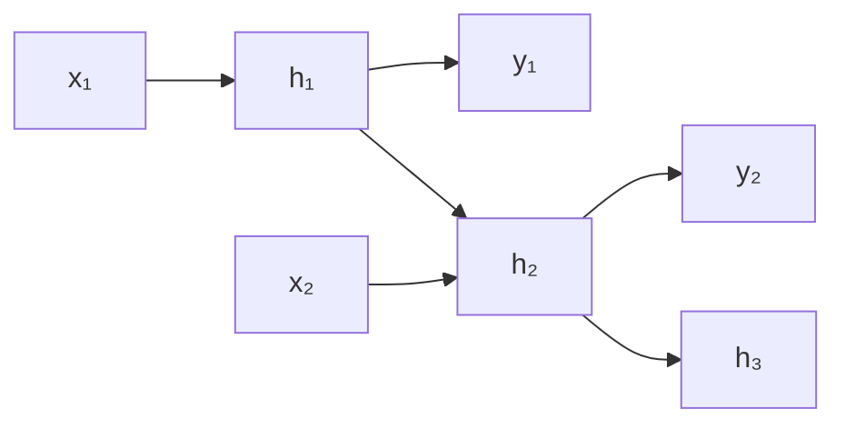

横向展开后就是一条很深的网络，只是每层权重相同。

![[V20xbU4RCoGaVExqzfuchKXunJf.png|700]]

*从左到右：RNN 只有一个 tanh 单元；LSTM 加了遗忘门、输入门、输出门和细胞状态；GRU 简化成重置门与更新门。*

### 致命弱点

**长序列上梯度会消失或爆炸**：反向传播要沿时间连乘上百次（BPTT），同一套权重反复相乘（见 [[#18 梯度消失与梯度爆炸]]）。

后果是**记不住远处信息**。解决办法是门控结构：[[#36 LSTM 长短期记忆网络]]、[[#37 GRU]]。

## 36 LSTM 长短期记忆网络

### 关键：多了一条细胞状态

LSTM 引入**细胞状态 $\mathbf{c}_t$** 和**三个门**来控制信息流动。细胞状态像一条"传送带"，信息可以几乎无损地往前传。

![[V20xbU4RCoGaVExqzfuchKXunJf.png|700]]

*看中间那栏：顶上那条横贯的直线就是细胞状态，三个 σ 分别是遗忘门、输入门、输出门。*

### 三个门

**遗忘门**——决定丢掉多少旧记忆：

$$\mathbf{f}_t = \sigma(\mathbf{W}_f[\mathbf{h}_{t-1}, \mathbf{x}_t] + \mathbf{b}_f)$$

**输入门**——决定写入多少新信息：

$$\mathbf{i}_t = \sigma(\mathbf{W}_i[\mathbf{h}_{t-1}, \mathbf{x}_t] + \mathbf{b}_i)$$

**候选细胞状态**：

$$\tilde{\mathbf{c}}_t = \tanh(\mathbf{W}_c[\mathbf{h}_{t-1}, \mathbf{x}_t] + \mathbf{b}_c)$$

**细胞状态更新**：

$$\mathbf{c}_t = \mathbf{f}_t \odot \mathbf{c}_{t-1} + \mathbf{i}_t \odot \tilde{\mathbf{c}}_t$$

**输出门**——决定暴露多少给隐状态：

$$\mathbf{o}_t = \sigma(\mathbf{W}_o[\mathbf{h}_{t-1}, \mathbf{x}_t] + \mathbf{b}_o),\qquad \mathbf{h}_t = \mathbf{o}_t \odot \tanh(\mathbf{c}_t)$$

$\odot$ 表示逐元素乘法。

### 为什么能缓解梯度消失

$$\mathbf{c}_t = \mathbf{f}_t \odot \mathbf{c}_{t-1} + (\cdots)$$

对 $\mathbf{c}_{t-1}$ 求导就是 $\mathbf{f}_t$——**没有矩阵连乘**，只有逐元素缩放。遗忘门接近 1 时梯度几乎原样传回去，所以长距离依赖能保留下来。

## 37 GRU

### 一句话

GRU 是 **LSTM 的简化版，只有两个门**：更新门 + 重置门。参数更少、训练更快，效果通常与 LSTM 相当。

![[V20xbU4RCoGaVExqzfuchKXunJf.png|700]]

*看右栏：只有两个 σ，一个管重置、一个管更新，也没有单独的细胞状态。*

### 两个门

**更新门**——在"保留旧状态"和"写入新状态"之间分配权重：

$$\mathbf{z}_t = \sigma(\mathbf{W}_z[\mathbf{h}_{t-1}, \mathbf{x}_t] + \mathbf{b}_z)$$

**重置门**——决定新状态要看多少旧历史：

$$\mathbf{r}_t = \sigma(\mathbf{W}_r[\mathbf{h}_{t-1}, \mathbf{x}_t] + \mathbf{b}_r)$$

**候选隐状态**（注意 $\mathbf{r}_t$ 作用在 $\mathbf{h}_{t-1}$ 上）：

$$\tilde{\mathbf{h}}_t = \tanh(\mathbf{W}_h[\mathbf{r}_t \odot \mathbf{h}_{t-1}, \mathbf{x}_t] + \mathbf{b}_h)$$

**更新**：

$$\mathbf{h}_t = (1 - \mathbf{z}_t)\odot\mathbf{h}_{t-1} + \mathbf{z}_t\odot\tilde{\mathbf{h}}_t$$

### 与 LSTM 的对应

| LSTM | GRU |
| --- | --- |
| 遗忘门 + 输入门 | 合并为一个更新门 $\mathbf{z}_t$（$(1-\mathbf{z})$ 管遗忘，$\mathbf{z}$ 管写入） |
| 输出门 | 取消 |
| 细胞状态 $\mathbf{c}_t$ + 隐状态 $\mathbf{h}_t$ | 只有一个隐状态 $\mathbf{h}_t$ |

### 结构对比

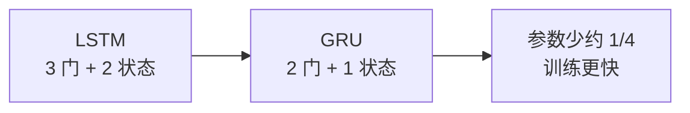

### 何时退化为普通 RNN

$\mathbf{z}_t \to 0$、$\mathbf{r}_t \to 1$ 时，$\mathbf{h}_t \approx \mathbf{h}_{t-1}$ 且候选值用全部历史——两个门都"不做事"，结构近似退化为普通 RNN。

## 38 编码器-解码器与 Seq2Seq

### Seq2Seq 是什么

**Sequence to Sequence**：输入一个序列，输出另一个序列。用于机器翻译、文本摘要、对话系统。

### 两个部件

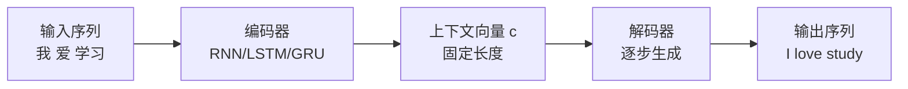

- **编码器**：把整个输入序列压成一个**固定长度的上下文向量**。
- **解码器**：以该向量为初始状态，逐步生成输出，每一步依赖前一步的输出与当前隐状态。

![[Pasted image 20261101204712.png|380]] ![[Pasted image 20261101210746.png|600]]

*左：编码器把序列压成一个向量；右：Seq2Seq 整体——编码器读完整句，解码器一个词一个词往外吐。*

### 训练

- 损失：交叉熵（输出词与目标词的差异）。
- 优化器：Adam 或 SGD。

### 致命缺陷

不管输入多长，都要塞进**同一个固定长度的向量**——信息必然丢失。

补救就是注意力机制：解码器每生成一个词时，"回头看"编码器的所有隐状态，从中挑相关的部分：

$$\alpha_{t,i} = \text{softmax}(\text{score}(\mathbf{s}_{t-1}, \mathbf{h}_i))$$

这就是 [[#39 注意力与 QKV]] 的起点。Transformer 后来干脆把循环结构整个扔掉，只留注意力。

## 39 注意力与 QKV

### 直觉

把注意力想成**查字典**：

| 角色 | 含义 | 类比 |
| --- | --- | --- |
| **Query**（查询） | 我现在想找什么 | 我要查的词 |
| **Key**（键） | 每条信息挂的标签 | 字典的索引 |
| **Value**（值） | 真正的内容 | 词条解释 |

用 Q 和每个 K 算相似度，softmax 成权重，再对 V 加权求和——**"按相关性取信息"**。

### 解决 RNN 的什么问题

- RNN 必须**顺序**处理，无法并行；
- 长距离依赖要靠隐状态一路传，越远越淡。

注意力让任意两个位置**一步直连**，路径长度从 $O(n)$ 变成 $O(1)$，而且整句可以并行算。

### 三种用法

| 名称 | Q 来自 | K、V 来自 | 用途 |
| --- | --- | --- | --- |
| 自注意力 | 同一序列 | 同一序列 | 编码器内部 |
| 交叉注意力 | 解码器 | 编码器输出 | 编码器-解码器 |
| 掩蔽自注意力 | 同一序列（只看左侧） | 同左 | 解码器生成 |

## 40 缩放点积注意力

### 公式

$$\text{Attention}(\mathbf{Q},\mathbf{K},\mathbf{V}) = \operatorname{softmax}\!\left(\frac{\mathbf{Q}\mathbf{K}^\top}{\sqrt{d_k}}\right)\mathbf{V}$$

三步：

1. $\mathbf{Q}\mathbf{K}^\top$：算每个 Query 与每个 Key 的相似度（点积越大越相关）
2. 除以 $\sqrt{d_k}$，再 softmax 成权重
3. 用权重对 $\mathbf{V}$ 加权求和

### 形状

| 张量 | 形状 |
| --- | --- |
| $\mathbf{Q}$ | $(B, L_q, d_k)$ |
| $\mathbf{K}$ | $(B, L_k, d_k)$ |
| $\mathbf{Q}\mathbf{K}^\top$ | $(B, L_q, L_k)$ |
| 输出 | $(B, L_q, d_v)$ |

注意力权重矩阵是 $L_q \times L_k$，这就是 $O(n^2)$ 的来源。

### 为什么要除以 $\sqrt{d_k}$

点积是 $d_k$ 个乘积之和，$d_k$ 越大方差越大，分数会被推到很大的数值区间。此时 softmax 会**极度尖锐**（几乎 one-hot），梯度几乎为 0，训练不动。

除以 $\sqrt{d_k}$ 把方差拉回 1 左右，softmax 保持在合适温度。

### 代码骨架

```python
scores = Q @ K.transpose(-2, -1) / math.sqrt(d_k)
attn = F.softmax(scores, dim=-1)
out = attn @ V
```

## 41 多头注意力 MHA

### 做法

把 $d_{\text{model}}$ 切成 $h$ 份，每份维度 $d_{\text{head}} = d_{\text{model}} / h$，**每个头独立做一次注意力**，最后拼接再线性变换。

$$\text{MultiHead}(\mathbf{Q},\mathbf{K},\mathbf{V}) = \text{Concat}(\text{head}_1,\dots,\text{head}_h)\mathbf{W}_O$$

$$\text{head}_i = \text{Attention}(\mathbf{Q}\mathbf{W}_Q^i,\ \mathbf{K}\mathbf{W}_K^i,\ \mathbf{V}\mathbf{W}_V^i)$$

### 张量形状变化

![[Iuhdbk5nbocDKNxidaAcRVQUn1e.png|620]]

*同一个输入用 $W_Q, W_K, W_V$ 投出三份，再 reshape 成多个头；虚线右边是 Transformer 特有的多头切分。*

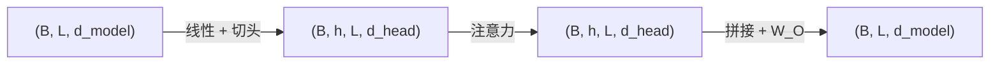

### 为什么多头更好

单个头的注意力是**一种**相似度模式。多头让模型同时在不同子空间里看不同的关系：一个头盯语法依存，一个头盯指代，一个头盯位置邻近……

**总计算量与单头几乎一样**，因为每头维度缩小了（$d_{\text{model}}/h$），总维度不变。这是"同样算力，换更多视角"的典型操作。

### 易错

- 代码里 `depth = d_model // num_heads`，必须整除（`assert d_model % num_heads == 0`）。
- `split_heads` 用的是 `view + permute`，用 `reshape` 而不 `contiguous` 后 `permute` 容易出错。
- 拼接前要 `permute` 回来并 `contiguous()`，否则 `view` 报错。

### 面试常考

能手写完整 MHA：线性投影 → 切头 → 缩放点积 → 拼回 → 输出投影。四步缺一不可。

## 42 位置编码：绝对与相对

### 为什么需要

Self-Attention 把输入当成**集合**来算：打乱词序，权重和输出都不变——它**置换不变**。

但语言有严格顺序。"我咬了狗"和"狗咬了我"必须区分，所以位置信息要**额外注入**。

### 两类注入方式

| | 绝对位置编码 | 相对位置编码 |
| --- | --- | --- |
| 注入位置 | 加在输入 embedding 上，逐元素相加 | 作用在注意力计算内部 |
| 代表方法 | 正弦编码（原论文）、可学习编码（BERT、GPT-2） | RoPE、ALiBi、T5 bias |
| 影响范围 | 之后 Q、K、V 都由它变换而来 | 只改 Q、K，不动 V |
| 可学习参数 | 固定式无，可学习式有 $L\times d$ | 一般无 |
| 外推性 | 差（没见过更长位置） | 较好 |

**位置信息影响的是"该关注谁"，落在 Q·K 上就够了，所以不必写进 V。**

### 可学习式

每个位置随机初始化一个 position embedding，与词 embedding 相加后一起训练。

- 优点：简单、表达自由
- 代价：参数多（$L\times d$），需要足够数据；超过训练长度就没有参数可用

### 一句话

**绝对**：位置加进输入，简单但外推差；**相对**：位置放进注意力，天然带平移不变性。

## 43 正弦位置编码

### 公式（Attention Is All You Need）

位置 $pos$ 的编码向量，偶数维用 sin、奇数维用 cos：

$$PE_{(pos,\ 2i)} = \sin\left(\frac{pos}{10000^{2i/d_{\text{model}}}}\right)$$

$$PE_{(pos,\ 2i+1)} = \cos\left(\frac{pos}{10000^{2i/d_{\text{model}}}}\right)$$

$i \in [0, 1, \ldots, (d_{\text{model}}-1)/2]$。

### 设计动机

**$pos+k$ 处的编码可以由 $pos$ 处的编码线性表示**（三角函数的和角公式），于是编码里隐含了位置差的信息。

不同维度对应不同频率：
- 低频（$i$ 大）→ 波长长，管**远距离**的粗定位
- 高频（$i$ 小）→ 波长短，管**近距离**的细分辨

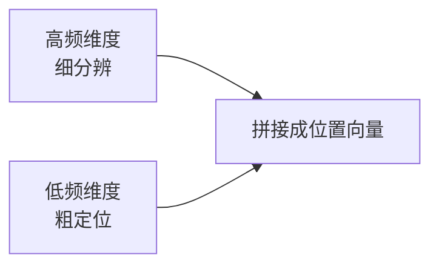

### 容易混淆的一点

这里说的"相对关系"**指两个 token 之间**。正弦编码本身仍然是每个位置一个**固定向量**（绝对的），只是它的数学形式允许位置差被线性表达。

真正的相对位置编码是直接对两个 token 的距离建模（见 [[#44 RoPE 旋转位置编码]]）。

### 优点

无参数、可解析计算、训练长度之外也能算出编码（虽然效果会退化）。

## 44 RoPE 旋转位置编码

### 目标：用绝对形式，做相对效果

给每个位置设计一个变换 $\boldsymbol{f}$，把位置写进向量：

$$\tilde{\boldsymbol{q}}_m = \boldsymbol{f}(\boldsymbol{q}, m),\qquad \tilde{\boldsymbol{k}}_n = \boldsymbol{f}(\boldsymbol{k}, n)$$

Attention 只用内积，所以要求内积里**只出现相对距离**：

$$\langle \boldsymbol{f}(\boldsymbol{q},m), \boldsymbol{f}(\boldsymbol{k},n)\rangle = g(\boldsymbol{q}, \boldsymbol{k}, m-n)$$

初始条件：位置 0 不改变向量，$\boldsymbol{f}(\boldsymbol{q},0) = \boldsymbol{q}$。

### 二维：解出来就是旋转

用复数表示，令 $m=n$ 先定模长（变换**不改变模长**），再由幅角方程得到等差关系 $\varphi(m) = m\theta$：

$$\boldsymbol{f}(\boldsymbol{q}, m) = \boldsymbol{q}\,e^{\mathrm{i}m\theta} = \begin{pmatrix}\cos m\theta & -\sin m\theta\\ \sin m\theta & \cos m\theta\end{pmatrix}\begin{pmatrix}q_0\\ q_1\end{pmatrix}$$

**位置不是加到向量上，而是把向量转了一个角度。**

### 高维：分块对角

偶数维可以两两一组，每组用自己的频率：

$$\boldsymbol{\mathcal{R}}_m = \operatorname{diag}\big(R(m\theta_0),\ \dots,\ R(m\theta_{d/2-1})\big),\qquad \theta_i = 10000^{-2i/d}$$

### 核心恒等式

$$(\boldsymbol{\mathcal{R}}_m\boldsymbol{q})^\top(\boldsymbol{\mathcal{R}}_n\boldsymbol{k}) = \boldsymbol{q}^\top\boldsymbol{\mathcal{R}}_m^\top\boldsymbol{\mathcal{R}}_n\boldsymbol{k} = \boldsymbol{q}^\top\boldsymbol{\mathcal{R}}_{n-m}\boldsymbol{k}$$

因为正交矩阵的转置等于逆，**角度相减就成了位置差**。这就是"绝对形式、相对效果"的落点。

副产物：$\boldsymbol{\mathcal{R}}_m$ 正交，不改变模长，不破坏数值稳定性。

### 实现：别真的乘矩阵

用逐元素运算等价实现：

$$\boldsymbol{q}\odot\cos(m\theta) + \boldsymbol{q}_{\text{rot}}\odot\sin(m\theta)$$

$\boldsymbol{q}_{\text{rot}}$ 是相邻两维交换并取负。

```python
def rotate_half(x):                 # 前后半配对（LLaMA 等实现）
    x1, x2 = x.chunk(2, dim=-1)
    return torch.cat((-x2, x1), dim=-1)

def apply_rope(x, cos, sin):
    return x * cos + rotate_half(x) * sin
```

### 两种配对约定

| 约定 | 配对方式 | 用在哪 |
| --- | --- | --- |
| 相邻两维 | $q_0$ 与 $q_1$ 一组 | 苏剑林原文 |
| 前后半 | $q_i$ 与 $q_{i+d/2}$ | LLaMA / Qwen 实现 |

两者数学上等价，只差一个固定的维度置换；**训练结果一致，但不能混用**——权重与 cos/sin 缓存必须同一套约定。

### 为什么只有 RoPE 能用于线性 Attention

其他相对编码都**直接改注意力矩阵**（加偏置、乘权重）；线性 Attention 压根不构造这个矩阵，那些方案全部失效。RoPE 只改 Q、K 本身，能塞进内积。

注意分母保持原样：带旋转的内积可能为负，放进分母有除零风险——只改分子，牺牲概率归一性换数值稳定。

### 局限

- 外推有限：旋转有周期性，远超训练长度时规律没见过。
- 仍需长度扩展技术（见 [[#48 长度外推与位置插值]]）。
- 不降低复杂度，仍是 $O(n^2)$。

## 45 KV Cache、MQA 与 GQA

### KV Cache：自回归生成的必备缓存

生成第 $t$ 个 token 时，要用到前面所有 token 的 K、V。而这些 K、V **不会因为新 token 而改变**，所以缓存起来，每步只算新 token 的 $k_t, v_t$ 并追加。

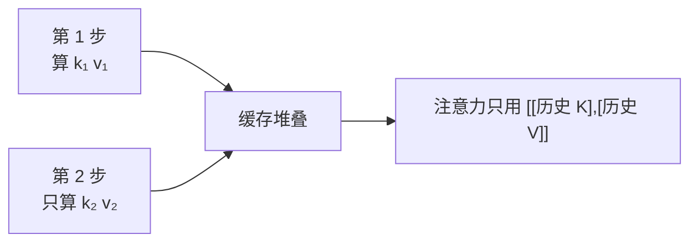

**代价**：显存随序列长度线性增长，长上下文时成为瓶颈。

![[I1MzboA5toLc1BxrowHcgfvRnxd.png|880]]

*左：每步重算整段 K、V；右：只把新 token 的 $k_t, v_t$ 追加进缓存，Q 始终只算当前这一个。*

$$ \text{KV 缓存大小} \propto 2 \times L \times h \times d_{\text{head}} \times \text{层数} \times \text{精度字节} $$

### MQA：多头 Query + 单头 KV

**Multi-Query Attention**：所有注意力头**共享同一组 K、V**，只有 Q 是多头的。

- KV 缓存直接缩小到 $1/h$
- 代价：表达能力略降，训练也可能不稳

### GQA：分组折中

**Grouped-Query Attention**：把 $h$ 个头分成 $g$ 组，每组共享一组 K、V。

| 方案 | KV 头数 | 缓存 |
| --- | --- | --- |
| MHA | $h$ | 1× |
| GQA | $g$（$1 < g < h$） | $g/h$ |
| MQA | 1 | $1/h$ |

GQA 是 MQA 与 MHA 的插值：**几乎保住 MHA 的效果，又把缓存降下来**，所以 LLaMA-2 70B 等主流大模型都用它。

![[WjujbGZQLoQt1uxbqlfc0ZDtnFY.png|640]]

*三栏对比：MHA 每个 Q 头配一组 KV；GQA 若干 Q 头共享一组；MQA 全部共享一组。*

### 一句话

**KV Cache 是拿显存换时间，MQA/GQA 是拿一点点表达力换回显存。**

## 46 FlashAttention 与 ZeRO

### FlashAttention：省的不是计算量，是显存读写

注意力要物化 $L\times L$ 的分数矩阵，显存 $O(L^2)$，且要在显存和片上缓存之间来回搬。

FlashAttention 的做法：**分块（tiling）+ 在线 softmax**，把注意力算成一块一块，边算边累加，**从不把完整的 $L\times L$ 矩阵写进显存**。

- 结果精确（不是近似算法）
- 减少 HBM 读写次数 → 实际速度更快
- 显存从 $O(L^2)$ 降到 $O(L)$

代价：实现复杂，需要写 CUDA；反向传播要重算前向块（重计算换显存）。

### ZeRO：把训练状态切开

数据并行每张卡都存一份完整模型、梯度、优化器状态，显存浪费。ZeRO 分三级逐步切分：

| 级别 | 切什么 | 显存节省（近似） |
| --- | --- | --- |
| ZeRO-1 | 优化器状态（最大头） | 4× |
| ZeRO-2 | + 梯度 | 8× |
| ZeRO-3 | + 参数本身 | 与卡数成正比 |

原理：**每份数据只有它所属的卡需要，用的时候再通信收集**。代价是通信量增加。

### 两者分工

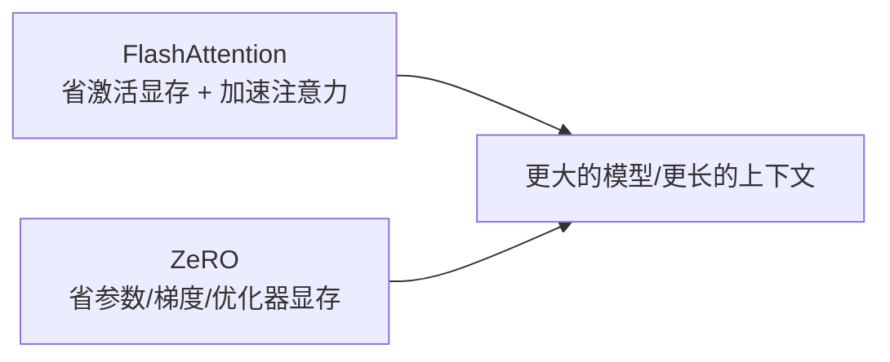

一个管"算的时候别爆显存"，一个管"存的状态别重复存"。

## 47 Transformer 架构与训练范式

### 整体结构

| 部分 | 组成 |
| --- | --- |
| 编码器层 | 多头自注意力 → 残差 + LayerNorm → 前馈网络 → 残差 + LayerNorm |
| 解码器层 | 掩蔽自注意力 → 交叉注意力 → 前馈网络（每个后面都接残差 + LN） |
| 输出 | 线性层 + softmax |

![[YrUHb7SZpoFJLtxYIkoczW98nUf.png|420]]

*整体结构：左边编码器堆 $n$ 层，右边解码器堆 $n$ 层，中间靠交叉注意力把编码器的信息接过来；两边输入都要先叠加位置编码。*

三个关键部件的分工：

- **残差**：给梯度一条直通路径（见 [[#33 ResNet 与残差连接]]）
- **LayerNorm**：稳定每层输入分布（注意不是 BN，因为序列长度可变、batch 依赖不可靠，见 [[#16 批量归一化 BN]]）
- **逐位置前馈网络**：对每个位置独立做非线性变换，提供容量

掩蔽自注意力用因果掩码把"未来"的分数置成 $-\infty$，保证生成第 $t$ 个词时看不到后面的词。

![[FAlebwjcioK8ibxl8bLcgG66nyc.png|420]]

*单个编码器层内部：自注意力 → 加残差 + 归一化 → 前馈网络 → 再加残差 + 归一化。*

### 两条技术路线

| | BERT | GPT |
| --- | --- | --- |
| 结构 | 只用编码器 | 只用解码器 |
| 训练目标 | 掩码语言模型（填空） | 下一词预测 |
| 擅长 | 理解类任务（分类、抽取） | 生成类任务 |

### 训练范式

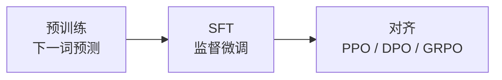

| 阶段 | 做什么 | 数据 |
| --- | --- | --- |
| 预训练 | 海量文本学语言规律 | 无标注语料 |
| SFT | 用"问题-标准答案"教它按指令回答 | 人工标注 |
| 对齐 | 用偏好数据调行为 | 人类偏好排序 |

- **PPO**：在线强化学习，需要奖励模型，训练不稳但灵活。
- **DPO**：不走强化学习，直接把偏好损失写成分类损失，简单稳定。
- **GRPO**：去掉价值网络，用一组采样的平均奖励作基线，省显存。

## 48 长度外推与位置插值

### 问题

模型在长度 2048 上训练，遇到 8192 的输入就崩——位置编码没见过那么大的值。

### 两条路：外推 vs 内插

**内插（Position Interpolation）**：不扩展编码范围，而是**把超长序列压回训练范围**——在相邻整数位置之间插入新点。

扩大到 $k$ 倍就用 $m/k$ 作位置：原来覆盖 $0\sim2047$，映射后同样的编码范围可表示 $k\times2048$ 个 token。

核心思想：**通过插值，让原本落在分布外的位置回到训练分布内。**

**外推**：在现有范围之外继续延伸，再用长句微调。代价是**注意力分数会异常增大**，影响其他指标。

### 扩 k 倍到底插几个点

训练长度 $L=2048$，要处理 6144（3 倍），按 $m/3$ 映射：

| 新位置 | 取哪个编码位置 |
| --- | --- |
| 0 | 0 |
| 1 | 1/3 |
| 2 | 2/3 |
| 3 | 1 |

原来相邻的 0 与 1 之间塞进了 **2 个新点**。

**一般规律**

| 目标 | 映射 | 相邻整数之间插入 | 最大长度 |
| --- | --- | --- | --- |
| 扩大 $k$ 倍 | $m/k$ | $k-1$ 个点 | $kL$ |
| 插入 $k$ 个点 | $m/(k+1)$ | $k$ 个点 | $(k+1)L$ |

为什么不是"扩三倍插三个点"：0 到 1 之间被三等分，多出来的只有两个**内点** $1/3$、$2/3$；第三个点是整数 1 本身，它本来就在。

### 常见方案

Position Interpolation、NTK-aware、YaRN 都是在 RoPE 基础上改**频率**或改**位置映射**（见 [[#44 RoPE 旋转位置编码]]）。

## 49 LoRA 低秩适配

### 一句话

冻结原模型权重，只在旁边挂一对**小矩阵**，训练时只更新这对小矩阵。

### 数学形式

原始线性层：

$$\mathbf{h} = \mathbf{W}_0\mathbf{x}$$

LoRA 改成：

$$\mathbf{h} = \mathbf{W}_0\mathbf{x} + \frac{\alpha}{r}\mathbf{B}\mathbf{A}\mathbf{x}$$

- $\mathbf{W}_0 \in \mathbb{R}^{d\times k}$：**冻结**，不训练
- $\mathbf{A} \in \mathbb{R}^{r\times k}$：降维，随机初始化
- $\mathbf{B} \in \mathbb{R}^{d\times r}$：升维，**零初始化**
- $r \ll \min(d,k)$：秩，通常 4–64

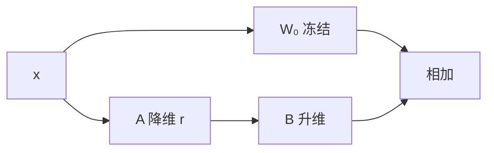

### 为什么 $\mathbf{B}$ 要零初始化

训练开始时 $\mathbf{B}\mathbf{A} = 0$，模型输出与原始完全一致——**从预训练模型原样起步**，不会因为新模块引入噪声。

### 为什么省显存

可训练参数从 $d\times k$ 降到 $r(d+k)$。$d=k=4096$、$r=8$ 时，从 1677 万降到约 6.5 万（约 1/256）。优化器状态、梯度都跟着一起省。

### 推理时零开销

训练完把 $\mathbf{B}\mathbf{A}$ 直接加回 $\mathbf{W}_0$：

$$\mathbf{W} = \mathbf{W}_0 + \frac{\alpha}{r}\mathbf{B}\mathbf{A}$$

合并后结构与原模型完全一样，**不增加任何推理延迟**。

### 适用位置

通常加在注意力的 $W_Q, W_K, W_V, W_O$ 和前馈层上。秩 $r$ 越大容量越强，但也越容易过拟合。
